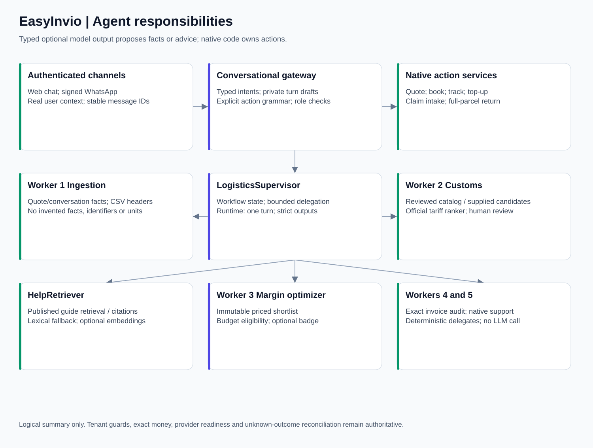

# Agent reference

EasyInvio combines bounded optional model assistance with deterministic domain services. A class or service called an agent does not automatically imply an LLM call or permission to move money. The executable registry is `LogisticsSupervisor`; [agent_contracts.json](agent_contracts.json) contains source-declared model instructions, tool names and schema definitions.

## Supervisor and workers

| Component | Inputs and function | Model use | Authority and fallback |
| --- | --- | --- | --- |
| `LogisticsSupervisor` | Coordinates interpreted intent, validated rates, existing confirm route, customs, help and deterministic delegates; creates typed Workflow transitions | Delegates optional model work | `confirm` delegates only an authenticated, selected BookingRequest to native lifecycle; workflow state is not the wallet/shipment state |
| Worker 1 `IngestionWorkerAgent` | Deterministic quote parsing, general conversational intent extraction, CSV header mapping and source grounding | `IngestionWorker`, `ConversationalIntentWorker`, `CSVHeaderWorker`; forced side-effect-free tools | Missing facts remain null; rejects invented references, countries/units and ambiguous mappings; standard form/known grammar remains available |
| Worker 2 `CustomsHarmonizerAgent` | Reuses matching reviewed catalog code, provides bounded suggestions, ranks official tariff candidates and prepares per-item information | `CustomsHarmonizer`, `OfficialTariffRanker` structured HSSelection | Can select only supplied dictionary/candidate codes; cannot certify a tariff, approve a declaration or invent goods facts |
| Worker 3 `MarginOptimizerAgent` | Advises over up to ten already-priced eligible offers and recorded route performance | One typed `StrategicChoice` model result under an outer 1.5-second optional deadline | Exactly one supported badge; never reprices, reorders or buys. Failure preserves original offers and stages bounded troubleshooting |
| Worker 4 `InvoiceSurchargeAuditorAgent` | Calls existing `invoice_upload.compare_line` using exact saved shipment/invoice snapshots | None | Comparison delegate only; native endpoint owns tenant lookup, transaction, duplicate detection and dispute persistence |
| Worker 5 `ProactiveClaimsSupportAgent` | Delegates authenticated tracking ingestion and durable exception-ticket/outbox wakeup | None | No autonomous insurer filing, refund or permission bypass; native security and delivery consent remain mandatory |
| `HelpRetriever` | Versioned published-guide chunks, lexical/optional semantic retrieval, grounded answers with section citations | Optional 256-dimensional embeddings and a cited-answer run | Searches documentation only; unavailable generation returns supported related-guide/fallback content |

Worker numbers are explanatory labels for the five specialist roles above. The additional concrete worker/run names below are actual names passed to the shared runtime, not separately deployed processes.

## Model calls and output contracts

`IngestionWorkerAgent.message` first tries `main.parse_quote`. Otherwise its forced `submit_quote_intent` tool validates QuoteIntent. `conversation` uses `submit_conversational_intent` for the broader ConversationalIntent, while explicit commands in the gateway avoid a model entirely. The agent must ground references and extracted locations in user text, keep missing fields null and avoid inventing a country from a city/postcode.

`csv_headers` tries exact known headers and aliases before asking `submit_header_mapping` to map unknown header names to the remaining allowed columns. It reads header meaning, not row contents. Every source header must map once, targets must be unique, required columns must remain present, weight/dimension units must be explicit and all original row values must be retained. It never converts guessed units or fabricates missing columns.

Customs suggestions use HSSelection with code, explanation and missing attributes. Catalog reuse needs matching normalized descriptions and prior review; it avoids a model call. The official ranker can only select an exact returned national code. `information` deduplicates descriptions for suggestion work but preserves each validated goods line’s quantities, values, origins, weights and allocation.

Worker 3’s StrategicChoice index refers to the supplied shortlist, not an arbitrary carrier. PRICE must select a cheapest customer price. SPEED requires an estimate. RELIABILITY requires at least ten on-time observations, at least 90% on time, no active exceptions and LOW risk. Unknown history does not establish reliability. BALANCED is available when evidence is limited.

For INDIVIDUAL or HIGH_VOLUME_COST_SENSITIVE_SELLER workspaces, deterministic budget_candidate finds the cheapest available Evri/Royal Mail/Yodel alias under the policy: no active exception/HIGH_DELAY_ALERT, no more expensive than available non-budget choices, and at most two estimated days slower than the fastest available non-budget offer. Missing estimates cannot prove the two-day allowance when enterprise estimates exist; mixed currencies cannot form a preference. After a valid model result, code enforces the eligible budget index and exact budget badge. Disabled AI, profile lookup failure or timeout does not create a budget badge.

The generated call catalog is authoritative for current runtime names, source lines, supplied tools and typed output classes. Adding a worker requires updating both code and the reference, not assigning an informal new number in a prompt.

## Shared runtime controls

`AgentSettings` is source-declared configuration. Defaults are AI disabled, model `gpt-4o-mini`, embeddings `text-embedding-3-small`, six-second request timeout, four concurrent slots, 600 output tokens, twenty per-tenant requests/minute, 100,000 reserved tokens/minute and a 256-entry response cache. Defaults are configurable names/limits, not claims about active remote model versions or provider account budgets.

`AgentRuntime` uses `AsyncOpenAI(max_retries=0)`, one Runner turn, temperature zero, non-parallel tools, forced tool choice where tools are supplied, `store=False` and disabled tracing/sensitive trace inclusion. Capacity checks occur before a model call. The process-local cache is keyed by tenant, worker, model and a digest of inputs/instructions, with bounded TTL/LRU behavior. Agent metrics aggregate model/embedding calls, tokens, cache hits, failures and deterministic calls for the current process.

Application settings and runtime privacy controls do not establish a provider’s contractual retention policy. Raw conversation prompts are not intentionally persisted as a general transcript, but structured drafts/quote choices, encrypted onboarding receipt replies and deliberately submitted claim notes are persisted privately and need retention rules.

When AI is enabled, the applicable model payload can include a user message, shipping descriptions/locations, supplied carrier offers or a redacted general help question. “No prompt logging” does not mean no information leaves the application. External processing/retention and the permitted data supplied to each model must be covered by the operator’s privacy configuration and agreements.

## Help retrieval

The corpus comes from `backend/help_center.py` GUIDES: built-in bodies plus the five root operational guides for order processing, routing rules, tracking/branding, returns and pickups. `GuideSections` splits headings; text chunks are up to 1,600 characters with a 1,400-character stride and a maximum bounded corpus of 160 chunks. Stable digests/versioning protect cached embeddings from stale corpus changes.

Lexical retrieval remains available. Optional embeddings are 256-dimensional validated finite vectors, cached under `output/agents`; this is a small local index rather than a separate hosted vector database. Generated answers must cite retrieved chunk IDs and become section links. Unsupported citations or insufficient evidence cause a fallback. Editing the architecture manual does not automatically add it to the public HelpRetriever corpus.

## Conversational controllers

`ConversationalActionGateway` is a deterministic action controller with optional intent interpretation. Its intents are QUOTE, BOOK_RESERVATION, TRACK_PACKAGE, TOPUP_WALLET, FILE_CLAIM, TRIGGER_RETURN and HELP. WEB_CHAT identity is the authenticated session; WHATSAPP is admitted through signed Twilio ingress and active phone binding. Public JSON sender_id is never permission to select a different user or tenant.

`ConversationStore` records a stable scoped message receipt before action execution, serializes per-user/channel work, replays completed messages and fences PROCESSING/REVIEW_REQUIRED outcomes. `ConversationDraft` is a private fifteen-minute structured collection state, bound to tenant, user, channel and assistance session. It collects real postcodes/countries, packed weight/dimensions and contact/street/city details. It never inserts placeholder streets to satisfy validation.

The native action methods, not an LLM tool, create checkout links, confirm a selected offer, look up stored tracking, ingest an insured claim support case or trigger a full-parcel return. Explicit grammar and role guards constrain financial actions even if a model proposes a different intent. WhatsApp selected booking hands off to the web app; chat claim intake requires authenticated evidence completion; explicit returns use the same reverse-logistics service and its replay fences.

`ConversationalSignupManager` and `SupabaseSignupProvider` are deterministic onboarding components, not language models. They own persona/profile collection, separate email/phone proof, attempt/lease/receipt fencing and workspace provisioning across Auth and SQL. They must not be replaced by an unvalidated model that writes directly to auth.users, wallets or membership tables.

## Failure and extension rules

Typed Workflow states RECEIVED, VALIDATING, NEEDS_INPUT, READY, EXECUTING, COMPLETED and REVIEW_REQUIRED describe orchestration. They do not replace domain states or prove that an external purchase/policy/claim completed. Failure handling must preserve the authoritative native service’s outcome and financial reservation.

To extend an agent: define a strict output schema; ground supplied facts; admit the minimal source-backed candidates; bound time/tokens/concurrency; decide a deterministic fallback; add tests for malformed outputs, invented IDs and permissions; and route consequential actions through existing authorized methods. Do not expose SQL, arbitrary HTTP, wallet writes or label purchase as unrestricted model tools.

## Queued transport and address facts

Signed WhatsApp ingress is decoupled by `WhatsAppQueue` and migration 043. The deterministic worker, not a model, resolves the active binding and invokes the same gateway with the stable MessageSid-derived request ID. Raw events and staged replies are encrypted; a canonical signed-field SHA-256 protects inbox reuse while the existing conversational digest remains unchanged. The original inbound timestamp is carried into the service-window record.

Dynamic UK address collection calls `PAFClient` and stores validated `PAFPremise` candidates, paging offset and selected UDPRNs in the private draft. Numeric selection is restricted to the displayed page and matching postcode. The model cannot invent/select a different premise or replace postal data. Contact name is collected separately. Pagination/selection never extend the original fifteen-minute deadline.

## Explicit EOD commands

The conversational enum additionally admits MANIFEST_STATUS and CLOSE_MANIFEST. Explicit deterministic grammar recognizes Manifest status and Close manifest <carrier>. A dispatch role, one actual carrier/account/warehouse match, active workspace/environment and the native ManifestService guards are mandatory. The message receipt ID becomes the stable close request ID. A model proposal alone cannot close a batch, create a scan form, invent a pickup or grant access to its PDF.

Carrier QR media is derived solely from confirmed native booking/return results. Client-supplied media URLs cannot authorize arbitrary fetch/forward operations. Image publication and delivery fallback cannot change a financial settlement or repeat the logistics action.

## Shared tracking delegate

ConversationalActionGateway TRACK_PACKAGE now delegates to TrackingWorkspace when migration 045 is ready, including exact store-order and parcel references. It reuses the caller?s verified tenant context and deterministic projections. The signed WhatsApp queue also accepts an explicitly supplied customer Track link capability, without guessing identity from a phone number. No LLM writes carrier status, refund state or financial entries. Existing gateway behavior remains the fallback before migration readiness.

## Status guidance shared by assistants

HelpSupportAgent retrieves the published status reference at `/help/status-guide`, with section-level citations and a versioned corpus. ConversationalActionGateway, the general supervisor and the intent worker route explanatory status questions to HELP without authorizing a booking, payment, refund, claim or return. A status question preserves a live ConversationDraft and its original TTL. Generic Pending/Failed/Received prompts ask for the screen instead of assuming a financial outcome. Without AI, authored status guidance still supplies next steps and a source link.
