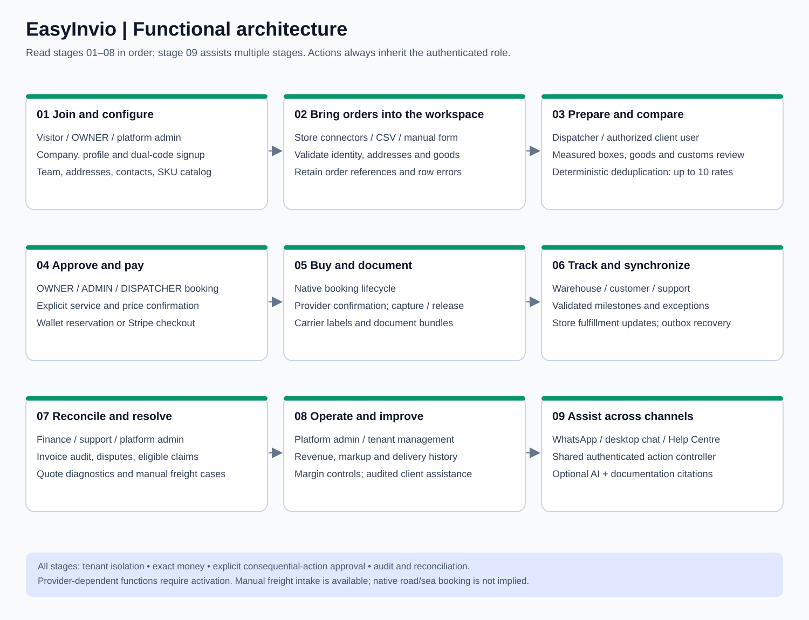

# Functional architecture

EasyInvio provides a shared shipping workspace for business merchants and individual senders. The central workflow is to establish an authorized workspace, prepare a real parcel and its goods, compare connected carrier prices, confirm a selected offer, pay through the existing billing ledger, obtain carrier documents, and track or resolve the shipment. Web forms, store imports, CSV uploads and conversations converge on the same services.

## Personas and permissions

`workspace_type` and `seller_classification` are commercial attributes; neither is an authorization role. `BUSINESS` and `INDIVIDUAL` workspaces share tenants, memberships, wallets, shipments, returns, policies and claims. Personal signup omits corporate registration/tax fields, but shipping still needs actual addresses, contact data and any required customs review.

| Persona | Developed capabilities | Consequential limits |
| --- | --- | --- |
| Platform super administrator | Cross-tenant dashboards; company/personal client administration; tenant billing and classification controls; carrier connections, verification and rotation; business margin rules; individual global markup; support, agent metrics and audited client assistance | Requires an Auth user in the server-side platform-admin allowlist; a tenant OWNER role alone does not grant platform access |
| Workspace OWNER | Workspace and team configuration; catalog maintenance; store setup; shipment preparation and booking; wallet/card workflows; reports; invoice disputes; permitted protection/claim/return operations | Every action remains subject to active membership, billing/environment checks and provider capability |
| Workspace ADMIN | Operational and configuration functions admitted by endpoint guards; booking, card-funded baskets and return checkout | OWNER-only endpoints may still deny ADMIN; use the API source guard rather than assuming universal parity |
| DISPATCHER | Import/review orders, measurements and goods; quotes, customs preparation, labels, tracking, retailer-paid returns and permitted catalog/support operations | No platform configuration; private financial fields are projected out where required; customer-paid return checkout/card baskets require OWNER/ADMIN |
| ACCOUNTANT | Permitted financial views, wallet activity and top-up, invoice audit/dispute operations, permitted quote/help/catalog reads | A financial role is not booking permission; dispatch writes and card-funded shipping baskets have their own guards |
| Individual sender | Personal signup/profile and the same permitted quote, booking, wallet, documents, tracking, support and return journeys | Global individual markup replaces business rules; personal status does not create a tax exemption or blanket insurance eligibility |
| Registered WhatsApp or web-chat user | Shared quote, selected booking, tracking, top-up, claim intake, returns and help controller | Registered phone binding or authenticated browser session supplies identity; text, sender_id and a model do not |
| Prospective customer | Public help, labeled sample workflows, personal/business registration and email verification | No live spending, tenant access or free wallet allocation before verified provisioning |
| Platform operator assisting a client | Search/select client workspace, record reason, operate with the support owner context, return to platform view | Original operator remains attributable; this is not impersonation of a particular employee’s narrower role |

Support is an administrative responsibility and workflow, not a universally defined separate `SUPPORT` membership role. See endpoint-specific guards for exact permissions.

## Workspace acquisition and onboarding

### Website registration

The registration modal offers Business Account and Personal Account. Business profiles collect corporate data; personal profiles collect name, email and phone without fabricated corporate identifiers. Registration and verification are separate operations. A private registration receipt, a random hashed secret, expiry, attempt limits and Supabase email verification precede provisioning. The password is supplied at the verification/password setup step, not persisted in the application database.

Successful provisioning creates the tenant, OWNER membership, profile and zero GBP wallet in one application database transaction. Supabase Auth and PostgreSQL are separate systems: an uncertain external identity change is retained for reconciliation rather than silently replayed. An existing email identity cannot be taken over by submitting its address to signup. Web-collected phone text does not independently establish a verified WhatsApp binding.

### WhatsApp registration

An unbound sender reaching the authenticated Twilio ingress can opt into signup. `PENDING_PERSONA` asks Business or Individual. Business continues through company and profile collection; Individual skips company/registration/VAT/EORI collection and advances to email. Both verify an email code issued by Supabase and a separate six-digit phone code generated by the application. The email code may be 6–10 digits, depending on the Supabase project settings. Reply in WhatsApp with `EMAIL_CODE PHONE_CODE`, separated by a space; this is not an email reply or a requirement to click a confirmation link.

After both codes verify, an Individual supplies their full name; a Business replies Continue to finalize. A single-use password recovery email supports later desktop password setup. New workspaces start with zero funds. Retryable verification mistakes, locked/expired sessions and uncertain provisioning are distinct states.

## Workspace configuration

The Settings catalogs provide versioned addresses, contacts and products. Address roles are SENDER, PICKUP, RETURN and INVOICE, with an active default per role. Product records hold SKU, description, unit weight, unit value/currency, country of manufacture and optionally reviewed HS classification. Search/select is a convenience; users can enter new shipment SKU and goods data manually. Official HS lookup is reused in products and customs preparation. Checking classification reviewed requires a valid code.

Catalog values are copied into a shipment snapshot. Changing a saved product or address does not retroactively rewrite a booked shipment. A prepared headless return additionally captures the warehouse ID and version and rechecks it before purchase.

Workspace settings also cover permitted company/profile updates, member invitations and role changes, billing and consent controls. Administration endpoints enforce their own role rules and optimistic/versioned update contracts where implemented.

## Order intake and preparation

Orders arrive from manual web forms, native/normalized configured store intake, marketplace polling/notification paths, or CSV/spreadsheet-assisted import. Importing and quoting do not buy labels. The dispatch workspace preserves store references, row errors and the distinction between imported, drafted, quoted, booking and booked states.

CSV import is bounded to 1,000 rows and 5 MB. Header normalization recognizes known aliases, may use a bounded model tool for unknown headers, and rejects ambiguous mappings or invented units. Row facts stay unchanged. Multi-piece parcels require measured boxes and allocation of goods to boxes. Freight arithmetic is available, but a parcel integration does not thereby acquire road/sea freight purchase capability.

Shipment preparation captures pickup/delivery contacts and addresses, actual packed weight, measured dimensions, currency, goods descriptions, quantities, values and origins. Optional saved-catalog choices do not replace validation. Weight previews should wait for meaningful values; server validation remains authoritative when rates are requested.

## Rating and selection

For standard parcels, dimensional weight is length × width × height in centimetres divided by 5,000, and billable weight is the larger of measured actual and dimensional weight. Freight can use configured cubic-metre/loading-metre factors, with stackability affecting the calculation. These calculations do not certify a carrier’s contract-specific freight acceptance.

The rating service queries tenant-approved connections with bounded parallelism and normalizes actual provider responses. Business pricing applies eligible priority margin rules. Individual pricing reads one global percentage/version for the batch, defaults to exactly 20.00% only when the policy row is unconfigured, bypasses business margin rules and retains its policy in the private pricing snapshot. Database failure is not an invitation to substitute a default.

Consolidation keeps distinct carrier/service/currency tiers, selects the higher-contribution duplicate according to deterministic ranking, orders by customer price and returns at most ten offers. Customer transport omits private aggregator credentials, connection identifiers and execution snapshots. Partial results, unsupported cargo, missing prices and unbookable labels are meaningful conditions, not invented rates.

Optional Worker 3 can badge one eligible budget option for INDIVIDUAL or explicitly classified HIGH_VOLUME_COST_SENSITIVE_SELLER tenants. It does not reorder, reprice, purchase or change the private booking reference. A budget recommendation needs a real returned option, no qualifying lane alert, no higher price than available enterprise choices and the bounded delivery-estimate allowance.

## Booking and payment

The user confirms an immutable, current offer. Native booking validates tenant, role, selected connection/configuration, quote expiry, prepared contents and environment before using the financial lifecycle. A stable idempotency key and advisory lock fence concurrent work; wallet reservations and ledger updates use database transactions and row locks.

Retailer/workspace billing reserves the selected total before a provider purchase. Confirmed label success captures it. Definitive failure releases it. Unknown provider outcome retains the reservation and requires GET-based reconciliation. Downloaded labels and customs documents are available through authorized document routes.

Card-funded booking creates an exact-price Stripe basket. A popup opening or closing is not proof of payment. Verified Stripe events/reconciliation credit the workspace before eligible bookings proceed. Unused credit stays in the workspace wallet unless a separate authorized refund operation exists; it is not automatically a card refund. Currency mixing is rejected.

Shipping amounts are presented excluding tax under the current checkout behavior. Applicable carrier taxes, import duties and destination charges may be separate. An individual workspace does not automatically trigger tax calculation or collection.

## Customs and documents

International goods need descriptions, values, weights, origins, currency, selected classification and explicit review. The UK Integrated Online Tariff search returns authoritative candidates for user selection; an optional ranker only ranks supplied candidates. The small local HS dictionary is an example/suggestion aid, not a globally certified tariff database. Missing material/function facts must be requested, not invented.

The checkout prepares a saved customs snapshot, commercial invoice and carrier-supported forms. Saved HS codes are reusable suggestions that still need shipment/destination review. Customs documents, labels, multi-label bundles and dispute/claim evidence have distinct document workflows; generated paperwork does not prove government filing or release of goods.

## Tracking, support and finance operations

Carrier callbacks authenticate before tenant-bound updates. Event identities and state precedence prevent duplicate/regressive updates. A manifest presents stored milestones, exceptions, proof-of-delivery links when supplied, and documents. A conversation reports the last recorded milestone; it does not invent a new live carrier check or hub location.

Support tickets connect exceptions, failed preparation/booking, invoice disputes and claims intake to a bounded workflow. Alert controls, recipient verification, consent/service-window rules, durable outboxes, delivery status and retry/review states determine whether notifications can be sent. Support staff distinguish app-processing failures from carrier delivery exceptions.

Invoice uploads compare carrier charges with stored exact baselines. Differences can produce reviewable billing disputes and supporting exports. Audit output is not an automatic carrier refund. Wallet history, reservation state and append-only ledger movements are the financial source of truth.

Reports show period/environment-scoped shipment revenue, stored gross markup, packages, active workspaces, tickets, lanes and measured transit. Cohorts separate BUSINESS and INDIVIDUAL and retain separate currencies. Stored markup is not net accounting profit. Observed transit requires accepted in-transit/delivery timestamps and is not a promised SLA or warehouse productivity measure.

## Protection and claims

The protection estimator implements the tested penny rounding/floor/cap behavior but returns unavailable/uninsured disclosure until the active program can be sold. A real policy requires enabled and verified XCover credentials, product/territory and retail-pricing authorization, a provider quote and confirmed booking.

Claims intake verifies the workspace, shipment, role and confirmed policy. Conversational loss/damage reporting creates the existing CLAIM_INGESTED case and support ticket, then links to authenticated evidence upload. It does not itself file an insurer claim or change the shipment into a fabricated insurer status. XClaim submission, evidence upload, provider polling/webhooks and settlement verification are separate steps. Wallet credit requires verified insurer settlement and its idempotent ledger entry.

## Returns

The headless return API, manual manifest control, chat commands and signed merchant/marketplace gateway use one `ReverseLogisticsService`. The original outbound shipment must belong to the active workspace; store-triggered requests also bind to the configured store. A default active RETURN warehouse replaces the original seller destination, and the original customer delivery address becomes the return origin.

This workflow returns the entire originally measured single parcel. Partial goods, changed packaging and grouped multi-piece returns need separate review. Fresh return quotes use current approved connections. Lowest exact customer price wins, with budget networks winning equal-price ties; incomplete provider results stop automatic selection. New customs consent is required for international returns.

RETAILER_PAY delegates to normal booking/billing. CUSTOMER_PAY creates an OWNER/ADMIN-authorized Stripe checkout and waits for verified payment. A durable receipt fences one full-parcel return per original shipment, including interrupted requests. Repeated delivery of the same command observes status; another key cannot bypass it.

Paperless documents are advertised only when supplied/confirmed by the provider. Sendcloud labelless-capable options and EasyPost USPS Label Broker have separate contracts. Otherwise the response requires a printed label. A shared 24-hour application link grants one drop-off document, not workspace access. Eligible carrier locations, not every post office/depot, determine where it can be used.

Returns do not imply merchant refund, restocking, product exchange, insurer cover or universal native marketplace RMA handling. Store tracking retains a separate return lifecycle; Shopify reverse-delivery updates need a verified native return reference.

## Conversations and public help

The same authenticated controller supports QUOTE, BOOK_RESERVATION, TRACK_PACKAGE, TOPUP_WALLET, FILE_CLAIM, TRIGGER_RETURN and HELP. Deterministic command grammar authorizes consequential actions; model extraction alone is insufficient. A 15-minute private draft collects real countries, postcodes, weight, measurements and addresses without requiring a saved route or fabricating Main Street.

WhatsApp `Book option N` hands off to signed web checkout. The WEB_CHAT booking command can confirm the displayed wallet option under the user’s dispatch role. Top-up commands return a Stripe confirmation link. Explicit return commands authorize a retailer-paid full-parcel return. Twilio deadlines and durable uncertainty fences still apply; a timeout is not proof that nothing happened.

Public guides remain readable without AI. Authenticated RAG answers retrieve only the published help corpus and cite sections; they do not query arbitrary customer records. Company lead research is a separate, manually invoked Companies House utility producing unsent drafts. It sends no campaign messages, allocates no wallet money and does not infer ethnicity/nationality from company names.

## WhatsApp premise selection and asynchronous replies

Dynamic UK quotes use licensed PAF lookup after countries/postcodes are supplied. Choose a numbered premise, use More/Back to page, and supply the actual pickup/delivery contact name separately. Provider line fields preserve premise, thoroughfare, locality and post town. Missing lookup configuration/outages offer retry or the ordinary web form rather than accepting guessed UK streets. Existing explicit saved routes remain separately configured; this lookup does not retroactively certify them.

The webhook now acknowledges durable acceptance with empty TwiML. Quotes, signup codes and return results arrive as separate WhatsApp REST messages. Confirmed paperless returns can arrive as a native carrier image/PDF attachment; otherwise the existing printable/link instructions apply. Draft expiry remains fifteen minutes from creation. An uncertain action/send can block that phone thread pending operator reconciliation. REST acceptance is not a delivery guarantee.

## Carrier manifests and image delivery

OWNER/ADMIN/DISPATCHER users can preview exact booked, unmanifested totals by account, carrier and pickup premise; close one bounded batch; inspect status; and download its PDF. Chat commands are `Manifest status` and `Close manifest Royal Mail`. Ambiguous accounts/warehouses require an explicit API selection rather than an invented choice. Each batch admits up to 1,000 shipments; preview includes all eligible rows and remaining batches stay available. Stable request IDs replay the original batch.

EasyPost close-out uses actual purchased shipment IDs and verifies returned tracking membership/document data. Unsupported Sendcloud/regional/direct close-out contracts produce an explicitly INTERNAL_HANDOVER driver sheet with tracking/postcodes, exact weights, totals, signature fields and an internal Code128 reference. This does not establish carrier closure or schedule/confirm collection. COMMITTED document preparation moves still-BOOKED members to MANIFESTED; real carrier transit/delivery events remain separate.

Confirmed QR assets can be normalized from provider URL/SVG/Base64 into PNG, stored privately under the tenant/shipment path and shared through a 24-hour read URL. Publication failure preserves the paid label and viewing link. Definitive Twilio media rejection or a signed failed delivery callback creates one text-link fallback; ambiguous sends never blindly replay.

## Shared shipment visibility

Business and individual workspaces share the Shipment tracking view: scoped reference search, operational summary cards, per-parcel timelines, separate forward/return outcomes and internal reviews. Platform owners use an audited cross-workspace Control Tower with an explicit active-workspace banner; ordinary tenant administrators cannot cross tenants. Accountants can read but cannot create links or reviews. Customers receive a revocable, expiring, fixed-membership link without needing a merchant account; the public page exposes scan summaries and bounded help intake, not merchant contacts, addresses, costs or internal notes. WhatsApp uses the same facts and distinguishes a received return from an unconfirmed merchandise refund.

## Manifest preparation, expiry and documents

Manifest & Labels separates imported preparation, current quote, expired quote, pending purchase and actual carrier milestones. Current quotes offer direct Review & book or explicit batch selection; expired quotes restore saved addresses, all boxes and goods allocations in Create a shipment for fresh comparison. Delivery proof, carrier PDF/QR, customs review and financial downloads require the corresponding state, real asset and role. Accountants have read-only manifest navigation. A readable customs goods table replaces raw JSON. Expiry is a display projection over the existing QUOTED row, preserving booking/reporting contracts.
