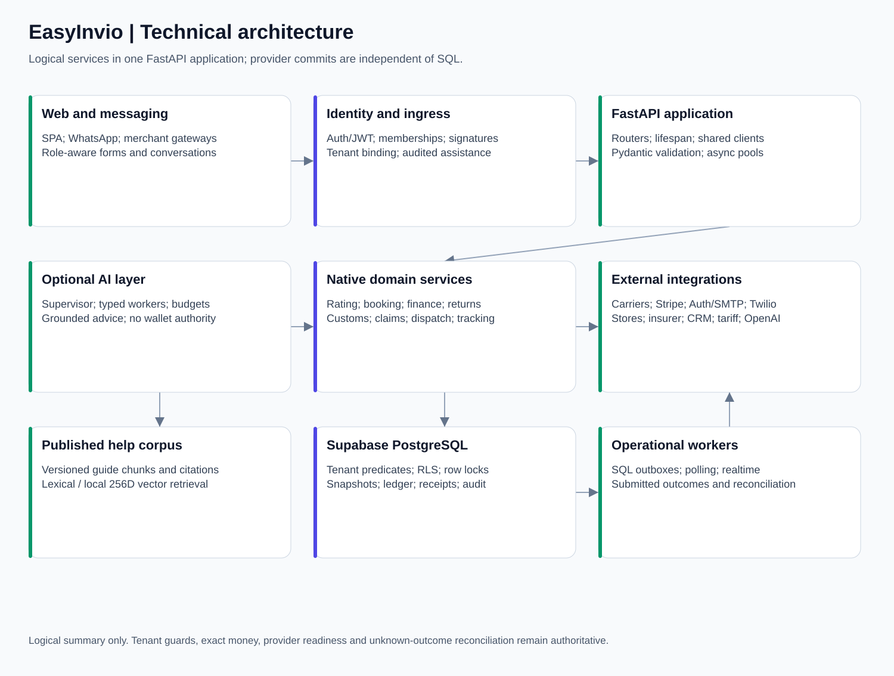
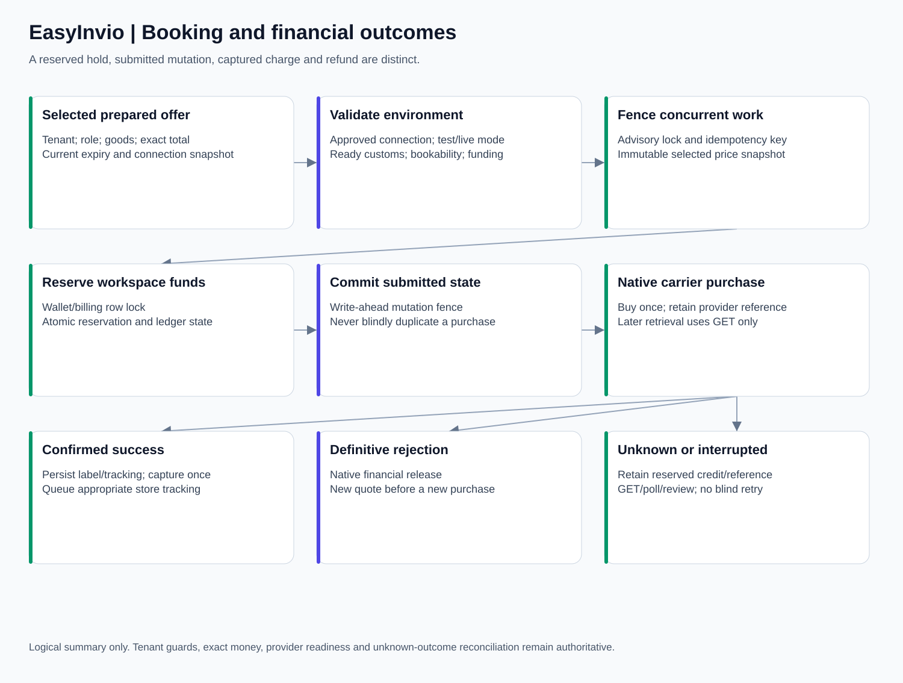

# EasyInvio complete application manual

Source revision: `890e1bf2fecda07e515080e3647562b192f9949f`. Read README.md for scope and generation rules.

# EasyInvio application manual

This is the maintained architecture and onboarding reference for EasyInvio.com. It describes the implementation in this repository, including business and individual workspaces, conversational onboarding, carrier selection, payments, protection, claims, headless returns, queued WhatsApp transport and UK PAF selection, signed carrier QR media and EOD manifests through migration 045. Open [overview.html](overview.html) for a searchable offline edition with diagrams and API tables. Read [llm_handoff.md](llm_handoff.md) before changing code with an LLM.

The source is `docs/platform_overview`. The generated distribution is `output/EasyInvio-Architecture`; `output/EasyInvio-Architecture.zip` contains the same manual. Changes belong in the source chapters and generator, followed by regeneration. Do not edit only the distribution.

## Reading order

1. [Functional architecture](functional_architecture.md): product scope, personas, features and complete customer journeys.
2. [Technical architecture](technical_architecture.md): components, startup, deployment boundaries, concurrency and source ownership.
3. [Agent reference](agent_reference.md): each actual worker, deterministic delegate, model contract and fallback.
4. [Security and finance](security_and_finance.md): identity, tenancy, Decimal arithmetic, reservations, payments and audit requirements.
5. [Integrations](integrations.md): carrier, storefront, messaging, email, customs, CRM and insurer contracts.
6. [Data model](data_model.md): tables, migrations, ownership and recovery states; [generated data dictionary](data_dictionary.md) for exact repository DDL.
7. [API reference](api_reference.md): every generated HTTP operation, dependency guard, request schema, response contract and implementation location.
8. [Operations runbook](operations_runbook.md): local startup, configuration, onboarding, troubleshooting and reconciliation.
9. [Testing and release](testing_and_release.md): test layers, UAT interpretation, external acceptance and release gates.
10. [LLM handoff](llm_handoff.md): instructions, reading paths and invariants for safe future changes.

## Machine readable references

- `openapi.json`: current application OpenAPI export, created without running lifespan or connecting to providers.
- `api_inventory.json`: operation-to-source/dependency mapping; application role checks can also reside in called helpers.
- `source_map.json`: Python modules, classes, functions and repository SQL references.
- `data_inventory.json`: migration objects and exact CREATE TABLE definitions available in this checkout.
- `configuration.json`: source-declared settings and environment-variable names, never private `.env` values.
- `versions.json`: installed local versions, declared ranges and lockfile entries with capture date.
- `agent_contracts.json`: source-declared model calls, tool/output contracts and Pydantic agent schemas.
- `manifest.json`: source revision, generated-file hashes and inventory counts.

## Interpretation rules

Implemented code, enabled configuration, a reachable provider account and live acceptance are different states. A feature in this manual may require credentials, contracts, feature flags, migrations, a permitted role or manual review. This manual is not a production release approval or a statement that any particular tenant has those prerequisites.

The core application is a modular monolith, not a deployed fleet of independent AI microservices. AI suggestions do not authorize a purchase, change a stored monetary price or establish customs/insurance approval. Personal accounts use the same financial and shipment schema as business accounts.

The initial core schema predates the checked-in migration sequence, which starts at 006. A new database needs the authorized baseline schema as well as the later migrations. Do not infer that applying 006–042 alone creates a complete fresh installation.

## Rebuild and verify

From the project root, using the project virtual environment:

```powershell
.\.venv\Scripts\python.exe docs/platform_overview/generate.py --render --export
.\.venv\Scripts\python.exe docs/platform_overview/generate.py --check
.\.venv\Scripts\python.exe docs/platform_overview/verify_manual.py
```

Generation reads application source, safe package metadata and source-declared schemas. It does not start the server, read customer exports, apply SQL, send messages, buy labels, charge cards or publish a deployment. Source links reference the recorded application commit and require repository access. The manual and diagrams work offline; source code itself is not bundled.


# Functional architecture

EasyInvio provides a shared shipping workspace for business merchants and individual senders. The central workflow is to establish an authorized workspace, prepare a real parcel and its goods, compare connected carrier prices, confirm a selected offer, pay through the existing billing ledger, obtain carrier documents, and track or resolve the shipment. Web forms, store imports, CSV uploads and conversations converge on the same services.


## Personas and permissions

`workspace_type` and `seller_classification` are commercial attributes; neither is an authorization role. `BUSINESS` and `INDIVIDUAL` workspaces share tenants, memberships, wallets, shipments, returns, policies and claims. Personal signup omits corporate registration/tax fields, but shipping still needs actual addresses, contact data and any required customs review.

| Persona | Developed capabilities | Consequential limits |
| --- | --- | --- |
| Platform super administrator | Cross-tenant dashboards; company/personal client administration; tenant billing and classification controls; carrier connections, verification and rotation; business margin rules; individual global markup; support, agent metrics and audited client assistance | Requires an Auth user in the server-side platform-admin allowlist; a tenant OWNER role alone does not grant platform access |
| Workspace OWNER | Workspace and team configuration; catalog maintenance; store setup; shipment preparation and booking; wallet/card workflows; reports; invoice disputes; permitted protection/claim/return operations | Every action remains subject to active membership, billing/environment checks and provider capability |
| Workspace ADMIN | Operational and configuration functions admitted by endpoint guards; booking, card-funded baskets and return checkout | OWNER-only endpoints may still deny ADMIN; use the API source guard rather than assuming universal parity |
| DISPATCHER | Import/review orders, measurements and goods; quotes, customs preparation, labels, tracking, retailer-paid returns and permitted catalog/support operations | No platform configuration; private financial fields are projected out where required; customer-paid return checkout/card baskets require OWNER/ADMIN |
| ACCOUNTANT | Permitted financial views, wallet activity and top-up, invoice audit/dispute operations, permitted quote/help/catalog reads | A financial role is not booking permission; dispatch writes and card-funded shipping baskets have their own guards |
| Individual sender | Personal signup/profile and the same permitted quote, booking, wallet, documents, tracking, support and return journeys | Global individual markup replaces business rules; personal status does not create a tax exemption or blanket insurance eligibility |
| Registered WhatsApp or web-chat user | Shared quote, selected booking, tracking, top-up, claim intake, returns and help controller | Registered phone binding or authenticated browser session supplies identity; text, sender_id and a model do not |
| Prospective customer | Public help, labeled sample workflows, personal/business registration and email verification | No live spending, tenant access or free wallet allocation before verified provisioning |
| Platform operator assisting a client | Search/select client workspace, record reason, operate with the support owner context, return to platform view | Original operator remains attributable; this is not impersonation of a particular employee’s narrower role |

Support is an administrative responsibility and workflow, not a universally defined separate `SUPPORT` membership role. See endpoint-specific guards for exact permissions.

## Workspace acquisition and onboarding

### Website registration

The registration modal offers Business Account and Personal Account. Business profiles collect corporate data; personal profiles collect name, email and phone without fabricated corporate identifiers. Registration and verification are separate operations. A private registration receipt, a random hashed secret, expiry, attempt limits and Supabase email verification precede provisioning. The password is supplied at the verification/password setup step, not persisted in the application database.

Successful provisioning creates the tenant, OWNER membership, profile and zero GBP wallet in one application database transaction. Supabase Auth and PostgreSQL are separate systems: an uncertain external identity change is retained for reconciliation rather than silently replayed. An existing email identity cannot be taken over by submitting its address to signup. Web-collected phone text does not independently establish a verified WhatsApp binding.

### WhatsApp registration

An unbound sender reaching the authenticated Twilio ingress can opt into signup. `PENDING_PERSONA` asks Business or Individual. Business continues through company and profile collection; Individual skips company/registration/VAT/EORI collection and advances to email. Both verify an email code issued by Supabase and a separate six-digit phone code generated by the application. The email code may be 6–10 digits, depending on the Supabase project settings. Reply in WhatsApp with `EMAIL_CODE PHONE_CODE`, separated by a space; this is not an email reply or a requirement to click a confirmation link.

After both codes verify, an Individual supplies their full name; a Business replies Continue to finalize. A single-use password recovery email supports later desktop password setup. New workspaces start with zero funds. Retryable verification mistakes, locked/expired sessions and uncertain provisioning are distinct states.

## Workspace configuration

The Settings catalogs provide versioned addresses, contacts and products. Address roles are SENDER, PICKUP, RETURN and INVOICE, with an active default per role. Product records hold SKU, description, unit weight, unit value/currency, country of manufacture and optionally reviewed HS classification. Search/select is a convenience; users can enter new shipment SKU and goods data manually. Official HS lookup is reused in products and customs preparation. Checking classification reviewed requires a valid code.

Catalog values are copied into a shipment snapshot. Changing a saved product or address does not retroactively rewrite a booked shipment. A prepared headless return additionally captures the warehouse ID and version and rechecks it before purchase.

Workspace settings also cover permitted company/profile updates, member invitations and role changes, billing and consent controls. Administration endpoints enforce their own role rules and optimistic/versioned update contracts where implemented.

## Order intake and preparation

Orders arrive from manual web forms, native/normalized configured store intake, marketplace polling/notification paths, or CSV/spreadsheet-assisted import. Importing and quoting do not buy labels. The dispatch workspace preserves store references, row errors and the distinction between imported, drafted, quoted, booking and booked states.

CSV import is bounded to 1,000 rows and 5 MB. Header normalization recognizes known aliases, may use a bounded model tool for unknown headers, and rejects ambiguous mappings or invented units. Row facts stay unchanged. Multi-piece parcels require measured boxes and allocation of goods to boxes. Freight arithmetic is available, but a parcel integration does not thereby acquire road/sea freight purchase capability.

Shipment preparation captures pickup/delivery contacts and addresses, actual packed weight, measured dimensions, currency, goods descriptions, quantities, values and origins. Optional saved-catalog choices do not replace validation. Weight previews should wait for meaningful values; server validation remains authoritative when rates are requested.

## Rating and selection

For standard parcels, dimensional weight is length × width × height in centimetres divided by 5,000, and billable weight is the larger of measured actual and dimensional weight. Freight can use configured cubic-metre/loading-metre factors, with stackability affecting the calculation. These calculations do not certify a carrier’s contract-specific freight acceptance.

The rating service queries tenant-approved connections with bounded parallelism and normalizes actual provider responses. Business pricing applies eligible priority margin rules. Individual pricing reads one global percentage/version for the batch, defaults to exactly 20.00% only when the policy row is unconfigured, bypasses business margin rules and retains its policy in the private pricing snapshot. Database failure is not an invitation to substitute a default.

Consolidation keeps distinct carrier/service/currency tiers, selects the higher-contribution duplicate according to deterministic ranking, orders by customer price and returns at most ten offers. Customer transport omits private aggregator credentials, connection identifiers and execution snapshots. Partial results, unsupported cargo, missing prices and unbookable labels are meaningful conditions, not invented rates.

Optional Worker 3 can badge one eligible budget option for INDIVIDUAL or explicitly classified HIGH_VOLUME_COST_SENSITIVE_SELLER tenants. It does not reorder, reprice, purchase or change the private booking reference. A budget recommendation needs a real returned option, no qualifying lane alert, no higher price than available enterprise choices and the bounded delivery-estimate allowance.

## Booking and payment

The user confirms an immutable, current offer. Native booking validates tenant, role, selected connection/configuration, quote expiry, prepared contents and environment before using the financial lifecycle. A stable idempotency key and advisory lock fence concurrent work; wallet reservations and ledger updates use database transactions and row locks.

Retailer/workspace billing reserves the selected total before a provider purchase. Confirmed label success captures it. Definitive failure releases it. Unknown provider outcome retains the reservation and requires GET-based reconciliation. Downloaded labels and customs documents are available through authorized document routes.

Card-funded booking creates an exact-price Stripe basket. A popup opening or closing is not proof of payment. Verified Stripe events/reconciliation credit the workspace before eligible bookings proceed. Unused credit stays in the workspace wallet unless a separate authorized refund operation exists; it is not automatically a card refund. Currency mixing is rejected.

Shipping amounts are presented excluding tax under the current checkout behavior. Applicable carrier taxes, import duties and destination charges may be separate. An individual workspace does not automatically trigger tax calculation or collection.

## Customs and documents

International goods need descriptions, values, weights, origins, currency, selected classification and explicit review. The UK Integrated Online Tariff search returns authoritative candidates for user selection; an optional ranker only ranks supplied candidates. The small local HS dictionary is an example/suggestion aid, not a globally certified tariff database. Missing material/function facts must be requested, not invented.

The checkout prepares a saved customs snapshot, commercial invoice and carrier-supported forms. Saved HS codes are reusable suggestions that still need shipment/destination review. Customs documents, labels, multi-label bundles and dispute/claim evidence have distinct document workflows; generated paperwork does not prove government filing or release of goods.

## Tracking, support and finance operations

Carrier callbacks authenticate before tenant-bound updates. Event identities and state precedence prevent duplicate/regressive updates. A manifest presents stored milestones, exceptions, proof-of-delivery links when supplied, and documents. A conversation reports the last recorded milestone; it does not invent a new live carrier check or hub location.

Support tickets connect exceptions, failed preparation/booking, invoice disputes and claims intake to a bounded workflow. Alert controls, recipient verification, consent/service-window rules, durable outboxes, delivery status and retry/review states determine whether notifications can be sent. Support staff distinguish app-processing failures from carrier delivery exceptions.

Invoice uploads compare carrier charges with stored exact baselines. Differences can produce reviewable billing disputes and supporting exports. Audit output is not an automatic carrier refund. Wallet history, reservation state and append-only ledger movements are the financial source of truth.

Reports show period/environment-scoped shipment revenue, stored gross markup, packages, active workspaces, tickets, lanes and measured transit. Cohorts separate BUSINESS and INDIVIDUAL and retain separate currencies. Stored markup is not net accounting profit. Observed transit requires accepted in-transit/delivery timestamps and is not a promised SLA or warehouse productivity measure.

## Protection and claims

The protection estimator implements the tested penny rounding/floor/cap behavior but returns unavailable/uninsured disclosure until the active program can be sold. A real policy requires enabled and verified XCover credentials, product/territory and retail-pricing authorization, a provider quote and confirmed booking.

Claims intake verifies the workspace, shipment, role and confirmed policy. Conversational loss/damage reporting creates the existing CLAIM_INGESTED case and support ticket, then links to authenticated evidence upload. It does not itself file an insurer claim or change the shipment into a fabricated insurer status. XClaim submission, evidence upload, provider polling/webhooks and settlement verification are separate steps. Wallet credit requires verified insurer settlement and its idempotent ledger entry.

## Returns

The headless return API, chat commands and signed merchant/marketplace gateway use `ReverseLogisticsService`; manual manifest controls use `ReturnReviewService` over the same native preparation, parent receipt, booking and payment ledgers. The original outbound shipment must belong to the active workspace and have recorded delivery; store triggers also bind to the configured store. A default active RETURN warehouse becomes the return destination and the original customer delivery address becomes its origin.

The manual flow opens a RETURN SHIPMENT panel in Create shipment with saved packing and goods for self-service review/editing and fresh customs consent. Up to ten current services are sorted by exact price with budget tie preference; partial provider results are disclosed before explicit selection. The automated command retains its original single-parcel maximum-price authorization. Grouped multi-piece return purchase remains unsupported. Expired prices require fresh comparison; preparation never buys postage.

RETAILER_PAY delegates to normal booking/billing. CUSTOMER_PAY creates an OWNER/ADMIN-authorized Stripe checkout and waits for verified payment. A durable receipt fences one full-parcel return per original shipment, including interrupted requests. Repeated delivery of the same command observes status; another key cannot bypass it.

Paperless documents are advertised only when supplied/confirmed by the provider. Sendcloud labelless-capable options and EasyPost USPS Label Broker have separate contracts. Otherwise the response requires a printed label. A shared 24-hour application link grants one drop-off document, not workspace access. Eligible carrier locations, not every post office/depot, determine where it can be used.

Returns do not imply merchant refund, restocking, product exchange, insurer cover or universal native marketplace RMA handling. Store tracking retains a separate return lifecycle; Shopify reverse-delivery updates need a verified native return reference.

Optional customer notices use migration 046 private review/delivery tables and separately enabled SendGrid Mail Send and approved Twilio utility templates. Customer permission and original customer contacts are required. Customer-pay notices contain a payment link first; label notices require verified payment plus confirmed postage for the selected offer. Signed 24-hour document links recheck these conditions on every download. Durable delivery receipts distinguish queued, sending, provider-accepted, failed and uncertain outcomes; ambiguous sends never automatically repeat. Supabase Auth SMTP is not reused as application mail credentials.

## Conversations and public help

The same authenticated controller supports QUOTE, BOOK_RESERVATION, TRACK_PACKAGE, TOPUP_WALLET, FILE_CLAIM, TRIGGER_RETURN and HELP. Deterministic command grammar authorizes consequential actions; model extraction alone is insufficient. A 15-minute private draft collects real countries, postcodes, weight, measurements and addresses without requiring a saved route or fabricating Main Street.

WhatsApp `Book option N` hands off to signed web checkout. The WEB_CHAT booking command can confirm the displayed wallet option under the user’s dispatch role. Top-up commands return a Stripe confirmation link. Explicit return commands authorize a retailer-paid full-parcel return. Twilio deadlines and durable uncertainty fences still apply; a timeout is not proof that nothing happened.

Public guides remain readable without AI. Authenticated RAG answers retrieve only the published help corpus and cite sections; they do not query arbitrary customer records. Company lead research is a separate, manually invoked Companies House utility producing unsent drafts. It sends no campaign messages, allocates no wallet money and does not infer ethnicity/nationality from company names.

## WhatsApp premise selection and asynchronous replies

Dynamic UK quotes use licensed PAF lookup after countries/postcodes are supplied. Choose a numbered premise, use More/Back to page, and supply the actual pickup/delivery contact name separately. Provider line fields preserve premise, thoroughfare, locality and post town. Missing lookup configuration/outages offer retry or the ordinary web form rather than accepting guessed UK streets. Existing explicit saved routes remain separately configured; this lookup does not retroactively certify them.

The webhook now acknowledges durable acceptance with empty TwiML. Quotes, signup codes and return results arrive as separate WhatsApp REST messages. Confirmed paperless returns can arrive as a native carrier image/PDF attachment; otherwise the existing printable/link instructions apply. Draft expiry remains fifteen minutes from creation. An uncertain action/send can block that phone thread pending operator reconciliation. REST acceptance is not a delivery guarantee.

## Carrier manifests and image delivery

OWNER/ADMIN/DISPATCHER users can preview exact booked, unmanifested totals by account, carrier and pickup premise; close one bounded batch; inspect status; and download its PDF. Chat commands are `Manifest status` and `Close manifest Royal Mail`. Ambiguous accounts/warehouses require an explicit API selection rather than an invented choice. Each batch admits up to 1,000 shipments; preview includes all eligible rows and remaining batches stay available. Stable request IDs replay the original batch.

EasyPost close-out uses actual purchased shipment IDs and verifies returned tracking membership/document data. Unsupported Sendcloud/regional/direct close-out contracts produce an explicitly INTERNAL_HANDOVER driver sheet with tracking/postcodes, exact weights, totals, signature fields and an internal Code128 reference. This does not establish carrier closure or schedule/confirm collection. COMMITTED document preparation moves still-BOOKED members to MANIFESTED; real carrier transit/delivery events remain separate.

Confirmed QR assets can be normalized from provider URL/SVG/Base64 into PNG, stored privately under the tenant/shipment path and shared through a 24-hour read URL. Publication failure preserves the paid label and viewing link. Definitive Twilio media rejection or a signed failed delivery callback creates one text-link fallback; ambiguous sends never blindly replay.

## Shared shipment visibility

Business and individual workspaces share the Shipment tracking view: scoped reference search, operational summary cards, per-parcel timelines, separate forward/return outcomes and internal reviews. Platform owners use an audited cross-workspace Control Tower with an explicit active-workspace banner; ordinary tenant administrators cannot cross tenants. Accountants can read but cannot create links or reviews. Customers receive a revocable, expiring, fixed-membership link without needing a merchant account; the public page exposes scan summaries and bounded help intake, not merchant contacts, addresses, costs or internal notes. WhatsApp uses the same facts and distinguishes a received return from an unconfirmed merchandise refund.

## Manifest preparation, expiry and documents

Manifest & Labels separates imported preparation, current quote, expired quote, pending purchase and actual carrier milestones. Current quotes offer direct Review & book or explicit batch selection; expired quotes restore saved addresses, all boxes and goods allocations in Create a shipment for fresh comparison. Delivery proof, carrier PDF/QR, customs review and financial downloads require the corresponding state, real asset and role. Accountants have read-only manifest navigation. A readable customs goods table replaces raw JSON. Expiry is a display projection over the existing QUOTED row, preserving booking/reporting contracts.

## Customer status reference

The Help Centre includes a searchable and downloadable status guide with headings for orders/quotes, booking/labels, tracking, funds, cancellations/refunds, returns, protection/claims, support, sync, identity and message/refresh operations. Every entry explains the recorded meaning and a safe recovery step. The manifest status header links to this guide. It separates parcel delivery, message delivery, warehouse receipt, insurer payment reports and confirmed financial credits. General guidance never asserts a live customer outcome.


# Technical architecture

The deployed unit represented by this repository is an asynchronous Python FastAPI application with a vanilla JavaScript single-page web interface. Logical services and agent workers are Python components within that application; PostgreSQL tables/outboxes coordinate durable state. External providers commit independently of database transactions. No Redis, Celery, Kubernetes, separate vector database or separate carrier microservice deployment is established by this code.



## Technology and version authority

`versions.json` records the generator’s Python interpreter, installed distributions, requirement declarations and lockfile entries. Installed local versions are not remote server versions. `requirements.txt` contains ranges/unpinned packages; `requirements.lock.txt` pins only a subset of the expanded dependency set. A complete reproducible production dependency artifact is an operational deliverable, not implied by that partial lockfile.

| Layer | Implementation | Important boundary |
| --- | --- | --- |
| Web client | Root `index.html`, HTML/CSS and modern vanilla JavaScript; Tailwind browser CDN major 4 and Lucide 0.468.0 | No React/Next build owns this UI; CDN patch versions and production asset strategy require separate control |
| API/runtime | FastAPI, Starlette, Uvicorn, Pydantic 2, pydantic-settings, asyncio | Lifespan creates real services; ASGITransport alone does not run startup |
| HTTP and validation | httpx, strict Pydantic schemas, bounded streams, timeouts, trusted endpoint/host checks | A provider body is untrusted and never becomes a fabricated quote or confirmed charge |
| Persistence | Supabase PostgreSQL/Auth; asyncpg; application transactions/advisory locks/row locks | Backend DB role can bypass RLS, so explicit tenant predicates remain mandatory |
| Identity | Supabase Auth HTTP/JWKS/JWT, application auth sessions, Fernet-encrypted provider tokens/credentials | Server-held refresh secrets; browser identity does not come from sender_id or an editable tenant field |
| AI | OpenAI Python client and Agents SDK, structured outputs/tools, optional embeddings | Bounded advisory/preparation layer, not monetary or authorization authority |
| Payment/messaging | Stripe and Twilio SDKs; verified webhook flows | Correct environment and signatures, not a successful popup or HTTP POST alone, establish success |
| Documents/imports | reportlab, pypdf, openpyxl, Pillow, safe XML, Markdown, multipart | PDF/data generation does not imply external filing or dispatch |
| Verification | pytest, pytest-asyncio, httpx mock/ASGI transports, Playwright and a Node syntax/contract check | Synthetic checks and live provider acceptance have different evidence scopes |

## Runtime composition

`main.py:lifespan` creates `LogisticsSupervisor` and its bounded runtime, then enters `deterministic_lifespan`. Configured mode loads Settings, installs query-secret redaction, builds a shared httpx client and asyncpg pool, verifies the database role and required schema objects, and wires the domain services into `app.state`. The optional agents’ invalid configuration disables assistance rather than rewriting financial behavior.

The pool reserves capacity for the dispatch listener. Database settings bound statement, lock and idle-transaction timeouts. A trusted role must have BYPASSRLS and the ability required by authenticated-role permission checks. Production startup checks a set of required tables, while feature-specific services can enforce additional migration readiness on first use; startup success does not prove all optional migrations/credentials are ready.

| `app.state` component | Responsibility/source |
| --- | --- |
| `settings`, `repository`, `rating` | Configuration, tenant-scoped carrier access and deterministic rates in main.py |
| `finance` | Wallet reservation, submission, capture/release and Stripe top-up creation |
| `xcover`, `protection`, `claims` | Provider client, protection purchase/reconciliation, XClaim submission/settlement |
| `automation_freight` | Validated Order snapshots, packing/customs preparation and quote-only/fulfillment modes |
| `partner_lifecycle`, `native_partners` | Selected-offer purchase/cancel/documents and configured native order/tracking jobs |
| `csv_orders`, `ecommerce`, `amazon_inbound` | Upload/order persistence, configured storefronts and marketplace intake |
| `dispatch_updates` | Dedicated PostgreSQL commit-time event listener and workspace update delivery |
| `tracking_support`, `support_delivery` | Tracking ingestion, ticket staging and notification outboxes |
| `payment_snapshots`, optional `sandbox_billing` | Verified Stripe event reconciliation and explicit sandbox controls |
| `admin_portal`, `whatsapp`, `twilio_validator`, `jwks` | Management, phone identity/conversation integration and JWT validation |
| optional `hubspot` | Verified configured CRM account, synchronization and provisioning |
| `logistics_supervisor` | Ingestion/customs/rate recommendations, deterministic audit/support delegates and help retrieval |

`ReverseLogisticsService`, `TenantCatalogService` and conversational gateway objects are constructed around shared services/pools when needed. They are not additional independent network servers.

## Background workers

The configured lifespan owns and cancels worker tasks on shutdown. Database jobs/outboxes survive process restarts; in-memory semaphores/caches/metrics do not.

| Task | Work | Activation |
| --- | --- | --- |
| E-commerce tracking worker | Retry pending imports/tracking delivery and invoke the existing return synchronization jobs | Configured mode; per-connector authorization controls effects |
| Native partner worker | Configured order synchronization, provider callback/event processing and reconciliation | Configured mode; native options/credentials determine eligible jobs |
| Partner lifecycle worker | Pending label GET polling and cancellation confirmation | Configured mode; preserves submitted reservation fencing |
| Dispatch updates worker | PostgreSQL LISTEN-based committed workspace events | Configured database/listener connection |
| Amazon inbound worker | Bounded, authenticated seller notification/order intake | Configured mode; seller credentials and connection state gate requests |
| Tracking/support worker | Durable exception/support work | Configured mode; authenticated event and settings controls |
| Support delivery worker | Approved email/WhatsApp delivery/status and retry state | Configured settings, recipient/consent/window rules |
| Payment snapshot worker | Retrieve and reconcile verified Stripe event snapshots | `STRIPE_ENABLED` |
| Card basket worker | Continue baskets only after verified funding, then existing selected-offer checkout | `STRIPE_ENABLED` |
| Protection worker | Resolve pending policy outcomes | XCover configuration/contract readiness |
| Claims worker | Submit/reconcile eligible claims and provider settlement evidence | XClaim configuration readiness |
| HubSpot worker | Configured CRM outbox/provisioning/metrics work | `HUBSPOT_ENABLED` and valid optional configuration |

These are deterministic operations workers. They are distinct from the named AI specialists in [agent_reference.md](agent_reference.md).

## Request and trust boundaries

Browser requests pass through identity/session, tenant and role checks before domain methods. Super-admin assistance retains the original operator and selected tenant context. Public Twilio, provider, Stripe and store callback routes implement their own signature/identity checks; absence of an OAuth scheme in generated OpenAPI does not make them unauthenticated.

The API reference lists declared dependencies and source locations. Some constraints live in called helpers, so the dependency column is not a complete authorization policy. Frontend visibility improves usability but never replaces backend permission checks.

Main routers are assembled from domain modules. Current OpenAPI is exported without lifespan and includes request schemas, constraints, security declarations where supplied, status responses and operation IDs. Some endpoints return validated domain dictionaries without a response model; an empty OpenAPI response schema must not be interpreted as an empty response.

## Domain source ownership

| Area | Principal files |
| --- | --- |
| Entrypoint/configuration/auth/rates/finance | `main.py`, `backend/identity.py`, `backend/database_tls.py` |
| Workspaces, personas and admin | `workspace_personas.py`, `web_registration.py`, `workspace_settings.py`, `admin_portal.py`, `admin_management.py`, `client_assistance.py` |
| Carrier routing and diagnostics | `aggregator_registry.py`, `sendcloud_adapter.py`, `carrier_access.py`, `carrier_consolidation.py`, `rate_diagnostics.py`, `platform_carriers.py`, `credential_rotation.py` |
| Orders, packing and booking | `automation_freight_engine.py`, `automation_three_partners.py`, `order_csv.py`, `package_sets.py`, `package_guidance.py`, `customer_checkout.py`, `bulk_checkout.py`, `booking_receipt.py` |
| Documents and dispatch | `dispatch_workspace.py`, `dispatch_realtime.py`, `dispatch_pdf.py`, `multi_label.py`, `advanced_logistics.py` |
| Payments and financial audit | `card_checkout.py`, `payment_gateway.py`, `invoice_upload.py`, `sandbox_hooks.py` |
| Stores/marketplaces/returns | `ecommerce_sync.py`, `ecommerce_connectors.py`, `ecommerce_inbound.py`, `store_connections.py`, `store_returns.py`, `reverse_logistics.py`, `return_ingress.py`, `return_documents.py` |
| Messaging and signup | `whatsapp_ingress.py`, `whatsapp_onboarding.py`, `whatsapp_bot.py`, main.py WhatsAppService, `agents/conversational_gateway.py` |
| Tracking/support/claims | `tracking_and_support.py`, `support_workflow.py`, `support_delivery.py`, `support_alert_controls.py`, `shipment_protection.py`, `xcover_claims.py`, `conversational_claims.py` |
| CRM and research | `hubspot_crm.py`, `hubspot_provisioning.py`, `tools/sme_lead_scraper.py` |
| AI and help | `agents/supervisor.py`, `workers.py`, `margin_optimizer.py`, `runtime.py`, `config.py`, `models.py`, `conversation_context.py`, `rag_support.py`, `routes.py`, `help_center.py` |

Paths in the table are relative to `backend/` except where stated. The generated source map lists all Python classes/functions and exact lines, including utility/diagnostic modules. A module’s presence does not mean it runs at startup; seed, migration and probe scripts must be treated as potentially mutating tools.

## Concurrency and failure design

Async provider fan-out, order limiters and model semaphores bound local concurrency. Stable receipts, PostgreSQL advisory locks, unique constraints and wallet row locks coordinate across processes. Per-process model rate limits are abuse controls, not a global billing limit.

No ordinary database transaction can atomically include a carrier, Stripe, Supabase Auth, Shopify or insurer commit. Write-ahead submitted/processing states, exact references, later GET observations and operator reconciliation handle this gap. Never automatically repeat a charge-producing provider mutation after timeout. A network error is not proof of rejection.

Returns add a private receipt before external work, allow only currently active return connections for the new network-selection mode, revalidate warehouse version and delegate financial settlement to the same native lifecycle. Legacy return quoting retains its historical connection behavior; the new flag does not reactivate retired accounts.

## Frontend lifecycle

The root SPA holds session access state in memory. It restores neither an authenticated session nor shipment forms merely by reading a stored token after page refresh. Renewal uses the application identity service while active; logout, identity/workspace change and assistance changes clear scoped forms, quotes, dialogs and chat state. Recovery links use the configured fragment/token contract and verified identity before password setup.

The code contains successive wrappers/extensions around shared UI functions. Before modifying `setView`, `clearSession`, renderers or API helpers, find the final assignment and all wrappers rather than editing an obsolete earlier definition. New interfaces should use textContent/DOM-safe rendering, actual API helpers, role state, responsive layout and identity-generation checks for asynchronous results.

## Deployment assumptions

Uvicorn serves the API and root HTML; a separate local frontend helper is optional. Public integrations need a reachable HTTPS origin and correctly configured callback URLs. ngrok is a local development ingress helper, not evidence of a production hosting architecture. Supabase custom SMTP is configured in Auth, not implemented as a second direct SendGrid mail engine.

Environment values, production host details, deployed PostgreSQL/Supabase versions, active contracts, external quotas and carrier coverage are deployment facts. The generated inventory deliberately reads source declarations and installed package metadata rather than private environment files or live provider databases.

## Queued WhatsApp and PAF execution (migration 043)

`app.state.whatsapp_queue` owns the encrypted inbox/outbox and Twilio REST client. `WHATSAPP_QUEUE_WORKERS` supplies 2 worker slots by default (1?8 per process). `app.state.paf` owns the shared asynchronous Ideal Postcodes adapter. Startup checks the two queue tables when Twilio is enabled; the key ring is mandatory. Webhook handlers delegate to `accept_whatsapp`, which authenticates and commits without any carrier lookup. Workers resolve identity and run `ConversationalActionGateway`/onboarding after the database claim commits. No database connection is retained during provider work or outbound REST.

Each phone/receiving-number thread is serialized using ordered eligible heads and `FOR UPDATE SKIP LOCKED`. Different threads and instances can progress independently. READY responses resume only unsent parts; PROCESSING/SENDING/REVIEW_REQUIRED are durable fences, not expiring leases that authorize replay. Encrypted raw events/replies require key rotation and retention controls. The targeted sub-500 ms ack must be load-tested against actual PostgreSQL/pool/network conditions.

## Manifest and carrier-media services (migration 044)

`ManifestService` is registered as app.state.manifests. It uses the existing pool, settings and repository; carrier submissions and ReportLab rendering run after short claim transactions commit. Preview aggregates all eligible shipment counts/packed weights; close uses bounded 1,000-shipment batches, tenant/account advisory locks, the cancellation-lock namespace and row locks. Claims and immutable snapshots precede upstream calls. Stored provider references permit GET-only recovery. PDFs are stored as private database bytes, with authenticated and narrowly signed downloads.

`QRMediaService` and logistics_media normalize actual carrier documents with Pillow/PyMuPDF, reject active/external SVG content, enforce limits and persist immutable private Supabase Storage objects. A database asset record binds tenant, shipment, hash and object key. No general URL proxy or public writable bucket is introduced. WhatsApp outbox parts support one signed image and a separate fallback viewing URL. Signed status callbacks verify account, SID and phone pair before scheduling an idempotent fallback or resolving uncertain REST acceptance. These are deterministic services, not new model agents.

## Shared Tracking 2.0 domain

`backend/tracking_workspace.py` owns tenant-scoped search, multi-parcel/order/return projections, customer capabilities and operator review. The browser workspace, public `/track` page and conversational gateway consume this same domain. Existing signed ingress and TrackingSupportService remain the event owner; migration 045 adds immutable event protection and private operational tables. `backend/tracking_refresh.py` implements optional EasyPost GET-only reconciliation, leased SQL work, account-wide cooldowns and bounded retry exhaustion. Startup enables the observer only after all eight 045 tables exist; legacy booking/tracking remains available without that migration. Polling defaults off.

## Manifest action ownership

`backend/return_review.py` implements the manual two-phase reverse workflow: tenant-scoped restoration, typed parcel/goods/customs edits, quote-only preparation, expiry checks and explicit offer selection. `return-workspace.js` mounts the return form inside Create shipment, fences session/workspace changes and never exposes an unpaid label. Selection atomically claims the existing original-parent return receipt before delegating to PartnerLifecycleService or the exact-price Stripe basket. `backend/return_delivery.py` stages payment notices and, only after verified payment and carrier confirmation for the selected offer, label notices. Its optional SendGrid/Twilio worker commits SENDING before network I/O and never retries ambiguous sends. Private migration 046 tables own preparation/outbound receipts; signed customer document downloads recheck the payment and shipment state. Existing rating, booking and financial owners remain unchanged.

`backend/manifest_workflow.py` owns the read-only action policy and allowlisted requote projection. `advanced_logistics.py` returns carrier/service identity, quote expiry, server time and evidence flags; its tenant-bound GET requote-context route never books or mutates rows. `manifest-workflow.js` renders context-appropriate actions and a customer-readable drawer, restores complex shipment facts and drops expired batch selections. SQL uses a bounded lateral lookup for unresolved historical provider jobs. Existing native confirmation, financial locks and document host validation remain authoritative.


# Agent reference

EasyInvio combines bounded optional model assistance with deterministic domain services. A class or service called an agent does not automatically imply an LLM call or permission to move money. The executable registry is `LogisticsSupervisor`; [agent_contracts.json](agent_contracts.json) contains source-declared model instructions, tool names and schema definitions.


## Supervisor and workers

| Component | Inputs and function | Model use | Authority and fallback |
| --- | --- | --- | --- |
| `LogisticsSupervisor` | Coordinates interpreted intent, validated rates, existing confirm route, customs, help and deterministic delegates; creates typed Workflow transitions | Delegates optional model work | `confirm` delegates only an authenticated, selected BookingRequest to native lifecycle; workflow state is not the wallet/shipment state |
| Worker 1 `IngestionWorkerAgent` | Deterministic quote parsing, general conversational intent extraction, CSV header mapping and source grounding | `IngestionWorker`, `ConversationalIntentWorker`, `CSVHeaderWorker`; forced side-effect-free tools | Missing facts remain null; rejects invented references, countries/units and ambiguous mappings; standard form/known grammar remains available |
| Worker 2 `CustomsHarmonizerAgent` | Reuses matching reviewed catalog code, provides bounded suggestions, ranks official tariff candidates and prepares per-item information | `CustomsHarmonizer`, `OfficialTariffRanker` structured HSSelection | Can select only supplied dictionary/candidate codes; cannot certify a tariff, approve a declaration or invent goods facts |
| Worker 3 `MarginOptimizerAgent` | Advises over up to ten already-priced eligible offers and recorded route performance | One typed `StrategicChoice` model result under an outer 1.5-second optional deadline | Exactly one supported badge; never reprices, reorders or buys. Failure preserves original offers and stages bounded troubleshooting |
| Worker 4 `InvoiceSurchargeAuditorAgent` | Calls existing `invoice_upload.compare_line` using exact saved shipment/invoice snapshots | None | Comparison delegate only; native endpoint owns tenant lookup, transaction, duplicate detection and dispute persistence |
| Worker 5 `ProactiveClaimsSupportAgent` | Delegates authenticated tracking ingestion and durable exception-ticket/outbox wakeup | None | No autonomous insurer filing, refund or permission bypass; native security and delivery consent remain mandatory |
| `HelpRetriever` | Versioned published-guide chunks, lexical/optional semantic retrieval, grounded answers with section citations | Optional 256-dimensional embeddings and a cited-answer run | Searches documentation only; unavailable generation returns supported related-guide/fallback content |

Worker numbers are explanatory labels for the five specialist roles above. The additional concrete worker/run names below are actual names passed to the shared runtime, not separately deployed processes.

## Model calls and output contracts

`IngestionWorkerAgent.message` first tries `main.parse_quote`. Otherwise its forced `submit_quote_intent` tool validates QuoteIntent. `conversation` uses `submit_conversational_intent` for the broader ConversationalIntent, while explicit commands in the gateway avoid a model entirely. The agent must ground references and extracted locations in user text, keep missing fields null and avoid inventing a country from a city/postcode.

`csv_headers` tries exact known headers and aliases before asking `submit_header_mapping` to map unknown header names to the remaining allowed columns. It reads header meaning, not row contents. Every source header must map once, targets must be unique, required columns must remain present, weight/dimension units must be explicit and all original row values must be retained. It never converts guessed units or fabricates missing columns.

Customs suggestions use HSSelection with code, explanation and missing attributes. Catalog reuse needs matching normalized descriptions and prior review; it avoids a model call. The official ranker can only select an exact returned national code. `information` deduplicates descriptions for suggestion work but preserves each validated goods line’s quantities, values, origins, weights and allocation.

Worker 3’s StrategicChoice index refers to the supplied shortlist, not an arbitrary carrier. PRICE must select a cheapest customer price. SPEED requires an estimate. RELIABILITY requires at least ten on-time observations, at least 90% on time, no active exceptions and LOW risk. Unknown history does not establish reliability. BALANCED is available when evidence is limited.

For INDIVIDUAL or HIGH_VOLUME_COST_SENSITIVE_SELLER workspaces, deterministic budget_candidate finds the cheapest available Evri/Royal Mail/Yodel alias under the policy: no active exception/HIGH_DELAY_ALERT, no more expensive than available non-budget choices, and at most two estimated days slower than the fastest available non-budget offer. Missing estimates cannot prove the two-day allowance when enterprise estimates exist; mixed currencies cannot form a preference. After a valid model result, code enforces the eligible budget index and exact budget badge. Disabled AI, profile lookup failure or timeout does not create a budget badge.

The generated call catalog is authoritative for current runtime names, source lines, supplied tools and typed output classes. Adding a worker requires updating both code and the reference, not assigning an informal new number in a prompt.

## Shared runtime controls

`AgentSettings` is source-declared configuration. Defaults are AI disabled, model `gpt-4o-mini`, embeddings `text-embedding-3-small`, six-second request timeout, four concurrent slots, 600 output tokens, twenty per-tenant requests/minute, 100,000 reserved tokens/minute and a 256-entry response cache. Defaults are configurable names/limits, not claims about active remote model versions or provider account budgets.

`AgentRuntime` uses `AsyncOpenAI(max_retries=0)`, one Runner turn, temperature zero, non-parallel tools, forced tool choice where tools are supplied, `store=False` and disabled tracing/sensitive trace inclusion. Capacity checks occur before a model call. The process-local cache is keyed by tenant, worker, model and a digest of inputs/instructions, with bounded TTL/LRU behavior. Agent metrics aggregate model/embedding calls, tokens, cache hits, failures and deterministic calls for the current process.

Application settings and runtime privacy controls do not establish a provider’s contractual retention policy. Raw conversation prompts are not intentionally persisted as a general transcript, but structured drafts/quote choices, encrypted onboarding receipt replies and deliberately submitted claim notes are persisted privately and need retention rules.

When AI is enabled, the applicable model payload can include a user message, shipping descriptions/locations, supplied carrier offers or a redacted general help question. “No prompt logging” does not mean no information leaves the application. External processing/retention and the permitted data supplied to each model must be covered by the operator’s privacy configuration and agreements.

## Help retrieval

The corpus comes from `backend/help_center.py` GUIDES: built-in bodies plus the five root operational guides for order processing, routing rules, tracking/branding, returns and pickups. `GuideSections` splits headings; text chunks are up to 1,600 characters with a 1,400-character stride and a maximum bounded corpus of 160 chunks. Stable digests/versioning protect cached embeddings from stale corpus changes.

Lexical retrieval remains available. Optional embeddings are 256-dimensional validated finite vectors, cached under `output/agents`; this is a small local index rather than a separate hosted vector database. Generated answers must cite retrieved chunk IDs and become section links. Unsupported citations or insufficient evidence cause a fallback. Editing the architecture manual does not automatically add it to the public HelpRetriever corpus.

## Conversational controllers

`ConversationalActionGateway` is a deterministic action controller with optional intent interpretation. Its intents are QUOTE, BOOK_RESERVATION, TRACK_PACKAGE, TOPUP_WALLET, FILE_CLAIM, TRIGGER_RETURN and HELP. WEB_CHAT identity is the authenticated session; WHATSAPP is admitted through signed Twilio ingress and active phone binding. Public JSON sender_id is never permission to select a different user or tenant.

`ConversationStore` records a stable scoped message receipt before action execution, serializes per-user/channel work, replays completed messages and fences PROCESSING/REVIEW_REQUIRED outcomes. `ConversationDraft` is a private fifteen-minute structured collection state, bound to tenant, user, channel and assistance session. It collects real postcodes/countries, packed weight/dimensions and contact/street/city details. It never inserts placeholder streets to satisfy validation.

The native action methods, not an LLM tool, create checkout links, confirm a selected offer, look up stored tracking, ingest an insured claim support case or trigger a full-parcel return. Explicit grammar and role guards constrain financial actions even if a model proposes a different intent. WhatsApp selected booking hands off to the web app; chat claim intake requires authenticated evidence completion; explicit returns use the same reverse-logistics service and its replay fences.

`ConversationalSignupManager` and `SupabaseSignupProvider` are deterministic onboarding components, not language models. They own persona/profile collection, separate email/phone proof, attempt/lease/receipt fencing and workspace provisioning across Auth and SQL. They must not be replaced by an unvalidated model that writes directly to auth.users, wallets or membership tables.

## Failure and extension rules

Typed Workflow states RECEIVED, VALIDATING, NEEDS_INPUT, READY, EXECUTING, COMPLETED and REVIEW_REQUIRED describe orchestration. They do not replace domain states or prove that an external purchase/policy/claim completed. Failure handling must preserve the authoritative native service’s outcome and financial reservation.

To extend an agent: define a strict output schema; ground supplied facts; admit the minimal source-backed candidates; bound time/tokens/concurrency; decide a deterministic fallback; add tests for malformed outputs, invented IDs and permissions; and route consequential actions through existing authorized methods. Do not expose SQL, arbitrary HTTP, wallet writes or label purchase as unrestricted model tools.

## Queued transport and address facts

Signed WhatsApp ingress is decoupled by `WhatsAppQueue` and migration 043. The deterministic worker, not a model, resolves the active binding and invokes the same gateway with the stable MessageSid-derived request ID. Raw events and staged replies are encrypted; a canonical signed-field SHA-256 protects inbox reuse while the existing conversational digest remains unchanged. The original inbound timestamp is carried into the service-window record.

Dynamic UK address collection calls `PAFClient` and stores validated `PAFPremise` candidates, paging offset and selected UDPRNs in the private draft. Numeric selection is restricted to the displayed page and matching postcode. The model cannot invent/select a different premise or replace postal data. Contact name is collected separately. Pagination/selection never extend the original fifteen-minute deadline.

## Explicit EOD commands

The conversational enum additionally admits MANIFEST_STATUS and CLOSE_MANIFEST. Explicit deterministic grammar recognizes Manifest status and Close manifest <carrier>. A dispatch role, one actual carrier/account/warehouse match, active workspace/environment and the native ManifestService guards are mandatory. The message receipt ID becomes the stable close request ID. A model proposal alone cannot close a batch, create a scan form, invent a pickup or grant access to its PDF.

Carrier QR media is derived solely from confirmed native booking/return results. Client-supplied media URLs cannot authorize arbitrary fetch/forward operations. Image publication and delivery fallback cannot change a financial settlement or repeat the logistics action.

## Shared tracking delegate

ConversationalActionGateway TRACK_PACKAGE now delegates to TrackingWorkspace when migration 045 is ready, including exact store-order and parcel references. It reuses the caller?s verified tenant context and deterministic projections. The signed WhatsApp queue also accepts an explicitly supplied customer Track link capability, without guessing identity from a phone number. No LLM writes carrier status, refund state or financial entries. Existing gateway behavior remains the fallback before migration readiness.

## Status guidance shared by assistants

HelpSupportAgent retrieves the published status reference at `/help/status-guide`, with section-level citations and a versioned corpus. ConversationalActionGateway, the general supervisor and the intent worker route explanatory status questions to HELP without authorizing a booking, payment, refund, claim or return. A status question preserves a live ConversationDraft and its original TTL. Generic Pending/Failed/Received prompts ask for the screen instead of assuming a financial outcome. Without AI, authored status guidance still supplies next steps and a source link.


# Security and financial invariants

Identity, tenant authorization, immutable pricing and externally confirmed outcomes are shared infrastructure. Reusing them is necessary for every web, WhatsApp, storefront, marketplace, admin-assistance and return feature. Do not create parallel wallet math or let model output become authority.

## Identity and sessions

The website authenticates through the application identity gateway backed by Supabase Auth. An application session references an encrypted provider access/refresh-token envelope in `app_auth_sessions`. The signed application access token is held in browser memory. Initial renewal windows are fifteen minutes, limited by provider expiry; renewal has an eight-hour absolute session limit. An expired application session cannot be resurrected just by refreshing the page. Provider refresh credentials stay on the server.

Normal authentication validates signatures/claims and active workspace membership rather than trusting tenant_id, role text, sender_id or a UI tab. The platform super-admin allowlist is distinct from tenant OWNER/ADMIN roles. A user with ambiguous multiple memberships is not silently assigned a workspace at login. Recovery links are constrained to configured origins and verified token/identity checks; passwords and OTPs are not ordinary application table fields.

The browser clears session-scoped forms, quote choices, order drafts, chat and modal state on logout or identity/workspace change. Async callbacks must compare their original scope/generation before rendering; a response from the prior tenant must not populate the new workspace.

## Tenant isolation and RLS

Every domain lookup/update binds the authenticated tenant. UUIDs do not authorize access. Cross-tenant tracking references, offer IDs, shipment IDs, payment carts, catalog IDs and claim IDs must resolve within the caller’s scope. Store-triggered returns additionally require the original shipment’s configured store ID.

Private backend tables enable RLS and revoke ordinary PUBLIC/anon/authenticated access where declared. The application DB role is privileged and can bypass RLS, so database RLS alone does not protect server queries that omit tenant predicates. Direct browser-database permission checks and authenticated API tests are separate acceptance gates. Inspect exact DDL and role checks rather than assuming every table has the same policy.

`validate_tenant_query` rejects a mismatched tenant selector on routes that call it. Other endpoints can legitimately ignore an unused query parameter and return only authenticated tenant rows; the security assertion is absence of foreign records plus the route’s actual contract, not a universal assumption that every request must return 403.

## Administrative assistance

Support sessions retain actor Auth ID, selected tenant, controlled operator membership, reason, hashed bearer binding, creation/expiry and revocation. Events record session starts/ends and request starts/finishes. The append-only event trigger disallows normal event updates/deletes. An active support context uses selected workspace owner functionality without issuing the target employee’s JWT or concealing the original administrator.

Assistance is time-limited and revocable, and renewal cannot extend beyond the implemented maximum. Keep session scoping and audit persistence on new routes. A required write-ahead audit failure must not silently become an unaudited privileged write. Ordinary service/registration/return receipts additionally retain the original requesting actor.

## Decimal and money representation

Use Decimal from validated strings or exact integral values. The strict shared decimal helper rejects floats, booleans, malformed numbers, NaN and infinities. JSON payloads should send monetary/weight fields as strings where required by the schema; serialization does not justify a float conversion before quantization. SQL `numeric` columns preserve their declared scale; inspect table DDL because weights, dimensions and money have different limits.

Use explicit rounding rules at the domain boundary. The protection estimate calculates one percent, quantizes pennies with ROUND_HALF_UP and applies a GBP 1.20 minimum. Zero/negative declared value and values above GBP 5,000 are rejected. GBP 120.50 produces an estimated GBP 1.21. That calculation returns uninsured/unavailable disclosures and does not buy cover.

Business rates use matching priority margin rules and their declared percentage/fixed/minimum behavior. Individual rates bypass those rules and snapshot one global percentage/version, defaulting to exactly 20.00% only for an absent configuration row. No business minimum-markup floor is added to that consumer rule. A stored price remains the price for that immutable offer until its expiry; later configuration affects future quotes.

Do not add different currencies together. Invoice comparisons and quote/ledger totals must retain source currency. Current shipping checkout excludes tax; a profile/persona flag alone cannot supply a jurisdiction, tax registration or rate. No new tax collection should be inferred from persona support.

## Reservation and purchase lifecycle



1. Validate workspace/role, prepared contents, selected offer, expiry, credential snapshot and supported environment before money or purchase.
2. Acquire the existing order/booking advisory lock and recheck authoritative shipment state. A repeated request can replay the exact known result; another selected offer cannot replace a submitted purchase.
3. In the financial transaction, lock the wallet/billing row and create the immutable reservation. Available prepaid credit is balance minus reserved balance; never use an unlocked read to authorize spend.
4. Mark the reservation submitted before a carrier mutation. If no submission occurred, release through the native NOT_SUBMITTED path; do not issue a compensating balance UPDATE by hand.
5. A confirmed label plus the native settlement path captures the exact reservation and persists tracking/documents. Definitive provider rejection releases it. Timeout, interrupted mutation or ambiguous response retains the reservation and native reference for reconciliation.
6. GET-based confirmation/polling may resolve a submitted purchase; it does not buy a second label. Capture/release/refund idempotency and ledger entries remain owned by FinanceEngine/native lifecycle.

Cancellation/refund is another explicit lifecycle. A provider accepting a cancellation request is not proof of final cancellation or a bank refund. Wallet credit follows verified final outcome and the original captured reservation; unsettled state remains reviewable.

## Stripe and customer payment

Checkout URLs must be validated Stripe URLs and created for the authenticated workspace. The verified amount/currency/customer/mode and receipt, not the browser’s redirect parameters, authorize funding. Stripe snapshot events have durable reconciliation; replay must not credit a wallet twice.

Card label baskets select exact prepared offers in one supported currency. They fund the workspace for that basket and purchase only after verified payment. Partial booking leaves unused credited funds in that wallet. CUSTOMER_PAY returns use the same mechanism: an authorized merchant OWNER/ADMIN creates a customer payment link, and verified customer card payment funds the merchant’s return basket. This is not a separate consumer wallet or automatic bank refund.

Sandbox hooks, TEST carrier credentials, SANDBOX database settings and tenant sandbox markings must align. An ordinary Sendcloud account does not acquire a non-billable test-label contract by setting a local TEST flag. Test keys for one provider do not establish a sandbox for another.

## Return and QR safeguards

One full-parcel reverse-logistics receipt per original shipment prevents duplicate returns through new command IDs. A repeated command must match its original content/actor/source. PROCESSING/REVIEW_REQUIRED does not mean safe to buy again. A warehouse changed/archived after quoting requires review; the version and exact normalized address are rechecked before purchase.

Sendcloud labelless is requested only on explicitly capable returned options. EasyPost USPS QR form creation is an optional, durably fenced post-purchase mutation. Its failure cannot turn a confirmed label into a definitive purchase failure, release captured funds or cause another buy. Later status recovery uses GET only.

Document URLs are HTTPS, tenant-bound and fetched only through approved hosts with redirects disabled and byte limits. The QR proxy admits only the supported PDF/PNG/JPEG representations; it does not execute SVG/HTML from a provider. Shared drop-off links use a dedicated issuer/audience, tenant/shipment scope and at most 24 hours, granting one document rather than general login. Query tokens must remain redacted from logs; a local/expired provider asset may still need support even while an application share token is valid.

## External input and secret handling

Twilio requests need valid account/signature and an exact public callback URL. Provider-specific tracking webhooks and Stripe/store/CRM callbacks have different signing contracts; do not reuse one provider’s validation for another. Signed normalized return webhooks require an enabled connection, active configured operator, timestamp within five minutes and HMAC over exact bytes including store identity.

Fernet-encrypted server credential envelopes are bound to their configured workspace/connection identities. A saved quote includes connection identity/fingerprint; rotating credentials requires new quotes for new purchases. Historical connection access is permitted only in verified lifecycle paths and is not a general bypass for disabled accounts.

Never commit `.env`, key files, JWTs, webhook secrets, customer exports, raw database dumps or provider bodies containing credentials. Logs use bounded diagnostic codes and redact query secrets. Seed/probe scripts and SQL are not safe read-only operations merely because they are in the repository. No financial retry should be added as a generic HTTP retry decorator.

## Encrypted conversational transport

Migration 043 stores exact signed inbound form bytes and outgoing parts under the existing Fernet key ring; both can contain OTPs and personal details. Ordinary browser roles have no table access. Keep required historical keys for outstanding rows and establish retention for completed payloads and review evidence. The canonical inbox SHA-256 includes every signed field/value/count while tolerating equivalent field ordering. Same SID/different content is rejected.

Queue claims and SENDING markers commit before external calls. A timeout never authorizes an action or outbound-message replay. PROCESSING/SENDING/REVIEW_REQUIRED can block subsequent messages on that thread until reconciled. READY resumes unsent parts only. Free-form messages older than 23h59m are rejected, and backlog processing does not extend the original inbound messaging window. A return media URL must be this application's HTTPS scoped proxy with a valid token for that same shipment; carrier document allowlists and token expiry still apply.

## Manifest membership and signed assets

Migration 044 constrains manifest membership to the same tenant and carrier account and makes assignment/MANIFESTED transitions server-owned. Audit events are append-only. Manifest creation checks current membership or active audited assistance, workspace/environment, exact origin and booked state. The cancellation lock is shared before claims commit, and a claimed shipment cannot be voided through the ordinary cancellation path. No wallet or financial-ledger write is added.

SUBMITTED preserves membership during uncertain provider creation. A PDF can complete only with exact native tracking membership/approved document or an explicitly internal handover sheet. Native ScanForm references are not fabricated carrier tracking IDs. Completing a document does not regress IN_TRANSIT/DELIVERED or imply physical pickup.

QR images live in a private bucket with immutable tenant/shipment/content-hash keys and 24-hour read capabilities. The default bucket has a restrictive browser-role policy as well as private visibility. Different custom buckets require equivalent provisioning. Storage keys remain server-side. Signed manifest downloads grant only one completed PDF; they do not authenticate a workspace. Signed Twilio failed statuses can resolve transport uncertainty, but cannot rerun a booking or move money.

## Tracking capability and event boundaries

Customer tracking uses a 256-bit secret in the URL fragment and POST body; only its SHA-256 hash is stored. Membership, expiry and hash are immutable, revocation cannot be reversed, and every resolution rechecks tenant-bound membership. Public output is an explicit allowlist. Customer help is idempotent and bounded; it never initiates payment or carrier mutation. Carrier event facts are append-only while the existing support_pending staging field remains updateable. Unknown/late carrier facts cannot regress shipment delivery. Merchandise refund status stays UNAVAILABLE without a verified order/payment feed; label/wallet refunds are not purchase refunds.

## Help Centre session bridge

The public guide remains unauthenticated. Its assistant uses a same-origin BroadcastChannel handshake to select one open, signed-in workspace tab. Only a bounded public documentation query is accepted; the target endpoint is fixed to authenticated help/search-agent. Tokens, tenant IDs and account records are never broadcast. The workspace validates current session/tenant/epoch again before returning allowlisted answer/citation fields. Nonce/age checks, bounded duplicate memory, one active request and ten requests/minute per tab limit incidental work; server authorization and model budgets remain authoritative. A changed workspace discards the answer. With no open signed-in workspace, the page offers public guides and clear sign-in instructions.


# Integrations and capability boundaries

This catalog separates SDK versions, API contracts and deployment activation. Local package versions are in [versions.json](versions.json); carrier/service availability is a property of the connected account, contract, route, dimensions, goods and environment. A quote is not a guarantee that the same connection may purchase a label.

## Carriers and aggregators

Royal Mail and Evri direct adapters are disabled extension provisions, not certified
wire integrations. Issued carrier API specifications and tested lifecycle bridges
are still required. See `docs/direct_carrier_provisions.md`
in the repository for the readiness boundary. All new provider work has
`INTEGRATION_*_ENABLED` controls; existing aggregator defaults remain enabled,
direct defaults remain disabled. Historical read-only reconciliation stays available.
Direct-first routing has a 2.2-second primary budget; aggregators retain uncovered
services, with exact native duplicates filtered from the offers. Equal-price
consolidation favors registered direct sources. No guessed OAuth/rates endpoint
or negotiated carrier price is enabled.

| Integration | Implemented path | Activation and limits |
| --- | --- | --- |
| EasyPost | Native quote/shipment/order lifecycle, selected-rate buy, retrieve/refund, tracking/forms, measured parcel/multi-piece and reviewed customs mapping; native returns | Canonical `https://api.easypost.com/v2`, account credentials and verified remote test/production mode; return shipment/rate must be freshly quoted |
| Sendcloud v3 | Dynamic shipping-option prices, native shipment/return announcement and document retrieval, cancellation request/status, supported customs/order workflows | Canonical `https://panel.sendcloud.sc/api/v3`, public/secret credentials, real contract/option eligibility; ordinary TEST mode cannot purchase billable labels |
| Sendcloud legacy pricing | Existing configured v2 method/limit price path | A compatibility path, not the preferred contract for new integrations; method limits/prices are not invented |
| Shippo | Native token-authenticated quotes, transactions, retrieved label status/refunds and supported returns/customs | Canonical configured endpoint and correct test/live token; native return carrier allowlist and cargo limits apply |
| Regional connections | Existing validated configurable regional rate strategy/registry | No generic assumption of purchase, industrial freight, letter, return or document support without its registered native adapter |

The registry reports capabilities, but the exact provider response and environment still determine bookability. Native parcel adapters do not establish universal road, sea, pallet or oversized freight booking. A manual freight/parcel help request preserves measurements and opens a support workflow instead of inventing a wholesale tariff.

### Paperless returns

Sendcloud rate discovery retains `functionalities.labelless`. A requested paperless return uses `delivery_option=drop_off_labelless` only when the chosen option explicitly supports it. Returned delivery option and actual document determine paperless availability. Printable services remain printable; a carrier QR or labelless label is not synthesized from a tracking URL.

EasyPost USPS Label Broker requires an enabled USPS Returns program. After confirmed purchase, the integration requests `/shipments/{id}/forms` with `form.type=label_qr_code`. This is not a universal `generate_qr_code=true` option. The optional POST is durably fenced; a timeout preserves the purchased label and later GET can retrieve the appended form. FedEx/Canada Post/other QR programs are not automatically implemented by the USPS path.

Shippo and other unsupported QR programs retain printable fallback. A paperless document can only be used at eligible locations for the selected service; it is not an assurance that every post office or depot will accept it.

## Storefronts and marketplaces

Store configuration lives in tenant-bound encrypted workspace connection envelopes, with legacy server connector settings as a compatibility source. Public settings reveal capability/configuration presence rather than private keys. Credentials, seller authorization, live import/delivery/return flags and active operator membership are independent controls.

| Channel | Intake/sync | Signature or authorization | Specific boundary |
| --- | --- | --- | --- |
| Shopify | Signed order create/paid webhooks, supported read-only order retrieval, opt-in native fulfillment and reverse-delivery tracking | Shopify HMAC over exact request body plus canonical shop-domain/topic checks; stored access/app credentials | Return tracking requires a verified ReverseFulfillmentOrder reference and correct quantities; a return must not fulfill the outbound order |
| WooCommerce | Signed supported order webhook normalization and verified SKU weight lookup | WooCommerce body HMAC/topic checks | No universal native return/RMA/refund lifecycle is inferred |
| Amazon | Signed normalized gateway plus implemented authorized seller notification/order intake using configured marketplaces/region/credentials | Gateway HMAC/timestamp or the explicit native seller intake contract | An arbitrary JSON notification is not proof of SP-API authorization; no universal Amazon return approval is supplied |
| Manual/CSV | Reviewed orders, source references, row-level errors, measured packages | Workspace JWT/role and schema checks | Import/quote creates no booking; ambiguity is returned for review |
| Normalized reverse gateway | Same ReturnCommand array for merchant and marketplace backends | Enabled `live_returns`, active configured dispatch member, per-store HMAC/timestamp | This is an explicit reviewed return command contract, not an automatic refund-to-label conversion |

The normalized return endpoint is `/api/v1/integration/return-webhooks/{store_id}`. Its signing bytes are `timestamp + '.' + store_id + '.' + exact_body`, using UTF-8 and the saved webhook secret with HMAC-SHA256 hex output. Headers are X-EasyInvio-Timestamp and X-EasyInvio-Return-Signature; timestamps expire after five minutes. Each body is a bounded array of stable request IDs. Customer-paid checkout requires the configured real role OWNER/ADMIN.

Outgoing store tracking uses durable outboxes. Return quantity/reference and return lifecycle are preserved; unsupported delivery updates remain held for review. Native marketplace return approval, merchant refunds, restocking and exchanges are separate product capabilities.

## Stripe payments

`FinanceEngine`, `payment_gateway.py` and `card_checkout.py` use Stripe Checkout and verified snapshots/webhooks for wallet funding and exact selected-offer card baskets. STRIPE_ENABLED, secret/webhook keys, livemode, return URLs and the existing database/payment mode checks control activation. The SDK version and configured Stripe event/API behavior are different facts; event payload variants are handled by the existing snapshot reconciliation contract.

A client popup or redirect is only navigation. Verified payment precedes credit and eligible label purchasing. Check the cart/top-up receipt before retrying. TEST/LIVE mismatches, wrong amounts/currency and uncertain provider outcomes remain blocked/reviewable. Customer-paid returns use a Stripe link, not a silent debit to the retailer wallet.

## Twilio and conversational ingress

Twilio posts to `/api/v1/integrations/whatsapp/webhook`. RequestValidator verifies the signature against the exact configured public URL, account and request values. `TWILIO_WEBHOOK_URL` includes that endpoint; `BOOKING_PAGE_URL` is the separate dashboard origin for handoff links. An ngrok localhost inspection URL is not the public forwarding URL.

After signature validation, both WhatsApp webhook URLs commit an encrypted raw event to the migration 043 inbox and return empty `<Response/>`. A 450 ms application budget targets acknowledgement below 500 ms under healthy infrastructure; production percentiles need staging measurement. Carrier/onboarding/agent calls run in lifespan-owned `WhatsAppQueue` workers, not in the webhook. SQL row locks and unique MessageSid enforce ordered per-phone processing and duplicate/conflicting-content handling. Canonical SHA-256 covers all signed field pairs; the existing scoped conversational receipt remains unchanged.

Registered senders resolve through active bindings and real membership when a worker executes. Unregistered senders enter opt-in onboarding when enabled. Reply parts are encrypted and staged before a Twilio REST call in `asyncio.to_thread`; automatic SDK retries are off. SENDING/PROCESSING and unknown outcomes are fenced for reconciliation. ACCEPTED records REST acceptance, not delivery. READY can resume unsent parts without replaying the action. Original ingress time governs the free-form messaging window.

Confirmed paperless returns attach a separate `media_url` using the same shipment's signed public HTTPS document proxy. No QR means printable/link fallback. Twilio must reach the public proxy and receive a supported real carrier image/PDF; delivery, file-size and account restrictions still need live acceptance.

### Licensed UK address lookup

`PAFClient` is the asynchronous adapter boundary; `IdealPostcodesClient` uses a fixed HTTPS endpoint, server-only `IDEAL_POSTCODES_API_KEY`, PAF dataset filtering and bounded postcode pagination. Dynamic GB WhatsApp quotes present eight premises per page, accept a displayed number/More/Back, preserve provider-formatted lines and post town, then collect the contact name. Failed/unconfigured lookup never inserts a guessed UK street. Explicit saved routes and ordinary web/non-GB collection retain their existing paths. PAF access/licensing and retention are operational prerequisites, not carrier eligibility guarantees.

Outbound support WhatsApp delivery is independently gated by SUPPORT_WHATSAPP_ENABLED, verified recipient/consent and either the supported recent inbound service window or approved template Content SID. Returning TwiML to a user’s inbound message does not authorize unsolicited outreach campaigns.

## Supabase Auth and SendGrid

The application calls Supabase Auth’s OTP, verify, password/session and recovery endpoints. The project’s Auth SMTP configuration relays email through SendGrid with the approved sender (the configured operational setup uses operations@easyinvio.com). SMTP server credentials and sender/template configuration belong in Supabase Auth/secret management, not in a second local OTP generator or browser script.

Use the maintained verification and reset templates in `docs/identity/email_templates`. Email OTP length is accepted from six to ten digits; the separate application WhatsApp code is six digits. Email delivery acceptance is not proof of inbox delivery. Unverified identities can exist temporarily in Auth while the workspace remains unprovisioned; email collision/reuse handling must preserve identity ownership, not delete/claim an arbitrary Auth account.

Recovery redirects must be allowlisted and point to the deployed SPA route that understands the fragment/token contract. `localhost:3000` only works if that user’s computer is serving the app there. A safe local configured origin is the actual Uvicorn/dashboard address, not a port guessed from another framework.

## UK tariff search and customs

`customer_checkout.search_tariff` calls the UK Integrated Online Tariff search at `https://www.trade-tariff.service.gov.uk/api/v2/search`, returns normalized official candidates/source URLs and asks clarification for ambiguous goods. Product classification lookup reuses it. Optional AI ranking is constrained to returned candidates; the separate local curated dictionary is not an official worldwide HS database. Destination requirements and final classification remain reviewed shipment facts.

## XCover and XClaim

`shipment_protection.py` separates a deterministic price estimate from provider quote/policy booking. XCOVER_ENABLED, TEST/LIVE environment, real partner/API/signing credentials, verified parcel contract and verified retail pricing must be ready before protection is available. Supported territory, product, currency, goods and timing come from the contracted program, not marketing copy.

`xcover_claims.py` uses separate XClaim program credentials and token/signature handling. It supports configured first-notice-of-loss mapping, evidence upload, creation, GET reconciliation/webhook intake and settlement-source validation. FNOL/settlement mappings must match partner-authoritative fields; unknown fields are not guessed. An approved claim status alone is not proof that the master account received settlement. Wallet payout uses verified payment/currency/reference/payee/receipt/time and an idempotent credit path.

Conversation intake records CLAIM_INGESTED plus an OPEN support ticket after policy/role checks and sends the authenticated evidence-panel link. It does not directly authorize insurer submission or issue money.

## HubSpot CRM

Configured HubSpot integration supports verified account/portal checks, durable CRM synchronization, selected activation/metrics and signed Closed Won provisioning workflows. Private access tokens are account credentials, not intrinsically sandbox keys. HUBSPOT_ENVIRONMENT and expected portal must match the approved account; provisioning additionally requires the app subscription, secret/app identity, exact public URL and selected stage mapping.

Optional upsell stages/pipeline settings do not permit invented deals or promises of customer savings. HubSpot startup/configuration failure can disable optional CRM without granting an alternate onboarding permission. Inspect the CRM outbox before replaying any mutation.

## Companies House research

`backend/tools/sme_lead_scraper.py` is manually invoked, outside the application request lifecycle. It queries the official public-data API with active-company, outward postcode district and SIC filters; default hubs are TW6 and M90. It applies de-duplication, bounded pagination/request pacing and explicit truncation reporting.

COMPANIES_HOUSE_API_KEY authenticates that optional research, not shipping or signup. Exports are company-level candidates requiring review. A registered office does not prove an operating warehouse, volume, SME size or trade corridor. China/India corridor evidence must be supplied as explicit company-level declarations for review, not inferred personal nationality. The utility produces unsent drafts with recipient unset, messages_sent=0 and wallet_changes=0; a proposed demo balance is illustrative, not live funds. Do not commit its real prospect exports.

## Contract references

The source modules retain the implemented API contracts. External contract changes require fresh verification before updating adapters: [EasyPost forms](https://docs.easypost.com/docs/shipments/forms), [USPS Label Broker](https://support.easypost.com/hc/en-us/articles/4410441700493-Generate-USPS-Label-Broker-QR-Codes), [Sendcloud returns](https://sendcloud.dev/docs/returns), [Companies House API](https://developer.company-information.service.gov.uk/), [Supabase Auth](https://supabase.com/docs/guides/auth). These links are references, not a statement that every external service/version was live-tested during documentation generation.

## Manifest provider contracts and QR Storage

EasyPost manifest creation uses the documented top-level shipments array at POST /v2/scan_forms. Same origin/carrier account, permitted label date and carrier support remain provider requirements. A created form must match the exact tracking set and supply an approved PDF. A stored sf_ reference supports subsequent GET recovery; timeout never authorizes another POST.

A generic Sendcloud /api/v2/manifests contract is not established by the current public catalog. Sendcloud and unsupported regional/direct connections therefore produce INTERNAL_HANDOVER paperwork with carrier_closed=false. Official carrier-required closure must still be completed through the verified panel/contract-specific workflow; the application does not invent that API or call internal paperwork carrier acceptance.

Supabase Storage supplies private image persistence/read signing with the existing server service key, under LOGISTICS_MEDIA_BUCKET (default easyinvio-logistics). SVG/PDF may be rasterized to PNG using PyMuPDF; PNG/JPEG is decoded/re-encoded with Pillow. Native media sends include the canonical outbound-status callback. Definite format rejection and signed failed/undelivered media status create a unique text-only viewing-link fallback; a timeout alone does not. Proactive support notifications remain separate.

## Tracking capability registry

EasyPost supports installed signed webhooks and optional GET-only retrieval of existing shipment/tracker resources; reconciliation never creates a billable tracker. Sendcloud and Shippo retain verified webhook normalization; arbitrary polling is explicitly unsupported. Royal Mail/Evri direct transports remain disabled provisions, not certified live integrations. The capability API separates installed support, connection activation and environment; contract fees/quotas remain unknown unless verified. New milestone availability is in-app only: paid WhatsApp/SMS/email campaigns are not activated.


# Data model and migrations

Supabase PostgreSQL stores tenant identity, prepared and booked shipments, funds, operational receipts and outboxes. Supabase Auth owns credentials and verified identity. Application SQL and external provider calls have independent commits; durable states retain uncertainty rather than treating a network failure as rollback.

The generated [data_dictionary.md](data_dictionary.md) lists every checked-in migration and exact CREATE TABLE definitions. [data_inventory.json](data_inventory.json) also lists later ALTER targets and SQL object references. These are source-derived, not a live database introspection or a consolidated reconstruction of every ALTER/trigger/index into a final schema.

## Baseline schema

The baseline tables used by main.py include tenants, users, carrier_accounts, margin_rules, shipments, wallets, wallet_topups, wallet_reservations, wallet_ledger, whatsapp_bindings, whatsapp_routes, whatsapp_quote_choices and whatsapp_receipts. The original initial-schema steps are not fully present as migrations 001–005 in this checkout. An authorized baseline must exist before applying the checked-in sequence beginning at 006. A developer must not invent a replacement financial schema from field guesses.

Auth IDs and application membership IDs are distinct. Most domain objects scope by tenant_id and id; relevant foreign keys bind that pair to prevent cross-tenant references. A `created_by_user_id` membership reference and an `actor_auth_user_id` identity reference are not interchangeable.

## Domain ownership

| Domain | Principal records | Authoritative service |
| --- | --- | --- |
| Workspace | tenants, users, profiles/settings, invitations, web_registration_sessions | Identity, workspace settings/personas, admin management and registration |
| Sessions | app_auth_sessions, app_login_limits and identity-rate-limit state | Identity gateway; encrypted provider token envelopes |
| Shipping | shipments, package/goods records, partner_shipping_offers, quote snapshots | Rating, automation/order preparation and native partner lifecycle |
| Carrier configuration | carrier_accounts, platform connection/options and credential rotation/audit records | Platform carrier management and registry |
| Pricing | margin_rules, individual_pricing_settings, individual_pricing_events | Business margin evaluator and server-owned individual policy |
| Funds | wallets, wallet_topups, wallet_reservations, wallet_ledger, payment_carts and Stripe snapshot/reconciliation records | FinanceEngine/payment gateway/card checkout |
| Catalogs | tenant_catalog_addresses, tenant_catalog_contacts, tenant_catalog_products | TenantCatalogService with version/default/archive rules |
| Conversations | conversational_messages, whatsapp_quote_choices/receipts/bindings/routes | Shared gateway, receipt store and verified phone service |
| Signup | whatsapp_registration_queue, whatsapp_registration_receipts, web_registration_sessions | Signup managers plus Supabase Auth |
| Returns | reverse_logistics_requests, shipments return parent/lifecycle, return tracking outbox state | ReverseLogisticsService and existing booking/store return services |
| Stores | ecommerce_stores, workspace_store_connections, ecommerce_tracking_outbox, amazon_order_notifications | E-commerce/store connection/seller intake services |
| Tracking/support | tracking_events, support_tickets, activity/review/alert/outbox records, automation_failures | Tracking ingestion, support workflow and delivery workers |
| Invoice disputes | persisted source baselines, billing_disputes and related audit/activity | Exact invoice upload/audit and dispute workflow |
| Protection/claims | quote/policy/reservation/claim/evidence/settlement records declared in protection migrations | ProtectionService and XClaimService |
| Admin/CRM | admin configuration/management/assistance audit records, CRM outbox/provisioning/metrics | Platform management, assistance and HubSpot services |
| Dispatch | workspace_dispatch_events and PostgreSQL notifications | Commit-time dispatch events and realtime listener |

Use the generated dictionary for exact table names/DDL, not the grouped shorthand above. Multiple tables can participate in one domain; some foundational tables are baseline-only.

## Important snapshots

`shipments.logistics_metadata.automation_order` retains validated addresses, cargo/packages, goods, customs consent and return context. `automation_customs` is the reviewed declaration snapshot. `automation_label` retains the confirmed native label/documents; `return_dropoff_qr_code_url` is the real provider drop-off asset where available. These private snapshots are projected for public/client transport rather than rewritten by AI.

`pricing_snapshot.selected_rate`, immutable offer IDs, source connection fingerprint, wholesale/client/currency fields and expiry establish what was quoted/selected. Provider rate IDs are not interchangeable across accounts or environments. Persisted invoice baselines retain actual component breakdowns; a display estimate is not an authoritative wholesale baseline.

Catalog copies protect existing shipments against later catalog edits. Return warehouse identity/version protects against destination changes between preparation and purchase. A policy/claim payload digest, receipt input hash or idempotency key is part of its semantic replay contract; changing payload contents under the same key is a conflict.

## Durable states and recovery

| Aggregate | States or stages relevant to callers | Interpretation |
| --- | --- | --- |
| Shipment | Imported/unfulfilled, DRAFT, QUOTED, BOOKING, BOOKED and tracked terminal/exception states | A quote/import is not a purchase; BOOKING can retain submitted uncertain credit |
| Wallet reservation | Reserved/native pre-submission, SUBMITTED, CAPTURED, released/failure outcomes | Use exact schema/service transition values; a hold and a completed debit are different |
| Card basket | CREATING, AWAITING_PAYMENT, BOOKING, COMPLETED, REVIEW_REQUIRED | A returned checkout URL is not paid; partial results can leave unused wallet credit |
| Conversation receipt | PROCESSING, COMPLETED, REVIEW_REQUIRED | Replay only a completed saved response; interruption must not repeat effects |
| Return receipt | PROCESSING, BOOKED, PAYMENT_REQUIRED, REVIEW_REQUIRED | Unique full-parcel return per original shipment; status observation may recover completed card booking/QR, never repurchase |
| WhatsApp registration | PENDING_PERSONA, PENDING_COMPANY, PENDING_PROFILE, PENDING_EMAIL, SENDING_EMAIL, PENDING_OTP, PROVISIONING, VERIFIED, LOCKED, EXPIRED, CANCELLED, RECONCILIATION_REQUIRED | Separate collection, delivery, proof, provisioning and uncertainty; persona changes required migration 040 |
| Web registration | SENDING_EMAIL, PENDING_OTP, PROVISIONING, VERIFIED, RECONCILIATION_REQUIRED | Private receipt and Auth proof precede workspace activation |
| Claims | Local intake, queued/submitted/provider review and settlement-specific states | CLAIM_INGESTED is not insurer acceptance or settlement; source DDL/provider mappings remain authoritative |
| Store return sync | Return lifecycle plus REQUESTED/APPROVED/IN_TRANSIT/RECEIVED/review/resolved state | Native reverse-delivery reference and tenant/store identity remain required |

State labels in this overview are not a replacement for exact CHECK constraints and service methods. A future enum must be introduced in both schema and transition logic, not invented in a chatbot response.

## Recent migration lineage

| Migration | Added/changed responsibility |
| --- | --- |
| 030 | Exact selected-offer card baskets |
| 031 | Private encrypted workspace store connections |
| 032 | Dispatch commit events and invoice audit support |
| 033 | XCover/XClaim cases, evidence/submission/settlement support |
| 034 | Support alert controls |
| 035 | Multi-package/goods allocation, separate return lifecycle/parent, credential/submitted snapshot protections |
| 036 | Tenant address/contact/product catalogs |
| 037 | Attributable admin assistance sessions and append-only events |
| 038 | Private ordered conversational receipts/quote context |
| 039 | Private WhatsApp registration state and encrypted reply receipts |
| 040 | BUSINESS/INDIVIDUAL personas, individual global policy/audit, web verification receipts and signup state extension |
| 041 | Explicit cost-sensitive seller strategy and server-owned persona/classification guard |
| 042 | Private full-parcel reverse-logistics command receipts and parent/replay fencing |
| 043 | Encrypted signed WhatsApp inbox and ordered REST reply outbox; uncertain-action/send fences |
| 044 | Carrier manifests/audit events; tenant-account shipment membership; MANIFESTED state; private QR assets and idempotent media fallback |
| 045 | Shared tracking: fixed-scope customer links, help intake, preferences, in-app milestones, bounded read-only reconciliation, account cooldowns, case reviews and append-only audit |
| 046 | Private reviewed return sessions and customer instruction outbox; existing parent, booking and verified-payment ledgers remain authoritative |

Earlier checked-in migrations 006–029 add metadata, admin/configuration, sandbox controls, stores/CRM, tracking/support, reports, identity, carriers, native lifecycle and booking references. The generated migration catalog lists all filenames/source hashes; migration numbering must continue after 045 rather than reuse the historical prompt’s proposed 027/028 numbers.

## Access, audit and retention

Private tables revoke ordinary browser roles; trusted backend access still requires explicit tenant predicates. Assistance and individual pricing events are append-only under their declared triggers. Wallet ledger and financial snapshots follow the existing financial invariants. Credential/encrypted receipt fields require key-version management; never export decrypted secrets into documentation or logs.

Retention must cover structured conversation drafts/quote choices, deliberately submitted claim notes/evidence, encrypted onboarding receipts, expired sessions, uploaded invoice data and support delivery/audit records. Runtime model caching is not a substitute for a retention policy. Backup/restore, key retention, data deletion and legal retention are deployment policies that must be defined by the operator; no automatic cleanup should delete unresolved financial evidence.

The WhatsApp queue contains encrypted raw inputs/replies, not a browser-readable transcript. Unresolved PROCESSING/SENDING/REVIEW_REQUIRED rows require reconciliation; payload/key/PAF snapshot retention must be explicitly managed.


# Operations runbook

Use an authorized development/sandbox environment for integration setup and mutation testing. Application startup, a passing unit suite and a provider accepting an email are separate checks. Record the exact application revision, migration state and environment before diagnosing an incident.

## Local startup

From `C:\Projects\easyinvio` in PowerShell:

After moving this checkout, use [the folder-rename and environment repair guide](https://github.com/sync4ai-lab/veloce.ai/blob/main/docs/project_folder_rename.md). Existing Windows virtual-environment launchers can retain the old absolute directory even when the Python executable still works. The repair preserves installed packages and private configuration. A folder rename does not change the public domain, Git repository, database schema or compatibility identifiers.

```powershell
.\.venv\Scripts\python.exe -m uvicorn main:app --host 127.0.0.1 --port 8000
```

Open `http://127.0.0.1:8000/` and check `/health`. Use module import mode so the entire main.py module and its late router registrations are loaded before startup. The legacy direct `python main.py` path starts its runner before some later router registrations; it is not the preferred complete application startup command.

For an isolated local preview with the full module import order:

```powershell
.\.venv\Scripts\python.exe -c "import sys, uvicorn; sys.argv.append('--local-preview'); uvicorn.run('main:app', host='127.0.0.1', port=8000)"
```

Preview is sample UI/logic, not evidence of real database, wallet, payment or carrier success. Do not pass `--local-preview` directly to the uvicorn command parser. The optional `serve_frontend.py` serves only allowed UI routes on 5500 and avoids exposing the project directory; the SPA routes API calls from that port to loopback 8000. Never use a generic directory server at the project root that could serve `.env` or exports.

## Port and process diagnosis

`WinError 10048` means the listening address/port is already occupied, often by the first backend instance. It does not mean the application needs a different Twilio endpoint. Identify the listener without terminating unrelated processes:

```powershell
Get-NetTCPConnection -LocalPort 8000 -State Listen | Select-Object LocalAddress,LocalPort,OwningProcess
Get-Process -Id <OwningProcess-from-the-previous-command>
```

Keep the intended existing server or stop that identified development instance with Ctrl+C in its own terminal. If you deliberately change the server port, also update the tunnel target and applicable local origins. A log line like `127.0.0.1:59164 - GET /health 200` shows the caller’s ephemeral source port, not a changed server listening port.

For startup failures, collect the exception preceding “Application startup failed,” not only that final line. Do not paste a full `.env`, access token, database URL or provider body. Missing schema, DB role capability, TLS, malformed JSON configuration and optional-provider configuration are different diagnoses.

## Configuration reference

[configuration.json](configuration.json) and [configuration_reference.md](configuration_reference.md) list source-declared settings/types/default expressions and variable names from `.env.example`. They never publish private `.env` values. Field defaults are not deployment instructions to enable every feature.

| Group | Required setup/activation |
| --- | --- |
| Core database/Auth | Supabase URL and appropriate publishable/server keys; DATABASE_URL; approved CA/TLS mode; server Fernet CREDENTIAL_KEYS; approved baseline schema and migrations; AUTH_JWT_SECRET for app sessions |
| Browser identity | FRONTEND_ALLOWED_ORIGINS, JWT algorithm/audience, correct password-recovery origin, platform-admin Auth ID allowlist |
| Carrier accounts | Approved canonical provider origin, encrypted real key/account credentials, environment, tenant account access, timeout and exact approved document hosts |
| Spending | PROVIDER_ENVIRONMENT, DATABASE_ENVIRONMENT, tenant sandbox flag and AUTOMATION_PURCHASE_ENABLED must satisfy native guards |
| Stripe | STRIPE_ENABLED, correct mode/key, signing secret, success/cancel URLs, verified webhook destination and adequate DB pool capacity for card checkout |
| WhatsApp | TWILIO_ENABLED, account/token/number, exact public TWILIO_WEBHOOK_URL, sandbox pairing where applicable; BOOKING_PAGE_URL and strong QUOTE_LINK_SECRET for links |
| Signup/email | WHATSAPP_ONBOARDING_ENABLED and limits; Supabase email OTP/signup settings; custom SMTP/approved sender; OTP/reset templates; recovery allowlist |
| Stores | Encrypted store connections or approved legacy ECOMMERCE_CONNECTORS, real platform authorization, SKU weights when missing, explicit import/delivery/live_returns controls |
| Tracking/support | Native provider settings or valid tenant-bound TRACKING_WEBHOOK_KEYS; notification controls, approved recipient/consent, template/status URL where needed |
| AI | LOGISTICS_AGENTS_ENABLED plus OPENAI_API_KEY; bounded model/embedding/time/concurrency/token/cache settings |
| Insurance/claims | Real XCover product/key/signature/contract/pricing verification; separate XClaim credentials, approved FNOL/settlement mappings and payout identity |
| CRM | Optional HubSpot credentials, expected portal/environment, signed app subscription and stage mappings for provisioning |
| Research utility | COMPANIES_HOUSE_API_KEY only for manually invoked company-level research; no app-startup requirement |

If TRACKING_WEBHOOK_KEYS is malformed, the legacy receiver is deliberately disabled. Valid native encrypted provider configurations can still be available. Correct the JSON/key map for that receiver instead of disabling signature or tenant verification globally.

## Database deployment

Obtain the authorized baseline before creating a new database. Inspect current migration history and backup/rollback policy; apply checked-in migrations in sequence through 042 using approved operational access. Several numbered scripts alter privileged functions, policies, triggers and role grants. Do not assume a file named apply/seed/verify is read-only.

No documentation rebuild applies migrations. The startup table checks are readiness checks rather than a migration runner. If a feature reports “Apply migration 038/042,” confirm its exact schema and privileges in the intended database rather than testing against a live company workspace by accident.

## WhatsApp and email validation

1. Run the configured backend on 8000 and verify health.
2. Start your approved public HTTPS tunnel to that port. In ngrok, `http://127.0.0.1:4040` is the local inspection interface. The forwarding `https://...` origin is what Twilio needs; verify the running tunnel’s actual public URL rather than reusing a stale hostname.
3. Set TWILIO_WEBHOOK_URL to `PUBLIC_HTTPS_ORIGIN/api/v1/integrations/whatsapp/webhook` and save that exact URL as the inbound messaging webhook in the configured Twilio sandbox/sender. Signature verification depends on matching it exactly. Restart after configuration changes.
4. Set BOOKING_PAGE_URL to the public dashboard root served by this app, not the webhook path. A localhost URL in a phone message points to the phone itself.
5. Pair the phone with the current sandbox join code shown by Twilio. The sandbox’s “all set” reply proves pairing, not application webhook delivery.
6. Send Register. Verify persona collection, business-only fields, email dispatch, separate phone code, correctly formatted `EMAIL_CODE PHONE_CODE`, and final provisioning/password email.
7. For an already registered phone, request a quote, supply real missing values, check available choices, and use Book option N to open authenticated web review/payment. Top-up and return tests require deliberate sandbox authorization.

In Supabase Auth, configure the production custom SMTP relay using the approved SendGrid credentials/sender and domain records. Publish the repository OTP/reset templates in their matching Auth template slots. The application does not send a competing email OTP directly through SendGrid. Inspect delivery records/recipient inbox separately from API acceptance.

The email OTP may contain six to ten digits; the separate WhatsApp code is exactly six. Enter the email code first, then a space, then the phone code in WhatsApp. Requesting Resend replaces the active phone challenge and has a one-minute cooldown, three-send budget and five verification attempts; use the latest matching pair. Do not delete an existing Auth identity just to reuse an email. Unverified/stale registration rows, an existing real membership and uncertain verification are handled differently by the signup engine.

## Rate incident investigation

Collect the sanitized quote/request reference, tenant/environment, timestamp, route countries/postcodes, measured dimensions/weight, currency, cargo and returned diagnostic code. Do not include bearer credentials. An empty rate set can be caused by disabled connections, wrong mode/key, unsupported cargo, an ineligible route, currency, size/weight or provider rejection.

Inspect the configured connections and their read-only verification/diagnostic endpoints, native availability notices and sanitized provider issues. A 422 is a request-schema problem; it is not evidence that an aggregator lost its connection. A 503 is not enough to identify a provider; inspect the processing/support diagnostic. A valid quote is not proof a label can be purchased.

If freight says the parcel integrations cannot quote it, keep the exact measurements, lane and stackability and use manual freight/support intake. Do not relabel freight as a parcel, bypass dimensions or invent a tariff. The support team needs a contracted freight provider/manual quote process before offering a live road/sea service.

## Booking and payment incidents

Before retrying, identify shipment, selected offer, order idempotency key, wallet reservation, payment cart/top-up and native provider reference. Check whether the reservation was submitted, captured or released. Never infer “nothing happened” from a popup closing or a network timeout.

| Symptom | Investigate/action |
| --- | --- |
| Carrier unavailable, credit released | Confirm a definitive rejection/released reservation; request fresh quotes and a permitted alternative |
| Outcome uncertain/reserved credit retained | Reconcile the original native ID with existing GET/polling tools; do not buy or release again |
| Stripe window closes/no payment UI | Check returned checkout error/URL, mode alignment, basket bookability, request receipt and Stripe event/cart state |
| Payment verified, some labels fail | Inspect the existing basket and shipments; unused credit remains in wallet, not an automatic bank refund |
| Expired/changed offer or rotated connection | Requote with current configuration before any new payment/purchase |
| ORDER_SERVICE_FAILED/processing failure | Inspect the support/automation failure code and native service readiness; it is not proof the account is merely “not live” |

Cancellation and refund require the existing verified provider/financial lifecycle. Support must not fix an uncertain purchase with direct wallet SQL or by deleting the idempotency receipt.

## Returns operation

Save a default active RETURN address, enable eligible return connections and apply 042. Use Create return in the manifest or the authenticated API. Arrays contain a stable UUID per intended full-parcel return; optional maximum_price is an exact decimal string in the original quote currency. Inspect every batch result and the booked/payment/review counts.

For CUSTOMER_PAY, an OWNER/ADMIN creates the Stripe link; the customer pays there before a label is bought. RETAILER_PAY uses normal workspace billing. A response with PAYMENT_REQUIRED is not a booked return. Use the authenticated return-status endpoint to observe the existing request and any completed card booking.

A receipt fences one full-parcel return per original shipment even after a failure. Correcting a warehouse or configuration does not authorize clearing a receipt/retrying a purchase. Support must inspect whether any return shipment, reservation, cart, native purchase or optional form request exists and reconcile the existing preparation through approved tooling. There is no blanket automatic retry/reset endpoint in the current headless contract.

If no paperless document is confirmed, print the carrier label. Do not tell a consumer to present an ordinary tracking URL as a QR code. Shared links require the configured public app origin/secret and approved source host, expire after 24 hours and grant only the document. Carrier locations/rules still apply. Optional USPS form failure retains the paid label; GET status can recover the form without another POST.

Enable signed return requests per store before connecting a merchant/marketplace gateway. The gateway must submit the reviewed normalized command array and proper timestamp/HMAC; a platform refund or return request event is not automatically an authorized carrier purchase.

## Claims, support and synchronization

Check policy confirmation and role before claiming coverage. CLAIM_INGESTED is support intake, not insurer review. Review evidence state, provider reference and submitted fence before filing/replaying. Verified settlement needs authoritative payment details before the existing wallet-credit method runs.

For missing store updates, inspect active connector authorization, original store/order identity, outbox state and required native reference. Return delivery must not be marked as ordinary fulfillment. For missing alerts, inspect verified recipient, consent/binding, service window/template, outbox state and provider delivery receipt rather than directly sending a duplicate message.

Dispatch sockets authenticate through the first JSON message, not URL query tokens. If the dedicated database listener reconnects or a queue overflows, clients receive refresh_required; HTTP refresh remains the fallback. A websocket disconnect/heartbeat is not a shipment failure.

## Shutdown and change management

Stop the intended development server with Ctrl+C; lifespan cancels workers and closes clients/pools. A cancelled local coroutine does not undo a provider-side mutation. Review durable submitted/processing states after interruptions. Rolling out credentials, migrations or new pricing requires the existing compare/version/audit safeguards and an explicit deployment plan.

Keep source documentation, generated references, diagrams and the ZIP synchronized with the generator. Follow project AGENTS.md for authorized checks/commits/pushes. Git synchronization alone does not authorize production deployment or database changes.

## WhatsApp inbox/outbox activation and incident handling

Apply 043 after 042 through the authorized migration process. Configure a valid CREDENTIAL_KEYS ring, normal Twilio account/token/number/canonical webhook URL, and a licensed IDEAL_POSTCODES_API_KEY for dynamic UK chat addresses. WHATSAPP_QUEUE_WORKERS defaults to 2 (1?8 per process). Restart the application; no separate Python worker command is needed. Do not apply SQL or charge/send anything merely to regenerate documentation.

Successful inbound HTTP now returns exactly `<Response/>`. Check whatsapp_inbound_queue and whatsapp_reply_outbox states plus Twilio logs for the actual reply. Missing tables prevent Twilio-enabled startup. Failed enqueue returns 503 for same-SID redelivery. Inspect thread ordering: unresolved PROCESSING/SENDING/REVIEW_REQUIRED blocks later messages for that sender/receiver. Never reset these states or blindly resend; reconcile action receipts, reservations/shipments and outbound SIDs through an authorized audited process. ACCEPTED means REST acceptance, not device delivery. READY can resume only unsent STAGED parts.

For PAF failures, check licence/key/account availability without logging the secret. Confirm complete postcode/country and select from the presented list. No manual street fallback is manufactured in dynamic GB chat. Preserve the configured fifteen-minute draft deadline. Public HTTPS BOOKING_PAGE_URL and approved document hosts are required for Twilio QR image/PDF fetching; a localhost dashboard cannot serve media to Twilio. Proactive support-notification delivery remains a separate outbox/callback contract.

## EOD and paperless media rollout

If 044 reports `public.whatsapp_reply_outbox` missing, check that **both**
`public.whatsapp_inbound_queue` and `public.whatsapp_reply_outbox` exist in the
selected Supabase project. Both are installed by the complete
`043_whatsapp_async_ingress.sql` after 042. If neither exists, apply 043, then
rerun the complete corrected 044. A single queue or incompatible schema indicates
partial installation: preserve receipts and compare/repair against 043 rather
than creating an empty replacement table. Corrected 044 checks baseline tables,
column types, unique keys, queue FK and RLS before changing the shipment enum.
The original failure rolls back 044's second transaction; an earlier committed
MANIFESTED enum value may remain and is safe to retain for retry.

Apply the complete 044 script after 043 without an additional outer transaction. Its explicit enum transaction commits before using MANIFESTED. Install updated requirements including PyMuPDF. Confirm private default Storage bucket/policy, valid server-only Supabase service key, approved document hosts, public HTTPS app origin and quote-link signing secret. Configure equivalent policies separately for a custom bucket. Twilio-enabled startup checks the new schema; native media automatically sets /api/v1/integrations/whatsapp/outbound-status/{part_id} on the configured public origin. The Twilio-only local ingress forwards this callback.

Use POST /api/v1/dispatch/manifests/preview, then close with a stable request_id, carrier_account_id and any required carrier_code/warehouse_id. GET /{id} retrieves status/reconciles a known native reference without another POST. Authenticated /{id}/document and signed /{id}/download serve completed PDFs. Live mutations require LIVE database/provider alignment and enabled purchase controls. Internal handover sheets do not replace mandatory carrier paperwork or schedule pickup.

For uncertain submissions, reconcile the manifest and exact member labels against provider records before any maintenance. Do not clear manifest_id or replay a close request as a generic fix. FAILED membership is retained for reviewed remediation. Preview remaining bookings after a 1,000-shipment batch. For media incidents, inspect private bucket visibility, asset/hash/path, viewing link, Twilio SID and signed callback status. Uncertain sends require evidence; a definitive failed image may stage one text fallback. Never retry the original booking or refund it because a document/message failed.

## Tracking 2.0 rollout

Read [the full implementation and rollout guide](https://github.com/sync4ai-lab/veloce.ai/blob/c5b7b15/docs/tracking_2_implementation.md). Apply complete migrations 043, 044 and then 045 to the intended database only after backup/staging review. Set BOOKING_PAGE_URL to the actual HTTPS application origin for customer links, not a webhook-only tunnel. TRACKING_POLLING_ENABLED=false is the safe default. Enabling reconciliation requires an active supported account and verified read entitlements; start with the default six-hour cadence, inspect health/dead jobs and reconcile provider limits before retrying. Native asyncpg contention and actual provider delivery remain staging acceptance work.

## Manifest status and action troubleshooting

See [the workflow audit and operating guide](https://github.com/sync4ai-lab/veloce.ai/blob/main/docs/manifest_workflow_audit.md). Imported means order data imported into EasyInvio, not customs import clearance. The quote default is QUOTE_TTL_SECONDS=300; carrier contract validity can differ. Restart and refresh after frontend changes; no additional migration is required for the manifest fix. Never copy a shipment with unresolved reserved/submitted funds or an uncertain carrier transaction to repeat the purchase. Keep carrier-issued PDFs and native paperless QR assets where supported; never replace them with an invented barcode.

## Reviewed return rollout

Apply migration 046 after the complete 045, then restart and refresh. See [the return integration guide](https://github.com/sync4ai-lab/veloce.ai/blob/main/docs/headless_returns.html) for typed endpoints and exact delivery settings. Returns unlock only after recorded delivery, not label creation or manifest submission. The manual form compares services before selection; it has no mandatory price cap. Original customer and versioned RETURN warehouse addresses stay server-owned; packing, goods and customs can be reviewed in the shipment workspace. Grouped multi-piece return purchase remains unsupported.

Customer delivery defaults off. Supabase Auth SMTP is separate from application SendGrid Mail Send credentials. Configure RETURN_EMAIL_ENABLED/RETURN_SENDGRID_API_KEY/RETURN_EMAIL_FROM and RETURN_WHATSAPP_ENABLED/RETURN_WHATSAPP_CONTENT_SID/RETURN_WHATSAPP_MESSAGING_SERVICE_SID, plus existing Twilio credentials, a public HTTPS BOOKING_PAGE_URL and QUOTE_LINK_SECRET (32+ characters). The approved utility template uses variables 1=heading, 2=instructions, 3=full secure link. Confirm customer permission; recipients come from the original outbound shipment. Sandbox/approved-sender restrictions remain provider requirements.

Monitor return_customer_deliveries: READY is queued, ACCEPTED is provider acceptance, FAILED means rejected/disabled, and REVIEW_REQUIRED means an uncertain send requiring reconciliation. Never reset SENDING/REVIEW_REQUIRED to replay a message blindly. Payment notices carry no postage; label notices require verified payment plus the selected carrier label. Documents are signed for 24 hours and rechecked at access. No test sends, paid labels or live schema mutations are part of the implementation verification.

## Maintaining status answers

Maintain `docs/status_reference.md` as the customer source, registered by `backend/help_center.py`. Section-aware indexing in HelpRetriever preserves heading anchors and complete recovery guidance. The shared corpus has a hard 160-chunk limit; current coverage uses 154 chunks, including 72 status-guide chunks. Content changes alter the corpus hash and invalidate versioned answers/embedding caches automatically. Run status/help/agent tests after changing states or wording. Model/vector outages must retain cited document guidance; uncertain carrier or money operations still require reconciliation, never replay to clear a status.

The Help Centre assistant requires an open signed-in workspace in another tab on the same origin; its general-guidance channel does not read legacy localStorage tokens. Restart the app and refresh existing tabs after updates. Cited document guidance is displayed when AI is disabled; no new migration or provider activation is needed.


# Testing and release evidence

Tests establish the behavior they actually exercise. Synthetic provider boundaries are valuable for deterministic contracts and failure paths; they do not certify active carrier contracts, email delivery, production RLS or insurer settlement. Historical UAT reports remain historical records rather than release approvals to be overwritten by a new pass count.

## Verification layers

| Layer | What to verify | Evidence boundary |
| --- | --- | --- |
| Pure calculations/schemas | Exact Decimal scale/rounding, invalid types/nonfinite values, packing/volumetric and customs validation, margin policy | No carrier, wallet reconciliation or deployed database implied |
| Service/HTTP contracts | Auth/tenant/store guards, actual request schema, bounded failures, source connection binding, native response projection | ASGI service fakes are not live provider acceptance |
| Concurrency/idempotency | Same/changed keys, simultaneous booking, submitted uncertainty, capture/release/replay invariants, original return parent fencing | Python mock locks do not replace an authorized real PostgreSQL concurrency test |
| Browser | Personas, login/reset, session cleanup, safe rendering, selection/payment/return controls, disabled actions, responsive layout | Offline network stubs do not establish external delivery or charging |
| Controlled DB sandbox | Actual constraints, role grants, RLS/browser permissions, foreign-tenant rows, transaction/concurrency and migration compatibility | Must use an approved isolated baseline and test fixtures, not a current client workspace |
| External sandbox/staging | Real credentials/modes, quotes, selected-label lifecycle, Stripe events, SMTP OTP/recovery, signatures, stores, insurer workflows and QR retrieval | Each provider’s sandbox contract is specific; some integrations have no verified non-billable purchase mode |
| Product/release UAT | Mandatory feature/security/finance gates, operational recovery, support workflow and product-owner acceptance | An aggregate pass percentage never overrides a failed mandatory gate |

## Safe local commands

```powershell
.\.venv\Scripts\python.exe -m pytest tests -q -p no:cacheprovider
& .\.venv\Lib\site-packages\playwright\driver\node.exe tests/frontend_contract.cjs
.\.venv\Scripts\python.exe tests/headless_returns_browser.py
```

Scope pytest to `tests`. Repository-root discovery can collect temporary diagnostics, customer result text or executable probes under output/Archive that were never meant as a safe regression suite. Do not run every `verify_*`, `apply_*`, seed or output script blindly. Some probes contact a configured database/provider or mutate fixtures.

Async API fixtures must deliberately initialize required services or explicitly manage the FastAPI lifespan. `httpx.ASGITransport(app=app)` does not automatically start it. For isolated tests, install controlled service/pool fixtures and scope/restore dependency overrides in finally blocks. A real integration fixture starting background workers requires an approved sandbox, not just a mocked JWT and an existing company UUID.

## Current recorded implementation evidence

The headless-returns implementation at application commit `10b4eef` recorded 907 passing tests, one skipped test and fourteen passing subtests using `pytest tests -q -p no:cacheprovider`. The known TestTopupInput collection warning was present. Offline headless-return browser checks covered authenticated batch submission, exact price ceiling, duplicate-submit UI fencing, QR link rendering, role restriction, mobile layout and identity cleanup; the frontend contract check passed.

This is prior implementation evidence, not a claim that this documentation build reruns all application tests or exercises a live database/provider. Test files and their ownership are indexed in the generated source map/test catalog; new changes must run the checks appropriate to their scope.

## Interpreting the old master matrix

The historical 252 calculator passes represented seven unique input/expectation pairs repeated 36 times. They prove repeatability for those component assertions, not 252 independent end-to-end business scenarios or a concurrent load target. Exact output strings establish the tested penny values; constructing Decimal from an output only proves parseability, not provenance throughout the application.

Earlier HTTP failures included invalid RatingRequest fields, absent lifespan-provided app.state services and incorrect expectations about an unused tenant query parameter. A 503/AttributeError is not a successful carrier integration test. Correct assertions must retain sanitized response details, verify actual meaningful rates, distinct duplicate tiers/order/shortlist behavior and foreign-data exclusion. A len(rates) <= 10 check alone permits zero results.

Tests removed from one revised file do not become passing evidence. Concurrency, volumetric weight, comma normalization, wallet deltas, one-time purchase/capture and actual provider lifecycle coverage must be verified in their real owning tests. Error status assertions should also verify the intended classification/message where it matters.

## Required release acceptance

1. Verify the authorized baseline and applied migrations through 042, exact schema constraints/role grants and safe rollback/backup plan in the target environment.
2. Verify each persona and platform-admin boundary with real authenticated identities; test foreign-tenant/store fixtures and direct database permissions separately. Test assistance attribution and expiry.
3. Verify exact new quote/customer price snapshots, individual global policy versioning, business rules, supported currencies and tax disclosures. AI recommendation failure must preserve priced offers.
4. Exercise successful purchase, definitive rejection, unknown outcome, cancellation and recovery against each authorized carrier program. Demonstrate one financial capture/release and no duplicate label on redelivery.
5. Verify Stripe mode/amount/currency, top-up event replay, exact baskets, customer-paid return handoff and remaining-credit behavior. Do not judge payment by the popup alone.
6. Verify public HTTPS webhook identity and callback URLs; test invalid signatures, replayed IDs and tenant/store/account binding. Confirm email OTP/recovery templates, actual delivery and completed provisioning.
7. Verify customs review and real carrier document download, multi-piece goods allocation, return warehouse version checks, and any supported paperless program at eligible locations. Do not promise universal freight or QR coverage.
8. Where protection is sold, verify the contracted XCover product/pricing/territory and full policy/claim/settlement workflow with approved provider evidence. Estimate-only tests cannot authorize sale.
9. Exercise store and support outbox recovery, credential rotation, worker interruption and operational reconciliation without duplicate messages, purchases or credits.
10. Retain sanitized terminal/JUnit/browser/provider evidence, record known exclusions and obtain explicit product-owner/release authorization. Documentation and a Git push are not that authorization.

## Documentation checks

The architecture generator validates current OpenAPI/source mappings, schema references, chapter links, file hashes, diagrams and distribution parity without applying migrations or running lifespan. Its browser review checks searchable navigation, tables, code blocks, diagrams, links and mobile overflow. For documentation-only changes, diff review and `git diff --check` are the required project checks; application tests are needed if code behavior also changes.

## Queued WhatsApp/PAF change verification, 21 October 2026

The scoped offline regression run passed **222 tests** across test_whatsapp_queue, test_paf_lookup, test_conversation_context, test_conversational_gateway, test_whatsapp_bot, test_sandbox_hooks, test_whatsapp_onboarding, test_whatsapp_ingress, test_agents, test_headless_returns and test_identity, with two existing collection warnings. Compilation and diff checks also passed. Fake DB/HTTP/Twilio services validate empty signed acknowledgement, encrypted events, replay/conflict handling, PAF mapping and both UK endpoints, immutable TTL, media parameters, uncertain/definite send fencing and READY recovery.

No migration, live PAF lookup, carrier purchase, payment or WhatsApp send was executed. These tests do not prove actual PostgreSQL lock contention or the sub-500 ms production latency percentile. Staging acceptance must apply 043, provision licensed PAF, verify actual signature/REST account permissions, measure acknowledgement under load, exercise crash/reconciliation and confirm Twilio can fetch/deliver the signed carrier document.

## EOD manifests and signed media, 21 October 2026

Subsequent migration dependency verification executes the actual 043 and corrected
044 SQL against disposable PGlite 0.5.10 PostgreSQL instances. All **10 DDL
regressions** passed, covering absent/partial queues, incompatible types, missing
uniqueness/FK/RLS, receipt preservation, text/enum status upgrades, an earlier
enum-only commit, tenant/account assignment guards, append-only events and private
grants/Storage policies. **19 scoped application tests** for manifests and the
WhatsApp queue also passed. These runs use synthetic schemas and never connect to
Supabase; actual deployed schema drift and native server contention still require
authorized staging verification. See `tests/test_manifest_migrations.cjs` and the
recovery steps in the operations runbook.

The full tests directory passed **945 tests, one skipped and 14 subtests**, with two existing collection warnings. Compilation and diff checks passed. Synthetic provider/database/Storage/Twilio tests cover role/tenant boundaries, exact totals, replay/competing closes, native membership/document validation, timeout fencing, 1,005 shipments in bounded batches, image sanitization/private signing, and immediate/signed-callback media fallback. A three-page 60-shipment sample PDF was rendered and visually inspected.

No migration, live close-out, Storage upload, payment or message was executed. Staging must verify the actual 044 migration/constraints and lock contention, provider eligibility/label dates, private bucket policies and retention, dependency deployment, signed host reachability and real WhatsApp delivery. A generated internal sheet is never external carrier acceptance evidence.

## Tracking 2.0 verification

The new offline suite covers scoped APIs and sanitized shared projections. An explicit disposable PGlite 0.5.10 bridge runs actual 043/044/045 DDL and service SQL, including event immutability, link hashing/revocation, grouped parcels/returns, customer help, lease recovery, retry exhaustion and provider cooldowns. These tests skip unless PGLITE_TEST_MODULE is configured; they never fall back to live Supabase. Synthetic browser QA covers owner, tenant admin, dispatcher, accountant, individual and platform owner at desktop/mobile widths, plus public customer intake and revoked links. See [the implementation guide](https://github.com/sync4ai-lab/veloce.ai/blob/c5b7b15/docs/tracking_2_implementation.md) for commands and external acceptance limits.

## Manifest workflow regression

The manifest audit adds 24 offline state/API tests and one explicit disposable PostgreSQL query test. Browser QA checks 18 state/asset cases across six personas, plus direct booking review, counted batch selection, in-place expiry, all-box/goods restoration, PDF/QR/receipt/invoice downloads, proof gating, readable customs and responsive widths. Platform-owner management navigation stays restricted; ordinary tenant dispatch is never inferred from global read access. Synthetic browser documents establish UI plumbing, not carrier acceptance or live postage.

## Status knowledge verification

The published status guide is indexed by individual anchored sections, including recovery instructions. Tests cover exact-code discovery, all citation targets, offline authored answers, mocked cited AI generation, ambiguous-status clarification, preservation of explicit native commands, and pending quote TTL/receipt replay in both WhatsApp and web chat. Local regression completed with 1026 passed, one skipped, two warnings and 14 subtests passed using explicit disposable PostgreSQL. The Help Centre browser suite passed at desktop/mobile widths with no page errors, live provider calls or sent messages. These checks validate documentation/routing, not a live carrier or insurer outcome.


# LLM and new engineer handoff

Start with AGENTS.md and the current user request, then this manual’s README, functional architecture, security/finance invariants and the source modules owning the requested behavior. The manual describes the recorded implementation; it does not override repository instructions, newer source, deployed provider contracts or explicit user authorization.

## First hour reading path

1. Confirm the working directory, branch, remote, staged state and unrelated local edits. Never print `.env`, credentials, tokens, exports or raw customer/provider logs.
2. Read the functional and technical chapters to distinguish personas, domain services, optional agents and external integrations.
3. Look up the exact HTTP operation in api_reference.md/api_inventory.json and its schema in openapi.json. Follow the source location and called permission helpers; dependency summaries are not complete role policies.
4. Use source_map.json to find owning classes/functions and data_dictionary.md/data_inventory.json to find checked-in migrations. Obtain the authorized baseline for actual database setup.
5. Read the relevant tests and feature guide before changing a contract. Preserve established error, idempotency, projection and financial behavior.
6. Check operations_runbook.md before starting workers, invoking diagnostics or interpreting payment/webhook failures.

## Non-negotiable implementation rules

- Identity comes from validated session/phone/provider context, never an editable user/tenant/role string or a model proposal. Explicitly tenant-scope every privileged SQL path.
- BUSINESS/INDIVIDUAL and seller classification are server-owned strategy fields. They do not create new authorization roles or a parallel wallet schema.
- Use Decimal with strict validated input, explicit scale/rounding and supported currency. Never replace exact money with float or silently relabel a currency.
- Reuse RatingService, immutable selected offers, PartnerLifecycleService, FinanceEngine and native payment/claim methods. Do not implement a second wallet balance-update path.
- Mark submissions/receipts before external effects and preserve unknown outcomes. Timeout is not rejection; do not release funds or retry a provider buy blindly.
- AI parses/ranks/prepares within bounded source-backed candidates. It cannot grant permission, change a displayed price, invent an offer/rate/reference/address, approve customs or establish coverage/settlement.
- Use only documented provider-specific flags and real returned assets. `generate_qr_code=true` is not a universal carrier contract; printable fallback is a valid result.
- Store returns, ordinary fulfillment, merchant refund, restocking and insurer claims are distinct lifecycles. Do not collapse their statuses or update the forward order as fulfilled by a return.
- Recover through existing GET/status/outbox reconciliation and audited operator workflows. A processing receipt is not disposable bookkeeping.
- Preserve user edits and stage only task changes. Project instructions authorize routine relevant checks, coherent commits and pushes; they do not authorize deployment, live SQL, labels, charges or outreach.

## Common change paths

| Request | Read first |
| --- | --- |
| New conversational intent | agents/models.py, conversational_gateway.py, conversation_context.py, ConversationStore and the native service/role guard |
| Agent prompt/tool change | agent_reference.md, agents/workers.py or margin_optimizer.py, runtime.py, exact output schema and grounding/fallback tests |
| Carrier/rate/QR problem | aggregator_registry.py, sendcloud_adapter.py or main strategies, automation_three_partners.py, carrier_access.py, label_availability.py, return_documents.py |
| Payment/booking mismatch | FinanceEngine, partner lifecycle, card_checkout.py, payment_gateway.py, immutable snapshot and reservation tests |
| Signup/session/email issue | identity.py, web_registration.py, whatsapp_onboarding.py, actual Auth templates, source defaults and callbacks; never inspect secrets by printing them |
| Product/address/customs UI | tenant_catalogs.py, customer_checkout.py, final SPA wrappers and tests; tariff candidates and review consent remain explicit |
| Store/marketplace return | ecommerce_connectors.py, store_connections.py, ecommerce_inbound.py, return_ingress.py, reverse_logistics.py and store_returns.py |
| Support/claims/settlement | tracking_and_support.py, support_workflow.py, support_delivery.py, shipment_protection.py, xcover_claims.py and evidence/ledger tests |
| Admin persona/markup/report | admin_portal.py, admin_management.py, workspace_personas.py, client_assistance.py and migrations 037/040/041 |

## Documentation maintenance

The source manual is `docs/platform_overview`. Edit its curated Markdown chapters/diagram definitions, then run the generator to refresh overview HTML, endpoint/schema inventories, source maps, data/configuration catalogs and diagrams. Use `--render --export` to refresh PNGs and `output/EasyInvio-Architecture.zip`. Check mode verifies coverage and distribution content; it does not substitute for application tests.

Record source revision separately from the documentation commit. Installed local package versions are not deployed versions, a feature flag default is not active configuration, and an old UAT number is not a new test run. Preserve historical UAT reports instead of silently revising them into a sign-off.

When a change introduces an API, table, source module, agent contract or integration capability, update the owning chapter and regenerate. When the code’s behavior is uncertain, inspect its source/test path and describe the limitation rather than filling the gap with a plausible architecture. Do not add the private architecture manual to public help retrieval without a separate deliberate product decision.

## Safe verification defaults

Use `rg`/`rg --files` on intended source directories and exclude output/archives. Scope regression tests to `tests`; repository-root discovery can execute diagnostics from temporary folders. Use isolated dependency/service fixtures with cleanup; manage FastAPI lifespan deliberately when required. Never start real workers against a configured customer database just to make an HTTP test pass.

For reversible documentation edits, validate content, links/rendering and diff cleanliness. For behavioral changes, run the owning meaningful tests and required checks, then broaden only for a specific unresolved concern. Follow the project’s automatic Git synchronization policy and report the resulting branch/commit/push accurately.

## Manifest/media change invariants

Read manifest_service.py, logistics_media.py, migration 044, whatsapp_queue.py and the carrier_manifests_and_media operating guide before changing EOD or image delivery. Preserve manifest tenant/account membership, cancellation lock coordination, pre-submission fencing, immutable snapshots and GET-only native recovery. MANIFESTED must remain compatible with label access, tracking, protection, reports and booking replay. Internal handover references are not carrier tracking/pickup outcomes.

Do not create a generic Sendcloud manifest POST without its verified public contract. Do not put private QR assets in a public bucket or allow chat input to select arbitrary outbound URLs. Definite failed media and uncertain REST outcomes have different recovery authority; neither authorizes replaying a financial action.

## Tracking 2.0 ownership

Read tracking_workspace.py, tracking_refresh.py, migration 045 and docs/tracking_2_implementation.md before changing tracking. Preserve fixed customer-link membership, public allowlists, tenant/admin authorization, immutable scan facts, read-only provider reconciliation, account cooldowns and default-disabled polling. A stale feed is not a confirmed delay, a return receipt is not a purchase refund, and a provider capability declaration is not activation or contract certification.


# API reference

219 OpenAPI HTTP operations across 196 paths are listed below, followed by WebSocket/non-schema routes and every request/response component. This export imports the app without starting lifespan.

Use [openapi.json](openapi.json) for structural contracts and [api_inventory.json](api_inventory.json) for source/dependency mapping. Custom Python validators can impose stricter rules than generated JSON Schema, including rejecting floats on a Decimal field. Empty response schemas do not prove an empty response; read the handler/service when no response model is declared.

Workspace Bearer authentication, platform-owner allowlisting, callback signatures, scoped document tokens and preview guards are different. Missing OpenAPI security metadata never establishes anonymous access. Guards may live in called helpers.

## Shared conventions

- Preserve exact decimal strings and currency as required by the component schema. NaN/infinity and unsupported floats are not money.
- Keep a stable request/idempotency UUID for one semantic action; changed payloads conflict. Never resubmit an uncertain charge as a new key.
- Inspect every batch item and count; HTTP success does not prove every item booked.
- 401 concerns identity/signature, 403 scope/permission/activation, 404 scoped lookup, 409 conflict/review/expiry, 422 validation/readiness. A timeout/5xx can retain an unknown outcome; handlers may document more specific statuses.

## HTTP operation index

| Method | Path | Summary |
| --- | --- | --- |
| GET | [/api/v1/admin/agents/metrics](#op-get-api-v1-admin-agents-metrics) | Metrics |
| GET | [/api/v1/admin/analytics/dashboard](#op-get-api-v1-admin-analytics-dashboard) | Platform Report |
| POST | [/api/v1/admin/audit/invoice](#op-post-api-v1-admin-audit-invoice) | Owner Audit |
| GET | [/api/v1/admin/carriers](#op-get-api-v1-admin-carriers) | Carriers |
| POST | [/api/v1/admin/carriers](#op-post-api-v1-admin-carriers) | Add Carrier |
| DELETE | [/api/v1/admin/carriers/{account_id}](#op-delete-api-v1-admin-carriers-account-id) | Remove Carrier |
| PATCH | [/api/v1/admin/carriers/{account_id}](#op-patch-api-v1-admin-carriers-account-id) | Change Carrier |
| POST | [/api/v1/admin/carriers/{account_id}/disable](#op-post-api-v1-admin-carriers-account-id-disable) | Remove Carrier |
| POST | [/api/v1/admin/carriers/{account_id}/replace-credentials](#op-post-api-v1-admin-carriers-account-id-replace-credentials) | Replace Credentials |
| GET | [/api/v1/admin/client-assistance/clients](#op-get-api-v1-admin-client-assistance-clients) | Clients |
| GET | [/api/v1/admin/client-assistance/events](#op-get-api-v1-admin-client-assistance-events) | Events |
| POST | [/api/v1/admin/client-assistance/sessions](#op-post-api-v1-admin-client-assistance-sessions) | Start |
| DELETE | [/api/v1/admin/client-assistance/sessions/{session_id}](#op-delete-api-v1-admin-client-assistance-sessions-session-id) | Stop |
| GET | [/api/v1/admin/individual-pricing](#op-get-api-v1-admin-individual-pricing) | Read Individual Pricing |
| PUT | [/api/v1/admin/individual-pricing](#op-put-api-v1-admin-individual-pricing) | Update Individual Pricing |
| POST | [/api/v1/admin/insurance/settlements](#op-post-api-v1-admin-insurance-settlements) | Platform Settlement |
| GET | [/api/v1/admin/integrations/alerts](#op-get-api-v1-admin-integrations-alerts) | Integration Alerts |
| GET | [/api/v1/admin/margins](#op-get-api-v1-admin-margins) | Margins |
| POST | [/api/v1/admin/margins](#op-post-api-v1-admin-margins) | Create Margin |
| DELETE | [/api/v1/admin/margins/{rule_id}](#op-delete-api-v1-admin-margins-rule-id) | Retire Margin |
| PUT | [/api/v1/admin/margins/{rule_id}](#op-put-api-v1-admin-margins-rule-id) | Update Margin |
| GET | [/api/v1/admin/platform-carriers](#op-get-api-v1-admin-platform-carriers) | List Connections |
| POST | [/api/v1/admin/platform-carriers](#op-post-api-v1-admin-platform-carriers) | Create |
| GET | [/api/v1/admin/platform-carriers/capabilities](#op-get-api-v1-admin-platform-carriers-capabilities) | Capabilities |
| DELETE | [/api/v1/admin/platform-carriers/{connection_id}](#op-delete-api-v1-admin-platform-carriers-connection-id) | Retire |
| PUT | [/api/v1/admin/platform-carriers/{connection_id}](#op-put-api-v1-admin-platform-carriers-connection-id) | Update |
| POST | [/api/v1/admin/platform-carriers/{connection_id}/disable](#op-post-api-v1-admin-platform-carriers-connection-id-disable) | Retire |
| POST | [/api/v1/admin/platform-carriers/{connection_id}/native-orders/reconcile](#op-post-api-v1-admin-platform-carriers-connection-id-native-orders-reconcile) | Reconcile Order |
| GET | [/api/v1/admin/platform-carriers/{connection_id}/native-settings](#op-get-api-v1-admin-platform-carriers-connection-id-native-settings) | Read Configuration |
| PUT | [/api/v1/admin/platform-carriers/{connection_id}/native-settings](#op-put-api-v1-admin-platform-carriers-connection-id-native-settings) | Configure |
| GET | [/api/v1/admin/platform-carriers/{connection_id}/quote-diagnostics](#op-get-api-v1-admin-platform-carriers-connection-id-quote-diagnostics) | Diagnostics |
| POST | [/api/v1/admin/platform-carriers/{connection_id}/upgrade-sendcloud](#op-post-api-v1-admin-platform-carriers-connection-id-upgrade-sendcloud) | Upgrade Sendcloud |
| POST | [/api/v1/admin/platform-carriers/{connection_id}/verify](#op-post-api-v1-admin-platform-carriers-connection-id-verify) | Verify Connection |
| POST | [/api/v1/admin/sandbox/whatsapp-setup](#op-post-api-v1-admin-sandbox-whatsapp-setup) | Setup Whatsapp |
| GET | [/api/v1/admin/shipments/manifest](#op-get-api-v1-admin-shipments-manifest) | Owner Manifest |
| GET | [/api/v1/admin/shipments/{shipment_id}/dispute-draft](#op-get-api-v1-admin-shipments-shipment-id-dispute-draft) | Admin Get Draft |
| PUT | [/api/v1/admin/shipments/{shipment_id}/dispute-draft](#op-put-api-v1-admin-shipments-shipment-id-dispute-draft) | Admin Save Draft |
| GET | [/api/v1/admin/support/tickets](#op-get-api-v1-admin-support-tickets) | All Tickets |
| POST | [/api/v1/admin/support/tickets/{ticket_id}/intervene](#op-post-api-v1-admin-support-tickets-ticket-id-intervene) | Admin Intervene |
| POST | [/api/v1/admin/support/tickets/{ticket_id}/resolve](#op-post-api-v1-admin-support-tickets-ticket-id-resolve) | Admin Resolve |
| GET | [/api/v1/admin/support/whatsapp/bindings](#op-get-api-v1-admin-support-whatsapp-bindings) | Bindings |
| PATCH | [/api/v1/admin/support/whatsapp/bindings/{binding_id}](#op-patch-api-v1-admin-support-whatsapp-bindings-binding-id) | Pause |
| GET | [/api/v1/admin/tenants](#op-get-api-v1-admin-tenants) | Tenants |
| POST | [/api/v1/admin/tenants](#op-post-api-v1-admin-tenants) | Create Tenant |
| PATCH | [/api/v1/admin/tenants/{tenant_id}/seller-classification](#op-patch-api-v1-admin-tenants-tenant-id-seller-classification) | Update Seller Classification |
| GET | [/api/v1/admin/tracking/health](#op-get-api-v1-admin-tracking-health) | Health |
| GET | [/api/v1/admin/tracking/shipments](#op-get-api-v1-admin-tracking-shipments) | Global Shipments |
| GET | [/api/v1/admin/tracking/shipments/{shipment_id}](#op-get-api-v1-admin-tracking-shipments-shipment-id) | Admin Detail |
| POST | [/api/v1/admin/tracking/shipments/{shipment_id}/refresh](#op-post-api-v1-admin-tracking-shipments-shipment-id-refresh) | Global Refresh |
| POST | [/api/v1/admin/tracking/shipments/{shipment_id}/retry](#op-post-api-v1-admin-tracking-shipments-shipment-id-retry) | Global Retry |
| POST | [/api/v1/admin/tracking/shipments/{shipment_id}/review](#op-post-api-v1-admin-tracking-shipments-shipment-id-review) | Global Review |
| GET | [/api/v1/admin/transactions](#op-get-api-v1-admin-transactions) | Transactions |
| POST | [/api/v1/agents/customs/information](#op-post-api-v1-agents-customs-information) | Information |
| POST | [/api/v1/agents/customs/suggest](#op-post-api-v1-agents-customs-suggest) | Customs |
| POST | [/api/v1/agents/interpret](#op-post-api-v1-agents-interpret) | Interpret |
| POST | [/api/v1/agents/quote](#op-post-api-v1-agents-quote) | Quote |
| GET | [/api/v1/analytics/carrier-performance](#op-get-api-v1-analytics-carrier-performance) | Carrier Performance |
| GET | [/api/v1/analytics/reports](#op-get-api-v1-analytics-reports) | Reports |
| GET | [/api/v1/analytics/tracking-readiness](#op-get-api-v1-analytics-tracking-readiness) | Readiness |
| POST | [/api/v1/audit/invoice](#op-post-api-v1-audit-invoice) | Audit |
| POST | [/api/v1/audit/preview](#op-post-api-v1-audit-preview) | Audit Preview |
| POST | [/api/v1/auth/accept-invitation](#op-post-api-v1-auth-accept-invitation) | Accept |
| POST | [/api/v1/auth/forgot-password](#op-post-api-v1-auth-forgot-password) | Forgot Password |
| POST | [/api/v1/auth/logout](#op-post-api-v1-auth-logout) | Logout |
| GET | [/api/v1/auth/me](#op-get-api-v1-auth-me) | Me |
| PATCH | [/api/v1/auth/me](#op-patch-api-v1-auth-me) | Update Me |
| POST | [/api/v1/auth/register](#op-post-api-v1-auth-register) | Register Account |
| POST | [/api/v1/auth/register/verify](#op-post-api-v1-auth-register-verify) | Verify Account |
| POST | [/api/v1/auth/renew](#op-post-api-v1-auth-renew) | Renew |
| POST | [/api/v1/auth/reset-password](#op-post-api-v1-auth-reset-password) | Reset Password |
| POST | [/api/v1/auth/token](#op-post-api-v1-auth-token) | Token |
| POST | [/api/v1/automation/bulk-fulfill](#op-post-api-v1-automation-bulk-fulfill) | Bulk |
| POST | [/api/v1/automation/cargo-weight](#op-post-api-v1-automation-cargo-weight) | Cargo Weight |
| GET | [/api/v1/automation/customs/{shipment_id}](#op-get-api-v1-automation-customs-shipment-id) | Customs |
| POST | [/api/v1/automation/orders/{shipment_id}/reconcile](#op-post-api-v1-automation-orders-shipment-id-reconcile) | Reconcile |
| POST | [/api/v1/billing/carts](#op-post-api-v1-billing-carts) | Create |
| POST | [/api/v1/billing/carts/{cart_id}/complete](#op-post-api-v1-billing-carts-cart-id-complete) | Complete |
| POST | [/api/v1/billing/create-checkout](#op-post-api-v1-billing-create-checkout) | Create Checkout |
| POST | [/api/v1/billing/test-topup](#op-post-api-v1-billing-test-topup) | Test Topup |
| GET | [/api/v1/billing/topups/{topup_id}](#op-get-api-v1-billing-topups-topup-id) | Topup Status |
| POST | [/api/v1/billing/topups/{topup_id}/reconcile](#op-post-api-v1-billing-topups-topup-id-reconcile) | Reconcile |
| GET | [/api/v1/billing/wallet-activity](#op-get-api-v1-billing-wallet-activity) | Activity |
| POST | [/api/v1/billing/webhooks/stripe](#op-post-api-v1-billing-webhooks-stripe) | Snapshot Webhook |
| GET | [/api/v1/catalog/addresses](#op-get-api-v1-catalog-addresses) | List Addresses |
| POST | [/api/v1/catalog/addresses](#op-post-api-v1-catalog-addresses) | Create Addresses |
| DELETE | [/api/v1/catalog/addresses/{record_id}](#op-delete-api-v1-catalog-addresses-record-id) | Archive Addresses |
| PUT | [/api/v1/catalog/addresses/{record_id}](#op-put-api-v1-catalog-addresses-record-id) | Update Addresses |
| GET | [/api/v1/catalog/contacts](#op-get-api-v1-catalog-contacts) | List Contacts |
| POST | [/api/v1/catalog/contacts](#op-post-api-v1-catalog-contacts) | Create Contacts |
| DELETE | [/api/v1/catalog/contacts/{record_id}](#op-delete-api-v1-catalog-contacts-record-id) | Archive Contacts |
| PUT | [/api/v1/catalog/contacts/{record_id}](#op-put-api-v1-catalog-contacts-record-id) | Update Contacts |
| GET | [/api/v1/catalog/products](#op-get-api-v1-catalog-products) | List Products |
| POST | [/api/v1/catalog/products](#op-post-api-v1-catalog-products) | Create Products |
| GET | [/api/v1/catalog/products/by-sku/{sku}](#op-get-api-v1-catalog-products-by-sku-sku) | By Sku |
| DELETE | [/api/v1/catalog/products/{record_id}](#op-delete-api-v1-catalog-products-record-id) | Archive Products |
| PUT | [/api/v1/catalog/products/{record_id}](#op-put-api-v1-catalog-products-record-id) | Update Products |
| GET | [/api/v1/checkout/context](#op-get-api-v1-checkout-context) | Context |
| POST | [/api/v1/checkout/hs-search](#op-post-api-v1-checkout-hs-search) | Hs Search |
| POST | [/api/v1/checkout/prepare](#op-post-api-v1-checkout-prepare) | Prepare |
| GET | [/api/v1/checkout/{shipment_id}/commercial-invoice.pdf](#op-get-api-v1-checkout-shipment-id-commercial-invoice-pdf) | Invoice |
| GET | [/api/v1/checkout/{shipment_id}/receipt.pdf](#op-get-api-v1-checkout-shipment-id-receipt-pdf) | Receipt |
| GET | [/api/v1/config](#op-get-api-v1-config) | Public Config |
| POST | [/api/v1/conversational/process-message](#op-post-api-v1-conversational-process-message) | Process Message |
| GET | [/api/v1/countries](#op-get-api-v1-countries) | Countries |
| POST | [/api/v1/crm/sync-tenant](#op-post-api-v1-crm-sync-tenant) | Sync Tenant |
| POST | [/api/v1/customs/declaration](#op-post-api-v1-customs-declaration) | Declaration |
| POST | [/api/v1/customs/harmonize](#op-post-api-v1-customs-harmonize) | Harmonize |
| GET | [/api/v1/dispatch-workspace/orders](#op-get-api-v1-dispatch-workspace-orders) | Inbox |
| GET | [/api/v1/dispatch-workspace/orders/{shipment_id}](#op-get-api-v1-dispatch-workspace-orders-shipment-id) | Prepare |
| POST | [/api/v1/dispatch-workspace/orders/{shipment_id}/prepare](#op-post-api-v1-dispatch-workspace-orders-shipment-id-prepare) | Save Preparation |
| POST | [/api/v1/dispatch-workspace/print-bundle](#op-post-api-v1-dispatch-workspace-print-bundle) | Print Bundle |
| POST | [/api/v1/dispatch-workspace/process](#op-post-api-v1-dispatch-workspace-process) | Process |
| POST | [/api/v1/dispatch-workspace/sync/{store_id}](#op-post-api-v1-dispatch-workspace-sync-store-id) | Sync |
| POST | [/api/v1/dispatch/manifests/close](#op-post-api-v1-dispatch-manifests-close) | Close |
| POST | [/api/v1/dispatch/manifests/preview](#op-post-api-v1-dispatch-manifests-preview) | Preview |
| GET | [/api/v1/dispatch/manifests/{manifest_id}](#op-get-api-v1-dispatch-manifests-manifest-id) | Status |
| GET | [/api/v1/dispatch/manifests/{manifest_id}/document](#op-get-api-v1-dispatch-manifests-manifest-id-document) | Document |
| GET | [/api/v1/dispatch/manifests/{manifest_id}/download](#op-get-api-v1-dispatch-manifests-manifest-id-download) | Download |
| GET | [/api/v1/dispatch/summary](#op-get-api-v1-dispatch-summary) | Dispatch Summary |
| POST | [/api/v1/finance/audit-invoice-upload](#op-post-api-v1-finance-audit-invoice-upload) | Upload |
| GET | [/api/v1/finance/billing-disputes](#op-get-api-v1-finance-billing-disputes) | Disputes |
| POST | [/api/v1/help/search-agent](#op-post-api-v1-help-search-agent) | Search |
| POST | [/api/v1/integration/pull-orders](#op-post-api-v1-integration-pull-orders) | Pull Orders |
| POST | [/api/v1/integration/return-webhooks/{store_id}](#op-post-api-v1-integration-return-webhooks-store-id) | Return Webhook |
| GET | [/api/v1/integration/tracking-events](#op-get-api-v1-integration-tracking-events) | Tracking Events |
| POST | [/api/v1/integration/tracking-events/{event_id}/reconcile](#op-post-api-v1-integration-tracking-events-event-id-reconcile) | Reconcile Tracking |
| POST | [/api/v1/integration/tracking-events/{event_id}/return-reference](#op-post-api-v1-integration-tracking-events-event-id-return-reference) | Link Return |
| POST | [/api/v1/integration/webhooks/{store_id}](#op-post-api-v1-integration-webhooks-store-id) | Native Webhook |
| POST | [/api/v1/integrations/ecommerce/orders-sync](#op-post-api-v1-integrations-ecommerce-orders-sync) | Orders |
| POST | [/api/v1/integrations/hubspot-webhook](#op-post-api-v1-integrations-hubspot-webhook) | Webhook |
| POST | [/api/v1/integrations/whatsapp/outbound-status/{part_id}](#op-post-api-v1-integrations-whatsapp-outbound-status-part-id) | Status |
| POST | [/api/v1/integrations/whatsapp/webhook](#op-post-api-v1-integrations-whatsapp-webhook) | Whatsapp Webhook |
| POST | [/api/v1/logistics/cargo-weight](#op-post-api-v1-logistics-cargo-weight) | Cargo Weight |
| POST | [/api/v1/logistics/package-guidance](#op-post-api-v1-logistics-package-guidance) | Public Guidance |
| POST | [/api/v1/logistics/weight](#op-post-api-v1-logistics-weight) | Weight |
| GET | [/api/v1/profile](#op-get-api-v1-profile) | Profile |
| POST | [/api/v1/public/tracking/help](#op-post-api-v1-public-tracking-help) | Public Help |
| POST | [/api/v1/public/tracking/resolve](#op-post-api-v1-public-tracking-resolve) | Public Tracking |
| POST | [/api/v1/rates/preview](#op-post-api-v1-rates-preview) | Rates Preview |
| POST | [/api/v1/rates/sample](#op-post-api-v1-rates-sample) | Sample Rates |
| GET | [/api/v1/routing/disruptions](#op-get-api-v1-routing-disruptions) | Routing |
| GET | [/api/v1/routing/preview](#op-get-api-v1-routing-preview) | Routing Preview |
| GET | [/api/v1/routing/sample](#op-get-api-v1-routing-sample) | Sample Routing |
| POST | [/api/v1/shipments/batch](#op-post-api-v1-shipments-batch) | Batch |
| POST | [/api/v1/shipments/batch-preview](#op-post-api-v1-shipments-batch-preview) | Batch Preview |
| POST | [/api/v1/shipments/batch-review-preview](#op-post-api-v1-shipments-batch-review-preview) | Review Preview |
| GET | [/api/v1/shipments/batch-template](#op-get-api-v1-shipments-batch-template) | Batch Template |
| GET | [/api/v1/shipments/batch/{shipment_id}](#op-get-api-v1-shipments-batch-shipment-id) | Uploaded Order |
| POST | [/api/v1/shipments/batch/{shipment_id}/quote](#op-post-api-v1-shipments-batch-shipment-id-quote) | Review Order |
| POST | [/api/v1/shipments/bulk/checkout](#op-post-api-v1-shipments-bulk-checkout) | Checkout |
| POST | [/api/v1/shipments/bulk/print-bundle](#op-post-api-v1-shipments-bulk-print-bundle) | Print Bundle |
| POST | [/api/v1/shipments/bulk/quote](#op-post-api-v1-shipments-bulk-quote) | Quote |
| POST | [/api/v1/shipments/bulk/review](#op-post-api-v1-shipments-bulk-review) | Review |
| GET | [/api/v1/shipments/manifest](#op-get-api-v1-shipments-manifest) | Manifest |
| GET | [/api/v1/shipments/{shipment_id}/dispute-draft](#op-get-api-v1-shipments-shipment-id-dispute-draft) | Get Draft |
| PUT | [/api/v1/shipments/{shipment_id}/dispute-draft](#op-put-api-v1-shipments-shipment-id-dispute-draft) | Save Draft |
| GET | [/api/v1/shipments/{shipment_id}/label/preview](#op-get-api-v1-shipments-shipment-id-label-preview) | Print Preview |
| GET | [/api/v1/shipments/{shipment_id}/requote-context](#op-get-api-v1-shipments-shipment-id-requote-context) | Restore Quote |
| GET | [/api/v1/shipping/claims/{case_id}](#op-get-api-v1-shipping-claims-case-id) | Claim Status |
| GET | [/api/v1/shipping/claims/{case_id}/evidence/{evidence_id}](#op-get-api-v1-shipping-claims-case-id-evidence-evidence-id) | Evidence Download |
| POST | [/api/v1/shipping/confirm-booking](#op-post-api-v1-shipping-confirm-booking) | Confirm |
| POST | [/api/v1/shipping/insurance-updates](#op-post-api-v1-shipping-insurance-updates) | Insurance Updates |
| GET | [/api/v1/shipping/insured-shipments](#op-get-api-v1-shipping-insured-shipments) | Insured List |
| GET | [/api/v1/shipping/native-orders](#op-get-api-v1-shipping-native-orders) | Native Order Statuses |
| POST | [/api/v1/shipping/native-orders/sync](#op-post-api-v1-shipping-native-orders-sync) | Synchronize |
| POST | [/api/v1/shipping/package-check](#op-post-api-v1-shipping-package-check) | Workspace Check |
| POST | [/api/v1/shipping/prepare-return](#op-post-api-v1-shipping-prepare-return) | Prepare Return |
| GET | [/api/v1/shipping/protection-quote](#op-get-api-v1-shipping-protection-quote) | Protection Quote |
| POST | [/api/v1/shipping/protection-quote](#op-post-api-v1-shipping-protection-quote) | Prepare Protection |
| POST | [/api/v1/shipping/quote-support](#op-post-api-v1-shipping-quote-support) | Quote Support |
| POST | [/api/v1/shipping/request-void](#op-post-api-v1-shipping-request-void) | Void |
| GET | [/api/v1/shipping/return-dropoff](#op-get-api-v1-shipping-return-dropoff) | Return Dropoff |
| GET | [/api/v1/shipping/return-requests/{request_id}](#op-get-api-v1-shipping-return-requests-request-id) | Return Status |
| GET | [/api/v1/shipping/returns/customer-document](#op-get-api-v1-shipping-returns-customer-document) | Document |
| POST | [/api/v1/shipping/returns/review](#op-post-api-v1-shipping-returns-review) | Review |
| GET | [/api/v1/shipping/returns/reviews/{request_id}](#op-get-api-v1-shipping-returns-reviews-request-id) | Status |
| POST | [/api/v1/shipping/returns/reviews/{request_id}/select](#op-post-api-v1-shipping-returns-reviews-request-id-select) | Select |
| GET | [/api/v1/shipping/returns/{shipment_id}/preparation-context](#op-get-api-v1-shipping-returns-shipment-id-preparation-context) | Context |
| POST | [/api/v1/shipping/submit-claim](#op-post-api-v1-shipping-submit-claim) | Submit Claim |
| POST | [/api/v1/shipping/tracking-webhooks](#op-post-api-v1-shipping-tracking-webhooks) | Tracking Webhooks |
| GET | [/api/v1/shipping/{shipment_id}/documents/{document}](#op-get-api-v1-shipping-shipment-id-documents-document) | Document |
| GET | [/api/v1/support/tickets](#op-get-api-v1-support-tickets) | Client Tickets |
| POST | [/api/v1/support/tickets/{ticket_id}/intervene](#op-post-api-v1-support-tickets-ticket-id-intervene) | Intervene |
| POST | [/api/v1/support/tickets/{ticket_id}/resolve](#op-post-api-v1-support-tickets-ticket-id-resolve) | Resolve |
| POST | [/api/v1/support/whatsapp/consent](#op-post-api-v1-support-whatsapp-consent) | Consent |
| POST | [/api/v1/support/whatsapp/status/{message_id}](#op-post-api-v1-support-whatsapp-status-message-id) | Status |
| GET | [/api/v1/tracking/capabilities](#op-get-api-v1-tracking-capabilities) | Capabilities |
| GET | [/api/v1/tracking/notifications](#op-get-api-v1-tracking-notifications) | Notifications |
| GET | [/api/v1/tracking/preferences](#op-get-api-v1-tracking-preferences) | Get Preferences |
| PUT | [/api/v1/tracking/preferences](#op-put-api-v1-tracking-preferences) | Put Preferences |
| DELETE | [/api/v1/tracking/share-links/{share_id}](#op-delete-api-v1-tracking-share-links-share-id) | Revoke |
| GET | [/api/v1/tracking/shipments](#op-get-api-v1-tracking-shipments) | Shipments |
| GET | [/api/v1/tracking/shipments/{shipment_id}](#op-get-api-v1-tracking-shipments-shipment-id) | Detail |
| POST | [/api/v1/tracking/shipments/{shipment_id}/refresh](#op-post-api-v1-tracking-shipments-shipment-id-refresh) | Refresh |
| POST | [/api/v1/tracking/shipments/{shipment_id}/review](#op-post-api-v1-tracking-shipments-shipment-id-review) | Review |
| POST | [/api/v1/tracking/shipments/{shipment_id}/share](#op-post-api-v1-tracking-shipments-shipment-id-share) | Share |
| GET | [/api/v1/tracking/shipments/{shipment_id}/share-links](#op-get-api-v1-tracking-shipments-shipment-id-share-links) | Shares |
| POST | [/api/v1/tracking/webhook](#op-post-api-v1-tracking-webhook) | Webhook |
| GET | [/api/v1/wallet](#op-get-api-v1-wallet) | Wallet |
| POST | [/api/v1/workspace/invitations](#op-post-api-v1-workspace-invitations) | Invite |
| POST | [/api/v1/workspace/invitations/{invite_id}/cancel](#op-post-api-v1-workspace-invitations-invite-id-cancel) | Cancel |
| POST | [/api/v1/workspace/invitations/{invite_id}/resend](#op-post-api-v1-workspace-invitations-invite-id-resend) | Resend |
| GET | [/api/v1/workspace/settings](#op-get-api-v1-workspace-settings) | Settings |
| PATCH | [/api/v1/workspace/settings](#op-patch-api-v1-workspace-settings) | Company |
| GET | [/api/v1/workspace/stores](#op-get-api-v1-workspace-stores) | Stores |
| POST | [/api/v1/workspace/stores](#op-post-api-v1-workspace-stores) | Create Store |
| PATCH | [/api/v1/workspace/stores/{store_id}](#op-patch-api-v1-workspace-stores-store-id) | Store State |
| GET | [/api/v1/workspace/stores/{store_id}/connection](#op-get-api-v1-workspace-stores-store-id-connection) | Read |
| PUT | [/api/v1/workspace/stores/{store_id}/connection](#op-put-api-v1-workspace-stores-store-id-connection) | Save |
| GET | [/api/v1/workspace/stores/{store_id}/notifications](#op-get-api-v1-workspace-stores-store-id-notifications) | Notifications |
| POST | [/api/v1/workspace/stores/{store_id}/notifications/{notification_id}/retry](#op-post-api-v1-workspace-stores-store-id-notifications-notification-id-retry) | Retry |
| POST | [/api/v1/workspace/users](#op-post-api-v1-workspace-users) | Add Member |
| PATCH | [/api/v1/workspace/users/{member_id}](#op-patch-api-v1-workspace-users-member-id) | Member |
| GET | [/health](#op-get-health) | Health |
| POST | [/v1/rates](#op-post-v1-rates) | Get Rates |
| POST | [/v1/wallet/topups](#op-post-v1-wallet-topups) | Create Wallet Topup |
| GET | [/v1/whatsapp/quote-choice](#op-get-v1-whatsapp-quote-choice) | Resolve Quote Choice |
| POST | [/webhooks/stripe](#op-post-webhooks-stripe) | Stripe Webhook |
| POST | [/webhooks/twilio/whatsapp](#op-post-webhooks-twilio-whatsapp) | Inbound Whatsapp |

## Operation contracts

<a id="op-get-api-v1-admin-agents-metrics"></a>
### GET /api/v1/admin/agents/metrics

Platform owner dependency; additional source/helper guards apply.

Implementation: [backend/agents/routes.py:60](https://github.com/sync4ai-lab/veloce.ai/blob/890e1bf2fecda07e515080e3647562b192f9949f/backend/agents/routes.py#L60), `build_router.<locals>.metrics`.

Declared dependencies: `HTTPBearer`, `authenticate_platform_owner`.
Guard/helper calls in handler: follow linked implementation and service.

Request body:

```json
null
```

Documented responses:

```json
{
  "200": {
    "description": "Successful Response",
    "content": {
      "application/json": {
        "schema": {}
      }
    }
  }
}
```

<a id="op-get-api-v1-admin-analytics-dashboard"></a>
### GET /api/v1/admin/analytics/dashboard

Platform owner dependency; additional source/helper guards apply.

Implementation: [backend/dashboard_portal.py:107](https://github.com/sync4ai-lab/veloce.ai/blob/890e1bf2fecda07e515080e3647562b192f9949f/backend/dashboard_portal.py#L107), `build_router.<locals>.platform_report`.

Declared dependencies: `HTTPBearer`, `authenticate_platform_owner`.
Guard/helper calls in handler: follow linked implementation and service.

Parameters:

```json
[
  {
    "name": "start_date",
    "in": "query",
    "required": true,
    "schema": {
      "type": "string",
      "format": "date",
      "title": "Start Date"
    }
  },
  {
    "name": "end_date",
    "in": "query",
    "required": true,
    "schema": {
      "type": "string",
      "format": "date",
      "title": "End Date"
    }
  },
  {
    "name": "environment",
    "in": "query",
    "required": false,
    "schema": {
      "enum": [
        "PRODUCTION",
        "SANDBOX"
      ],
      "type": "string",
      "default": "PRODUCTION",
      "title": "Environment"
    }
  }
]
```

Request body:

```json
null
```

Documented responses:

```json
{
  "200": {
    "description": "Successful Response",
    "content": {
      "application/json": {
        "schema": {}
      }
    }
  },
  "422": {
    "description": "Validation Error",
    "content": {
      "application/json": {
        "schema": {
          "$ref": "#/components/schemas/HTTPValidationError"
        }
      }
    }
  }
}
```

<a id="op-post-api-v1-admin-audit-invoice"></a>
### POST /api/v1/admin/audit/invoice

Platform owner dependency; additional source/helper guards apply.

Implementation: [backend/ai_engine.py:282](https://github.com/sync4ai-lab/veloce.ai/blob/890e1bf2fecda07e515080e3647562b192f9949f/backend/ai_engine.py#L282), `build_router.<locals>.owner_audit`.

Declared dependencies: `HTTPBearer`, `authenticate_platform_owner`.
Guard/helper calls in handler: follow linked implementation and service.

Parameters:

```json
[
  {
    "name": "tenant_id",
    "in": "query",
    "required": true,
    "schema": {
      "type": "string",
      "format": "uuid",
      "title": "Tenant Id"
    }
  }
]
```

Request body:

```json
{
  "required": true,
  "content": {
    "application/json": {
      "schema": {
        "$ref": "#/components/schemas/InvoiceInput"
      }
    }
  }
}
```

Documented responses:

```json
{
  "200": {
    "description": "Successful Response",
    "content": {
      "application/json": {
        "schema": {}
      }
    }
  },
  "422": {
    "description": "Validation Error",
    "content": {
      "application/json": {
        "schema": {
          "$ref": "#/components/schemas/HTTPValidationError"
        }
      }
    }
  }
}
```

<a id="op-get-api-v1-admin-carriers"></a>
### GET /api/v1/admin/carriers

Platform owner dependency; additional source/helper guards apply.

Implementation: [backend/admin_management.py:127](https://github.com/sync4ai-lab/veloce.ai/blob/890e1bf2fecda07e515080e3647562b192f9949f/backend/admin_management.py#L127), `carriers`.

Declared dependencies: `HTTPBearer`, `authenticate_platform_owner`.
Guard/helper calls in handler: follow linked implementation and service.

Request body:

```json
null
```

Documented responses:

```json
{
  "200": {
    "description": "Successful Response",
    "content": {
      "application/json": {
        "schema": {}
      }
    }
  }
}
```

<a id="op-post-api-v1-admin-carriers"></a>
### POST /api/v1/admin/carriers

Platform owner dependency; additional source/helper guards apply.

Implementation: [backend/admin_management.py:138](https://github.com/sync4ai-lab/veloce.ai/blob/890e1bf2fecda07e515080e3647562b192f9949f/backend/admin_management.py#L138), `add_carrier`.

Declared dependencies: `HTTPBearer`, `authenticate_platform_owner`.
Guard/helper calls in handler: follow linked implementation and service.

Request body:

```json
{
  "content": {
    "application/json": {
      "schema": {
        "$ref": "#/components/schemas/CarrierCreate"
      }
    }
  },
  "required": true
}
```

Documented responses:

```json
{
  "201": {
    "description": "Successful Response",
    "content": {
      "application/json": {
        "schema": {}
      }
    }
  },
  "422": {
    "description": "Validation Error",
    "content": {
      "application/json": {
        "schema": {
          "$ref": "#/components/schemas/HTTPValidationError"
        }
      }
    }
  }
}
```

<a id="op-delete-api-v1-admin-carriers-account-id"></a>
### DELETE /api/v1/admin/carriers/{account_id}

Platform owner dependency; additional source/helper guards apply.

Implementation: [backend/admin_management.py:210](https://github.com/sync4ai-lab/veloce.ai/blob/890e1bf2fecda07e515080e3647562b192f9949f/backend/admin_management.py#L210), `remove_carrier`.

Declared dependencies: `HTTPBearer`, `authenticate_platform_owner`.
Guard/helper calls in handler: follow linked implementation and service.

Parameters:

```json
[
  {
    "name": "account_id",
    "in": "path",
    "required": true,
    "schema": {
      "type": "string",
      "format": "uuid",
      "title": "Account Id"
    }
  }
]
```

Request body:

```json
null
```

Documented responses:

```json
{
  "200": {
    "description": "Successful Response",
    "content": {
      "application/json": {
        "schema": {}
      }
    }
  },
  "422": {
    "description": "Validation Error",
    "content": {
      "application/json": {
        "schema": {
          "$ref": "#/components/schemas/HTTPValidationError"
        }
      }
    }
  }
}
```

<a id="op-patch-api-v1-admin-carriers-account-id"></a>
### PATCH /api/v1/admin/carriers/{account_id}

Platform owner dependency; additional source/helper guards apply.

Implementation: [backend/admin_management.py:183](https://github.com/sync4ai-lab/veloce.ai/blob/890e1bf2fecda07e515080e3647562b192f9949f/backend/admin_management.py#L183), `change_carrier`.

Declared dependencies: `HTTPBearer`, `authenticate_platform_owner`.
Guard/helper calls in handler: follow linked implementation and service.

Parameters:

```json
[
  {
    "name": "account_id",
    "in": "path",
    "required": true,
    "schema": {
      "type": "string",
      "format": "uuid",
      "title": "Account Id"
    }
  }
]
```

Request body:

```json
{
  "required": true,
  "content": {
    "application/json": {
      "schema": {
        "$ref": "#/components/schemas/CarrierUpdate"
      }
    }
  }
}
```

Documented responses:

```json
{
  "200": {
    "description": "Successful Response",
    "content": {
      "application/json": {
        "schema": {}
      }
    }
  },
  "422": {
    "description": "Validation Error",
    "content": {
      "application/json": {
        "schema": {
          "$ref": "#/components/schemas/HTTPValidationError"
        }
      }
    }
  }
}
```

<a id="op-post-api-v1-admin-carriers-account-id-disable"></a>
### POST /api/v1/admin/carriers/{account_id}/disable

Platform owner dependency; additional source/helper guards apply.

Implementation: [backend/admin_management.py:210](https://github.com/sync4ai-lab/veloce.ai/blob/890e1bf2fecda07e515080e3647562b192f9949f/backend/admin_management.py#L210), `remove_carrier`.

Declared dependencies: `HTTPBearer`, `authenticate_platform_owner`.
Guard/helper calls in handler: follow linked implementation and service.

Parameters:

```json
[
  {
    "name": "account_id",
    "in": "path",
    "required": true,
    "schema": {
      "type": "string",
      "format": "uuid",
      "title": "Account Id"
    }
  }
]
```

Request body:

```json
null
```

Documented responses:

```json
{
  "200": {
    "description": "Successful Response",
    "content": {
      "application/json": {
        "schema": {}
      }
    }
  },
  "422": {
    "description": "Validation Error",
    "content": {
      "application/json": {
        "schema": {
          "$ref": "#/components/schemas/HTTPValidationError"
        }
      }
    }
  }
}
```

<a id="op-post-api-v1-admin-carriers-account-id-replace-credentials"></a>
### POST /api/v1/admin/carriers/{account_id}/replace-credentials

Platform owner dependency; additional source/helper guards apply.

Implementation: [backend/credential_rotation.py:32](https://github.com/sync4ai-lab/veloce.ai/blob/890e1bf2fecda07e515080e3647562b192f9949f/backend/credential_rotation.py#L32), `replace_credentials`.

Declared dependencies: `HTTPBearer`, `authenticate_platform_owner`.
Guard/helper calls in handler: `require_recent_admin_auth`.

Parameters:

```json
[
  {
    "name": "account_id",
    "in": "path",
    "required": true,
    "schema": {
      "type": "string",
      "format": "uuid",
      "title": "Account Id"
    }
  }
]
```

Request body:

```json
{
  "required": true,
  "content": {
    "application/json": {
      "schema": {
        "$ref": "#/components/schemas/CredentialReplacement"
      }
    }
  }
}
```

Documented responses:

```json
{
  "201": {
    "description": "Successful Response",
    "content": {
      "application/json": {
        "schema": {}
      }
    }
  },
  "422": {
    "description": "Validation Error",
    "content": {
      "application/json": {
        "schema": {
          "$ref": "#/components/schemas/HTTPValidationError"
        }
      }
    }
  }
}
```

<a id="op-get-api-v1-admin-client-assistance-clients"></a>
### GET /api/v1/admin/client-assistance/clients

Platform owner dependency; additional source/helper guards apply.

Implementation: [backend/client_assistance.py:111](https://github.com/sync4ai-lab/veloce.ai/blob/890e1bf2fecda07e515080e3647562b192f9949f/backend/client_assistance.py#L111), `clients`.

Declared dependencies: `HTTPBearer`, `authenticate_platform_owner`.
Guard/helper calls in handler: follow linked implementation and service.

Parameters:

```json
[
  {
    "name": "q",
    "in": "query",
    "required": false,
    "schema": {
      "type": "string",
      "maxLength": 200,
      "default": "",
      "title": "Q"
    }
  }
]
```

Request body:

```json
null
```

Documented responses:

```json
{
  "200": {
    "description": "Successful Response",
    "content": {
      "application/json": {
        "schema": {}
      }
    }
  },
  "422": {
    "description": "Validation Error",
    "content": {
      "application/json": {
        "schema": {
          "$ref": "#/components/schemas/HTTPValidationError"
        }
      }
    }
  }
}
```

<a id="op-get-api-v1-admin-client-assistance-events"></a>
### GET /api/v1/admin/client-assistance/events

Platform owner dependency; additional source/helper guards apply.

Implementation: [backend/client_assistance.py:164](https://github.com/sync4ai-lab/veloce.ai/blob/890e1bf2fecda07e515080e3647562b192f9949f/backend/client_assistance.py#L164), `events`.

Declared dependencies: `HTTPBearer`, `authenticate_platform_owner`.
Guard/helper calls in handler: follow linked implementation and service.

Parameters:

```json
[
  {
    "name": "tenant_id",
    "in": "query",
    "required": false,
    "schema": {
      "anyOf": [
        {
          "type": "string",
          "format": "uuid"
        },
        {
          "type": "null"
        }
      ],
      "title": "Tenant Id"
    }
  },
  {
    "name": "include_reads",
    "in": "query",
    "required": false,
    "schema": {
      "type": "boolean",
      "default": false,
      "title": "Include Reads"
    }
  }
]
```

Request body:

```json
null
```

Documented responses:

```json
{
  "200": {
    "description": "Successful Response",
    "content": {
      "application/json": {
        "schema": {}
      }
    }
  },
  "422": {
    "description": "Validation Error",
    "content": {
      "application/json": {
        "schema": {
          "$ref": "#/components/schemas/HTTPValidationError"
        }
      }
    }
  }
}
```

<a id="op-post-api-v1-admin-client-assistance-sessions"></a>
### POST /api/v1/admin/client-assistance/sessions

Platform owner dependency; additional source/helper guards apply.

Implementation: [backend/client_assistance.py:122](https://github.com/sync4ai-lab/veloce.ai/blob/890e1bf2fecda07e515080e3647562b192f9949f/backend/client_assistance.py#L122), `start`.

Declared dependencies: `HTTPBearer`, `authenticate_platform_owner`.
Guard/helper calls in handler: follow linked implementation and service.

Request body:

```json
{
  "content": {
    "application/json": {
      "schema": {
        "$ref": "#/components/schemas/StartAssistance"
      }
    }
  },
  "required": true
}
```

Documented responses:

```json
{
  "201": {
    "description": "Successful Response",
    "content": {
      "application/json": {
        "schema": {}
      }
    }
  },
  "422": {
    "description": "Validation Error",
    "content": {
      "application/json": {
        "schema": {
          "$ref": "#/components/schemas/HTTPValidationError"
        }
      }
    }
  }
}
```

<a id="op-delete-api-v1-admin-client-assistance-sessions-session-id"></a>
### DELETE /api/v1/admin/client-assistance/sessions/{session_id}

Platform owner dependency; additional source/helper guards apply.

Implementation: [backend/client_assistance.py:151](https://github.com/sync4ai-lab/veloce.ai/blob/890e1bf2fecda07e515080e3647562b192f9949f/backend/client_assistance.py#L151), `stop`.

Declared dependencies: `HTTPBearer`, `authenticate_platform_owner`.
Guard/helper calls in handler: follow linked implementation and service.

Parameters:

```json
[
  {
    "name": "session_id",
    "in": "path",
    "required": true,
    "schema": {
      "type": "string",
      "format": "uuid",
      "title": "Session Id"
    }
  }
]
```

Request body:

```json
null
```

Documented responses:

```json
{
  "200": {
    "description": "Successful Response",
    "content": {
      "application/json": {
        "schema": {}
      }
    }
  },
  "422": {
    "description": "Validation Error",
    "content": {
      "application/json": {
        "schema": {
          "$ref": "#/components/schemas/HTTPValidationError"
        }
      }
    }
  }
}
```

<a id="op-get-api-v1-admin-individual-pricing"></a>
### GET /api/v1/admin/individual-pricing

Platform owner dependency; additional source/helper guards apply.

Implementation: [backend/admin_portal.py:588](https://github.com/sync4ai-lab/veloce.ai/blob/890e1bf2fecda07e515080e3647562b192f9949f/backend/admin_portal.py#L588), `read_individual_pricing`.

Declared dependencies: `HTTPBearer`, `authenticate_platform_owner`.
Guard/helper calls in handler: follow linked implementation and service.

Request body:

```json
null
```

Documented responses:

```json
{
  "200": {
    "description": "Successful Response",
    "content": {
      "application/json": {
        "schema": {}
      }
    }
  }
}
```

<a id="op-put-api-v1-admin-individual-pricing"></a>
### PUT /api/v1/admin/individual-pricing

Platform owner dependency; additional source/helper guards apply.

Implementation: [backend/admin_portal.py:595](https://github.com/sync4ai-lab/veloce.ai/blob/890e1bf2fecda07e515080e3647562b192f9949f/backend/admin_portal.py#L595), `update_individual_pricing`.

Declared dependencies: `HTTPBearer`, `authenticate_platform_owner`.
Guard/helper calls in handler: follow linked implementation and service.

Request body:

```json
{
  "content": {
    "application/json": {
      "schema": {
        "$ref": "#/components/schemas/IndividualPricingUpdate"
      }
    }
  },
  "required": true
}
```

Documented responses:

```json
{
  "200": {
    "description": "Successful Response",
    "content": {
      "application/json": {
        "schema": {}
      }
    }
  },
  "422": {
    "description": "Validation Error",
    "content": {
      "application/json": {
        "schema": {
          "$ref": "#/components/schemas/HTTPValidationError"
        }
      }
    }
  }
}
```

<a id="op-post-api-v1-admin-insurance-settlements"></a>
### POST /api/v1/admin/insurance/settlements

Platform owner dependency; additional source/helper guards apply.

Implementation: [backend/shipment_protection.py:2177](https://github.com/sync4ai-lab/veloce.ai/blob/890e1bf2fecda07e515080e3647562b192f9949f/backend/shipment_protection.py#L2177), `build_router.<locals>.platform_settlement`.

Declared dependencies: `HTTPBearer`, `authenticate_platform_owner`.
Guard/helper calls in handler: follow linked implementation and service.

Request body:

```json
{
  "content": {
    "application/json": {
      "schema": {
        "$ref": "#/components/schemas/PlatformSettlement"
      }
    }
  },
  "required": true
}
```

Documented responses:

```json
{
  "200": {
    "description": "Successful Response",
    "content": {
      "application/json": {
        "schema": {}
      }
    }
  },
  "422": {
    "description": "Validation Error",
    "content": {
      "application/json": {
        "schema": {
          "$ref": "#/components/schemas/HTTPValidationError"
        }
      }
    }
  }
}
```

<a id="op-get-api-v1-admin-integrations-alerts"></a>
### GET /api/v1/admin/integrations/alerts

Platform owner dependency; additional source/helper guards apply.

Implementation: [backend/hubspot_crm.py:472](https://github.com/sync4ai-lab/veloce.ai/blob/890e1bf2fecda07e515080e3647562b192f9949f/backend/hubspot_crm.py#L472), `build_router.<locals>.integration_alerts`.

Declared dependencies: `HTTPBearer`, `authenticate_platform_owner`.
Guard/helper calls in handler: follow linked implementation and service.

Request body:

```json
null
```

Documented responses:

```json
{
  "200": {
    "description": "Successful Response",
    "content": {
      "application/json": {
        "schema": {}
      }
    }
  }
}
```

<a id="op-get-api-v1-admin-margins"></a>
### GET /api/v1/admin/margins

Platform owner dependency; additional source/helper guards apply.

Implementation: [backend/admin_management.py:43](https://github.com/sync4ai-lab/veloce.ai/blob/890e1bf2fecda07e515080e3647562b192f9949f/backend/admin_management.py#L43), `margins`.

Declared dependencies: `HTTPBearer`, `authenticate_platform_owner`.
Guard/helper calls in handler: follow linked implementation and service.

Parameters:

```json
[
  {
    "name": "tenant_id",
    "in": "query",
    "required": false,
    "schema": {
      "anyOf": [
        {
          "type": "string",
          "format": "uuid"
        },
        {
          "type": "null"
        }
      ],
      "title": "Tenant Id"
    }
  }
]
```

Request body:

```json
null
```

Documented responses:

```json
{
  "200": {
    "description": "Successful Response",
    "content": {
      "application/json": {
        "schema": {}
      }
    }
  },
  "422": {
    "description": "Validation Error",
    "content": {
      "application/json": {
        "schema": {
          "$ref": "#/components/schemas/HTTPValidationError"
        }
      }
    }
  }
}
```

<a id="op-post-api-v1-admin-margins"></a>
### POST /api/v1/admin/margins

Platform owner dependency; additional source/helper guards apply.

Implementation: [backend/admin_portal.py:569](https://github.com/sync4ai-lab/veloce.ai/blob/890e1bf2fecda07e515080e3647562b192f9949f/backend/admin_portal.py#L569), `create_margin`.

Declared dependencies: `HTTPBearer`, `authenticate_platform_owner`.
Guard/helper calls in handler: follow linked implementation and service.

Request body:

```json
{
  "required": true,
  "content": {
    "application/json": {
      "schema": {
        "$ref": "#/components/schemas/MarginCreate"
      }
    }
  }
}
```

Documented responses:

```json
{
  "201": {
    "description": "Successful Response",
    "content": {
      "application/json": {
        "schema": {
          "$ref": "#/components/schemas/MarginCreated"
        }
      }
    }
  },
  "422": {
    "description": "Validation Error",
    "content": {
      "application/json": {
        "schema": {
          "$ref": "#/components/schemas/HTTPValidationError"
        }
      }
    }
  }
}
```

<a id="op-delete-api-v1-admin-margins-rule-id"></a>
### DELETE /api/v1/admin/margins/{rule_id}

Platform owner dependency; additional source/helper guards apply.

Implementation: [backend/admin_management.py:80](https://github.com/sync4ai-lab/veloce.ai/blob/890e1bf2fecda07e515080e3647562b192f9949f/backend/admin_management.py#L80), `retire_margin`.

Declared dependencies: `HTTPBearer`, `authenticate_platform_owner`.
Guard/helper calls in handler: follow linked implementation and service.

Parameters:

```json
[
  {
    "name": "rule_id",
    "in": "path",
    "required": true,
    "schema": {
      "type": "string",
      "format": "uuid",
      "title": "Rule Id"
    }
  }
]
```

Request body:

```json
null
```

Documented responses:

```json
{
  "200": {
    "description": "Successful Response",
    "content": {
      "application/json": {
        "schema": {}
      }
    }
  },
  "422": {
    "description": "Validation Error",
    "content": {
      "application/json": {
        "schema": {
          "$ref": "#/components/schemas/HTTPValidationError"
        }
      }
    }
  }
}
```

<a id="op-put-api-v1-admin-margins-rule-id"></a>
### PUT /api/v1/admin/margins/{rule_id}

Platform owner dependency; additional source/helper guards apply.

Implementation: [backend/admin_management.py:54](https://github.com/sync4ai-lab/veloce.ai/blob/890e1bf2fecda07e515080e3647562b192f9949f/backend/admin_management.py#L54), `update_margin`.

Declared dependencies: `HTTPBearer`, `authenticate_platform_owner`.
Guard/helper calls in handler: follow linked implementation and service.

Parameters:

```json
[
  {
    "name": "rule_id",
    "in": "path",
    "required": true,
    "schema": {
      "type": "string",
      "format": "uuid",
      "title": "Rule Id"
    }
  }
]
```

Request body:

```json
{
  "required": true,
  "content": {
    "application/json": {
      "schema": {
        "$ref": "#/components/schemas/MarginCreate"
      }
    }
  }
}
```

Documented responses:

```json
{
  "200": {
    "description": "Successful Response",
    "content": {
      "application/json": {
        "schema": {}
      }
    }
  },
  "422": {
    "description": "Validation Error",
    "content": {
      "application/json": {
        "schema": {
          "$ref": "#/components/schemas/HTTPValidationError"
        }
      }
    }
  }
}
```

<a id="op-get-api-v1-admin-platform-carriers"></a>
### GET /api/v1/admin/platform-carriers

Platform owner dependency; additional source/helper guards apply.

Implementation: [backend/platform_carriers.py:107](https://github.com/sync4ai-lab/veloce.ai/blob/890e1bf2fecda07e515080e3647562b192f9949f/backend/platform_carriers.py#L107), `list_connections`.

Declared dependencies: `HTTPBearer`, `authenticate_platform_owner`.
Guard/helper calls in handler: follow linked implementation and service.

Request body:

```json
null
```

Documented responses:

```json
{
  "200": {
    "description": "Successful Response",
    "content": {
      "application/json": {
        "schema": {}
      }
    }
  }
}
```

<a id="op-post-api-v1-admin-platform-carriers"></a>
### POST /api/v1/admin/platform-carriers

Platform owner dependency; additional source/helper guards apply.

Implementation: [backend/platform_carriers.py:114](https://github.com/sync4ai-lab/veloce.ai/blob/890e1bf2fecda07e515080e3647562b192f9949f/backend/platform_carriers.py#L114), `create`.

Declared dependencies: `HTTPBearer`, `authenticate_platform_owner`.
Guard/helper calls in handler: follow linked implementation and service.

Request body:

```json
{
  "content": {
    "application/json": {
      "schema": {
        "$ref": "#/components/schemas/PlatformConnection"
      }
    }
  },
  "required": true
}
```

Documented responses:

```json
{
  "201": {
    "description": "Successful Response",
    "content": {
      "application/json": {
        "schema": {}
      }
    }
  },
  "422": {
    "description": "Validation Error",
    "content": {
      "application/json": {
        "schema": {
          "$ref": "#/components/schemas/HTTPValidationError"
        }
      }
    }
  }
}
```

<a id="op-get-api-v1-admin-platform-carriers-capabilities"></a>
### GET /api/v1/admin/platform-carriers/capabilities

Platform owner dependency; additional source/helper guards apply.

Implementation: [backend/platform_carriers.py:134](https://github.com/sync4ai-lab/veloce.ai/blob/890e1bf2fecda07e515080e3647562b192f9949f/backend/platform_carriers.py#L134), `capabilities`.

Declared dependencies: `HTTPBearer`, `authenticate_platform_owner`.
Guard/helper calls in handler: follow linked implementation and service.

Request body:

```json
null
```

Documented responses:

```json
{
  "200": {
    "description": "Successful Response",
    "content": {
      "application/json": {
        "schema": {}
      }
    }
  }
}
```

<a id="op-delete-api-v1-admin-platform-carriers-connection-id"></a>
### DELETE /api/v1/admin/platform-carriers/{connection_id}

Platform owner dependency; additional source/helper guards apply.

Implementation: [backend/platform_carriers.py:124](https://github.com/sync4ai-lab/veloce.ai/blob/890e1bf2fecda07e515080e3647562b192f9949f/backend/platform_carriers.py#L124), `retire`.

Declared dependencies: `HTTPBearer`, `authenticate_platform_owner`.
Guard/helper calls in handler: follow linked implementation and service.

Parameters:

```json
[
  {
    "name": "connection_id",
    "in": "path",
    "required": true,
    "schema": {
      "type": "string",
      "format": "uuid",
      "title": "Connection Id"
    }
  }
]
```

Request body:

```json
null
```

Documented responses:

```json
{
  "200": {
    "description": "Successful Response",
    "content": {
      "application/json": {
        "schema": {}
      }
    }
  },
  "422": {
    "description": "Validation Error",
    "content": {
      "application/json": {
        "schema": {
          "$ref": "#/components/schemas/HTTPValidationError"
        }
      }
    }
  }
}
```

<a id="op-put-api-v1-admin-platform-carriers-connection-id"></a>
### PUT /api/v1/admin/platform-carriers/{connection_id}

Platform owner dependency; additional source/helper guards apply.

Implementation: [backend/platform_carriers.py:119](https://github.com/sync4ai-lab/veloce.ai/blob/890e1bf2fecda07e515080e3647562b192f9949f/backend/platform_carriers.py#L119), `update`.

Declared dependencies: `HTTPBearer`, `authenticate_platform_owner`.
Guard/helper calls in handler: follow linked implementation and service.

Parameters:

```json
[
  {
    "name": "connection_id",
    "in": "path",
    "required": true,
    "schema": {
      "type": "string",
      "format": "uuid",
      "title": "Connection Id"
    }
  }
]
```

Request body:

```json
{
  "required": true,
  "content": {
    "application/json": {
      "schema": {
        "$ref": "#/components/schemas/PlatformConnection"
      }
    }
  }
}
```

Documented responses:

```json
{
  "200": {
    "description": "Successful Response",
    "content": {
      "application/json": {
        "schema": {}
      }
    }
  },
  "422": {
    "description": "Validation Error",
    "content": {
      "application/json": {
        "schema": {
          "$ref": "#/components/schemas/HTTPValidationError"
        }
      }
    }
  }
}
```

<a id="op-post-api-v1-admin-platform-carriers-connection-id-disable"></a>
### POST /api/v1/admin/platform-carriers/{connection_id}/disable

Platform owner dependency; additional source/helper guards apply.

Implementation: [backend/platform_carriers.py:124](https://github.com/sync4ai-lab/veloce.ai/blob/890e1bf2fecda07e515080e3647562b192f9949f/backend/platform_carriers.py#L124), `retire`.

Declared dependencies: `HTTPBearer`, `authenticate_platform_owner`.
Guard/helper calls in handler: follow linked implementation and service.

Parameters:

```json
[
  {
    "name": "connection_id",
    "in": "path",
    "required": true,
    "schema": {
      "type": "string",
      "format": "uuid",
      "title": "Connection Id"
    }
  }
]
```

Request body:

```json
null
```

Documented responses:

```json
{
  "200": {
    "description": "Successful Response",
    "content": {
      "application/json": {
        "schema": {}
      }
    }
  },
  "422": {
    "description": "Validation Error",
    "content": {
      "application/json": {
        "schema": {
          "$ref": "#/components/schemas/HTTPValidationError"
        }
      }
    }
  }
}
```

<a id="op-post-api-v1-admin-platform-carriers-connection-id-native-orders-reconcile"></a>
### POST /api/v1/admin/platform-carriers/{connection_id}/native-orders/reconcile

Platform owner dependency; additional source/helper guards apply.

Implementation: [backend/automation_three_partners.py:481](https://github.com/sync4ai-lab/veloce.ai/blob/890e1bf2fecda07e515080e3647562b192f9949f/backend/automation_three_partners.py#L481), `build_native_router.<locals>.reconcile_order`.

Declared dependencies: `HTTPBearer`, `authenticate_platform_owner`.
Guard/helper calls in handler: follow linked implementation and service.

Parameters:

```json
[
  {
    "name": "connection_id",
    "in": "path",
    "required": true,
    "schema": {
      "type": "string",
      "format": "uuid",
      "title": "Connection Id"
    }
  }
]
```

Request body:

```json
{
  "required": true,
  "content": {
    "application/json": {
      "schema": {
        "$ref": "#/components/schemas/NativeOrderReconciliation"
      }
    }
  }
}
```

Documented responses:

```json
{
  "200": {
    "description": "Successful Response",
    "content": {
      "application/json": {
        "schema": {}
      }
    }
  },
  "422": {
    "description": "Validation Error",
    "content": {
      "application/json": {
        "schema": {
          "$ref": "#/components/schemas/HTTPValidationError"
        }
      }
    }
  }
}
```

<a id="op-get-api-v1-admin-platform-carriers-connection-id-native-settings"></a>
### GET /api/v1/admin/platform-carriers/{connection_id}/native-settings

Platform owner dependency; additional source/helper guards apply.

Implementation: [backend/automation_three_partners.py:547](https://github.com/sync4ai-lab/veloce.ai/blob/890e1bf2fecda07e515080e3647562b192f9949f/backend/automation_three_partners.py#L547), `build_native_router.<locals>.read_configuration`.

Declared dependencies: `HTTPBearer`, `authenticate_platform_owner`.
Guard/helper calls in handler: follow linked implementation and service.

Parameters:

```json
[
  {
    "name": "connection_id",
    "in": "path",
    "required": true,
    "schema": {
      "type": "string",
      "format": "uuid",
      "title": "Connection Id"
    }
  }
]
```

Request body:

```json
null
```

Documented responses:

```json
{
  "200": {
    "description": "Successful Response",
    "content": {
      "application/json": {
        "schema": {}
      }
    }
  },
  "422": {
    "description": "Validation Error",
    "content": {
      "application/json": {
        "schema": {
          "$ref": "#/components/schemas/HTTPValidationError"
        }
      }
    }
  }
}
```

<a id="op-put-api-v1-admin-platform-carriers-connection-id-native-settings"></a>
### PUT /api/v1/admin/platform-carriers/{connection_id}/native-settings

Platform owner dependency; additional source/helper guards apply.

Implementation: [backend/automation_three_partners.py:507](https://github.com/sync4ai-lab/veloce.ai/blob/890e1bf2fecda07e515080e3647562b192f9949f/backend/automation_three_partners.py#L507), `build_native_router.<locals>.configure`.

Declared dependencies: `HTTPBearer`, `authenticate_platform_owner`.
Guard/helper calls in handler: follow linked implementation and service.

Parameters:

```json
[
  {
    "name": "connection_id",
    "in": "path",
    "required": true,
    "schema": {
      "type": "string",
      "format": "uuid",
      "title": "Connection Id"
    }
  }
]
```

Request body:

```json
{
  "required": true,
  "content": {
    "application/json": {
      "schema": {
        "$ref": "#/components/schemas/NativeProviderSettings"
      }
    }
  }
}
```

Documented responses:

```json
{
  "200": {
    "description": "Successful Response",
    "content": {
      "application/json": {
        "schema": {}
      }
    }
  },
  "422": {
    "description": "Validation Error",
    "content": {
      "application/json": {
        "schema": {
          "$ref": "#/components/schemas/HTTPValidationError"
        }
      }
    }
  }
}
```

<a id="op-get-api-v1-admin-platform-carriers-connection-id-quote-diagnostics"></a>
### GET /api/v1/admin/platform-carriers/{connection_id}/quote-diagnostics

Platform owner dependency; additional source/helper guards apply.

Implementation: [backend/workspace_settings.py:178](https://github.com/sync4ai-lab/veloce.ai/blob/890e1bf2fecda07e515080e3647562b192f9949f/backend/workspace_settings.py#L178), `build_router.<locals>.diagnostics`.

Declared dependencies: `HTTPBearer`, `authenticate_platform_owner`.
Guard/helper calls in handler: follow linked implementation and service.

Parameters:

```json
[
  {
    "name": "connection_id",
    "in": "path",
    "required": true,
    "schema": {
      "type": "string",
      "format": "uuid",
      "title": "Connection Id"
    }
  }
]
```

Request body:

```json
null
```

Documented responses:

```json
{
  "200": {
    "description": "Successful Response",
    "content": {
      "application/json": {
        "schema": {}
      }
    }
  },
  "422": {
    "description": "Validation Error",
    "content": {
      "application/json": {
        "schema": {
          "$ref": "#/components/schemas/HTTPValidationError"
        }
      }
    }
  }
}
```

<a id="op-post-api-v1-admin-platform-carriers-connection-id-upgrade-sendcloud"></a>
### POST /api/v1/admin/platform-carriers/{connection_id}/upgrade-sendcloud

Platform owner dependency; additional source/helper guards apply.

Implementation: [backend/platform_carriers.py:141](https://github.com/sync4ai-lab/veloce.ai/blob/890e1bf2fecda07e515080e3647562b192f9949f/backend/platform_carriers.py#L141), `upgrade_sendcloud`.

Declared dependencies: `HTTPBearer`, `authenticate_platform_owner`.
Guard/helper calls in handler: follow linked implementation and service.

Parameters:

```json
[
  {
    "name": "connection_id",
    "in": "path",
    "required": true,
    "schema": {
      "type": "string",
      "format": "uuid",
      "title": "Connection Id"
    }
  }
]
```

Request body:

```json
null
```

Documented responses:

```json
{
  "200": {
    "description": "Successful Response",
    "content": {
      "application/json": {
        "schema": {}
      }
    }
  },
  "422": {
    "description": "Validation Error",
    "content": {
      "application/json": {
        "schema": {
          "$ref": "#/components/schemas/HTTPValidationError"
        }
      }
    }
  }
}
```

<a id="op-post-api-v1-admin-platform-carriers-connection-id-verify"></a>
### POST /api/v1/admin/platform-carriers/{connection_id}/verify

Platform owner dependency; additional source/helper guards apply.

Implementation: [backend/platform_carriers.py:206](https://github.com/sync4ai-lab/veloce.ai/blob/890e1bf2fecda07e515080e3647562b192f9949f/backend/platform_carriers.py#L206), `verify_connection`.

Declared dependencies: `HTTPBearer`, `authenticate_platform_owner`.
Guard/helper calls in handler: `ShippoAdapter(None, secret, environment=row['environment']).authentication`, `httpx.BasicAuth`.

Parameters:

```json
[
  {
    "name": "connection_id",
    "in": "path",
    "required": true,
    "schema": {
      "type": "string",
      "format": "uuid",
      "title": "Connection Id"
    }
  }
]
```

Request body:

```json
null
```

Documented responses:

```json
{
  "200": {
    "description": "Successful Response",
    "content": {
      "application/json": {
        "schema": {}
      }
    }
  },
  "422": {
    "description": "Validation Error",
    "content": {
      "application/json": {
        "schema": {
          "$ref": "#/components/schemas/HTTPValidationError"
        }
      }
    }
  }
}
```

<a id="op-post-api-v1-admin-sandbox-whatsapp-setup"></a>
### POST /api/v1/admin/sandbox/whatsapp-setup

Platform owner dependency; additional source/helper guards apply.

Implementation: [backend/sandbox_hooks.py:301](https://github.com/sync4ai-lab/veloce.ai/blob/890e1bf2fecda07e515080e3647562b192f9949f/backend/sandbox_hooks.py#L301), `build_router.<locals>.setup_whatsapp`.

Declared dependencies: `HTTPBearer`, `authenticate_platform_owner`.
Guard/helper calls in handler: `require_sandbox_environment`.

Request body:

```json
{
  "content": {
    "application/json": {
      "schema": {
        "$ref": "#/components/schemas/WhatsAppSandboxSetup"
      }
    }
  },
  "required": true
}
```

Documented responses:

```json
{
  "200": {
    "description": "Successful Response",
    "content": {
      "application/json": {
        "schema": {}
      }
    }
  },
  "422": {
    "description": "Validation Error",
    "content": {
      "application/json": {
        "schema": {
          "$ref": "#/components/schemas/HTTPValidationError"
        }
      }
    }
  }
}
```

<a id="op-get-api-v1-admin-shipments-manifest"></a>
### GET /api/v1/admin/shipments/manifest

Platform owner dependency; additional source/helper guards apply.

Implementation: [backend/advanced_logistics.py:407](https://github.com/sync4ai-lab/veloce.ai/blob/890e1bf2fecda07e515080e3647562b192f9949f/backend/advanced_logistics.py#L407), `build_router.<locals>.owner_manifest`.

Declared dependencies: `HTTPBearer`, `authenticate_platform_owner`.
Guard/helper calls in handler: follow linked implementation and service.

Request body:

```json
null
```

Documented responses:

```json
{
  "200": {
    "description": "Successful Response",
    "content": {
      "application/json": {
        "schema": {}
      }
    }
  }
}
```

<a id="op-get-api-v1-admin-shipments-shipment-id-dispute-draft"></a>
### GET /api/v1/admin/shipments/{shipment_id}/dispute-draft

Platform owner dependency; additional source/helper guards apply.

Implementation: [backend/workspace_settings.py:204](https://github.com/sync4ai-lab/veloce.ai/blob/890e1bf2fecda07e515080e3647562b192f9949f/backend/workspace_settings.py#L204), `build_router.<locals>.admin_get_draft`.

Declared dependencies: `HTTPBearer`, `authenticate_platform_owner`.
Guard/helper calls in handler: follow linked implementation and service.

Parameters:

```json
[
  {
    "name": "shipment_id",
    "in": "path",
    "required": true,
    "schema": {
      "type": "string",
      "format": "uuid",
      "title": "Shipment Id"
    }
  },
  {
    "name": "tenant_id",
    "in": "query",
    "required": true,
    "schema": {
      "type": "string",
      "format": "uuid",
      "title": "Tenant Id"
    }
  }
]
```

Request body:

```json
null
```

Documented responses:

```json
{
  "200": {
    "description": "Successful Response",
    "content": {
      "application/json": {
        "schema": {}
      }
    }
  },
  "422": {
    "description": "Validation Error",
    "content": {
      "application/json": {
        "schema": {
          "$ref": "#/components/schemas/HTTPValidationError"
        }
      }
    }
  }
}
```

<a id="op-put-api-v1-admin-shipments-shipment-id-dispute-draft"></a>
### PUT /api/v1/admin/shipments/{shipment_id}/dispute-draft

Platform owner dependency; additional source/helper guards apply.

Implementation: [backend/workspace_settings.py:207](https://github.com/sync4ai-lab/veloce.ai/blob/890e1bf2fecda07e515080e3647562b192f9949f/backend/workspace_settings.py#L207), `build_router.<locals>.admin_save_draft`.

Declared dependencies: `HTTPBearer`, `authenticate_platform_owner`.
Guard/helper calls in handler: follow linked implementation and service.

Parameters:

```json
[
  {
    "name": "shipment_id",
    "in": "path",
    "required": true,
    "schema": {
      "type": "string",
      "format": "uuid",
      "title": "Shipment Id"
    }
  },
  {
    "name": "tenant_id",
    "in": "query",
    "required": true,
    "schema": {
      "type": "string",
      "format": "uuid",
      "title": "Tenant Id"
    }
  }
]
```

Request body:

```json
{
  "required": true,
  "content": {
    "application/json": {
      "schema": {
        "$ref": "#/components/schemas/Draft"
      }
    }
  }
}
```

Documented responses:

```json
{
  "200": {
    "description": "Successful Response",
    "content": {
      "application/json": {
        "schema": {}
      }
    }
  },
  "422": {
    "description": "Validation Error",
    "content": {
      "application/json": {
        "schema": {
          "$ref": "#/components/schemas/HTTPValidationError"
        }
      }
    }
  }
}
```

<a id="op-get-api-v1-admin-support-tickets"></a>
### GET /api/v1/admin/support/tickets

Platform owner dependency; additional source/helper guards apply.

Implementation: [backend/dashboard_portal.py:198](https://github.com/sync4ai-lab/veloce.ai/blob/890e1bf2fecda07e515080e3647562b192f9949f/backend/dashboard_portal.py#L198), `build_router.<locals>.all_tickets`.

Declared dependencies: `HTTPBearer`, `authenticate_platform_owner`.
Guard/helper calls in handler: follow linked implementation and service.

Parameters:

```json
[
  {
    "name": "environment",
    "in": "query",
    "required": false,
    "schema": {
      "enum": [
        "PRODUCTION",
        "SANDBOX"
      ],
      "type": "string",
      "default": "PRODUCTION",
      "title": "Environment"
    }
  },
  {
    "name": "active_only",
    "in": "query",
    "required": false,
    "schema": {
      "type": "boolean",
      "default": false,
      "title": "Active Only"
    }
  }
]
```

Request body:

```json
null
```

Documented responses:

```json
{
  "200": {
    "description": "Successful Response",
    "content": {
      "application/json": {
        "schema": {}
      }
    }
  },
  "422": {
    "description": "Validation Error",
    "content": {
      "application/json": {
        "schema": {
          "$ref": "#/components/schemas/HTTPValidationError"
        }
      }
    }
  }
}
```

<a id="op-post-api-v1-admin-support-tickets-ticket-id-intervene"></a>
### POST /api/v1/admin/support/tickets/{ticket_id}/intervene

Platform owner dependency; additional source/helper guards apply.

Implementation: [backend/dashboard_portal.py:209](https://github.com/sync4ai-lab/veloce.ai/blob/890e1bf2fecda07e515080e3647562b192f9949f/backend/dashboard_portal.py#L209), `build_router.<locals>.admin_intervene`.

Declared dependencies: `HTTPBearer`, `authenticate_platform_owner`.
Guard/helper calls in handler: follow linked implementation and service.

Parameters:

```json
[
  {
    "name": "ticket_id",
    "in": "path",
    "required": true,
    "schema": {
      "type": "string",
      "format": "uuid",
      "title": "Ticket Id"
    }
  }
]
```

Request body:

```json
{
  "required": true,
  "content": {
    "application/json": {
      "schema": {
        "$ref": "#/components/schemas/Intervention"
      }
    }
  }
}
```

Documented responses:

```json
{
  "200": {
    "description": "Successful Response",
    "content": {
      "application/json": {
        "schema": {}
      }
    }
  },
  "422": {
    "description": "Validation Error",
    "content": {
      "application/json": {
        "schema": {
          "$ref": "#/components/schemas/HTTPValidationError"
        }
      }
    }
  }
}
```

<a id="op-post-api-v1-admin-support-tickets-ticket-id-resolve"></a>
### POST /api/v1/admin/support/tickets/{ticket_id}/resolve

Platform owner dependency; additional source/helper guards apply.

Implementation: [backend/dashboard_portal.py:221](https://github.com/sync4ai-lab/veloce.ai/blob/890e1bf2fecda07e515080e3647562b192f9949f/backend/dashboard_portal.py#L221), `build_router.<locals>.admin_resolve`.

Declared dependencies: `HTTPBearer`, `authenticate_platform_owner`.
Guard/helper calls in handler: follow linked implementation and service.

Parameters:

```json
[
  {
    "name": "ticket_id",
    "in": "path",
    "required": true,
    "schema": {
      "type": "string",
      "format": "uuid",
      "title": "Ticket Id"
    }
  }
]
```

Request body:

```json
null
```

Documented responses:

```json
{
  "200": {
    "description": "Successful Response",
    "content": {
      "application/json": {
        "schema": {}
      }
    }
  },
  "422": {
    "description": "Validation Error",
    "content": {
      "application/json": {
        "schema": {
          "$ref": "#/components/schemas/HTTPValidationError"
        }
      }
    }
  }
}
```

<a id="op-get-api-v1-admin-support-whatsapp-bindings"></a>
### GET /api/v1/admin/support/whatsapp/bindings

Platform owner dependency; additional source/helper guards apply.

Implementation: [backend/support_alert_controls.py:16](https://github.com/sync4ai-lab/veloce.ai/blob/890e1bf2fecda07e515080e3647562b192f9949f/backend/support_alert_controls.py#L16), `build_router.<locals>.bindings`.

Declared dependencies: `HTTPBearer`, `authenticate_platform_owner`.
Guard/helper calls in handler: follow linked implementation and service.

Request body:

```json
null
```

Documented responses:

```json
{
  "200": {
    "description": "Successful Response",
    "content": {
      "application/json": {
        "schema": {}
      }
    }
  }
}
```

<a id="op-patch-api-v1-admin-support-whatsapp-bindings-binding-id"></a>
### PATCH /api/v1/admin/support/whatsapp/bindings/{binding_id}

Platform owner dependency; additional source/helper guards apply.

Implementation: [backend/support_alert_controls.py:32](https://github.com/sync4ai-lab/veloce.ai/blob/890e1bf2fecda07e515080e3647562b192f9949f/backend/support_alert_controls.py#L32), `build_router.<locals>.pause`.

Declared dependencies: `HTTPBearer`, `authenticate_platform_owner`.
Guard/helper calls in handler: follow linked implementation and service.

Parameters:

```json
[
  {
    "name": "binding_id",
    "in": "path",
    "required": true,
    "schema": {
      "type": "string",
      "format": "uuid",
      "title": "Binding Id"
    }
  }
]
```

Request body:

```json
{
  "required": true,
  "content": {
    "application/json": {
      "schema": {
        "$ref": "#/components/schemas/AlertPause"
      }
    }
  }
}
```

Documented responses:

```json
{
  "200": {
    "description": "Successful Response",
    "content": {
      "application/json": {
        "schema": {}
      }
    }
  },
  "422": {
    "description": "Validation Error",
    "content": {
      "application/json": {
        "schema": {
          "$ref": "#/components/schemas/HTTPValidationError"
        }
      }
    }
  }
}
```

<a id="op-get-api-v1-admin-tenants"></a>
### GET /api/v1/admin/tenants

Platform owner dependency; additional source/helper guards apply.

Implementation: [backend/admin_management.py:33](https://github.com/sync4ai-lab/veloce.ai/blob/890e1bf2fecda07e515080e3647562b192f9949f/backend/admin_management.py#L33), `tenants`.

Declared dependencies: `HTTPBearer`, `authenticate_platform_owner`.
Guard/helper calls in handler: follow linked implementation and service.

Parameters:

```json
[
  {
    "name": "limit",
    "in": "query",
    "required": false,
    "schema": {
      "type": "integer",
      "maximum": 500,
      "minimum": 1,
      "default": 200,
      "title": "Limit"
    }
  }
]
```

Request body:

```json
null
```

Documented responses:

```json
{
  "200": {
    "description": "Successful Response",
    "content": {
      "application/json": {
        "schema": {}
      }
    }
  },
  "422": {
    "description": "Validation Error",
    "content": {
      "application/json": {
        "schema": {
          "$ref": "#/components/schemas/HTTPValidationError"
        }
      }
    }
  }
}
```

<a id="op-post-api-v1-admin-tenants"></a>
### POST /api/v1/admin/tenants

Platform owner dependency; additional source/helper guards apply.

Implementation: [backend/admin_portal.py:561](https://github.com/sync4ai-lab/veloce.ai/blob/890e1bf2fecda07e515080e3647562b192f9949f/backend/admin_portal.py#L561), `create_tenant`.

Declared dependencies: `HTTPBearer`, `authenticate_platform_owner`.
Guard/helper calls in handler: follow linked implementation and service.

Request body:

```json
{
  "required": true,
  "content": {
    "application/json": {
      "schema": {
        "$ref": "#/components/schemas/TenantCreate"
      }
    }
  }
}
```

Documented responses:

```json
{
  "201": {
    "description": "Successful Response",
    "content": {
      "application/json": {
        "schema": {
          "$ref": "#/components/schemas/TenantCreated"
        }
      }
    }
  },
  "422": {
    "description": "Validation Error",
    "content": {
      "application/json": {
        "schema": {
          "$ref": "#/components/schemas/HTTPValidationError"
        }
      }
    }
  }
}
```

<a id="op-patch-api-v1-admin-tenants-tenant-id-seller-classification"></a>
### PATCH /api/v1/admin/tenants/{tenant_id}/seller-classification

Platform owner dependency; additional source/helper guards apply.

Implementation: [backend/admin_management.py:237](https://github.com/sync4ai-lab/veloce.ai/blob/890e1bf2fecda07e515080e3647562b192f9949f/backend/admin_management.py#L237), `update_seller_classification`.

Declared dependencies: `HTTPBearer`, `authenticate_platform_owner`.
Guard/helper calls in handler: follow linked implementation and service.

Parameters:

```json
[
  {
    "name": "tenant_id",
    "in": "path",
    "required": true,
    "schema": {
      "type": "string",
      "format": "uuid",
      "title": "Tenant Id"
    }
  }
]
```

Request body:

```json
{
  "required": true,
  "content": {
    "application/json": {
      "schema": {
        "$ref": "#/components/schemas/SellerClassificationUpdate"
      }
    }
  }
}
```

Documented responses:

```json
{
  "200": {
    "description": "Successful Response",
    "content": {
      "application/json": {
        "schema": {}
      }
    }
  },
  "422": {
    "description": "Validation Error",
    "content": {
      "application/json": {
        "schema": {
          "$ref": "#/components/schemas/HTTPValidationError"
        }
      }
    }
  }
}
```

<a id="op-get-api-v1-admin-tracking-health"></a>
### GET /api/v1/admin/tracking/health

Platform owner dependency; additional source/helper guards apply.

Implementation: [backend/tracking_workspace.py:596](https://github.com/sync4ai-lab/veloce.ai/blob/890e1bf2fecda07e515080e3647562b192f9949f/backend/tracking_workspace.py#L596), `build_router.<locals>.health`.

Declared dependencies: `HTTPBearer`, `authenticate_platform_owner`.
Guard/helper calls in handler: follow linked implementation and service.

Request body:

```json
null
```

Documented responses:

```json
{
  "200": {
    "description": "Successful Response",
    "content": {
      "application/json": {
        "schema": {}
      }
    }
  }
}
```

<a id="op-get-api-v1-admin-tracking-shipments"></a>
### GET /api/v1/admin/tracking/shipments

Platform owner dependency; additional source/helper guards apply.

Implementation: [backend/tracking_workspace.py:469](https://github.com/sync4ai-lab/veloce.ai/blob/890e1bf2fecda07e515080e3647562b192f9949f/backend/tracking_workspace.py#L469), `build_router.<locals>.global_shipments`.

Declared dependencies: `HTTPBearer`, `authenticate_platform_owner`.
Guard/helper calls in handler: follow linked implementation and service.

Parameters:

```json
[
  {
    "name": "tenant_id",
    "in": "query",
    "required": false,
    "schema": {
      "anyOf": [
        {
          "type": "string",
          "format": "uuid"
        },
        {
          "type": "null"
        }
      ],
      "title": "Tenant Id"
    }
  },
  {
    "name": "q",
    "in": "query",
    "required": false,
    "schema": {
      "type": "string",
      "default": "",
      "title": "Q"
    }
  },
  {
    "name": "view",
    "in": "query",
    "required": false,
    "schema": {
      "type": "string",
      "default": "all",
      "title": "View"
    }
  },
  {
    "name": "carrier",
    "in": "query",
    "required": false,
    "schema": {
      "type": "string",
      "maxLength": 50,
      "default": "",
      "title": "Carrier"
    }
  },
  {
    "name": "country",
    "in": "query",
    "required": false,
    "schema": {
      "type": "string",
      "maxLength": 2,
      "default": "",
      "title": "Country"
    }
  },
  {
    "name": "start",
    "in": "query",
    "required": false,
    "schema": {
      "anyOf": [
        {
          "type": "string",
          "format": "date"
        },
        {
          "type": "null"
        }
      ],
      "title": "Start"
    }
  },
  {
    "name": "end",
    "in": "query",
    "required": false,
    "schema": {
      "anyOf": [
        {
          "type": "string",
          "format": "date"
        },
        {
          "type": "null"
        }
      ],
      "title": "End"
    }
  },
  {
    "name": "page",
    "in": "query",
    "required": false,
    "schema": {
      "type": "integer",
      "maximum": 10000,
      "minimum": 1,
      "default": 1,
      "title": "Page"
    }
  }
]
```

Request body:

```json
null
```

Documented responses:

```json
{
  "200": {
    "description": "Successful Response",
    "content": {
      "application/json": {
        "schema": {}
      }
    }
  },
  "422": {
    "description": "Validation Error",
    "content": {
      "application/json": {
        "schema": {
          "$ref": "#/components/schemas/HTTPValidationError"
        }
      }
    }
  }
}
```

<a id="op-get-api-v1-admin-tracking-shipments-shipment-id"></a>
### GET /api/v1/admin/tracking/shipments/{shipment_id}

Platform owner dependency; additional source/helper guards apply.

Implementation: [backend/tracking_workspace.py:479](https://github.com/sync4ai-lab/veloce.ai/blob/890e1bf2fecda07e515080e3647562b192f9949f/backend/tracking_workspace.py#L479), `build_router.<locals>.admin_detail`.

Declared dependencies: `HTTPBearer`, `authenticate_platform_owner`.
Guard/helper calls in handler: follow linked implementation and service.

Parameters:

```json
[
  {
    "name": "shipment_id",
    "in": "path",
    "required": true,
    "schema": {
      "type": "string",
      "format": "uuid",
      "title": "Shipment Id"
    }
  }
]
```

Request body:

```json
null
```

Documented responses:

```json
{
  "200": {
    "description": "Successful Response",
    "content": {
      "application/json": {
        "schema": {}
      }
    }
  },
  "422": {
    "description": "Validation Error",
    "content": {
      "application/json": {
        "schema": {
          "$ref": "#/components/schemas/HTTPValidationError"
        }
      }
    }
  }
}
```

<a id="op-post-api-v1-admin-tracking-shipments-shipment-id-refresh"></a>
### POST /api/v1/admin/tracking/shipments/{shipment_id}/refresh

Platform owner dependency; additional source/helper guards apply.

Implementation: [backend/tracking_workspace.py:586](https://github.com/sync4ai-lab/veloce.ai/blob/890e1bf2fecda07e515080e3647562b192f9949f/backend/tracking_workspace.py#L586), `build_router.<locals>.global_refresh`.

Declared dependencies: `HTTPBearer`, `authenticate_platform_owner`.
Guard/helper calls in handler: follow linked implementation and service.

Parameters:

```json
[
  {
    "name": "shipment_id",
    "in": "path",
    "required": true,
    "schema": {
      "type": "string",
      "format": "uuid",
      "title": "Shipment Id"
    }
  }
]
```

Request body:

```json
null
```

Documented responses:

```json
{
  "202": {
    "description": "Successful Response",
    "content": {
      "application/json": {
        "schema": {}
      }
    }
  },
  "422": {
    "description": "Validation Error",
    "content": {
      "application/json": {
        "schema": {
          "$ref": "#/components/schemas/HTTPValidationError"
        }
      }
    }
  }
}
```

<a id="op-post-api-v1-admin-tracking-shipments-shipment-id-retry"></a>
### POST /api/v1/admin/tracking/shipments/{shipment_id}/retry

Platform owner dependency; additional source/helper guards apply.

Implementation: [backend/tracking_workspace.py:591](https://github.com/sync4ai-lab/veloce.ai/blob/890e1bf2fecda07e515080e3647562b192f9949f/backend/tracking_workspace.py#L591), `build_router.<locals>.global_retry`.

Declared dependencies: `HTTPBearer`, `authenticate_platform_owner`.
Guard/helper calls in handler: follow linked implementation and service.

Parameters:

```json
[
  {
    "name": "shipment_id",
    "in": "path",
    "required": true,
    "schema": {
      "type": "string",
      "format": "uuid",
      "title": "Shipment Id"
    }
  }
]
```

Request body:

```json
null
```

Documented responses:

```json
{
  "202": {
    "description": "Successful Response",
    "content": {
      "application/json": {
        "schema": {}
      }
    }
  },
  "422": {
    "description": "Validation Error",
    "content": {
      "application/json": {
        "schema": {
          "$ref": "#/components/schemas/HTTPValidationError"
        }
      }
    }
  }
}
```

<a id="op-post-api-v1-admin-tracking-shipments-shipment-id-review"></a>
### POST /api/v1/admin/tracking/shipments/{shipment_id}/review

Platform owner dependency; additional source/helper guards apply.

Implementation: [backend/tracking_workspace.py:577](https://github.com/sync4ai-lab/veloce.ai/blob/890e1bf2fecda07e515080e3647562b192f9949f/backend/tracking_workspace.py#L577), `build_router.<locals>.global_review`.

Declared dependencies: `HTTPBearer`, `authenticate_platform_owner`.
Guard/helper calls in handler: follow linked implementation and service.

Parameters:

```json
[
  {
    "name": "shipment_id",
    "in": "path",
    "required": true,
    "schema": {
      "type": "string",
      "format": "uuid",
      "title": "Shipment Id"
    }
  }
]
```

Request body:

```json
{
  "required": true,
  "content": {
    "application/json": {
      "schema": {
        "$ref": "#/components/schemas/backend__tracking_workspace__ReviewRequest"
      }
    }
  }
}
```

Documented responses:

```json
{
  "200": {
    "description": "Successful Response",
    "content": {
      "application/json": {
        "schema": {}
      }
    }
  },
  "422": {
    "description": "Validation Error",
    "content": {
      "application/json": {
        "schema": {
          "$ref": "#/components/schemas/HTTPValidationError"
        }
      }
    }
  }
}
```

<a id="op-get-api-v1-admin-transactions"></a>
### GET /api/v1/admin/transactions

Platform owner dependency; additional source/helper guards apply.

Implementation: [backend/admin_management.py:223](https://github.com/sync4ai-lab/veloce.ai/blob/890e1bf2fecda07e515080e3647562b192f9949f/backend/admin_management.py#L223), `transactions`.

Declared dependencies: `HTTPBearer`, `authenticate_platform_owner`.
Guard/helper calls in handler: follow linked implementation and service.

Parameters:

```json
[
  {
    "name": "tenant_id",
    "in": "query",
    "required": false,
    "schema": {
      "anyOf": [
        {
          "type": "string",
          "format": "uuid"
        },
        {
          "type": "null"
        }
      ],
      "title": "Tenant Id"
    }
  }
]
```

Request body:

```json
null
```

Documented responses:

```json
{
  "200": {
    "description": "Successful Response",
    "content": {
      "application/json": {
        "schema": {}
      }
    }
  },
  "422": {
    "description": "Validation Error",
    "content": {
      "application/json": {
        "schema": {
          "$ref": "#/components/schemas/HTTPValidationError"
        }
      }
    }
  }
}
```

<a id="op-post-api-v1-agents-customs-information"></a>
### POST /api/v1/agents/customs/information

Authenticated workspace dependency; endpoint/helper role and tenant guards apply.

Implementation: [backend/agents/routes.py:46](https://github.com/sync4ai-lab/veloce.ai/blob/890e1bf2fecda07e515080e3647562b192f9949f/backend/agents/routes.py#L46), `build_router.<locals>.information`.

Declared dependencies: `HTTPBearer`, `authenticate`.
Guard/helper calls in handler: `engine.dispatch_permission`.

Request body:

```json
{
  "content": {
    "application/json": {
      "schema": {
        "$ref": "#/components/schemas/CustomsItems"
      }
    }
  },
  "required": true
}
```

Documented responses:

```json
{
  "200": {
    "description": "Successful Response",
    "content": {
      "application/json": {
        "schema": {}
      }
    }
  },
  "422": {
    "description": "Validation Error",
    "content": {
      "application/json": {
        "schema": {
          "$ref": "#/components/schemas/HTTPValidationError"
        }
      }
    }
  }
}
```

<a id="op-post-api-v1-agents-customs-suggest"></a>
### POST /api/v1/agents/customs/suggest

Authenticated workspace dependency; endpoint/helper role and tenant guards apply.

Implementation: [backend/agents/routes.py:29](https://github.com/sync4ai-lab/veloce.ai/blob/890e1bf2fecda07e515080e3647562b192f9949f/backend/agents/routes.py#L29), `build_router.<locals>.customs`.

Declared dependencies: `HTTPBearer`, `authenticate`.
Guard/helper calls in handler: `engine.dispatch_permission`.

Request body:

```json
{
  "content": {
    "application/json": {
      "schema": {
        "$ref": "#/components/schemas/Description"
      }
    }
  },
  "required": true
}
```

Documented responses:

```json
{
  "200": {
    "description": "Successful Response",
    "content": {
      "application/json": {
        "schema": {}
      }
    }
  },
  "422": {
    "description": "Validation Error",
    "content": {
      "application/json": {
        "schema": {
          "$ref": "#/components/schemas/HTTPValidationError"
        }
      }
    }
  }
}
```

<a id="op-post-api-v1-agents-interpret"></a>
### POST /api/v1/agents/interpret

Authenticated workspace dependency; endpoint/helper role and tenant guards apply.

Implementation: [backend/agents/routes.py:20](https://github.com/sync4ai-lab/veloce.ai/blob/890e1bf2fecda07e515080e3647562b192f9949f/backend/agents/routes.py#L20), `build_router.<locals>.interpret`.

Declared dependencies: `HTTPBearer`, `authenticate`.
Guard/helper calls in handler: follow linked implementation and service.

Request body:

```json
{
  "content": {
    "application/json": {
      "schema": {
        "$ref": "#/components/schemas/MessageRequest"
      }
    }
  },
  "required": true
}
```

Documented responses:

```json
{
  "200": {
    "description": "Successful Response",
    "content": {
      "application/json": {
        "schema": {}
      }
    }
  },
  "422": {
    "description": "Validation Error",
    "content": {
      "application/json": {
        "schema": {
          "$ref": "#/components/schemas/HTTPValidationError"
        }
      }
    }
  }
}
```

<a id="op-post-api-v1-agents-quote"></a>
### POST /api/v1/agents/quote

Authenticated workspace dependency; endpoint/helper role and tenant guards apply.

Implementation: [backend/agents/routes.py:24](https://github.com/sync4ai-lab/veloce.ai/blob/890e1bf2fecda07e515080e3647562b192f9949f/backend/agents/routes.py#L24), `build_router.<locals>.quote`.

Declared dependencies: `HTTPBearer`, `authenticate`.
Guard/helper calls in handler: follow linked implementation and service.

Request body:

```json
{
  "content": {
    "application/json": {
      "schema": {
        "$ref": "#/components/schemas/RatingRequest"
      }
    }
  },
  "required": true
}
```

Documented responses:

```json
{
  "200": {
    "description": "Successful Response",
    "content": {
      "application/json": {
        "schema": {}
      }
    }
  },
  "422": {
    "description": "Validation Error",
    "content": {
      "application/json": {
        "schema": {
          "$ref": "#/components/schemas/HTTPValidationError"
        }
      }
    }
  }
}
```

<a id="op-get-api-v1-analytics-carrier-performance"></a>
### GET /api/v1/analytics/carrier-performance

Authenticated workspace dependency; endpoint/helper role and tenant guards apply.

Implementation: [main.py:2421](https://github.com/sync4ai-lab/veloce.ai/blob/890e1bf2fecda07e515080e3647562b192f9949f/main.py#L2421), `carrier_performance`.

Declared dependencies: `HTTPBearer`, `authenticate`.
Guard/helper calls in handler: follow linked implementation and service.

Parameters:

```json
[
  {
    "name": "destination_country",
    "in": "query",
    "required": true,
    "schema": {
      "type": "string",
      "title": "Destination Country"
    }
  }
]
```

Request body:

```json
null
```

Documented responses:

```json
{
  "200": {
    "description": "Successful Response",
    "content": {
      "application/json": {
        "schema": {}
      }
    }
  },
  "422": {
    "description": "Validation Error",
    "content": {
      "application/json": {
        "schema": {
          "$ref": "#/components/schemas/HTTPValidationError"
        }
      }
    }
  }
}
```

<a id="op-get-api-v1-analytics-reports"></a>
### GET /api/v1/analytics/reports

Authenticated workspace dependency; endpoint/helper role and tenant guards apply.

Implementation: [backend/tracking_and_support.py:386](https://github.com/sync4ai-lab/veloce.ai/blob/890e1bf2fecda07e515080e3647562b192f9949f/backend/tracking_and_support.py#L386), `build_router.<locals>.reports`.

Declared dependencies: `HTTPBearer`, `authenticate`.
Guard/helper calls in handler: follow linked implementation and service.

Parameters:

```json
[
  {
    "name": "start_date",
    "in": "query",
    "required": true,
    "schema": {
      "type": "string",
      "format": "date",
      "title": "Start Date"
    }
  },
  {
    "name": "end_date",
    "in": "query",
    "required": true,
    "schema": {
      "type": "string",
      "format": "date",
      "title": "End Date"
    }
  },
  {
    "name": "page",
    "in": "query",
    "required": false,
    "schema": {
      "type": "integer",
      "maximum": 10000,
      "minimum": 1,
      "default": 1,
      "title": "Page"
    }
  },
  {
    "name": "page_size",
    "in": "query",
    "required": false,
    "schema": {
      "type": "integer",
      "maximum": 500,
      "minimum": 1,
      "default": 100,
      "title": "Page Size"
    }
  }
]
```

Request body:

```json
null
```

Documented responses:

```json
{
  "200": {
    "description": "Successful Response",
    "content": {
      "application/json": {
        "schema": {}
      }
    }
  },
  "422": {
    "description": "Validation Error",
    "content": {
      "application/json": {
        "schema": {
          "$ref": "#/components/schemas/HTTPValidationError"
        }
      }
    }
  }
}
```

<a id="op-get-api-v1-analytics-tracking-readiness"></a>
### GET /api/v1/analytics/tracking-readiness

Authenticated workspace dependency; endpoint/helper role and tenant guards apply.

Implementation: [backend/delivery_quality.py:45](https://github.com/sync4ai-lab/veloce.ai/blob/890e1bf2fecda07e515080e3647562b192f9949f/backend/delivery_quality.py#L45), `build_router.<locals>.readiness`.

Declared dependencies: `HTTPBearer`, `authenticate`.
Guard/helper calls in handler: `validate_tenant_query`.

Inline role conditions: `context.role not in {'OWNER', 'ADMIN', 'DISPATCHER', 'ACCOUNTANT'}`.

Parameters:

```json
[
  {
    "name": "origin_country",
    "in": "query",
    "required": true,
    "schema": {
      "type": "string",
      "title": "Origin Country"
    }
  },
  {
    "name": "destination_country",
    "in": "query",
    "required": true,
    "schema": {
      "type": "string",
      "title": "Destination Country"
    }
  }
]
```

Request body:

```json
null
```

Documented responses:

```json
{
  "200": {
    "description": "Successful Response",
    "content": {
      "application/json": {
        "schema": {}
      }
    }
  },
  "422": {
    "description": "Validation Error",
    "content": {
      "application/json": {
        "schema": {
          "$ref": "#/components/schemas/HTTPValidationError"
        }
      }
    }
  }
}
```

<a id="op-post-api-v1-audit-invoice"></a>
### POST /api/v1/audit/invoice

Authenticated workspace dependency; endpoint/helper role and tenant guards apply.

Implementation: [backend/ai_engine.py:262](https://github.com/sync4ai-lab/veloce.ai/blob/890e1bf2fecda07e515080e3647562b192f9949f/backend/ai_engine.py#L262), `build_router.<locals>.audit`.

Declared dependencies: `HTTPBearer`, `authenticate`.
Guard/helper calls in handler: follow linked implementation and service.

Inline role conditions: `context.role not in {'OWNER', 'ADMIN', 'ACCOUNTANT'}`.

Request body:

```json
{
  "content": {
    "application/json": {
      "schema": {
        "$ref": "#/components/schemas/InvoiceInput"
      }
    }
  },
  "required": true
}
```

Documented responses:

```json
{
  "200": {
    "description": "Successful Response",
    "content": {
      "application/json": {
        "schema": {}
      }
    }
  },
  "422": {
    "description": "Validation Error",
    "content": {
      "application/json": {
        "schema": {
          "$ref": "#/components/schemas/HTTPValidationError"
        }
      }
    }
  }
}
```

<a id="op-post-api-v1-audit-preview"></a>
### POST /api/v1/audit/preview

Preview/configuration guard; not live integration evidence.

Implementation: [backend/ai_engine.py:290](https://github.com/sync4ai-lab/veloce.ai/blob/890e1bf2fecda07e515080e3647562b192f9949f/backend/ai_engine.py#L290), `build_router.<locals>.audit_preview`.

Declared dependencies: none.
Guard/helper calls in handler: follow linked implementation and service.

Request body:

```json
{
  "content": {
    "application/json": {
      "schema": {
        "$ref": "#/components/schemas/InvoiceInput"
      }
    }
  },
  "required": true
}
```

Documented responses:

```json
{
  "200": {
    "description": "Successful Response",
    "content": {
      "application/json": {
        "schema": {}
      }
    }
  },
  "422": {
    "description": "Validation Error",
    "content": {
      "application/json": {
        "schema": {
          "$ref": "#/components/schemas/HTTPValidationError"
        }
      }
    }
  }
}
```

<a id="op-post-api-v1-auth-accept-invitation"></a>
### POST /api/v1/auth/accept-invitation

Identity/registration/recovery-specific validation and limits.

Implementation: [backend/workspace_settings.py:130](https://github.com/sync4ai-lab/veloce.ai/blob/890e1bf2fecda07e515080e3647562b192f9949f/backend/workspace_settings.py#L130), `build_router.<locals>.accept`.

Declared dependencies: none.
Guard/helper calls in handler: follow linked implementation and service.

Request body:

```json
{
  "content": {
    "application/json": {
      "schema": {
        "$ref": "#/components/schemas/Accept"
      }
    }
  },
  "required": true
}
```

Documented responses:

```json
{
  "200": {
    "description": "Successful Response",
    "content": {
      "application/json": {
        "schema": {}
      }
    }
  },
  "422": {
    "description": "Validation Error",
    "content": {
      "application/json": {
        "schema": {
          "$ref": "#/components/schemas/HTTPValidationError"
        }
      }
    }
  }
}
```

<a id="op-post-api-v1-auth-forgot-password"></a>
### POST /api/v1/auth/forgot-password

Identity/registration/recovery-specific validation and limits.

Implementation: [backend/identity.py:280](https://github.com/sync4ai-lab/veloce.ai/blob/890e1bf2fecda07e515080e3647562b192f9949f/backend/identity.py#L280), `forgot_password`.

Declared dependencies: none.
Guard/helper calls in handler: follow linked implementation and service.

Request body:

```json
{
  "content": {
    "application/json": {
      "schema": {
        "$ref": "#/components/schemas/RecoveryRequest"
      }
    }
  },
  "required": true
}
```

Documented responses:

```json
{
  "200": {
    "description": "Successful Response",
    "content": {
      "application/json": {
        "schema": {}
      }
    }
  },
  "422": {
    "description": "Validation Error",
    "content": {
      "application/json": {
        "schema": {
          "$ref": "#/components/schemas/HTTPValidationError"
        }
      }
    }
  }
}
```

<a id="op-post-api-v1-auth-logout"></a>
### POST /api/v1/auth/logout

Identity/registration/recovery-specific validation and limits.

Implementation: [backend/identity.py:245](https://github.com/sync4ai-lab/veloce.ai/blob/890e1bf2fecda07e515080e3647562b192f9949f/backend/identity.py#L245), `logout`.

Declared dependencies: none.
Guard/helper calls in handler: follow linked implementation and service.

Request body:

```json
null
```

Documented responses:

```json
{
  "200": {
    "description": "Successful Response",
    "content": {
      "application/json": {
        "schema": {}
      }
    }
  }
}
```

<a id="op-get-api-v1-auth-me"></a>
### GET /api/v1/auth/me

Identity/registration/recovery-specific validation and limits.

Implementation: [backend/identity.py:223](https://github.com/sync4ai-lab/veloce.ai/blob/890e1bf2fecda07e515080e3647562b192f9949f/backend/identity.py#L223), `me`.

Declared dependencies: none.
Guard/helper calls in handler: follow linked implementation and service.

Request body:

```json
null
```

Documented responses:

```json
{
  "200": {
    "description": "Successful Response",
    "content": {
      "application/json": {
        "schema": {}
      }
    }
  }
}
```

<a id="op-patch-api-v1-auth-me"></a>
### PATCH /api/v1/auth/me

Identity/registration/recovery-specific validation and limits.

Implementation: [backend/identity.py:233](https://github.com/sync4ai-lab/veloce.ai/blob/890e1bf2fecda07e515080e3647562b192f9949f/backend/identity.py#L233), `update_me`.

Declared dependencies: none.
Guard/helper calls in handler: follow linked implementation and service.

Request body:

```json
{
  "content": {
    "application/json": {
      "schema": {
        "$ref": "#/components/schemas/ProfileUpdate"
      }
    }
  },
  "required": true
}
```

Documented responses:

```json
{
  "200": {
    "description": "Successful Response",
    "content": {
      "application/json": {
        "schema": {}
      }
    }
  },
  "422": {
    "description": "Validation Error",
    "content": {
      "application/json": {
        "schema": {
          "$ref": "#/components/schemas/HTTPValidationError"
        }
      }
    }
  }
}
```

<a id="op-post-api-v1-auth-register"></a>
### POST /api/v1/auth/register

Identity/registration/recovery-specific validation and limits.

Implementation: [backend/identity.py:344](https://github.com/sync4ai-lab/veloce.ai/blob/890e1bf2fecda07e515080e3647562b192f9949f/backend/identity.py#L344), `register_account`.

Declared dependencies: none.
Guard/helper calls in handler: follow linked implementation and service.

Request body:

```json
{
  "content": {
    "application/json": {
      "schema": {
        "$ref": "#/components/schemas/RegistrationStart"
      }
    }
  },
  "required": true
}
```

Documented responses:

```json
{
  "200": {
    "description": "Successful Response",
    "content": {
      "application/json": {
        "schema": {}
      }
    }
  },
  "422": {
    "description": "Validation Error",
    "content": {
      "application/json": {
        "schema": {
          "$ref": "#/components/schemas/HTTPValidationError"
        }
      }
    }
  }
}
```

<a id="op-post-api-v1-auth-register-verify"></a>
### POST /api/v1/auth/register/verify

Identity/registration/recovery-specific validation and limits.

Implementation: [backend/identity.py:348](https://github.com/sync4ai-lab/veloce.ai/blob/890e1bf2fecda07e515080e3647562b192f9949f/backend/identity.py#L348), `verify_account`.

Declared dependencies: none.
Guard/helper calls in handler: follow linked implementation and service.

Request body:

```json
{
  "content": {
    "application/json": {
      "schema": {
        "$ref": "#/components/schemas/RegistrationVerify"
      }
    }
  },
  "required": true
}
```

Documented responses:

```json
{
  "200": {
    "description": "Successful Response",
    "content": {
      "application/json": {
        "schema": {}
      }
    }
  },
  "422": {
    "description": "Validation Error",
    "content": {
      "application/json": {
        "schema": {
          "$ref": "#/components/schemas/HTTPValidationError"
        }
      }
    }
  }
}
```

<a id="op-post-api-v1-auth-renew"></a>
### POST /api/v1/auth/renew

Identity/registration/recovery-specific validation and limits.

Implementation: [backend/identity.py:129](https://github.com/sync4ai-lab/veloce.ai/blob/890e1bf2fecda07e515080e3647562b192f9949f/backend/identity.py#L129), `renew`.

Declared dependencies: none.
Guard/helper calls in handler: `hashlib.sha256(request.headers.get('authorization', '').encode()).hexdigest`, `request.headers.get('authorization', '').encode`, `settings.auth_jwt_secret.get_secret_value`.

Request body:

```json
null
```

Documented responses:

```json
{
  "200": {
    "description": "Successful Response",
    "content": {
      "application/json": {
        "schema": {}
      }
    }
  }
}
```

<a id="op-post-api-v1-auth-reset-password"></a>
### POST /api/v1/auth/reset-password

Identity/registration/recovery-specific validation and limits.

Implementation: [backend/identity.py:309](https://github.com/sync4ai-lab/veloce.ai/blob/890e1bf2fecda07e515080e3647562b192f9949f/backend/identity.py#L309), `reset_password`.

Declared dependencies: none.
Guard/helper calls in handler: follow linked implementation and service.

Request body:

```json
{
  "content": {
    "application/json": {
      "schema": {
        "$ref": "#/components/schemas/ResetPassword"
      }
    }
  },
  "required": true
}
```

Documented responses:

```json
{
  "200": {
    "description": "Successful Response",
    "content": {
      "application/json": {
        "schema": {}
      }
    }
  },
  "422": {
    "description": "Validation Error",
    "content": {
      "application/json": {
        "schema": {
          "$ref": "#/components/schemas/HTTPValidationError"
        }
      }
    }
  }
}
```

<a id="op-post-api-v1-auth-token"></a>
### POST /api/v1/auth/token

Identity/registration/recovery-specific validation and limits.

Implementation: [backend/identity.py:74](https://github.com/sync4ai-lab/veloce.ai/blob/890e1bf2fecda07e515080e3647562b192f9949f/backend/identity.py#L74), `token`.

Declared dependencies: none.
Guard/helper calls in handler: `settings.auth_jwt_secret.get_secret_value`, `settings.auth_jwt_secret.get_secret_value().encode`.

Request body:

```json
{
  "content": {
    "application/json": {
      "schema": {
        "$ref": "#/components/schemas/Login"
      }
    }
  },
  "required": true
}
```

Documented responses:

```json
{
  "200": {
    "description": "Successful Response",
    "content": {
      "application/json": {
        "schema": {}
      }
    }
  },
  "422": {
    "description": "Validation Error",
    "content": {
      "application/json": {
        "schema": {
          "$ref": "#/components/schemas/HTTPValidationError"
        }
      }
    }
  }
}
```

<a id="op-post-api-v1-automation-bulk-fulfill"></a>
### POST /api/v1/automation/bulk-fulfill

Authenticated workspace dependency; endpoint/helper role and tenant guards apply.

Implementation: [backend/automation_freight_engine.py:591](https://github.com/sync4ai-lab/veloce.ai/blob/890e1bf2fecda07e515080e3647562b192f9949f/backend/automation_freight_engine.py#L591), `build_router.<locals>.bulk`.

Declared dependencies: `HTTPBearer`, `authenticate`.
Guard/helper calls in handler: follow linked implementation and service.

Inline role conditions: `context.role not in {'OWNER', 'ADMIN', 'DISPATCHER'}`.

Request body:

```json
null
```

Documented responses:

```json
{
  "200": {
    "description": "Successful Response",
    "content": {
      "application/json": {
        "schema": {}
      }
    }
  }
}
```

<a id="op-post-api-v1-automation-cargo-weight"></a>
### POST /api/v1/automation/cargo-weight

Authenticated workspace dependency; endpoint/helper role and tenant guards apply.

Implementation: [backend/automation_freight_engine.py:580](https://github.com/sync4ai-lab/veloce.ai/blob/890e1bf2fecda07e515080e3647562b192f9949f/backend/automation_freight_engine.py#L580), `build_router.<locals>.cargo_weight`.

Declared dependencies: `HTTPBearer`, `authenticate`.
Guard/helper calls in handler: follow linked implementation and service.

Request body:

```json
{
  "content": {
    "application/json": {
      "schema": {
        "$ref": "#/components/schemas/Cargo"
      }
    }
  },
  "required": true
}
```

Documented responses:

```json
{
  "200": {
    "description": "Successful Response",
    "content": {
      "application/json": {
        "schema": {}
      }
    }
  },
  "422": {
    "description": "Validation Error",
    "content": {
      "application/json": {
        "schema": {
          "$ref": "#/components/schemas/HTTPValidationError"
        }
      }
    }
  }
}
```

<a id="op-get-api-v1-automation-customs-shipment-id"></a>
### GET /api/v1/automation/customs/{shipment_id}

Authenticated workspace dependency; endpoint/helper role and tenant guards apply.

Implementation: [backend/automation_freight_engine.py:584](https://github.com/sync4ai-lab/veloce.ai/blob/890e1bf2fecda07e515080e3647562b192f9949f/backend/automation_freight_engine.py#L584), `build_router.<locals>.customs`.

Declared dependencies: `HTTPBearer`, `authenticate`.
Guard/helper calls in handler: follow linked implementation and service.

Parameters:

```json
[
  {
    "name": "shipment_id",
    "in": "path",
    "required": true,
    "schema": {
      "type": "string",
      "format": "uuid",
      "title": "Shipment Id"
    }
  }
]
```

Request body:

```json
null
```

Documented responses:

```json
{
  "200": {
    "description": "Successful Response",
    "content": {
      "application/json": {
        "schema": {}
      }
    }
  },
  "422": {
    "description": "Validation Error",
    "content": {
      "application/json": {
        "schema": {
          "$ref": "#/components/schemas/HTTPValidationError"
        }
      }
    }
  }
}
```

<a id="op-post-api-v1-automation-orders-shipment-id-reconcile"></a>
### POST /api/v1/automation/orders/{shipment_id}/reconcile

Authenticated workspace dependency; endpoint/helper role and tenant guards apply.

Implementation: [backend/automation_freight_engine.py:588](https://github.com/sync4ai-lab/veloce.ai/blob/890e1bf2fecda07e515080e3647562b192f9949f/backend/automation_freight_engine.py#L588), `build_router.<locals>.reconcile`.

Declared dependencies: `HTTPBearer`, `authenticate`.
Guard/helper calls in handler: follow linked implementation and service.

Parameters:

```json
[
  {
    "name": "shipment_id",
    "in": "path",
    "required": true,
    "schema": {
      "type": "string",
      "format": "uuid",
      "title": "Shipment Id"
    }
  }
]
```

Request body:

```json
null
```

Documented responses:

```json
{
  "200": {
    "description": "Successful Response",
    "content": {
      "application/json": {
        "schema": {}
      }
    }
  },
  "422": {
    "description": "Validation Error",
    "content": {
      "application/json": {
        "schema": {
          "$ref": "#/components/schemas/HTTPValidationError"
        }
      }
    }
  }
}
```

<a id="op-post-api-v1-billing-carts"></a>
### POST /api/v1/billing/carts

Authenticated workspace dependency; endpoint/helper role and tenant guards apply.

Implementation: [backend/card_checkout.py:137](https://github.com/sync4ai-lab/veloce.ai/blob/890e1bf2fecda07e515080e3647562b192f9949f/backend/card_checkout.py#L137), `build_router.<locals>.create`.

Declared dependencies: `HTTPBearer`, `authenticate`.
Guard/helper calls in handler: follow linked implementation and service.

Request body:

```json
{
  "content": {
    "application/json": {
      "schema": {
        "$ref": "#/components/schemas/CardCart"
      }
    }
  },
  "required": true
}
```

Documented responses:

```json
{
  "200": {
    "description": "Successful Response",
    "content": {
      "application/json": {
        "schema": {}
      }
    }
  },
  "422": {
    "description": "Validation Error",
    "content": {
      "application/json": {
        "schema": {
          "$ref": "#/components/schemas/HTTPValidationError"
        }
      }
    }
  }
}
```

<a id="op-post-api-v1-billing-carts-cart-id-complete"></a>
### POST /api/v1/billing/carts/{cart_id}/complete

Authenticated workspace dependency; endpoint/helper role and tenant guards apply.

Implementation: [backend/card_checkout.py:140](https://github.com/sync4ai-lab/veloce.ai/blob/890e1bf2fecda07e515080e3647562b192f9949f/backend/card_checkout.py#L140), `build_router.<locals>.complete`.

Declared dependencies: `HTTPBearer`, `authenticate`.
Guard/helper calls in handler: follow linked implementation and service.

Parameters:

```json
[
  {
    "name": "cart_id",
    "in": "path",
    "required": true,
    "schema": {
      "type": "string",
      "format": "uuid",
      "title": "Cart Id"
    }
  }
]
```

Request body:

```json
null
```

Documented responses:

```json
{
  "200": {
    "description": "Successful Response",
    "content": {
      "application/json": {
        "schema": {}
      }
    }
  },
  "422": {
    "description": "Validation Error",
    "content": {
      "application/json": {
        "schema": {
          "$ref": "#/components/schemas/HTTPValidationError"
        }
      }
    }
  }
}
```

<a id="op-post-api-v1-billing-create-checkout"></a>
### POST /api/v1/billing/create-checkout

Authenticated workspace dependency; endpoint/helper role and tenant guards apply.

Implementation: [backend/payment_gateway.py:354](https://github.com/sync4ai-lab/veloce.ai/blob/890e1bf2fecda07e515080e3647562b192f9949f/backend/payment_gateway.py#L354), `build_router.<locals>.create_checkout`.

Declared dependencies: `HTTPBearer`, `authenticate`.
Guard/helper calls in handler: `require_payment_gateway`.

Inline role conditions: `context.role not in FINANCE_ROLES`.

Request body:

```json
{
  "content": {
    "application/json": {
      "schema": {
        "$ref": "#/components/schemas/CheckoutInput"
      }
    }
  },
  "required": true
}
```

Documented responses:

```json
{
  "200": {
    "description": "Successful Response",
    "content": {
      "application/json": {
        "schema": {}
      }
    }
  },
  "422": {
    "description": "Validation Error",
    "content": {
      "application/json": {
        "schema": {
          "$ref": "#/components/schemas/HTTPValidationError"
        }
      }
    }
  }
}
```

<a id="op-post-api-v1-billing-test-topup"></a>
### POST /api/v1/billing/test-topup

Authenticated workspace dependency; endpoint/helper role and tenant guards apply.

Implementation: [backend/sandbox_hooks.py:284](https://github.com/sync4ai-lab/veloce.ai/blob/890e1bf2fecda07e515080e3647562b192f9949f/backend/sandbox_hooks.py#L284), `build_router.<locals>.test_topup`.

Declared dependencies: `HTTPBearer`, `authenticate`.
Guard/helper calls in handler: follow linked implementation and service.

Request body:

```json
{
  "content": {
    "application/json": {
      "schema": {
        "$ref": "#/components/schemas/TestTopupInput"
      }
    }
  },
  "required": true
}
```

Documented responses:

```json
{
  "200": {
    "description": "Successful Response",
    "content": {
      "application/json": {
        "schema": {}
      }
    }
  },
  "422": {
    "description": "Validation Error",
    "content": {
      "application/json": {
        "schema": {
          "$ref": "#/components/schemas/HTTPValidationError"
        }
      }
    }
  }
}
```

<a id="op-get-api-v1-billing-topups-topup-id"></a>
### GET /api/v1/billing/topups/{topup_id}

Authenticated workspace dependency; endpoint/helper role and tenant guards apply.

Implementation: [backend/payment_gateway.py:391](https://github.com/sync4ai-lab/veloce.ai/blob/890e1bf2fecda07e515080e3647562b192f9949f/backend/payment_gateway.py#L391), `build_router.<locals>.topup_status`.

Declared dependencies: `HTTPBearer`, `authenticate`.
Guard/helper calls in handler: follow linked implementation and service.

Inline role conditions: `context.role not in FINANCE_ROLES`.

Parameters:

```json
[
  {
    "name": "topup_id",
    "in": "path",
    "required": true,
    "schema": {
      "type": "string",
      "format": "uuid",
      "title": "Topup Id"
    }
  }
]
```

Request body:

```json
null
```

Documented responses:

```json
{
  "200": {
    "description": "Successful Response",
    "content": {
      "application/json": {
        "schema": {}
      }
    }
  },
  "422": {
    "description": "Validation Error",
    "content": {
      "application/json": {
        "schema": {
          "$ref": "#/components/schemas/HTTPValidationError"
        }
      }
    }
  }
}
```

<a id="op-post-api-v1-billing-topups-topup-id-reconcile"></a>
### POST /api/v1/billing/topups/{topup_id}/reconcile

Authenticated workspace dependency; endpoint/helper role and tenant guards apply.

Implementation: [backend/payment_gateway.py:387](https://github.com/sync4ai-lab/veloce.ai/blob/890e1bf2fecda07e515080e3647562b192f9949f/backend/payment_gateway.py#L387), `build_router.<locals>.reconcile`.

Declared dependencies: `HTTPBearer`, `authenticate`.
Guard/helper calls in handler: follow linked implementation and service.

Parameters:

```json
[
  {
    "name": "topup_id",
    "in": "path",
    "required": true,
    "schema": {
      "type": "string",
      "format": "uuid",
      "title": "Topup Id"
    }
  }
]
```

Request body:

```json
null
```

Documented responses:

```json
{
  "200": {
    "description": "Successful Response",
    "content": {
      "application/json": {
        "schema": {}
      }
    }
  },
  "422": {
    "description": "Validation Error",
    "content": {
      "application/json": {
        "schema": {
          "$ref": "#/components/schemas/HTTPValidationError"
        }
      }
    }
  }
}
```

<a id="op-get-api-v1-billing-wallet-activity"></a>
### GET /api/v1/billing/wallet-activity

Authenticated workspace dependency; endpoint/helper role and tenant guards apply.

Implementation: [backend/payment_gateway.py:375](https://github.com/sync4ai-lab/veloce.ai/blob/890e1bf2fecda07e515080e3647562b192f9949f/backend/payment_gateway.py#L375), `build_router.<locals>.activity`.

Declared dependencies: `HTTPBearer`, `authenticate`.
Guard/helper calls in handler: follow linked implementation and service.

Inline role conditions: `context.role not in FINANCE_ROLES`.

Request body:

```json
null
```

Documented responses:

```json
{
  "200": {
    "description": "Successful Response",
    "content": {
      "application/json": {
        "schema": {}
      }
    }
  }
}
```

<a id="op-post-api-v1-billing-webhooks-stripe"></a>
### POST /api/v1/billing/webhooks/stripe

Callback-specific signature/identity/tenant checks in handler and service.

Implementation: [backend/payment_gateway.py:189](https://github.com/sync4ai-lab/veloce.ai/blob/890e1bf2fecda07e515080e3647562b192f9949f/backend/payment_gateway.py#L189), `snapshot_webhook`.

Declared dependencies: none.
Guard/helper calls in handler: follow linked implementation and service.

Request body:

```json
null
```

Documented responses:

```json
{
  "200": {
    "description": "Successful Response",
    "content": {
      "application/json": {
        "schema": {}
      }
    }
  }
}
```

<a id="op-get-api-v1-catalog-addresses"></a>
### GET /api/v1/catalog/addresses

Authenticated workspace dependency; endpoint/helper role and tenant guards apply.

Implementation: [backend/tenant_catalogs.py:184](https://github.com/sync4ai-lab/veloce.ai/blob/890e1bf2fecda07e515080e3647562b192f9949f/backend/tenant_catalogs.py#L184), `build_router.<locals>.routes.<locals>.listing`.

Declared dependencies: `HTTPBearer`, `authenticate`.
Guard/helper calls in handler: `permission`.

Parameters:

```json
[
  {
    "name": "q",
    "in": "query",
    "required": false,
    "schema": {
      "type": "string",
      "maxLength": 100,
      "default": "",
      "title": "Q"
    }
  },
  {
    "name": "offset",
    "in": "query",
    "required": false,
    "schema": {
      "type": "integer",
      "maximum": 10000,
      "minimum": 0,
      "default": 0,
      "title": "Offset"
    }
  },
  {
    "name": "limit",
    "in": "query",
    "required": false,
    "schema": {
      "type": "integer",
      "maximum": 100,
      "minimum": 1,
      "default": 50,
      "title": "Limit"
    }
  },
  {
    "name": "address_role",
    "in": "query",
    "required": false,
    "schema": {
      "anyOf": [
        {
          "enum": [
            "SENDER",
            "RETURN",
            "PICKUP",
            "INVOICE"
          ],
          "type": "string"
        },
        {
          "type": "null"
        }
      ],
      "title": "Address Role"
    }
  }
]
```

Request body:

```json
null
```

Documented responses:

```json
{
  "200": {
    "description": "Successful Response",
    "content": {
      "application/json": {
        "schema": {}
      }
    }
  },
  "422": {
    "description": "Validation Error",
    "content": {
      "application/json": {
        "schema": {
          "$ref": "#/components/schemas/HTTPValidationError"
        }
      }
    }
  }
}
```

<a id="op-post-api-v1-catalog-addresses"></a>
### POST /api/v1/catalog/addresses

Authenticated workspace dependency; endpoint/helper role and tenant guards apply.

Implementation: [backend/tenant_catalogs.py:193](https://github.com/sync4ai-lab/veloce.ai/blob/890e1bf2fecda07e515080e3647562b192f9949f/backend/tenant_catalogs.py#L193), `build_router.<locals>.routes.<locals>.create`.

Declared dependencies: `HTTPBearer`, `authenticate`.
Guard/helper calls in handler: `permission`.

Request body:

```json
{
  "required": true,
  "content": {
    "application/json": {
      "schema": {
        "$ref": "#/components/schemas/AddressInput"
      }
    }
  }
}
```

Documented responses:

```json
{
  "201": {
    "description": "Successful Response",
    "content": {
      "application/json": {
        "schema": {}
      }
    }
  },
  "422": {
    "description": "Validation Error",
    "content": {
      "application/json": {
        "schema": {
          "$ref": "#/components/schemas/HTTPValidationError"
        }
      }
    }
  }
}
```

<a id="op-delete-api-v1-catalog-addresses-record-id"></a>
### DELETE /api/v1/catalog/addresses/{record_id}

Authenticated workspace dependency; endpoint/helper role and tenant guards apply.

Implementation: [backend/tenant_catalogs.py:207](https://github.com/sync4ai-lab/veloce.ai/blob/890e1bf2fecda07e515080e3647562b192f9949f/backend/tenant_catalogs.py#L207), `build_router.<locals>.routes.<locals>.archive`.

Declared dependencies: `HTTPBearer`, `authenticate`.
Guard/helper calls in handler: `permission`.

Parameters:

```json
[
  {
    "name": "record_id",
    "in": "path",
    "required": true,
    "schema": {
      "type": "string",
      "format": "uuid",
      "title": "Record Id"
    }
  }
]
```

Request body:

```json
{
  "required": true,
  "content": {
    "application/json": {
      "schema": {
        "$ref": "#/components/schemas/ArchiveInput"
      }
    }
  }
}
```

Documented responses:

```json
{
  "200": {
    "description": "Successful Response",
    "content": {
      "application/json": {
        "schema": {}
      }
    }
  },
  "422": {
    "description": "Validation Error",
    "content": {
      "application/json": {
        "schema": {
          "$ref": "#/components/schemas/HTTPValidationError"
        }
      }
    }
  }
}
```

<a id="op-put-api-v1-catalog-addresses-record-id"></a>
### PUT /api/v1/catalog/addresses/{record_id}

Authenticated workspace dependency; endpoint/helper role and tenant guards apply.

Implementation: [backend/tenant_catalogs.py:200](https://github.com/sync4ai-lab/veloce.ai/blob/890e1bf2fecda07e515080e3647562b192f9949f/backend/tenant_catalogs.py#L200), `build_router.<locals>.routes.<locals>.update`.

Declared dependencies: `HTTPBearer`, `authenticate`.
Guard/helper calls in handler: `permission`.

Parameters:

```json
[
  {
    "name": "record_id",
    "in": "path",
    "required": true,
    "schema": {
      "type": "string",
      "format": "uuid",
      "title": "Record Id"
    }
  }
]
```

Request body:

```json
{
  "required": true,
  "content": {
    "application/json": {
      "schema": {
        "$ref": "#/components/schemas/AddressInput"
      }
    }
  }
}
```

Documented responses:

```json
{
  "200": {
    "description": "Successful Response",
    "content": {
      "application/json": {
        "schema": {}
      }
    }
  },
  "422": {
    "description": "Validation Error",
    "content": {
      "application/json": {
        "schema": {
          "$ref": "#/components/schemas/HTTPValidationError"
        }
      }
    }
  }
}
```

<a id="op-get-api-v1-catalog-contacts"></a>
### GET /api/v1/catalog/contacts

Authenticated workspace dependency; endpoint/helper role and tenant guards apply.

Implementation: [backend/tenant_catalogs.py:184](https://github.com/sync4ai-lab/veloce.ai/blob/890e1bf2fecda07e515080e3647562b192f9949f/backend/tenant_catalogs.py#L184), `build_router.<locals>.routes.<locals>.listing`.

Declared dependencies: `HTTPBearer`, `authenticate`.
Guard/helper calls in handler: `permission`.

Parameters:

```json
[
  {
    "name": "q",
    "in": "query",
    "required": false,
    "schema": {
      "type": "string",
      "maxLength": 100,
      "default": "",
      "title": "Q"
    }
  },
  {
    "name": "offset",
    "in": "query",
    "required": false,
    "schema": {
      "type": "integer",
      "maximum": 10000,
      "minimum": 0,
      "default": 0,
      "title": "Offset"
    }
  },
  {
    "name": "limit",
    "in": "query",
    "required": false,
    "schema": {
      "type": "integer",
      "maximum": 100,
      "minimum": 1,
      "default": 50,
      "title": "Limit"
    }
  },
  {
    "name": "address_role",
    "in": "query",
    "required": false,
    "schema": {
      "anyOf": [
        {
          "enum": [
            "SENDER",
            "RETURN",
            "PICKUP",
            "INVOICE"
          ],
          "type": "string"
        },
        {
          "type": "null"
        }
      ],
      "title": "Address Role"
    }
  }
]
```

Request body:

```json
null
```

Documented responses:

```json
{
  "200": {
    "description": "Successful Response",
    "content": {
      "application/json": {
        "schema": {}
      }
    }
  },
  "422": {
    "description": "Validation Error",
    "content": {
      "application/json": {
        "schema": {
          "$ref": "#/components/schemas/HTTPValidationError"
        }
      }
    }
  }
}
```

<a id="op-post-api-v1-catalog-contacts"></a>
### POST /api/v1/catalog/contacts

Authenticated workspace dependency; endpoint/helper role and tenant guards apply.

Implementation: [backend/tenant_catalogs.py:193](https://github.com/sync4ai-lab/veloce.ai/blob/890e1bf2fecda07e515080e3647562b192f9949f/backend/tenant_catalogs.py#L193), `build_router.<locals>.routes.<locals>.create`.

Declared dependencies: `HTTPBearer`, `authenticate`.
Guard/helper calls in handler: `permission`.

Request body:

```json
{
  "required": true,
  "content": {
    "application/json": {
      "schema": {
        "$ref": "#/components/schemas/ContactInput"
      }
    }
  }
}
```

Documented responses:

```json
{
  "201": {
    "description": "Successful Response",
    "content": {
      "application/json": {
        "schema": {}
      }
    }
  },
  "422": {
    "description": "Validation Error",
    "content": {
      "application/json": {
        "schema": {
          "$ref": "#/components/schemas/HTTPValidationError"
        }
      }
    }
  }
}
```

<a id="op-delete-api-v1-catalog-contacts-record-id"></a>
### DELETE /api/v1/catalog/contacts/{record_id}

Authenticated workspace dependency; endpoint/helper role and tenant guards apply.

Implementation: [backend/tenant_catalogs.py:207](https://github.com/sync4ai-lab/veloce.ai/blob/890e1bf2fecda07e515080e3647562b192f9949f/backend/tenant_catalogs.py#L207), `build_router.<locals>.routes.<locals>.archive`.

Declared dependencies: `HTTPBearer`, `authenticate`.
Guard/helper calls in handler: `permission`.

Parameters:

```json
[
  {
    "name": "record_id",
    "in": "path",
    "required": true,
    "schema": {
      "type": "string",
      "format": "uuid",
      "title": "Record Id"
    }
  }
]
```

Request body:

```json
{
  "required": true,
  "content": {
    "application/json": {
      "schema": {
        "$ref": "#/components/schemas/ArchiveInput"
      }
    }
  }
}
```

Documented responses:

```json
{
  "200": {
    "description": "Successful Response",
    "content": {
      "application/json": {
        "schema": {}
      }
    }
  },
  "422": {
    "description": "Validation Error",
    "content": {
      "application/json": {
        "schema": {
          "$ref": "#/components/schemas/HTTPValidationError"
        }
      }
    }
  }
}
```

<a id="op-put-api-v1-catalog-contacts-record-id"></a>
### PUT /api/v1/catalog/contacts/{record_id}

Authenticated workspace dependency; endpoint/helper role and tenant guards apply.

Implementation: [backend/tenant_catalogs.py:200](https://github.com/sync4ai-lab/veloce.ai/blob/890e1bf2fecda07e515080e3647562b192f9949f/backend/tenant_catalogs.py#L200), `build_router.<locals>.routes.<locals>.update`.

Declared dependencies: `HTTPBearer`, `authenticate`.
Guard/helper calls in handler: `permission`.

Parameters:

```json
[
  {
    "name": "record_id",
    "in": "path",
    "required": true,
    "schema": {
      "type": "string",
      "format": "uuid",
      "title": "Record Id"
    }
  }
]
```

Request body:

```json
{
  "required": true,
  "content": {
    "application/json": {
      "schema": {
        "$ref": "#/components/schemas/ContactInput"
      }
    }
  }
}
```

Documented responses:

```json
{
  "200": {
    "description": "Successful Response",
    "content": {
      "application/json": {
        "schema": {}
      }
    }
  },
  "422": {
    "description": "Validation Error",
    "content": {
      "application/json": {
        "schema": {
          "$ref": "#/components/schemas/HTTPValidationError"
        }
      }
    }
  }
}
```

<a id="op-get-api-v1-catalog-products"></a>
### GET /api/v1/catalog/products

Authenticated workspace dependency; endpoint/helper role and tenant guards apply.

Implementation: [backend/tenant_catalogs.py:184](https://github.com/sync4ai-lab/veloce.ai/blob/890e1bf2fecda07e515080e3647562b192f9949f/backend/tenant_catalogs.py#L184), `build_router.<locals>.routes.<locals>.listing`.

Declared dependencies: `HTTPBearer`, `authenticate`.
Guard/helper calls in handler: `permission`.

Parameters:

```json
[
  {
    "name": "q",
    "in": "query",
    "required": false,
    "schema": {
      "type": "string",
      "maxLength": 100,
      "default": "",
      "title": "Q"
    }
  },
  {
    "name": "offset",
    "in": "query",
    "required": false,
    "schema": {
      "type": "integer",
      "maximum": 10000,
      "minimum": 0,
      "default": 0,
      "title": "Offset"
    }
  },
  {
    "name": "limit",
    "in": "query",
    "required": false,
    "schema": {
      "type": "integer",
      "maximum": 100,
      "minimum": 1,
      "default": 50,
      "title": "Limit"
    }
  },
  {
    "name": "address_role",
    "in": "query",
    "required": false,
    "schema": {
      "anyOf": [
        {
          "enum": [
            "SENDER",
            "RETURN",
            "PICKUP",
            "INVOICE"
          ],
          "type": "string"
        },
        {
          "type": "null"
        }
      ],
      "title": "Address Role"
    }
  }
]
```

Request body:

```json
null
```

Documented responses:

```json
{
  "200": {
    "description": "Successful Response",
    "content": {
      "application/json": {
        "schema": {}
      }
    }
  },
  "422": {
    "description": "Validation Error",
    "content": {
      "application/json": {
        "schema": {
          "$ref": "#/components/schemas/HTTPValidationError"
        }
      }
    }
  }
}
```

<a id="op-post-api-v1-catalog-products"></a>
### POST /api/v1/catalog/products

Authenticated workspace dependency; endpoint/helper role and tenant guards apply.

Implementation: [backend/tenant_catalogs.py:193](https://github.com/sync4ai-lab/veloce.ai/blob/890e1bf2fecda07e515080e3647562b192f9949f/backend/tenant_catalogs.py#L193), `build_router.<locals>.routes.<locals>.create`.

Declared dependencies: `HTTPBearer`, `authenticate`.
Guard/helper calls in handler: `permission`.

Request body:

```json
{
  "required": true,
  "content": {
    "application/json": {
      "schema": {
        "$ref": "#/components/schemas/ProductInput"
      }
    }
  }
}
```

Documented responses:

```json
{
  "201": {
    "description": "Successful Response",
    "content": {
      "application/json": {
        "schema": {}
      }
    }
  },
  "422": {
    "description": "Validation Error",
    "content": {
      "application/json": {
        "schema": {
          "$ref": "#/components/schemas/HTTPValidationError"
        }
      }
    }
  }
}
```

<a id="op-get-api-v1-catalog-products-by-sku-sku"></a>
### GET /api/v1/catalog/products/by-sku/{sku}

Authenticated workspace dependency; endpoint/helper role and tenant guards apply.

Implementation: [backend/tenant_catalogs.py:225](https://github.com/sync4ai-lab/veloce.ai/blob/890e1bf2fecda07e515080e3647562b192f9949f/backend/tenant_catalogs.py#L225), `build_router.<locals>.by_sku`.

Declared dependencies: `HTTPBearer`, `authenticate`.
Guard/helper calls in handler: follow linked implementation and service.

Parameters:

```json
[
  {
    "name": "sku",
    "in": "path",
    "required": true,
    "schema": {
      "type": "string",
      "title": "Sku"
    }
  }
]
```

Request body:

```json
null
```

Documented responses:

```json
{
  "200": {
    "description": "Successful Response",
    "content": {
      "application/json": {
        "schema": {}
      }
    }
  },
  "422": {
    "description": "Validation Error",
    "content": {
      "application/json": {
        "schema": {
          "$ref": "#/components/schemas/HTTPValidationError"
        }
      }
    }
  }
}
```

<a id="op-delete-api-v1-catalog-products-record-id"></a>
### DELETE /api/v1/catalog/products/{record_id}

Authenticated workspace dependency; endpoint/helper role and tenant guards apply.

Implementation: [backend/tenant_catalogs.py:207](https://github.com/sync4ai-lab/veloce.ai/blob/890e1bf2fecda07e515080e3647562b192f9949f/backend/tenant_catalogs.py#L207), `build_router.<locals>.routes.<locals>.archive`.

Declared dependencies: `HTTPBearer`, `authenticate`.
Guard/helper calls in handler: `permission`.

Parameters:

```json
[
  {
    "name": "record_id",
    "in": "path",
    "required": true,
    "schema": {
      "type": "string",
      "format": "uuid",
      "title": "Record Id"
    }
  }
]
```

Request body:

```json
{
  "required": true,
  "content": {
    "application/json": {
      "schema": {
        "$ref": "#/components/schemas/ArchiveInput"
      }
    }
  }
}
```

Documented responses:

```json
{
  "200": {
    "description": "Successful Response",
    "content": {
      "application/json": {
        "schema": {}
      }
    }
  },
  "422": {
    "description": "Validation Error",
    "content": {
      "application/json": {
        "schema": {
          "$ref": "#/components/schemas/HTTPValidationError"
        }
      }
    }
  }
}
```

<a id="op-put-api-v1-catalog-products-record-id"></a>
### PUT /api/v1/catalog/products/{record_id}

Authenticated workspace dependency; endpoint/helper role and tenant guards apply.

Implementation: [backend/tenant_catalogs.py:200](https://github.com/sync4ai-lab/veloce.ai/blob/890e1bf2fecda07e515080e3647562b192f9949f/backend/tenant_catalogs.py#L200), `build_router.<locals>.routes.<locals>.update`.

Declared dependencies: `HTTPBearer`, `authenticate`.
Guard/helper calls in handler: `permission`.

Parameters:

```json
[
  {
    "name": "record_id",
    "in": "path",
    "required": true,
    "schema": {
      "type": "string",
      "format": "uuid",
      "title": "Record Id"
    }
  }
]
```

Request body:

```json
{
  "required": true,
  "content": {
    "application/json": {
      "schema": {
        "$ref": "#/components/schemas/ProductInput"
      }
    }
  }
}
```

Documented responses:

```json
{
  "200": {
    "description": "Successful Response",
    "content": {
      "application/json": {
        "schema": {}
      }
    }
  },
  "422": {
    "description": "Validation Error",
    "content": {
      "application/json": {
        "schema": {
          "$ref": "#/components/schemas/HTTPValidationError"
        }
      }
    }
  }
}
```

<a id="op-get-api-v1-checkout-context"></a>
### GET /api/v1/checkout/context

Authenticated workspace dependency; endpoint/helper role and tenant guards apply.

Implementation: [backend/customer_checkout.py:130](https://github.com/sync4ai-lab/veloce.ai/blob/890e1bf2fecda07e515080e3647562b192f9949f/backend/customer_checkout.py#L130), `build_router.<locals>.context`.

Declared dependencies: `HTTPBearer`, `authenticate`.
Guard/helper calls in handler: follow linked implementation and service.

Parameters:

```json
[
  {
    "name": "offer_id",
    "in": "query",
    "required": true,
    "schema": {
      "type": "string",
      "format": "uuid",
      "title": "Offer Id"
    }
  }
]
```

Request body:

```json
null
```

Documented responses:

```json
{
  "200": {
    "description": "Successful Response",
    "content": {
      "application/json": {
        "schema": {}
      }
    }
  },
  "422": {
    "description": "Validation Error",
    "content": {
      "application/json": {
        "schema": {
          "$ref": "#/components/schemas/HTTPValidationError"
        }
      }
    }
  }
}
```

<a id="op-post-api-v1-checkout-hs-search"></a>
### POST /api/v1/checkout/hs-search

Authenticated workspace dependency; endpoint/helper role and tenant guards apply.

Implementation: [backend/customer_checkout.py:118](https://github.com/sync4ai-lab/veloce.ai/blob/890e1bf2fecda07e515080e3647562b192f9949f/backend/customer_checkout.py#L118), `build_router.<locals>.hs_search`.

Declared dependencies: `HTTPBearer`, `authenticate`.
Guard/helper calls in handler: follow linked implementation and service.

Request body:

```json
{
  "content": {
    "application/json": {
      "schema": {
        "$ref": "#/components/schemas/TariffQuery"
      }
    }
  },
  "required": true
}
```

Documented responses:

```json
{
  "200": {
    "description": "Successful Response",
    "content": {
      "application/json": {
        "schema": {}
      }
    }
  },
  "422": {
    "description": "Validation Error",
    "content": {
      "application/json": {
        "schema": {
          "$ref": "#/components/schemas/HTTPValidationError"
        }
      }
    }
  }
}
```

<a id="op-post-api-v1-checkout-prepare"></a>
### POST /api/v1/checkout/prepare

Authenticated workspace dependency; endpoint/helper role and tenant guards apply.

Implementation: [backend/customer_checkout.py:142](https://github.com/sync4ai-lab/veloce.ai/blob/890e1bf2fecda07e515080e3647562b192f9949f/backend/customer_checkout.py#L142), `build_router.<locals>.prepare`.

Declared dependencies: `HTTPBearer`, `authenticate`.
Guard/helper calls in handler: follow linked implementation and service.

Inline role conditions: `user.role != 'DISPATCHER'`.

Request body:

```json
{
  "content": {
    "application/json": {
      "schema": {
        "$ref": "#/components/schemas/CheckoutPrepare"
      }
    }
  },
  "required": true
}
```

Documented responses:

```json
{
  "200": {
    "description": "Successful Response",
    "content": {
      "application/json": {
        "schema": {}
      }
    }
  },
  "422": {
    "description": "Validation Error",
    "content": {
      "application/json": {
        "schema": {
          "$ref": "#/components/schemas/HTTPValidationError"
        }
      }
    }
  }
}
```

<a id="op-get-api-v1-checkout-shipment-id-commercial-invoice-pdf"></a>
### GET /api/v1/checkout/{shipment_id}/commercial-invoice.pdf

Authenticated workspace dependency; endpoint/helper role and tenant guards apply.

Implementation: [backend/customer_checkout.py:218](https://github.com/sync4ai-lab/veloce.ai/blob/890e1bf2fecda07e515080e3647562b192f9949f/backend/customer_checkout.py#L218), `build_router.<locals>.invoice`.

Declared dependencies: `HTTPBearer`, `authenticate`.
Guard/helper calls in handler: follow linked implementation and service.

Parameters:

```json
[
  {
    "name": "shipment_id",
    "in": "path",
    "required": true,
    "schema": {
      "type": "string",
      "format": "uuid",
      "title": "Shipment Id"
    }
  }
]
```

Request body:

```json
null
```

Documented responses:

```json
{
  "200": {
    "description": "Successful Response",
    "content": {
      "application/json": {
        "schema": {}
      }
    }
  },
  "422": {
    "description": "Validation Error",
    "content": {
      "application/json": {
        "schema": {
          "$ref": "#/components/schemas/HTTPValidationError"
        }
      }
    }
  }
}
```

<a id="op-get-api-v1-checkout-shipment-id-receipt-pdf"></a>
### GET /api/v1/checkout/{shipment_id}/receipt.pdf

Authenticated workspace dependency; endpoint/helper role and tenant guards apply.

Implementation: [backend/customer_checkout.py:201](https://github.com/sync4ai-lab/veloce.ai/blob/890e1bf2fecda07e515080e3647562b192f9949f/backend/customer_checkout.py#L201), `build_router.<locals>.receipt`.

Declared dependencies: `HTTPBearer`, `authenticate`.
Guard/helper calls in handler: follow linked implementation and service.

Inline role conditions: `user.role == 'DISPATCHER'`.

Parameters:

```json
[
  {
    "name": "shipment_id",
    "in": "path",
    "required": true,
    "schema": {
      "type": "string",
      "format": "uuid",
      "title": "Shipment Id"
    }
  }
]
```

Request body:

```json
null
```

Documented responses:

```json
{
  "200": {
    "description": "Successful Response",
    "content": {
      "application/json": {
        "schema": {}
      }
    }
  },
  "422": {
    "description": "Validation Error",
    "content": {
      "application/json": {
        "schema": {
          "$ref": "#/components/schemas/HTTPValidationError"
        }
      }
    }
  }
}
```

<a id="op-get-api-v1-config"></a>
### GET /api/v1/config

Public UI/help/health/config surface; inspect projection.

Implementation: [main.py:2352](https://github.com/sync4ai-lab/veloce.ai/blob/890e1bf2fecda07e515080e3647562b192f9949f/main.py#L2352), `public_config`.

Declared dependencies: none.
Guard/helper calls in handler: follow linked implementation and service.

Request body:

```json
null
```

Documented responses:

```json
{
  "200": {
    "description": "Successful Response",
    "content": {
      "application/json": {
        "schema": {}
      }
    }
  }
}
```

<a id="op-post-api-v1-conversational-process-message"></a>
### POST /api/v1/conversational/process-message

Authenticated workspace dependency; endpoint/helper role and tenant guards apply.

Implementation: [backend/agents/conversational_gateway.py:672](https://github.com/sync4ai-lab/veloce.ai/blob/890e1bf2fecda07e515080e3647562b192f9949f/backend/agents/conversational_gateway.py#L672), `build_router.<locals>.process_message`.

Declared dependencies: `HTTPBearer`, `authenticate`.
Guard/helper calls in handler: `validate_tenant_query`.

Request body:

```json
{
  "content": {
    "application/json": {
      "schema": {
        "$ref": "#/components/schemas/ConversationMessage"
      }
    }
  },
  "required": true
}
```

Documented responses:

```json
{
  "200": {
    "description": "Successful Response",
    "content": {
      "application/json": {
        "schema": {}
      }
    }
  },
  "422": {
    "description": "Validation Error",
    "content": {
      "application/json": {
        "schema": {
          "$ref": "#/components/schemas/HTTPValidationError"
        }
      }
    }
  }
}
```

<a id="op-get-api-v1-countries"></a>
### GET /api/v1/countries

Handler/service validation; declared dependencies are not the full security policy.

Implementation: [backend/advanced_logistics.py:411](https://github.com/sync4ai-lab/veloce.ai/blob/890e1bf2fecda07e515080e3647562b192f9949f/backend/advanced_logistics.py#L411), `build_router.<locals>.countries`.

Declared dependencies: none.
Guard/helper calls in handler: follow linked implementation and service.

Request body:

```json
null
```

Documented responses:

```json
{
  "200": {
    "description": "Successful Response",
    "content": {
      "application/json": {
        "schema": {}
      }
    }
  }
}
```

<a id="op-post-api-v1-crm-sync-tenant"></a>
### POST /api/v1/crm/sync-tenant

Authenticated workspace dependency; endpoint/helper role and tenant guards apply.

Implementation: [backend/hubspot_crm.py:454](https://github.com/sync4ai-lab/veloce.ai/blob/890e1bf2fecda07e515080e3647562b192f9949f/backend/hubspot_crm.py#L454), `build_router.<locals>.sync_tenant`.

Declared dependencies: `HTTPBearer`, `authenticate`.
Guard/helper calls in handler: follow linked implementation and service.

Inline role conditions: `context.role not in {'OWNER', 'ADMIN'}`.

Request body:

```json
{
  "content": {
    "application/json": {
      "schema": {
        "$ref": "#/components/schemas/SyncTenantInput"
      }
    }
  },
  "required": true
}
```

Documented responses:

```json
{
  "202": {
    "description": "Successful Response",
    "content": {
      "application/json": {
        "schema": {}
      }
    }
  },
  "422": {
    "description": "Validation Error",
    "content": {
      "application/json": {
        "schema": {
          "$ref": "#/components/schemas/HTTPValidationError"
        }
      }
    }
  }
}
```

<a id="op-post-api-v1-customs-declaration"></a>
### POST /api/v1/customs/declaration

Handler/service validation; declared dependencies are not the full security policy.

Implementation: [backend/advanced_logistics.py:186](https://github.com/sync4ai-lab/veloce.ai/blob/890e1bf2fecda07e515080e3647562b192f9949f/backend/advanced_logistics.py#L186), `build_router.<locals>.declaration`.

Declared dependencies: none.
Guard/helper calls in handler: follow linked implementation and service.

Request body:

```json
{
  "content": {
    "application/json": {
      "schema": {
        "$ref": "#/components/schemas/DeclarationInput"
      }
    }
  },
  "required": true
}
```

Documented responses:

```json
{
  "200": {
    "description": "Successful Response",
    "content": {
      "application/json": {
        "schema": {}
      }
    }
  },
  "422": {
    "description": "Validation Error",
    "content": {
      "application/json": {
        "schema": {
          "$ref": "#/components/schemas/HTTPValidationError"
        }
      }
    }
  }
}
```

<a id="op-post-api-v1-customs-harmonize"></a>
### POST /api/v1/customs/harmonize

Handler/service validation; declared dependencies are not the full security policy.

Implementation: [backend/ai_engine.py:240](https://github.com/sync4ai-lab/veloce.ai/blob/890e1bf2fecda07e515080e3647562b192f9949f/backend/ai_engine.py#L240), `build_router.<locals>.harmonize`.

Declared dependencies: none.
Guard/helper calls in handler: follow linked implementation and service.

Request body:

```json
{
  "content": {
    "application/json": {
      "schema": {
        "$ref": "#/components/schemas/DescriptionInput"
      }
    }
  },
  "required": true
}
```

Documented responses:

```json
{
  "200": {
    "description": "Successful Response",
    "content": {
      "application/json": {
        "schema": {}
      }
    }
  },
  "422": {
    "description": "Validation Error",
    "content": {
      "application/json": {
        "schema": {
          "$ref": "#/components/schemas/HTTPValidationError"
        }
      }
    }
  }
}
```

<a id="op-get-api-v1-dispatch-workspace-orders"></a>
### GET /api/v1/dispatch-workspace/orders

Authenticated workspace dependency; endpoint/helper role and tenant guards apply.

Implementation: [backend/dispatch_workspace.py:157](https://github.com/sync4ai-lab/veloce.ai/blob/890e1bf2fecda07e515080e3647562b192f9949f/backend/dispatch_workspace.py#L157), `build_router.<locals>.inbox`.

Declared dependencies: `HTTPBearer`, `authenticate`.
Guard/helper calls in handler: `permitted`.

Parameters:

```json
[
  {
    "name": "offset",
    "in": "query",
    "required": false,
    "schema": {
      "type": "integer",
      "default": 0,
      "title": "Offset"
    }
  }
]
```

Request body:

```json
null
```

Documented responses:

```json
{
  "200": {
    "description": "Successful Response",
    "content": {
      "application/json": {
        "schema": {}
      }
    }
  },
  "422": {
    "description": "Validation Error",
    "content": {
      "application/json": {
        "schema": {
          "$ref": "#/components/schemas/HTTPValidationError"
        }
      }
    }
  }
}
```

<a id="op-get-api-v1-dispatch-workspace-orders-shipment-id"></a>
### GET /api/v1/dispatch-workspace/orders/{shipment_id}

Authenticated workspace dependency; endpoint/helper role and tenant guards apply.

Implementation: [backend/dispatch_workspace.py:195](https://github.com/sync4ai-lab/veloce.ai/blob/890e1bf2fecda07e515080e3647562b192f9949f/backend/dispatch_workspace.py#L195), `build_router.<locals>.prepare`.

Declared dependencies: `HTTPBearer`, `authenticate`.
Guard/helper calls in handler: `permitted`.

Parameters:

```json
[
  {
    "name": "shipment_id",
    "in": "path",
    "required": true,
    "schema": {
      "type": "string",
      "format": "uuid",
      "title": "Shipment Id"
    }
  }
]
```

Request body:

```json
null
```

Documented responses:

```json
{
  "200": {
    "description": "Successful Response",
    "content": {
      "application/json": {
        "schema": {}
      }
    }
  },
  "422": {
    "description": "Validation Error",
    "content": {
      "application/json": {
        "schema": {
          "$ref": "#/components/schemas/HTTPValidationError"
        }
      }
    }
  }
}
```

<a id="op-post-api-v1-dispatch-workspace-orders-shipment-id-prepare"></a>
### POST /api/v1/dispatch-workspace/orders/{shipment_id}/prepare

Authenticated workspace dependency; endpoint/helper role and tenant guards apply.

Implementation: [backend/dispatch_workspace.py:202](https://github.com/sync4ai-lab/veloce.ai/blob/890e1bf2fecda07e515080e3647562b192f9949f/backend/dispatch_workspace.py#L202), `build_router.<locals>.save_preparation`.

Declared dependencies: `HTTPBearer`, `authenticate`.
Guard/helper calls in handler: `permitted`.

Parameters:

```json
[
  {
    "name": "shipment_id",
    "in": "path",
    "required": true,
    "schema": {
      "type": "string",
      "format": "uuid",
      "title": "Shipment Id"
    }
  }
]
```

Request body:

```json
{
  "required": true,
  "content": {
    "application/json": {
      "schema": {
        "$ref": "#/components/schemas/Order"
      }
    }
  }
}
```

Documented responses:

```json
{
  "200": {
    "description": "Successful Response",
    "content": {
      "application/json": {
        "schema": {}
      }
    }
  },
  "422": {
    "description": "Validation Error",
    "content": {
      "application/json": {
        "schema": {
          "$ref": "#/components/schemas/HTTPValidationError"
        }
      }
    }
  }
}
```

<a id="op-post-api-v1-dispatch-workspace-print-bundle"></a>
### POST /api/v1/dispatch-workspace/print-bundle

Authenticated workspace dependency; endpoint/helper role and tenant guards apply.

Implementation: [backend/dispatch_workspace.py:230](https://github.com/sync4ai-lab/veloce.ai/blob/890e1bf2fecda07e515080e3647562b192f9949f/backend/dispatch_workspace.py#L230), `build_router.<locals>.print_bundle`.

Declared dependencies: `HTTPBearer`, `authenticate`.
Guard/helper calls in handler: `permitted`.

Request body:

```json
{
  "content": {
    "application/json": {
      "schema": {
        "$ref": "#/components/schemas/Selection"
      }
    }
  },
  "required": true
}
```

Documented responses:

```json
{
  "200": {
    "description": "Successful Response",
    "content": {
      "application/json": {
        "schema": {}
      }
    }
  },
  "422": {
    "description": "Validation Error",
    "content": {
      "application/json": {
        "schema": {
          "$ref": "#/components/schemas/HTTPValidationError"
        }
      }
    }
  }
}
```

<a id="op-post-api-v1-dispatch-workspace-process"></a>
### POST /api/v1/dispatch-workspace/process

Authenticated workspace dependency; endpoint/helper role and tenant guards apply.

Implementation: [backend/dispatch_workspace.py:215](https://github.com/sync4ai-lab/veloce.ai/blob/890e1bf2fecda07e515080e3647562b192f9949f/backend/dispatch_workspace.py#L215), `build_router.<locals>.process`.

Declared dependencies: `HTTPBearer`, `authenticate`.
Guard/helper calls in handler: `permitted`.

Request body:

```json
{
  "content": {
    "application/json": {
      "schema": {
        "$ref": "#/components/schemas/Selection"
      }
    }
  },
  "required": true
}
```

Documented responses:

```json
{
  "200": {
    "description": "Successful Response",
    "content": {
      "application/json": {
        "schema": {}
      }
    }
  },
  "422": {
    "description": "Validation Error",
    "content": {
      "application/json": {
        "schema": {
          "$ref": "#/components/schemas/HTTPValidationError"
        }
      }
    }
  }
}
```

<a id="op-post-api-v1-dispatch-workspace-sync-store-id"></a>
### POST /api/v1/dispatch-workspace/sync/{store_id}

Authenticated workspace dependency; endpoint/helper role and tenant guards apply.

Implementation: [backend/dispatch_workspace.py:176](https://github.com/sync4ai-lab/veloce.ai/blob/890e1bf2fecda07e515080e3647562b192f9949f/backend/dispatch_workspace.py#L176), `build_router.<locals>.sync`.

Declared dependencies: `HTTPBearer`, `authenticate`.
Guard/helper calls in handler: `permitted`.

Parameters:

```json
[
  {
    "name": "store_id",
    "in": "path",
    "required": true,
    "schema": {
      "type": "string",
      "format": "uuid",
      "title": "Store Id"
    }
  },
  {
    "name": "after",
    "in": "query",
    "required": false,
    "schema": {
      "anyOf": [
        {
          "type": "string"
        },
        {
          "type": "null"
        }
      ],
      "title": "After"
    }
  }
]
```

Request body:

```json
null
```

Documented responses:

```json
{
  "200": {
    "description": "Successful Response",
    "content": {
      "application/json": {
        "schema": {}
      }
    }
  },
  "422": {
    "description": "Validation Error",
    "content": {
      "application/json": {
        "schema": {
          "$ref": "#/components/schemas/HTTPValidationError"
        }
      }
    }
  }
}
```

<a id="op-post-api-v1-dispatch-manifests-close"></a>
### POST /api/v1/dispatch/manifests/close

Authenticated workspace dependency; endpoint/helper role and tenant guards apply.

Implementation: [backend/manifest_service.py:396](https://github.com/sync4ai-lab/veloce.ai/blob/890e1bf2fecda07e515080e3647562b192f9949f/backend/manifest_service.py#L396), `build_router.<locals>.close`.

Declared dependencies: `HTTPBearer`, `authenticate`.
Guard/helper calls in handler: follow linked implementation and service.

Request body:

```json
{
  "content": {
    "application/json": {
      "schema": {
        "$ref": "#/components/schemas/CloseManifest"
      }
    }
  },
  "required": true
}
```

Documented responses:

```json
{
  "200": {
    "description": "Successful Response",
    "content": {
      "application/json": {
        "schema": {
          "$ref": "#/components/schemas/ManifestResult"
        }
      }
    }
  },
  "422": {
    "description": "Validation Error",
    "content": {
      "application/json": {
        "schema": {
          "$ref": "#/components/schemas/HTTPValidationError"
        }
      }
    }
  }
}
```

<a id="op-post-api-v1-dispatch-manifests-preview"></a>
### POST /api/v1/dispatch/manifests/preview

Authenticated workspace dependency; endpoint/helper role and tenant guards apply.

Implementation: [backend/manifest_service.py:392](https://github.com/sync4ai-lab/veloce.ai/blob/890e1bf2fecda07e515080e3647562b192f9949f/backend/manifest_service.py#L392), `build_router.<locals>.preview`.

Declared dependencies: `HTTPBearer`, `authenticate`.
Guard/helper calls in handler: follow linked implementation and service.

Request body:

```json
{
  "content": {
    "application/json": {
      "schema": {
        "$ref": "#/components/schemas/PreviewManifest"
      }
    }
  },
  "required": true
}
```

Documented responses:

```json
{
  "200": {
    "description": "Successful Response",
    "content": {
      "application/json": {
        "schema": {
          "items": {
            "$ref": "#/components/schemas/ManifestCandidateSummary"
          },
          "type": "array",
          "title": "Response Preview Api V1 Dispatch Manifests Preview Post"
        }
      }
    }
  },
  "422": {
    "description": "Validation Error",
    "content": {
      "application/json": {
        "schema": {
          "$ref": "#/components/schemas/HTTPValidationError"
        }
      }
    }
  }
}
```

<a id="op-get-api-v1-dispatch-manifests-manifest-id"></a>
### GET /api/v1/dispatch/manifests/{manifest_id}

Authenticated workspace dependency; endpoint/helper role and tenant guards apply.

Implementation: [backend/manifest_service.py:401](https://github.com/sync4ai-lab/veloce.ai/blob/890e1bf2fecda07e515080e3647562b192f9949f/backend/manifest_service.py#L401), `build_router.<locals>.status`.

Declared dependencies: `HTTPBearer`, `authenticate`.
Guard/helper calls in handler: follow linked implementation and service.

Parameters:

```json
[
  {
    "name": "manifest_id",
    "in": "path",
    "required": true,
    "schema": {
      "type": "string",
      "format": "uuid",
      "title": "Manifest Id"
    }
  }
]
```

Request body:

```json
null
```

Documented responses:

```json
{
  "200": {
    "description": "Successful Response",
    "content": {
      "application/json": {
        "schema": {
          "$ref": "#/components/schemas/ManifestResult"
        }
      }
    }
  },
  "422": {
    "description": "Validation Error",
    "content": {
      "application/json": {
        "schema": {
          "$ref": "#/components/schemas/HTTPValidationError"
        }
      }
    }
  }
}
```

<a id="op-get-api-v1-dispatch-manifests-manifest-id-document"></a>
### GET /api/v1/dispatch/manifests/{manifest_id}/document

Authenticated workspace dependency; endpoint/helper role and tenant guards apply.

Implementation: [backend/manifest_service.py:404](https://github.com/sync4ai-lab/veloce.ai/blob/890e1bf2fecda07e515080e3647562b192f9949f/backend/manifest_service.py#L404), `build_router.<locals>.document`.

Declared dependencies: `HTTPBearer`, `authenticate`.
Guard/helper calls in handler: follow linked implementation and service.

Parameters:

```json
[
  {
    "name": "manifest_id",
    "in": "path",
    "required": true,
    "schema": {
      "type": "string",
      "format": "uuid",
      "title": "Manifest Id"
    }
  }
]
```

Request body:

```json
null
```

Documented responses:

```json
{
  "200": {
    "description": "Successful Response",
    "content": {
      "application/json": {
        "schema": {}
      }
    }
  },
  "422": {
    "description": "Validation Error",
    "content": {
      "application/json": {
        "schema": {
          "$ref": "#/components/schemas/HTTPValidationError"
        }
      }
    }
  }
}
```

<a id="op-get-api-v1-dispatch-manifests-manifest-id-download"></a>
### GET /api/v1/dispatch/manifests/{manifest_id}/download

Handler/service validation; declared dependencies are not the full security policy.

Implementation: [backend/manifest_service.py:407](https://github.com/sync4ai-lab/veloce.ai/blob/890e1bf2fecda07e515080e3647562b192f9949f/backend/manifest_service.py#L407), `build_router.<locals>.download`.

Declared dependencies: none.
Guard/helper calls in handler: follow linked implementation and service.

Parameters:

```json
[
  {
    "name": "manifest_id",
    "in": "path",
    "required": true,
    "schema": {
      "type": "string",
      "format": "uuid",
      "title": "Manifest Id"
    }
  },
  {
    "name": "token",
    "in": "query",
    "required": true,
    "schema": {
      "type": "string",
      "title": "Token"
    }
  }
]
```

Request body:

```json
null
```

Documented responses:

```json
{
  "200": {
    "description": "Successful Response",
    "content": {
      "application/json": {
        "schema": {}
      }
    }
  },
  "422": {
    "description": "Validation Error",
    "content": {
      "application/json": {
        "schema": {
          "$ref": "#/components/schemas/HTTPValidationError"
        }
      }
    }
  }
}
```

<a id="op-get-api-v1-dispatch-summary"></a>
### GET /api/v1/dispatch/summary

Authenticated workspace dependency; endpoint/helper role and tenant guards apply.

Implementation: [backend/dashboard_portal.py:61](https://github.com/sync4ai-lab/veloce.ai/blob/890e1bf2fecda07e515080e3647562b192f9949f/backend/dashboard_portal.py#L61), `build_router.<locals>.dispatch_summary`.

Declared dependencies: `HTTPBearer`, `authenticate`.
Guard/helper calls in handler: follow linked implementation and service.

Inline role conditions: `context.role not in {'OWNER', 'ADMIN', 'DISPATCHER'}`.

Request body:

```json
null
```

Documented responses:

```json
{
  "200": {
    "description": "Successful Response",
    "content": {
      "application/json": {
        "schema": {}
      }
    }
  }
}
```

<a id="op-post-api-v1-finance-audit-invoice-upload"></a>
### POST /api/v1/finance/audit-invoice-upload

Authenticated workspace dependency; endpoint/helper role and tenant guards apply.

Implementation: [backend/invoice_upload.py:162](https://github.com/sync4ai-lab/veloce.ai/blob/890e1bf2fecda07e515080e3647562b192f9949f/backend/invoice_upload.py#L162), `build_router.<locals>.upload`.

Declared dependencies: `HTTPBearer`, `authenticate`.
Guard/helper calls in handler: follow linked implementation and service.

Inline role conditions: `context.role not in {'OWNER', 'ADMIN', 'ACCOUNTANT'}`.

Request body:

```json
{
  "content": {
    "multipart/form-data": {
      "schema": {
        "$ref": "#/components/schemas/Body_upload_api_v1_finance_audit_invoice_upload_post"
      }
    }
  },
  "required": true
}
```

Documented responses:

```json
{
  "200": {
    "description": "Successful Response",
    "content": {
      "application/json": {
        "schema": {}
      }
    }
  },
  "422": {
    "description": "Validation Error",
    "content": {
      "application/json": {
        "schema": {
          "$ref": "#/components/schemas/HTTPValidationError"
        }
      }
    }
  }
}
```

<a id="op-get-api-v1-finance-billing-disputes"></a>
### GET /api/v1/finance/billing-disputes

Authenticated workspace dependency; endpoint/helper role and tenant guards apply.

Implementation: [backend/invoice_upload.py:225](https://github.com/sync4ai-lab/veloce.ai/blob/890e1bf2fecda07e515080e3647562b192f9949f/backend/invoice_upload.py#L225), `build_router.<locals>.disputes`.

Declared dependencies: `HTTPBearer`, `authenticate`.
Guard/helper calls in handler: follow linked implementation and service.

Inline role conditions: `context.role not in {'OWNER', 'ADMIN', 'ACCOUNTANT'}`.

Request body:

```json
null
```

Documented responses:

```json
{
  "200": {
    "description": "Successful Response",
    "content": {
      "application/json": {
        "schema": {}
      }
    }
  }
}
```

<a id="op-post-api-v1-help-search-agent"></a>
### POST /api/v1/help/search-agent

Authenticated workspace dependency; endpoint/helper role and tenant guards apply.

Implementation: [backend/agents/routes.py:56](https://github.com/sync4ai-lab/veloce.ai/blob/890e1bf2fecda07e515080e3647562b192f9949f/backend/agents/routes.py#L56), `build_router.<locals>.search`.

Declared dependencies: `HTTPBearer`, `authenticate`.
Guard/helper calls in handler: follow linked implementation and service.

Request body:

```json
{
  "content": {
    "application/json": {
      "schema": {
        "$ref": "#/components/schemas/HelpQuestion"
      }
    }
  },
  "required": true
}
```

Documented responses:

```json
{
  "200": {
    "description": "Successful Response",
    "content": {
      "application/json": {
        "schema": {}
      }
    }
  },
  "422": {
    "description": "Validation Error",
    "content": {
      "application/json": {
        "schema": {
          "$ref": "#/components/schemas/HTTPValidationError"
        }
      }
    }
  }
}
```

<a id="op-post-api-v1-integration-pull-orders"></a>
### POST /api/v1/integration/pull-orders

Authenticated workspace dependency; endpoint/helper role and tenant guards apply.

Implementation: [backend/ecommerce_sync.py:444](https://github.com/sync4ai-lab/veloce.ai/blob/890e1bf2fecda07e515080e3647562b192f9949f/backend/ecommerce_sync.py#L444), `build_router.<locals>.pull_orders`.

Declared dependencies: `HTTPBearer`, `authenticate`.
Guard/helper calls in handler: follow linked implementation and service.

Request body:

```json
null
```

Documented responses:

```json
{
  "201": {
    "description": "Successful Response",
    "content": {
      "application/json": {
        "schema": {}
      }
    }
  }
}
```

<a id="op-post-api-v1-integration-return-webhooks-store-id"></a>
### POST /api/v1/integration/return-webhooks/{store_id}

Callback-specific signature/identity/tenant checks in handler and service.

Implementation: [backend/ecommerce_sync.py:371](https://github.com/sync4ai-lab/veloce.ai/blob/890e1bf2fecda07e515080e3647562b192f9949f/backend/ecommerce_sync.py#L371), `build_router.<locals>.return_webhook`.

Declared dependencies: none.
Guard/helper calls in handler: follow linked implementation and service.

Parameters:

```json
[
  {
    "name": "store_id",
    "in": "path",
    "required": true,
    "schema": {
      "type": "string",
      "format": "uuid",
      "title": "Store Id"
    }
  }
]
```

Request body:

```json
null
```

Documented responses:

```json
{
  "200": {
    "description": "Successful Response",
    "content": {
      "application/json": {
        "schema": {}
      }
    }
  },
  "422": {
    "description": "Validation Error",
    "content": {
      "application/json": {
        "schema": {
          "$ref": "#/components/schemas/HTTPValidationError"
        }
      }
    }
  }
}
```

<a id="op-get-api-v1-integration-tracking-events"></a>
### GET /api/v1/integration/tracking-events

Authenticated workspace dependency; endpoint/helper role and tenant guards apply.

Implementation: [backend/ecommerce_sync.py:384](https://github.com/sync4ai-lab/veloce.ai/blob/890e1bf2fecda07e515080e3647562b192f9949f/backend/ecommerce_sync.py#L384), `build_router.<locals>.tracking_events`.

Declared dependencies: `HTTPBearer`, `authenticate`.
Guard/helper calls in handler: follow linked implementation and service.

Inline role conditions: `context.role not in {'OWNER', 'ADMIN', 'ACCOUNTANT'}`.

Request body:

```json
null
```

Documented responses:

```json
{
  "200": {
    "description": "Successful Response",
    "content": {
      "application/json": {
        "schema": {}
      }
    }
  }
}
```

<a id="op-post-api-v1-integration-tracking-events-event-id-reconcile"></a>
### POST /api/v1/integration/tracking-events/{event_id}/reconcile

Authenticated workspace dependency; endpoint/helper role and tenant guards apply.

Implementation: [backend/ecommerce_sync.py:394](https://github.com/sync4ai-lab/veloce.ai/blob/890e1bf2fecda07e515080e3647562b192f9949f/backend/ecommerce_sync.py#L394), `build_router.<locals>.reconcile_tracking`.

Declared dependencies: `HTTPBearer`, `authenticate`.
Guard/helper calls in handler: follow linked implementation and service.

Inline role conditions: `context.role not in {'OWNER', 'ADMIN'}`.

Parameters:

```json
[
  {
    "name": "event_id",
    "in": "path",
    "required": true,
    "schema": {
      "type": "string",
      "format": "uuid",
      "title": "Event Id"
    }
  }
]
```

Request body:

```json
null
```

Documented responses:

```json
{
  "200": {
    "description": "Successful Response",
    "content": {
      "application/json": {
        "schema": {}
      }
    }
  },
  "422": {
    "description": "Validation Error",
    "content": {
      "application/json": {
        "schema": {
          "$ref": "#/components/schemas/HTTPValidationError"
        }
      }
    }
  }
}
```

<a id="op-post-api-v1-integration-tracking-events-event-id-return-reference"></a>
### POST /api/v1/integration/tracking-events/{event_id}/return-reference

Authenticated workspace dependency; endpoint/helper role and tenant guards apply.

Implementation: [backend/ecommerce_sync.py:424](https://github.com/sync4ai-lab/veloce.ai/blob/890e1bf2fecda07e515080e3647562b192f9949f/backend/ecommerce_sync.py#L424), `build_router.<locals>.link_return`.

Declared dependencies: `HTTPBearer`, `authenticate`.
Guard/helper calls in handler: follow linked implementation and service.

Inline role conditions: `context.role not in {'OWNER', 'ADMIN'}`.

Parameters:

```json
[
  {
    "name": "event_id",
    "in": "path",
    "required": true,
    "schema": {
      "type": "string",
      "format": "uuid",
      "title": "Event Id"
    }
  }
]
```

Request body:

```json
{
  "required": true,
  "content": {
    "application/json": {
      "schema": {
        "$ref": "#/components/schemas/ReturnReference"
      }
    }
  }
}
```

Documented responses:

```json
{
  "200": {
    "description": "Successful Response",
    "content": {
      "application/json": {
        "schema": {}
      }
    }
  },
  "422": {
    "description": "Validation Error",
    "content": {
      "application/json": {
        "schema": {
          "$ref": "#/components/schemas/HTTPValidationError"
        }
      }
    }
  }
}
```

<a id="op-post-api-v1-integration-webhooks-store-id"></a>
### POST /api/v1/integration/webhooks/{store_id}

Callback-specific signature/identity/tenant checks in handler and service.

Implementation: [backend/ecommerce_sync.py:376](https://github.com/sync4ai-lab/veloce.ai/blob/890e1bf2fecda07e515080e3647562b192f9949f/backend/ecommerce_sync.py#L376), `build_router.<locals>.native_webhook`.

Declared dependencies: none.
Guard/helper calls in handler: follow linked implementation and service.

Parameters:

```json
[
  {
    "name": "store_id",
    "in": "path",
    "required": true,
    "schema": {
      "type": "string",
      "format": "uuid",
      "title": "Store Id"
    }
  }
]
```

Request body:

```json
null
```

Documented responses:

```json
{
  "201": {
    "description": "Successful Response",
    "content": {
      "application/json": {
        "schema": {}
      }
    }
  },
  "422": {
    "description": "Validation Error",
    "content": {
      "application/json": {
        "schema": {
          "$ref": "#/components/schemas/HTTPValidationError"
        }
      }
    }
  }
}
```

<a id="op-post-api-v1-integrations-ecommerce-orders-sync"></a>
### POST /api/v1/integrations/ecommerce/orders-sync

Handler/service validation; declared dependencies are not the full security policy.

Implementation: [backend/ecommerce_inbound.py:182](https://github.com/sync4ai-lab/veloce.ai/blob/890e1bf2fecda07e515080e3647562b192f9949f/backend/ecommerce_inbound.py#L182), `build_router.<locals>.orders`.

Declared dependencies: none.
Guard/helper calls in handler: follow linked implementation and service.

Parameters:

```json
[
  {
    "name": "store_id",
    "in": "query",
    "required": true,
    "schema": {
      "type": "string",
      "format": "uuid",
      "title": "Store Id"
    }
  }
]
```

Request body:

```json
null
```

Documented responses:

```json
{
  "200": {
    "description": "Successful Response",
    "content": {
      "application/json": {
        "schema": {}
      }
    }
  },
  "422": {
    "description": "Validation Error",
    "content": {
      "application/json": {
        "schema": {
          "$ref": "#/components/schemas/HTTPValidationError"
        }
      }
    }
  }
}
```

<a id="op-post-api-v1-integrations-hubspot-webhook"></a>
### POST /api/v1/integrations/hubspot-webhook

Callback-specific signature/identity/tenant checks in handler and service.

Implementation: [backend/hubspot_provisioning.py:49](https://github.com/sync4ai-lab/veloce.ai/blob/890e1bf2fecda07e515080e3647562b192f9949f/backend/hubspot_provisioning.py#L49), `webhook`.

Declared dependencies: none.
Guard/helper calls in handler: `verify_signature`.

Request body:

```json
null
```

Documented responses:

```json
{
  "202": {
    "description": "Successful Response",
    "content": {
      "application/json": {
        "schema": {}
      }
    }
  }
}
```

<a id="op-post-api-v1-integrations-whatsapp-outbound-status-part-id"></a>
### POST /api/v1/integrations/whatsapp/outbound-status/{part_id}

Handler/service validation; declared dependencies are not the full security policy.

Implementation: [backend/whatsapp_queue.py:314](https://github.com/sync4ai-lab/veloce.ai/blob/890e1bf2fecda07e515080e3647562b192f9949f/backend/whatsapp_queue.py#L314), `build_media_status_router.<locals>.status`.

Declared dependencies: none.
Guard/helper calls in handler: follow linked implementation and service.

Parameters:

```json
[
  {
    "name": "part_id",
    "in": "path",
    "required": true,
    "schema": {
      "type": "integer",
      "title": "Part Id"
    }
  }
]
```

Request body:

```json
null
```

Documented responses:

```json
{
  "200": {
    "description": "Successful Response",
    "content": {
      "application/json": {
        "schema": {}
      }
    }
  },
  "422": {
    "description": "Validation Error",
    "content": {
      "application/json": {
        "schema": {
          "$ref": "#/components/schemas/HTTPValidationError"
        }
      }
    }
  }
}
```

<a id="op-post-api-v1-integrations-whatsapp-webhook"></a>
### POST /api/v1/integrations/whatsapp/webhook

Callback-specific signature/identity/tenant checks in handler and service.

Implementation: [backend/whatsapp_bot.py:86](https://github.com/sync4ai-lab/veloce.ai/blob/890e1bf2fecda07e515080e3647562b192f9949f/backend/whatsapp_bot.py#L86), `whatsapp_webhook`.

Declared dependencies: none.
Guard/helper calls in handler: follow linked implementation and service.

Request body:

```json
null
```

Documented responses:

```json
{
  "200": {
    "description": "Successful Response",
    "content": {
      "application/json": {
        "schema": {}
      }
    }
  }
}
```

<a id="op-post-api-v1-logistics-cargo-weight"></a>
### POST /api/v1/logistics/cargo-weight

Handler/service validation; declared dependencies are not the full security policy.

Implementation: [backend/advanced_logistics.py:178](https://github.com/sync4ai-lab/veloce.ai/blob/890e1bf2fecda07e515080e3647562b192f9949f/backend/advanced_logistics.py#L178), `build_router.<locals>.cargo_weight`.

Declared dependencies: none.
Guard/helper calls in handler: follow linked implementation and service.

Request body:

```json
{
  "content": {
    "application/json": {
      "schema": {
        "$ref": "#/components/schemas/Cargo"
      }
    }
  },
  "required": true
}
```

Documented responses:

```json
{
  "200": {
    "description": "Successful Response",
    "content": {
      "application/json": {
        "schema": {}
      }
    }
  },
  "422": {
    "description": "Validation Error",
    "content": {
      "application/json": {
        "schema": {
          "$ref": "#/components/schemas/HTTPValidationError"
        }
      }
    }
  }
}
```

<a id="op-post-api-v1-logistics-package-guidance"></a>
### POST /api/v1/logistics/package-guidance

Handler/service validation; declared dependencies are not the full security policy.

Implementation: [backend/package_guidance.py:159](https://github.com/sync4ai-lab/veloce.ai/blob/890e1bf2fecda07e515080e3647562b192f9949f/backend/package_guidance.py#L159), `build_router.<locals>.public_guidance`.

Declared dependencies: none.
Guard/helper calls in handler: follow linked implementation and service.

Request body:

```json
{
  "content": {
    "application/json": {
      "schema": {
        "$ref": "#/components/schemas/PackageCheck"
      }
    }
  },
  "required": true
}
```

Documented responses:

```json
{
  "200": {
    "description": "Successful Response",
    "content": {
      "application/json": {
        "schema": {}
      }
    }
  },
  "422": {
    "description": "Validation Error",
    "content": {
      "application/json": {
        "schema": {
          "$ref": "#/components/schemas/HTTPValidationError"
        }
      }
    }
  }
}
```

<a id="op-post-api-v1-logistics-weight"></a>
### POST /api/v1/logistics/weight

Handler/service validation; declared dependencies are not the full security policy.

Implementation: [backend/advanced_logistics.py:174](https://github.com/sync4ai-lab/veloce.ai/blob/890e1bf2fecda07e515080e3647562b192f9949f/backend/advanced_logistics.py#L174), `build_router.<locals>.weight`.

Declared dependencies: none.
Guard/helper calls in handler: follow linked implementation and service.

Request body:

```json
{
  "content": {
    "application/json": {
      "schema": {
        "$ref": "#/components/schemas/ParcelInput"
      }
    }
  },
  "required": true
}
```

Documented responses:

```json
{
  "200": {
    "description": "Successful Response",
    "content": {
      "application/json": {
        "schema": {}
      }
    }
  },
  "422": {
    "description": "Validation Error",
    "content": {
      "application/json": {
        "schema": {
          "$ref": "#/components/schemas/HTTPValidationError"
        }
      }
    }
  }
}
```

<a id="op-get-api-v1-profile"></a>
### GET /api/v1/profile

Handler/service validation; declared dependencies are not the full security policy.

Implementation: [backend/dashboard_portal.py:84](https://github.com/sync4ai-lab/veloce.ai/blob/890e1bf2fecda07e515080e3647562b192f9949f/backend/dashboard_portal.py#L84), `build_router.<locals>.profile`.

Declared dependencies: none.
Guard/helper calls in handler: `authenticate`, `authenticate_platform_owner`.

Request body:

```json
null
```

Documented responses:

```json
{
  "200": {
    "description": "Successful Response",
    "content": {
      "application/json": {
        "schema": {}
      }
    }
  }
}
```

<a id="op-post-api-v1-public-tracking-help"></a>
### POST /api/v1/public/tracking/help

Handler/service validation; declared dependencies are not the full security policy.

Implementation: [backend/tracking_workspace.py:519](https://github.com/sync4ai-lab/veloce.ai/blob/890e1bf2fecda07e515080e3647562b192f9949f/backend/tracking_workspace.py#L519), `build_router.<locals>.public_help`.

Declared dependencies: none.
Guard/helper calls in handler: follow linked implementation and service.

Request body:

```json
{
  "content": {
    "application/json": {
      "schema": {
        "properties": {
          "token": {
            "type": "string",
            "pattern": "^[A-Za-z0-9_-]{40,100}$",
            "title": "Token"
          },
          "request_id": {
            "type": "string",
            "format": "uuid",
            "title": "Request Id"
          },
          "note": {
            "type": "string",
            "maxLength": 1000,
            "minLength": 10,
            "title": "Note"
          }
        },
        "additionalProperties": false,
        "type": "object",
        "required": [
          "token",
          "request_id",
          "note"
        ],
        "title": "CustomerRequest"
      }
    }
  },
  "required": true
}
```

Documented responses:

```json
{
  "202": {
    "description": "Successful Response",
    "content": {
      "application/json": {
        "schema": {}
      }
    }
  }
}
```

<a id="op-post-api-v1-public-tracking-resolve"></a>
### POST /api/v1/public/tracking/resolve

Handler/service validation; declared dependencies are not the full security policy.

Implementation: [backend/tracking_workspace.py:506](https://github.com/sync4ai-lab/veloce.ai/blob/890e1bf2fecda07e515080e3647562b192f9949f/backend/tracking_workspace.py#L506), `build_router.<locals>.public_tracking`.

Declared dependencies: none.
Guard/helper calls in handler: follow linked implementation and service.

Request body:

```json
{
  "content": {
    "application/json": {
      "schema": {
        "properties": {
          "token": {
            "type": "string",
            "pattern": "^[A-Za-z0-9_-]{40,100}$",
            "title": "Token"
          }
        },
        "additionalProperties": false,
        "type": "object",
        "required": [
          "token"
        ],
        "title": "ResolveRequest"
      }
    }
  },
  "required": true
}
```

Documented responses:

```json
{
  "200": {
    "description": "Successful Response",
    "content": {
      "application/json": {
        "schema": {}
      }
    }
  }
}
```

<a id="op-post-api-v1-rates-preview"></a>
### POST /api/v1/rates/preview

Preview/configuration guard; not live integration evidence.

Implementation: [backend/advanced_logistics.py:190](https://github.com/sync4ai-lab/veloce.ai/blob/890e1bf2fecda07e515080e3647562b192f9949f/backend/advanced_logistics.py#L190), `build_router.<locals>.rates_preview`.

Declared dependencies: none.
Guard/helper calls in handler: follow linked implementation and service.

Request body:

```json
{
  "content": {
    "application/json": {
      "schema": {
        "additionalProperties": true,
        "type": "object",
        "title": "Body"
      }
    }
  },
  "required": true
}
```

Documented responses:

```json
{
  "200": {
    "description": "Successful Response",
    "content": {
      "application/json": {
        "schema": {}
      }
    }
  },
  "422": {
    "description": "Validation Error",
    "content": {
      "application/json": {
        "schema": {
          "$ref": "#/components/schemas/HTTPValidationError"
        }
      }
    }
  }
}
```

<a id="op-post-api-v1-rates-sample"></a>
### POST /api/v1/rates/sample

Handler/service validation; declared dependencies are not the full security policy.

Implementation: [backend/advanced_logistics.py:199](https://github.com/sync4ai-lab/veloce.ai/blob/890e1bf2fecda07e515080e3647562b192f9949f/backend/advanced_logistics.py#L199), `build_router.<locals>.sample_rates`.

Declared dependencies: none.
Guard/helper calls in handler: follow linked implementation and service.

Request body:

```json
{
  "content": {
    "application/json": {
      "schema": {
        "additionalProperties": true,
        "type": "object",
        "title": "Body"
      }
    }
  },
  "required": true
}
```

Documented responses:

```json
{
  "200": {
    "description": "Successful Response",
    "content": {
      "application/json": {
        "schema": {}
      }
    }
  },
  "422": {
    "description": "Validation Error",
    "content": {
      "application/json": {
        "schema": {
          "$ref": "#/components/schemas/HTTPValidationError"
        }
      }
    }
  }
}
```

<a id="op-get-api-v1-routing-disruptions"></a>
### GET /api/v1/routing/disruptions

Authenticated workspace dependency; endpoint/helper role and tenant guards apply.

Implementation: [backend/ai_engine.py:247](https://github.com/sync4ai-lab/veloce.ai/blob/890e1bf2fecda07e515080e3647562b192f9949f/backend/ai_engine.py#L247), `build_router.<locals>.routing`.

Declared dependencies: `HTTPBearer`, `authenticate`.
Guard/helper calls in handler: follow linked implementation and service.

Parameters:

```json
[
  {
    "name": "origin",
    "in": "query",
    "required": true,
    "schema": {
      "type": "string",
      "title": "Origin"
    }
  },
  {
    "name": "destination",
    "in": "query",
    "required": true,
    "schema": {
      "type": "string",
      "title": "Destination"
    }
  }
]
```

Request body:

```json
null
```

Documented responses:

```json
{
  "200": {
    "description": "Successful Response",
    "content": {
      "application/json": {
        "schema": {}
      }
    }
  },
  "422": {
    "description": "Validation Error",
    "content": {
      "application/json": {
        "schema": {
          "$ref": "#/components/schemas/HTTPValidationError"
        }
      }
    }
  }
}
```

<a id="op-get-api-v1-routing-preview"></a>
### GET /api/v1/routing/preview

Preview/configuration guard; not live integration evidence.

Implementation: [backend/advanced_logistics.py:211](https://github.com/sync4ai-lab/veloce.ai/blob/890e1bf2fecda07e515080e3647562b192f9949f/backend/advanced_logistics.py#L211), `build_router.<locals>.routing_preview`.

Declared dependencies: none.
Guard/helper calls in handler: follow linked implementation and service.

Parameters:

```json
[
  {
    "name": "origin",
    "in": "query",
    "required": true,
    "schema": {
      "type": "string",
      "title": "Origin"
    }
  },
  {
    "name": "destination",
    "in": "query",
    "required": true,
    "schema": {
      "type": "string",
      "title": "Destination"
    }
  }
]
```

Request body:

```json
null
```

Documented responses:

```json
{
  "200": {
    "description": "Successful Response",
    "content": {
      "application/json": {
        "schema": {}
      }
    }
  },
  "422": {
    "description": "Validation Error",
    "content": {
      "application/json": {
        "schema": {
          "$ref": "#/components/schemas/HTTPValidationError"
        }
      }
    }
  }
}
```

<a id="op-get-api-v1-routing-sample"></a>
### GET /api/v1/routing/sample

Handler/service validation; declared dependencies are not the full security policy.

Implementation: [backend/advanced_logistics.py:205](https://github.com/sync4ai-lab/veloce.ai/blob/890e1bf2fecda07e515080e3647562b192f9949f/backend/advanced_logistics.py#L205), `build_router.<locals>.sample_routing`.

Declared dependencies: none.
Guard/helper calls in handler: follow linked implementation and service.

Parameters:

```json
[
  {
    "name": "origin",
    "in": "query",
    "required": true,
    "schema": {
      "type": "string",
      "title": "Origin"
    }
  },
  {
    "name": "destination",
    "in": "query",
    "required": true,
    "schema": {
      "type": "string",
      "title": "Destination"
    }
  }
]
```

Request body:

```json
null
```

Documented responses:

```json
{
  "200": {
    "description": "Successful Response",
    "content": {
      "application/json": {
        "schema": {}
      }
    }
  },
  "422": {
    "description": "Validation Error",
    "content": {
      "application/json": {
        "schema": {
          "$ref": "#/components/schemas/HTTPValidationError"
        }
      }
    }
  }
}
```

<a id="op-post-api-v1-shipments-batch"></a>
### POST /api/v1/shipments/batch

Authenticated workspace dependency; endpoint/helper role and tenant guards apply.

Implementation: [backend/advanced_logistics.py:221](https://github.com/sync4ai-lab/veloce.ai/blob/890e1bf2fecda07e515080e3647562b192f9949f/backend/advanced_logistics.py#L221), `build_router.<locals>.batch`.

Declared dependencies: `HTTPBearer`, `authenticate`.
Guard/helper calls in handler: follow linked implementation and service.

Inline role conditions: `context.role not in {'OWNER', 'ADMIN', 'DISPATCHER'}`.

Request body:

```json
null
```

Documented responses:

```json
{
  "200": {
    "description": "Successful Response",
    "content": {
      "application/json": {
        "schema": {}
      }
    }
  }
}
```

<a id="op-post-api-v1-shipments-batch-preview"></a>
### POST /api/v1/shipments/batch-preview

Preview/configuration guard; not live integration evidence.

Implementation: [backend/advanced_logistics.py:252](https://github.com/sync4ai-lab/veloce.ai/blob/890e1bf2fecda07e515080e3647562b192f9949f/backend/advanced_logistics.py#L252), `build_router.<locals>.batch_preview`.

Declared dependencies: none.
Guard/helper calls in handler: follow linked implementation and service.

Request body:

```json
null
```

Documented responses:

```json
{
  "200": {
    "description": "Successful Response",
    "content": {
      "application/json": {
        "schema": {}
      }
    }
  }
}
```

<a id="op-post-api-v1-shipments-batch-review-preview"></a>
### POST /api/v1/shipments/batch-review-preview

Preview/configuration guard; not live integration evidence.

Implementation: [backend/advanced_logistics.py:289](https://github.com/sync4ai-lab/veloce.ai/blob/890e1bf2fecda07e515080e3647562b192f9949f/backend/advanced_logistics.py#L289), `build_router.<locals>.review_preview`.

Declared dependencies: none.
Guard/helper calls in handler: follow linked implementation and service.

Request body:

```json
{
  "content": {
    "application/json": {
      "schema": {
        "$ref": "#/components/schemas/Order"
      }
    }
  },
  "required": true
}
```

Documented responses:

```json
{
  "200": {
    "description": "Successful Response",
    "content": {
      "application/json": {
        "schema": {}
      }
    }
  },
  "422": {
    "description": "Validation Error",
    "content": {
      "application/json": {
        "schema": {
          "$ref": "#/components/schemas/HTTPValidationError"
        }
      }
    }
  }
}
```

<a id="op-get-api-v1-shipments-batch-template"></a>
### GET /api/v1/shipments/batch-template

Handler/service validation; declared dependencies are not the full security policy.

Implementation: [backend/advanced_logistics.py:285](https://github.com/sync4ai-lab/veloce.ai/blob/890e1bf2fecda07e515080e3647562b192f9949f/backend/advanced_logistics.py#L285), `build_router.<locals>.batch_template`.

Declared dependencies: none.
Guard/helper calls in handler: follow linked implementation and service.

Parameters:

```json
[
  {
    "name": "extended",
    "in": "query",
    "required": false,
    "schema": {
      "type": "boolean",
      "default": false,
      "title": "Extended"
    }
  }
]
```

Request body:

```json
null
```

Documented responses:

```json
{
  "200": {
    "description": "Successful Response",
    "content": {
      "application/json": {
        "schema": {}
      }
    }
  },
  "422": {
    "description": "Validation Error",
    "content": {
      "application/json": {
        "schema": {
          "$ref": "#/components/schemas/HTTPValidationError"
        }
      }
    }
  }
}
```

<a id="op-get-api-v1-shipments-batch-shipment-id"></a>
### GET /api/v1/shipments/batch/{shipment_id}

Authenticated workspace dependency; endpoint/helper role and tenant guards apply.

Implementation: [backend/advanced_logistics.py:302](https://github.com/sync4ai-lab/veloce.ai/blob/890e1bf2fecda07e515080e3647562b192f9949f/backend/advanced_logistics.py#L302), `build_router.<locals>.uploaded_order`.

Declared dependencies: `HTTPBearer`, `authenticate`.
Guard/helper calls in handler: follow linked implementation and service.

Inline role conditions: `context.role not in {'OWNER', 'ADMIN', 'DISPATCHER'}`.

Parameters:

```json
[
  {
    "name": "shipment_id",
    "in": "path",
    "required": true,
    "schema": {
      "type": "string",
      "format": "uuid",
      "title": "Shipment Id"
    }
  }
]
```

Request body:

```json
null
```

Documented responses:

```json
{
  "200": {
    "description": "Successful Response",
    "content": {
      "application/json": {
        "schema": {}
      }
    }
  },
  "422": {
    "description": "Validation Error",
    "content": {
      "application/json": {
        "schema": {
          "$ref": "#/components/schemas/HTTPValidationError"
        }
      }
    }
  }
}
```

<a id="op-post-api-v1-shipments-batch-shipment-id-quote"></a>
### POST /api/v1/shipments/batch/{shipment_id}/quote

Authenticated workspace dependency; endpoint/helper role and tenant guards apply.

Implementation: [backend/advanced_logistics.py:312](https://github.com/sync4ai-lab/veloce.ai/blob/890e1bf2fecda07e515080e3647562b192f9949f/backend/advanced_logistics.py#L312), `build_router.<locals>.review_order`.

Declared dependencies: `HTTPBearer`, `authenticate`.
Guard/helper calls in handler: follow linked implementation and service.

Inline role conditions: `context.role not in {'OWNER', 'ADMIN', 'DISPATCHER'}`.

Parameters:

```json
[
  {
    "name": "shipment_id",
    "in": "path",
    "required": true,
    "schema": {
      "type": "string",
      "format": "uuid",
      "title": "Shipment Id"
    }
  }
]
```

Request body:

```json
{
  "required": true,
  "content": {
    "application/json": {
      "schema": {
        "$ref": "#/components/schemas/CSVCustomsReview"
      }
    }
  }
}
```

Documented responses:

```json
{
  "200": {
    "description": "Successful Response",
    "content": {
      "application/json": {
        "schema": {}
      }
    }
  },
  "422": {
    "description": "Validation Error",
    "content": {
      "application/json": {
        "schema": {
          "$ref": "#/components/schemas/HTTPValidationError"
        }
      }
    }
  }
}
```

<a id="op-post-api-v1-shipments-bulk-checkout"></a>
### POST /api/v1/shipments/bulk/checkout

Authenticated workspace dependency; endpoint/helper role and tenant guards apply.

Implementation: [backend/bulk_checkout.py:141](https://github.com/sync4ai-lab/veloce.ai/blob/890e1bf2fecda07e515080e3647562b192f9949f/backend/bulk_checkout.py#L141), `build_router.<locals>.checkout`.

Declared dependencies: `HTTPBearer`, `authenticate`.
Guard/helper calls in handler: `permitted`.

Request body:

```json
{
  "content": {
    "application/json": {
      "schema": {
        "$ref": "#/components/schemas/CheckoutSelection"
      }
    }
  },
  "required": true
}
```

Documented responses:

```json
{
  "200": {
    "description": "Successful Response",
    "content": {
      "application/json": {
        "schema": {}
      }
    }
  },
  "422": {
    "description": "Validation Error",
    "content": {
      "application/json": {
        "schema": {
          "$ref": "#/components/schemas/HTTPValidationError"
        }
      }
    }
  }
}
```

<a id="op-post-api-v1-shipments-bulk-print-bundle"></a>
### POST /api/v1/shipments/bulk/print-bundle

Authenticated workspace dependency; endpoint/helper role and tenant guards apply.

Implementation: [backend/bulk_checkout.py:145](https://github.com/sync4ai-lab/veloce.ai/blob/890e1bf2fecda07e515080e3647562b192f9949f/backend/bulk_checkout.py#L145), `build_router.<locals>.print_bundle`.

Declared dependencies: `HTTPBearer`, `authenticate`.
Guard/helper calls in handler: `permitted`.

Request body:

```json
{
  "content": {
    "application/json": {
      "schema": {
        "$ref": "#/components/schemas/OrderSelection"
      }
    }
  },
  "required": true
}
```

Documented responses:

```json
{
  "200": {
    "description": "Successful Response",
    "content": {
      "application/json": {
        "schema": {}
      }
    }
  },
  "422": {
    "description": "Validation Error",
    "content": {
      "application/json": {
        "schema": {
          "$ref": "#/components/schemas/HTTPValidationError"
        }
      }
    }
  }
}
```

<a id="op-post-api-v1-shipments-bulk-quote"></a>
### POST /api/v1/shipments/bulk/quote

Authenticated workspace dependency; endpoint/helper role and tenant guards apply.

Implementation: [backend/bulk_checkout.py:129](https://github.com/sync4ai-lab/veloce.ai/blob/890e1bf2fecda07e515080e3647562b192f9949f/backend/bulk_checkout.py#L129), `build_router.<locals>.quote`.

Declared dependencies: `HTTPBearer`, `authenticate`.
Guard/helper calls in handler: `permitted`.

Inline role conditions: `context.role != 'DISPATCHER'`.

Request body:

```json
{
  "content": {
    "application/json": {
      "schema": {
        "$ref": "#/components/schemas/OrderSelection"
      }
    }
  },
  "required": true
}
```

Documented responses:

```json
{
  "200": {
    "description": "Successful Response",
    "content": {
      "application/json": {
        "schema": {}
      }
    }
  },
  "422": {
    "description": "Validation Error",
    "content": {
      "application/json": {
        "schema": {
          "$ref": "#/components/schemas/HTTPValidationError"
        }
      }
    }
  }
}
```

<a id="op-post-api-v1-shipments-bulk-review"></a>
### POST /api/v1/shipments/bulk/review

Authenticated workspace dependency; endpoint/helper role and tenant guards apply.

Implementation: [backend/bulk_checkout.py:125](https://github.com/sync4ai-lab/veloce.ai/blob/890e1bf2fecda07e515080e3647562b192f9949f/backend/bulk_checkout.py#L125), `build_router.<locals>.review`.

Declared dependencies: `HTTPBearer`, `authenticate`.
Guard/helper calls in handler: `permitted`.

Request body:

```json
{
  "content": {
    "application/json": {
      "schema": {
        "$ref": "#/components/schemas/OrderSelection"
      }
    }
  },
  "required": true
}
```

Documented responses:

```json
{
  "200": {
    "description": "Successful Response",
    "content": {
      "application/json": {
        "schema": {}
      }
    }
  },
  "422": {
    "description": "Validation Error",
    "content": {
      "application/json": {
        "schema": {
          "$ref": "#/components/schemas/HTTPValidationError"
        }
      }
    }
  }
}
```

<a id="op-get-api-v1-shipments-manifest"></a>
### GET /api/v1/shipments/manifest

Authenticated workspace dependency; endpoint/helper role and tenant guards apply.

Implementation: [backend/advanced_logistics.py:400](https://github.com/sync4ai-lab/veloce.ai/blob/890e1bf2fecda07e515080e3647562b192f9949f/backend/advanced_logistics.py#L400), `build_router.<locals>.manifest`.

Declared dependencies: `HTTPBearer`, `authenticate`.
Guard/helper calls in handler: `validate_tenant_query`.

Inline role conditions: `context.role != 'DISPATCHER'`.

Request body:

```json
null
```

Documented responses:

```json
{
  "200": {
    "description": "Successful Response",
    "content": {
      "application/json": {
        "schema": {}
      }
    }
  }
}
```

<a id="op-get-api-v1-shipments-shipment-id-dispute-draft"></a>
### GET /api/v1/shipments/{shipment_id}/dispute-draft

Authenticated workspace dependency; endpoint/helper role and tenant guards apply.

Implementation: [backend/workspace_settings.py:161](https://github.com/sync4ai-lab/veloce.ai/blob/890e1bf2fecda07e515080e3647562b192f9949f/backend/workspace_settings.py#L161), `build_router.<locals>.get_draft`.

Declared dependencies: `HTTPBearer`, `authenticate`.
Guard/helper calls in handler: follow linked implementation and service.

Inline role conditions: `context.role not in {'OWNER', 'ADMIN', 'ACCOUNTANT'}`.

Parameters:

```json
[
  {
    "name": "shipment_id",
    "in": "path",
    "required": true,
    "schema": {
      "type": "string",
      "format": "uuid",
      "title": "Shipment Id"
    }
  }
]
```

Request body:

```json
null
```

Documented responses:

```json
{
  "200": {
    "description": "Successful Response",
    "content": {
      "application/json": {
        "schema": {}
      }
    }
  },
  "422": {
    "description": "Validation Error",
    "content": {
      "application/json": {
        "schema": {
          "$ref": "#/components/schemas/HTTPValidationError"
        }
      }
    }
  }
}
```

<a id="op-put-api-v1-shipments-shipment-id-dispute-draft"></a>
### PUT /api/v1/shipments/{shipment_id}/dispute-draft

Authenticated workspace dependency; endpoint/helper role and tenant guards apply.

Implementation: [backend/workspace_settings.py:167](https://github.com/sync4ai-lab/veloce.ai/blob/890e1bf2fecda07e515080e3647562b192f9949f/backend/workspace_settings.py#L167), `build_router.<locals>.save_draft`.

Declared dependencies: `HTTPBearer`, `authenticate`.
Guard/helper calls in handler: follow linked implementation and service.

Inline role conditions: `context.role not in {'OWNER', 'ADMIN', 'ACCOUNTANT'}`.

Parameters:

```json
[
  {
    "name": "shipment_id",
    "in": "path",
    "required": true,
    "schema": {
      "type": "string",
      "format": "uuid",
      "title": "Shipment Id"
    }
  }
]
```

Request body:

```json
{
  "required": true,
  "content": {
    "application/json": {
      "schema": {
        "$ref": "#/components/schemas/Draft"
      }
    }
  }
}
```

Documented responses:

```json
{
  "200": {
    "description": "Successful Response",
    "content": {
      "application/json": {
        "schema": {}
      }
    }
  },
  "422": {
    "description": "Validation Error",
    "content": {
      "application/json": {
        "schema": {
          "$ref": "#/components/schemas/HTTPValidationError"
        }
      }
    }
  }
}
```

<a id="op-get-api-v1-shipments-shipment-id-label-preview"></a>
### GET /api/v1/shipments/{shipment_id}/label/preview

Authenticated workspace dependency; endpoint/helper role and tenant guards apply.

Implementation: [backend/sandbox_hooks.py:294](https://github.com/sync4ai-lab/veloce.ai/blob/890e1bf2fecda07e515080e3647562b192f9949f/backend/sandbox_hooks.py#L294), `build_router.<locals>.print_preview`.

Declared dependencies: `HTTPBearer`, `authenticate`.
Guard/helper calls in handler: `request.app.state.finance.authorize_label_preview`.

Parameters:

```json
[
  {
    "name": "shipment_id",
    "in": "path",
    "required": true,
    "schema": {
      "type": "string",
      "format": "uuid",
      "title": "Shipment Id"
    }
  }
]
```

Request body:

```json
null
```

Documented responses:

```json
{
  "200": {
    "description": "Successful Response",
    "content": {
      "application/json": {
        "schema": {}
      }
    }
  },
  "422": {
    "description": "Validation Error",
    "content": {
      "application/json": {
        "schema": {
          "$ref": "#/components/schemas/HTTPValidationError"
        }
      }
    }
  }
}
```

<a id="op-get-api-v1-shipments-shipment-id-requote-context"></a>
### GET /api/v1/shipments/{shipment_id}/requote-context

Authenticated workspace dependency; endpoint/helper role and tenant guards apply.

Implementation: [backend/advanced_logistics.py:379](https://github.com/sync4ai-lab/veloce.ai/blob/890e1bf2fecda07e515080e3647562b192f9949f/backend/advanced_logistics.py#L379), `build_router.<locals>.restore_quote`.

Declared dependencies: `HTTPBearer`, `authenticate`.
Guard/helper calls in handler: `validate_tenant_query`.

Inline role conditions: `context.role not in {'OWNER', 'ADMIN', 'DISPATCHER'}`.

Parameters:

```json
[
  {
    "name": "shipment_id",
    "in": "path",
    "required": true,
    "schema": {
      "type": "string",
      "format": "uuid",
      "title": "Shipment Id"
    }
  }
]
```

Request body:

```json
null
```

Documented responses:

```json
{
  "200": {
    "description": "Successful Response",
    "content": {
      "application/json": {
        "schema": {}
      }
    }
  },
  "422": {
    "description": "Validation Error",
    "content": {
      "application/json": {
        "schema": {
          "$ref": "#/components/schemas/HTTPValidationError"
        }
      }
    }
  }
}
```

<a id="op-get-api-v1-shipping-claims-case-id"></a>
### GET /api/v1/shipping/claims/{case_id}

Authenticated workspace dependency; endpoint/helper role and tenant guards apply.

Implementation: [backend/shipment_protection.py:1987](https://github.com/sync4ai-lab/veloce.ai/blob/890e1bf2fecda07e515080e3647562b192f9949f/backend/shipment_protection.py#L1987), `build_router.<locals>.claim_status`.

Declared dependencies: `HTTPBearer`, `authenticate`.
Guard/helper calls in handler: `require_claim_role`.

Parameters:

```json
[
  {
    "name": "case_id",
    "in": "path",
    "required": true,
    "schema": {
      "type": "string",
      "format": "uuid",
      "title": "Case Id"
    }
  }
]
```

Request body:

```json
null
```

Documented responses:

```json
{
  "200": {
    "description": "Successful Response",
    "content": {
      "application/json": {
        "schema": {}
      }
    }
  },
  "422": {
    "description": "Validation Error",
    "content": {
      "application/json": {
        "schema": {
          "$ref": "#/components/schemas/HTTPValidationError"
        }
      }
    }
  }
}
```

<a id="op-get-api-v1-shipping-claims-case-id-evidence-evidence-id"></a>
### GET /api/v1/shipping/claims/{case_id}/evidence/{evidence_id}

Authenticated workspace dependency; endpoint/helper role and tenant guards apply.

Implementation: [backend/shipment_protection.py:2039](https://github.com/sync4ai-lab/veloce.ai/blob/890e1bf2fecda07e515080e3647562b192f9949f/backend/shipment_protection.py#L2039), `build_router.<locals>.evidence_download`.

Declared dependencies: `HTTPBearer`, `authenticate`.
Guard/helper calls in handler: `require_claim_role`.

Parameters:

```json
[
  {
    "name": "case_id",
    "in": "path",
    "required": true,
    "schema": {
      "type": "string",
      "format": "uuid",
      "title": "Case Id"
    }
  },
  {
    "name": "evidence_id",
    "in": "path",
    "required": true,
    "schema": {
      "type": "string",
      "format": "uuid",
      "title": "Evidence Id"
    }
  }
]
```

Request body:

```json
null
```

Documented responses:

```json
{
  "200": {
    "description": "Successful Response",
    "content": {
      "application/json": {
        "schema": {}
      }
    }
  },
  "422": {
    "description": "Validation Error",
    "content": {
      "application/json": {
        "schema": {
          "$ref": "#/components/schemas/HTTPValidationError"
        }
      }
    }
  }
}
```

<a id="op-post-api-v1-shipping-confirm-booking"></a>
### POST /api/v1/shipping/confirm-booking

Authenticated workspace dependency; endpoint/helper role and tenant guards apply.

Implementation: [backend/automation_three_partners.py:2120](https://github.com/sync4ai-lab/veloce.ai/blob/890e1bf2fecda07e515080e3647562b192f9949f/backend/automation_three_partners.py#L2120), `build_router.<locals>.confirm`.

Declared dependencies: `HTTPBearer`, `authenticate`.
Guard/helper calls in handler: follow linked implementation and service.

Request body:

```json
{
  "content": {
    "application/json": {
      "schema": {
        "$ref": "#/components/schemas/BookingRequest"
      }
    }
  },
  "required": true
}
```

Documented responses:

```json
{
  "200": {
    "description": "Successful Response",
    "content": {
      "application/json": {
        "schema": {}
      }
    }
  },
  "422": {
    "description": "Validation Error",
    "content": {
      "application/json": {
        "schema": {
          "$ref": "#/components/schemas/HTTPValidationError"
        }
      }
    }
  }
}
```

<a id="op-post-api-v1-shipping-insurance-updates"></a>
### POST /api/v1/shipping/insurance-updates

Callback-specific signature/identity/tenant checks in handler and service.

Implementation: [backend/shipment_protection.py:2069](https://github.com/sync4ai-lab/veloce.ai/blob/890e1bf2fecda07e515080e3647562b192f9949f/backend/shipment_protection.py#L2069), `build_router.<locals>.insurance_updates`.

Declared dependencies: none.
Guard/helper calls in handler: follow linked implementation and service.

Request body:

```json
null
```

Documented responses:

```json
{
  "200": {
    "description": "Successful Response",
    "content": {
      "application/json": {
        "schema": {}
      }
    }
  }
}
```

<a id="op-get-api-v1-shipping-insured-shipments"></a>
### GET /api/v1/shipping/insured-shipments

Authenticated workspace dependency; endpoint/helper role and tenant guards apply.

Implementation: [backend/shipment_protection.py:1695](https://github.com/sync4ai-lab/veloce.ai/blob/890e1bf2fecda07e515080e3647562b192f9949f/backend/shipment_protection.py#L1695), `build_router.<locals>.insured_list`.

Declared dependencies: `HTTPBearer`, `authenticate`.
Guard/helper calls in handler: `require_claim_role`, `validate_tenant_query`.

Request body:

```json
null
```

Documented responses:

```json
{
  "200": {
    "description": "Successful Response",
    "content": {
      "application/json": {
        "schema": {}
      }
    }
  }
}
```

<a id="op-get-api-v1-shipping-native-orders"></a>
### GET /api/v1/shipping/native-orders

Authenticated workspace dependency; endpoint/helper role and tenant guards apply.

Implementation: [backend/automation_three_partners.py:591](https://github.com/sync4ai-lab/veloce.ai/blob/890e1bf2fecda07e515080e3647562b192f9949f/backend/automation_three_partners.py#L591), `build_native_router.<locals>.native_order_statuses`.

Declared dependencies: `HTTPBearer`, `authenticate`.
Guard/helper calls in handler: `authorize`.

Request body:

```json
null
```

Documented responses:

```json
{
  "200": {
    "description": "Successful Response",
    "content": {
      "application/json": {
        "schema": {}
      }
    }
  }
}
```

<a id="op-post-api-v1-shipping-native-orders-sync"></a>
### POST /api/v1/shipping/native-orders/sync

Authenticated workspace dependency; endpoint/helper role and tenant guards apply.

Implementation: [backend/automation_three_partners.py:562](https://github.com/sync4ai-lab/veloce.ai/blob/890e1bf2fecda07e515080e3647562b192f9949f/backend/automation_three_partners.py#L562), `build_native_router.<locals>.synchronize`.

Declared dependencies: `HTTPBearer`, `authenticate`.
Guard/helper calls in handler: `authorize`.

Request body:

```json
{
  "content": {
    "application/json": {
      "schema": {
        "$ref": "#/components/schemas/NativeOrderSelection"
      }
    }
  },
  "required": true
}
```

Documented responses:

```json
{
  "200": {
    "description": "Successful Response",
    "content": {
      "application/json": {
        "schema": {}
      }
    }
  },
  "422": {
    "description": "Validation Error",
    "content": {
      "application/json": {
        "schema": {
          "$ref": "#/components/schemas/HTTPValidationError"
        }
      }
    }
  }
}
```

<a id="op-post-api-v1-shipping-package-check"></a>
### POST /api/v1/shipping/package-check

Authenticated workspace dependency; endpoint/helper role and tenant guards apply.

Implementation: [backend/package_guidance.py:163](https://github.com/sync4ai-lab/veloce.ai/blob/890e1bf2fecda07e515080e3647562b192f9949f/backend/package_guidance.py#L163), `build_router.<locals>.workspace_check`.

Declared dependencies: `HTTPBearer`, `authenticate`.
Guard/helper calls in handler: follow linked implementation and service.

Inline role conditions: `context.role not in {'OWNER', 'ADMIN', 'DISPATCHER', 'ACCOUNTANT'}`.

Request body:

```json
{
  "content": {
    "application/json": {
      "schema": {
        "$ref": "#/components/schemas/PackageCheck"
      }
    }
  },
  "required": true
}
```

Documented responses:

```json
{
  "200": {
    "description": "Successful Response",
    "content": {
      "application/json": {
        "schema": {}
      }
    }
  },
  "422": {
    "description": "Validation Error",
    "content": {
      "application/json": {
        "schema": {
          "$ref": "#/components/schemas/HTTPValidationError"
        }
      }
    }
  }
}
```

<a id="op-post-api-v1-shipping-prepare-return"></a>
### POST /api/v1/shipping/prepare-return

Authenticated workspace dependency; endpoint/helper role and tenant guards apply.

Implementation: [backend/automation_three_partners.py:2137](https://github.com/sync4ai-lab/veloce.ai/blob/890e1bf2fecda07e515080e3647562b192f9949f/backend/automation_three_partners.py#L2137), `build_router.<locals>.prepare_return`.

Declared dependencies: `HTTPBearer`, `authenticate`.
Guard/helper calls in handler: `validate_tenant_query`.

Request body:

```json
{
  "content": {
    "application/json": {
      "schema": {
        "anyOf": [
          {
            "$ref": "#/components/schemas/ReturnRequest"
          },
          {
            "items": {
              "$ref": "#/components/schemas/ReturnCommand"
            },
            "type": "array"
          }
        ],
        "title": "Body"
      }
    }
  },
  "required": true
}
```

Documented responses:

```json
{
  "200": {
    "description": "Successful Response",
    "content": {
      "application/json": {
        "schema": {}
      }
    }
  },
  "422": {
    "description": "Validation Error",
    "content": {
      "application/json": {
        "schema": {
          "$ref": "#/components/schemas/HTTPValidationError"
        }
      }
    }
  }
}
```

<a id="op-get-api-v1-shipping-protection-quote"></a>
### GET /api/v1/shipping/protection-quote

Authenticated workspace dependency; endpoint/helper role and tenant guards apply.

Implementation: [backend/shipment_protection.py:1614](https://github.com/sync4ai-lab/veloce.ai/blob/890e1bf2fecda07e515080e3647562b192f9949f/backend/shipment_protection.py#L1614), `build_router.<locals>.protection_quote`.

Declared dependencies: `HTTPBearer`, `authenticate`.
Guard/helper calls in handler: follow linked implementation and service.

Parameters:

```json
[
  {
    "name": "offer_id",
    "in": "query",
    "required": true,
    "schema": {
      "type": "string",
      "format": "uuid",
      "title": "Offer Id"
    }
  }
]
```

Request body:

```json
null
```

Documented responses:

```json
{
  "200": {
    "description": "Successful Response",
    "content": {
      "application/json": {
        "schema": {}
      }
    }
  },
  "422": {
    "description": "Validation Error",
    "content": {
      "application/json": {
        "schema": {
          "$ref": "#/components/schemas/HTTPValidationError"
        }
      }
    }
  }
}
```

<a id="op-post-api-v1-shipping-protection-quote"></a>
### POST /api/v1/shipping/protection-quote

Authenticated workspace dependency; endpoint/helper role and tenant guards apply.

Implementation: [backend/shipment_protection.py:1681](https://github.com/sync4ai-lab/veloce.ai/blob/890e1bf2fecda07e515080e3647562b192f9949f/backend/shipment_protection.py#L1681), `build_router.<locals>.prepare_protection`.

Declared dependencies: `HTTPBearer`, `authenticate`.
Guard/helper calls in handler: follow linked implementation and service.

Inline role conditions: `context.role not in {'OWNER', 'ADMIN', 'DISPATCHER'}`.

Request body:

```json
{
  "required": true,
  "content": {
    "application/json": {
      "schema": {
        "type": "object",
        "additionalProperties": true,
        "title": "Body"
      }
    }
  }
}
```

Documented responses:

```json
{
  "200": {
    "description": "Successful Response",
    "content": {
      "application/json": {
        "schema": {}
      }
    }
  },
  "422": {
    "description": "Validation Error",
    "content": {
      "application/json": {
        "schema": {
          "$ref": "#/components/schemas/HTTPValidationError"
        }
      }
    }
  }
}
```

<a id="op-post-api-v1-shipping-quote-support"></a>
### POST /api/v1/shipping/quote-support

Authenticated workspace dependency; endpoint/helper role and tenant guards apply.

Implementation: [backend/package_guidance.py:137](https://github.com/sync4ai-lab/veloce.ai/blob/890e1bf2fecda07e515080e3647562b192f9949f/backend/package_guidance.py#L137), `build_router.<locals>.quote_support`.

Declared dependencies: `HTTPBearer`, `authenticate`.
Guard/helper calls in handler: follow linked implementation and service.

Inline role conditions: `context.role not in {'OWNER', 'ADMIN', 'DISPATCHER', 'ACCOUNTANT'}`.

Request body:

```json
{
  "content": {
    "application/json": {
      "schema": {
        "$ref": "#/components/schemas/QuoteSupport"
      }
    }
  },
  "required": true
}
```

Documented responses:

```json
{
  "200": {
    "description": "Successful Response",
    "content": {
      "application/json": {
        "schema": {}
      }
    }
  },
  "422": {
    "description": "Validation Error",
    "content": {
      "application/json": {
        "schema": {
          "$ref": "#/components/schemas/HTTPValidationError"
        }
      }
    }
  }
}
```

<a id="op-post-api-v1-shipping-request-void"></a>
### POST /api/v1/shipping/request-void

Authenticated workspace dependency; endpoint/helper role and tenant guards apply.

Implementation: [backend/automation_three_partners.py:2133](https://github.com/sync4ai-lab/veloce.ai/blob/890e1bf2fecda07e515080e3647562b192f9949f/backend/automation_three_partners.py#L2133), `build_router.<locals>.void`.

Declared dependencies: `HTTPBearer`, `authenticate`.
Guard/helper calls in handler: follow linked implementation and service.

Request body:

```json
{
  "content": {
    "application/json": {
      "schema": {
        "$ref": "#/components/schemas/VoidRequest"
      }
    }
  },
  "required": true
}
```

Documented responses:

```json
{
  "200": {
    "description": "Successful Response",
    "content": {
      "application/json": {
        "schema": {}
      }
    }
  },
  "422": {
    "description": "Validation Error",
    "content": {
      "application/json": {
        "schema": {
          "$ref": "#/components/schemas/HTTPValidationError"
        }
      }
    }
  }
}
```

<a id="op-get-api-v1-shipping-return-dropoff"></a>
### GET /api/v1/shipping/return-dropoff

Scoped signed return-document capability token.

Implementation: [backend/automation_three_partners.py:2153](https://github.com/sync4ai-lab/veloce.ai/blob/890e1bf2fecda07e515080e3647562b192f9949f/backend/automation_three_partners.py#L2153), `build_router.<locals>.return_dropoff`.

Declared dependencies: none.
Guard/helper calls in handler: follow linked implementation and service.

Parameters:

```json
[
  {
    "name": "token",
    "in": "query",
    "required": true,
    "schema": {
      "type": "string",
      "title": "Token"
    }
  }
]
```

Request body:

```json
null
```

Documented responses:

```json
{
  "200": {
    "description": "Successful Response",
    "content": {
      "application/json": {
        "schema": {}
      }
    }
  },
  "422": {
    "description": "Validation Error",
    "content": {
      "application/json": {
        "schema": {
          "$ref": "#/components/schemas/HTTPValidationError"
        }
      }
    }
  }
}
```

<a id="op-get-api-v1-shipping-return-requests-request-id"></a>
### GET /api/v1/shipping/return-requests/{request_id}

Authenticated workspace dependency; endpoint/helper role and tenant guards apply.

Implementation: [backend/automation_three_partners.py:2146](https://github.com/sync4ai-lab/veloce.ai/blob/890e1bf2fecda07e515080e3647562b192f9949f/backend/automation_three_partners.py#L2146), `build_router.<locals>.return_status`.

Declared dependencies: `HTTPBearer`, `authenticate`.
Guard/helper calls in handler: `validate_tenant_query`.

Parameters:

```json
[
  {
    "name": "request_id",
    "in": "path",
    "required": true,
    "schema": {
      "type": "string",
      "format": "uuid",
      "title": "Request Id"
    }
  }
]
```

Request body:

```json
null
```

Documented responses:

```json
{
  "200": {
    "description": "Successful Response",
    "content": {
      "application/json": {
        "schema": {}
      }
    }
  },
  "422": {
    "description": "Validation Error",
    "content": {
      "application/json": {
        "schema": {
          "$ref": "#/components/schemas/HTTPValidationError"
        }
      }
    }
  }
}
```

<a id="op-get-api-v1-shipping-returns-customer-document"></a>
### GET /api/v1/shipping/returns/customer-document

Handler/service validation; declared dependencies are not the full security policy.

Implementation: [backend/return_review.py:325](https://github.com/sync4ai-lab/veloce.ai/blob/890e1bf2fecda07e515080e3647562b192f9949f/backend/return_review.py#L325), `build_router.<locals>.document`.

Declared dependencies: none.
Guard/helper calls in handler: follow linked implementation and service.

Parameters:

```json
[
  {
    "name": "token",
    "in": "query",
    "required": true,
    "schema": {
      "type": "string",
      "title": "Token"
    }
  }
]
```

Request body:

```json
null
```

Documented responses:

```json
{
  "200": {
    "description": "Successful Response",
    "content": {
      "application/json": {
        "schema": {}
      }
    }
  },
  "422": {
    "description": "Validation Error",
    "content": {
      "application/json": {
        "schema": {
          "$ref": "#/components/schemas/HTTPValidationError"
        }
      }
    }
  }
}
```

<a id="op-post-api-v1-shipping-returns-review"></a>
### POST /api/v1/shipping/returns/review

Authenticated workspace dependency; endpoint/helper role and tenant guards apply.

Implementation: [backend/return_review.py:313](https://github.com/sync4ai-lab/veloce.ai/blob/890e1bf2fecda07e515080e3647562b192f9949f/backend/return_review.py#L313), `build_router.<locals>.review`.

Declared dependencies: `HTTPBearer`, `authenticate`.
Guard/helper calls in handler: follow linked implementation and service.

Request body:

```json
{
  "content": {
    "application/json": {
      "schema": {
        "$ref": "#/components/schemas/backend__return_review__ReviewRequest"
      }
    }
  },
  "required": true
}
```

Documented responses:

```json
{
  "200": {
    "description": "Successful Response",
    "content": {
      "application/json": {
        "schema": {}
      }
    }
  },
  "422": {
    "description": "Validation Error",
    "content": {
      "application/json": {
        "schema": {
          "$ref": "#/components/schemas/HTTPValidationError"
        }
      }
    }
  }
}
```

<a id="op-get-api-v1-shipping-returns-reviews-request-id"></a>
### GET /api/v1/shipping/returns/reviews/{request_id}

Authenticated workspace dependency; endpoint/helper role and tenant guards apply.

Implementation: [backend/return_review.py:321](https://github.com/sync4ai-lab/veloce.ai/blob/890e1bf2fecda07e515080e3647562b192f9949f/backend/return_review.py#L321), `build_router.<locals>.status`.

Declared dependencies: `HTTPBearer`, `authenticate`.
Guard/helper calls in handler: follow linked implementation and service.

Parameters:

```json
[
  {
    "name": "request_id",
    "in": "path",
    "required": true,
    "schema": {
      "type": "string",
      "format": "uuid",
      "title": "Request Id"
    }
  }
]
```

Request body:

```json
null
```

Documented responses:

```json
{
  "200": {
    "description": "Successful Response",
    "content": {
      "application/json": {
        "schema": {}
      }
    }
  },
  "422": {
    "description": "Validation Error",
    "content": {
      "application/json": {
        "schema": {
          "$ref": "#/components/schemas/HTTPValidationError"
        }
      }
    }
  }
}
```

<a id="op-post-api-v1-shipping-returns-reviews-request-id-select"></a>
### POST /api/v1/shipping/returns/reviews/{request_id}/select

Authenticated workspace dependency; endpoint/helper role and tenant guards apply.

Implementation: [backend/return_review.py:317](https://github.com/sync4ai-lab/veloce.ai/blob/890e1bf2fecda07e515080e3647562b192f9949f/backend/return_review.py#L317), `build_router.<locals>.select`.

Declared dependencies: `HTTPBearer`, `authenticate`.
Guard/helper calls in handler: follow linked implementation and service.

Parameters:

```json
[
  {
    "name": "request_id",
    "in": "path",
    "required": true,
    "schema": {
      "type": "string",
      "format": "uuid",
      "title": "Request Id"
    }
  }
]
```

Request body:

```json
{
  "required": true,
  "content": {
    "application/json": {
      "schema": {
        "$ref": "#/components/schemas/SelectReturn"
      }
    }
  }
}
```

Documented responses:

```json
{
  "200": {
    "description": "Successful Response",
    "content": {
      "application/json": {
        "schema": {}
      }
    }
  },
  "422": {
    "description": "Validation Error",
    "content": {
      "application/json": {
        "schema": {
          "$ref": "#/components/schemas/HTTPValidationError"
        }
      }
    }
  }
}
```

<a id="op-get-api-v1-shipping-returns-shipment-id-preparation-context"></a>
### GET /api/v1/shipping/returns/{shipment_id}/preparation-context

Authenticated workspace dependency; endpoint/helper role and tenant guards apply.

Implementation: [backend/return_review.py:309](https://github.com/sync4ai-lab/veloce.ai/blob/890e1bf2fecda07e515080e3647562b192f9949f/backend/return_review.py#L309), `build_router.<locals>.context`.

Declared dependencies: `HTTPBearer`, `authenticate`.
Guard/helper calls in handler: follow linked implementation and service.

Parameters:

```json
[
  {
    "name": "shipment_id",
    "in": "path",
    "required": true,
    "schema": {
      "type": "string",
      "format": "uuid",
      "title": "Shipment Id"
    }
  }
]
```

Request body:

```json
null
```

Documented responses:

```json
{
  "200": {
    "description": "Successful Response",
    "content": {
      "application/json": {
        "schema": {}
      }
    }
  },
  "422": {
    "description": "Validation Error",
    "content": {
      "application/json": {
        "schema": {
          "$ref": "#/components/schemas/HTTPValidationError"
        }
      }
    }
  }
}
```

<a id="op-post-api-v1-shipping-submit-claim"></a>
### POST /api/v1/shipping/submit-claim

Authenticated workspace dependency; endpoint/helper role and tenant guards apply.

Implementation: [backend/shipment_protection.py:1738](https://github.com/sync4ai-lab/veloce.ai/blob/890e1bf2fecda07e515080e3647562b192f9949f/backend/shipment_protection.py#L1738), `build_router.<locals>.submit_claim`.

Declared dependencies: `HTTPBearer`, `authenticate`.
Guard/helper calls in handler: `require_claim_role`.

Request body:

```json
null
```

Documented responses:

```json
{
  "200": {
    "description": "Successful Response",
    "content": {
      "application/json": {
        "schema": {}
      }
    }
  }
}
```

<a id="op-post-api-v1-shipping-tracking-webhooks"></a>
### POST /api/v1/shipping/tracking-webhooks

Callback-specific signature/identity/tenant checks in handler and service.

Implementation: [backend/automation_three_partners.py:492](https://github.com/sync4ai-lab/veloce.ai/blob/890e1bf2fecda07e515080e3647562b192f9949f/backend/automation_three_partners.py#L492), `build_native_router.<locals>.tracking_webhooks`.

Declared dependencies: none.
Guard/helper calls in handler: follow linked implementation and service.

Request body:

```json
null
```

Documented responses:

```json
{
  "200": {
    "description": "Successful Response",
    "content": {
      "application/json": {
        "schema": {}
      }
    }
  }
}
```

<a id="op-get-api-v1-shipping-shipment-id-documents-document"></a>
### GET /api/v1/shipping/{shipment_id}/documents/{document}

Authenticated workspace dependency; endpoint/helper role and tenant guards apply.

Implementation: [backend/automation_three_partners.py:2162](https://github.com/sync4ai-lab/veloce.ai/blob/890e1bf2fecda07e515080e3647562b192f9949f/backend/automation_three_partners.py#L2162), `build_router.<locals>.document`.

Declared dependencies: `HTTPBearer`, `authenticate`.
Guard/helper calls in handler: follow linked implementation and service.

Parameters:

```json
[
  {
    "name": "shipment_id",
    "in": "path",
    "required": true,
    "schema": {
      "type": "string",
      "format": "uuid",
      "title": "Shipment Id"
    }
  },
  {
    "name": "document",
    "in": "path",
    "required": true,
    "schema": {
      "type": "string",
      "title": "Document"
    }
  }
]
```

Request body:

```json
null
```

Documented responses:

```json
{
  "200": {
    "description": "Successful Response",
    "content": {
      "application/json": {
        "schema": {}
      }
    }
  },
  "422": {
    "description": "Validation Error",
    "content": {
      "application/json": {
        "schema": {
          "$ref": "#/components/schemas/HTTPValidationError"
        }
      }
    }
  }
}
```

<a id="op-get-api-v1-support-tickets"></a>
### GET /api/v1/support/tickets

Authenticated workspace dependency; endpoint/helper role and tenant guards apply.

Implementation: [backend/dashboard_portal.py:194](https://github.com/sync4ai-lab/veloce.ai/blob/890e1bf2fecda07e515080e3647562b192f9949f/backend/dashboard_portal.py#L194), `build_router.<locals>.client_tickets`.

Declared dependencies: `HTTPBearer`, `authenticate`.
Guard/helper calls in handler: follow linked implementation and service.

Request body:

```json
null
```

Documented responses:

```json
{
  "200": {
    "description": "Successful Response",
    "content": {
      "application/json": {
        "schema": {}
      }
    }
  }
}
```

<a id="op-post-api-v1-support-tickets-ticket-id-intervene"></a>
### POST /api/v1/support/tickets/{ticket_id}/intervene

Authenticated workspace dependency; endpoint/helper role and tenant guards apply.

Implementation: [backend/dashboard_portal.py:202](https://github.com/sync4ai-lab/veloce.ai/blob/890e1bf2fecda07e515080e3647562b192f9949f/backend/dashboard_portal.py#L202), `build_router.<locals>.intervene`.

Declared dependencies: `HTTPBearer`, `authenticate`.
Guard/helper calls in handler: follow linked implementation and service.

Inline role conditions: `context.role not in {'OWNER', 'ADMIN', 'DISPATCHER'}`.

Parameters:

```json
[
  {
    "name": "ticket_id",
    "in": "path",
    "required": true,
    "schema": {
      "type": "string",
      "format": "uuid",
      "title": "Ticket Id"
    }
  }
]
```

Request body:

```json
{
  "required": true,
  "content": {
    "application/json": {
      "schema": {
        "$ref": "#/components/schemas/Intervention"
      }
    }
  }
}
```

Documented responses:

```json
{
  "200": {
    "description": "Successful Response",
    "content": {
      "application/json": {
        "schema": {}
      }
    }
  },
  "422": {
    "description": "Validation Error",
    "content": {
      "application/json": {
        "schema": {
          "$ref": "#/components/schemas/HTTPValidationError"
        }
      }
    }
  }
}
```

<a id="op-post-api-v1-support-tickets-ticket-id-resolve"></a>
### POST /api/v1/support/tickets/{ticket_id}/resolve

Authenticated workspace dependency; endpoint/helper role and tenant guards apply.

Implementation: [backend/dashboard_portal.py:213](https://github.com/sync4ai-lab/veloce.ai/blob/890e1bf2fecda07e515080e3647562b192f9949f/backend/dashboard_portal.py#L213), `build_router.<locals>.resolve`.

Declared dependencies: `HTTPBearer`, `authenticate`.
Guard/helper calls in handler: follow linked implementation and service.

Inline role conditions: `context.role not in {'OWNER', 'ADMIN', 'DISPATCHER'}`.

Parameters:

```json
[
  {
    "name": "ticket_id",
    "in": "path",
    "required": true,
    "schema": {
      "type": "string",
      "format": "uuid",
      "title": "Ticket Id"
    }
  }
]
```

Request body:

```json
null
```

Documented responses:

```json
{
  "200": {
    "description": "Successful Response",
    "content": {
      "application/json": {
        "schema": {}
      }
    }
  },
  "422": {
    "description": "Validation Error",
    "content": {
      "application/json": {
        "schema": {
          "$ref": "#/components/schemas/HTTPValidationError"
        }
      }
    }
  }
}
```

<a id="op-post-api-v1-support-whatsapp-consent"></a>
### POST /api/v1/support/whatsapp/consent

Authenticated workspace dependency; endpoint/helper role and tenant guards apply.

Implementation: [backend/support_delivery.py:151](https://github.com/sync4ai-lab/veloce.ai/blob/890e1bf2fecda07e515080e3647562b192f9949f/backend/support_delivery.py#L151), `build_router.<locals>.consent`.

Declared dependencies: `HTTPBearer`, `authenticate`.
Guard/helper calls in handler: follow linked implementation and service.

Inline role conditions: `context.role not in {'OWNER', 'ADMIN'}`.

Request body:

```json
{
  "content": {
    "application/json": {
      "schema": {
        "$ref": "#/components/schemas/Consent"
      }
    }
  },
  "required": true
}
```

Documented responses:

```json
{
  "200": {
    "description": "Successful Response",
    "content": {
      "application/json": {
        "schema": {}
      }
    }
  },
  "422": {
    "description": "Validation Error",
    "content": {
      "application/json": {
        "schema": {
          "$ref": "#/components/schemas/HTTPValidationError"
        }
      }
    }
  }
}
```

<a id="op-post-api-v1-support-whatsapp-status-message-id"></a>
### POST /api/v1/support/whatsapp/status/{message_id}

Handler/service validation; declared dependencies are not the full security policy.

Implementation: [backend/support_delivery.py:148](https://github.com/sync4ai-lab/veloce.ai/blob/890e1bf2fecda07e515080e3647562b192f9949f/backend/support_delivery.py#L148), `build_router.<locals>.status`.

Declared dependencies: none.
Guard/helper calls in handler: follow linked implementation and service.

Parameters:

```json
[
  {
    "name": "message_id",
    "in": "path",
    "required": true,
    "schema": {
      "type": "string",
      "format": "uuid",
      "title": "Message Id"
    }
  }
]
```

Request body:

```json
null
```

Documented responses:

```json
{
  "200": {
    "description": "Successful Response",
    "content": {
      "application/json": {
        "schema": {}
      }
    }
  },
  "422": {
    "description": "Validation Error",
    "content": {
      "application/json": {
        "schema": {
          "$ref": "#/components/schemas/HTTPValidationError"
        }
      }
    }
  }
}
```

<a id="op-get-api-v1-tracking-capabilities"></a>
### GET /api/v1/tracking/capabilities

Authenticated workspace dependency; endpoint/helper role and tenant guards apply.

Implementation: [backend/tracking_workspace.py:610](https://github.com/sync4ai-lab/veloce.ai/blob/890e1bf2fecda07e515080e3647562b192f9949f/backend/tracking_workspace.py#L610), `build_router.<locals>.capabilities`.

Declared dependencies: `HTTPBearer`, `authenticate`.
Guard/helper calls in handler: follow linked implementation and service.

Request body:

```json
null
```

Documented responses:

```json
{
  "200": {
    "description": "Successful Response",
    "content": {
      "application/json": {
        "schema": {}
      }
    }
  }
}
```

<a id="op-get-api-v1-tracking-notifications"></a>
### GET /api/v1/tracking/notifications

Authenticated workspace dependency; endpoint/helper role and tenant guards apply.

Implementation: [backend/tracking_workspace.py:551](https://github.com/sync4ai-lab/veloce.ai/blob/890e1bf2fecda07e515080e3647562b192f9949f/backend/tracking_workspace.py#L551), `build_router.<locals>.notifications`.

Declared dependencies: `HTTPBearer`, `authenticate`.
Guard/helper calls in handler: follow linked implementation and service.

Request body:

```json
null
```

Documented responses:

```json
{
  "200": {
    "description": "Successful Response",
    "content": {
      "application/json": {
        "schema": {}
      }
    }
  }
}
```

<a id="op-get-api-v1-tracking-preferences"></a>
### GET /api/v1/tracking/preferences

Authenticated workspace dependency; endpoint/helper role and tenant guards apply.

Implementation: [backend/tracking_workspace.py:531](https://github.com/sync4ai-lab/veloce.ai/blob/890e1bf2fecda07e515080e3647562b192f9949f/backend/tracking_workspace.py#L531), `build_router.<locals>.get_preferences`.

Declared dependencies: `HTTPBearer`, `authenticate`.
Guard/helper calls in handler: follow linked implementation and service.

Request body:

```json
null
```

Documented responses:

```json
{
  "200": {
    "description": "Successful Response",
    "content": {
      "application/json": {
        "schema": {}
      }
    }
  }
}
```

<a id="op-put-api-v1-tracking-preferences"></a>
### PUT /api/v1/tracking/preferences

Authenticated workspace dependency; endpoint/helper role and tenant guards apply.

Implementation: [backend/tracking_workspace.py:539](https://github.com/sync4ai-lab/veloce.ai/blob/890e1bf2fecda07e515080e3647562b192f9949f/backend/tracking_workspace.py#L539), `build_router.<locals>.put_preferences`.

Declared dependencies: `HTTPBearer`, `authenticate`.
Guard/helper calls in handler: follow linked implementation and service.

Inline role conditions: `context.role not in {'OWNER', 'ADMIN'}`.

Request body:

```json
{
  "content": {
    "application/json": {
      "schema": {
        "$ref": "#/components/schemas/Preferences"
      }
    }
  },
  "required": true
}
```

Documented responses:

```json
{
  "200": {
    "description": "Successful Response",
    "content": {
      "application/json": {
        "schema": {}
      }
    }
  },
  "422": {
    "description": "Validation Error",
    "content": {
      "application/json": {
        "schema": {
          "$ref": "#/components/schemas/HTTPValidationError"
        }
      }
    }
  }
}
```

<a id="op-delete-api-v1-tracking-share-links-share-id"></a>
### DELETE /api/v1/tracking/share-links/{share_id}

Authenticated workspace dependency; endpoint/helper role and tenant guards apply.

Implementation: [backend/tracking_workspace.py:487](https://github.com/sync4ai-lab/veloce.ai/blob/890e1bf2fecda07e515080e3647562b192f9949f/backend/tracking_workspace.py#L487), `build_router.<locals>.revoke`.

Declared dependencies: `HTTPBearer`, `authenticate`.
Guard/helper calls in handler: follow linked implementation and service.

Parameters:

```json
[
  {
    "name": "share_id",
    "in": "path",
    "required": true,
    "schema": {
      "type": "string",
      "format": "uuid",
      "title": "Share Id"
    }
  }
]
```

Request body:

```json
null
```

Documented responses:

```json
{
  "200": {
    "description": "Successful Response",
    "content": {
      "application/json": {
        "schema": {}
      }
    }
  },
  "422": {
    "description": "Validation Error",
    "content": {
      "application/json": {
        "schema": {
          "$ref": "#/components/schemas/HTTPValidationError"
        }
      }
    }
  }
}
```

<a id="op-get-api-v1-tracking-shipments"></a>
### GET /api/v1/tracking/shipments

Authenticated workspace dependency; endpoint/helper role and tenant guards apply.

Implementation: [backend/tracking_workspace.py:464](https://github.com/sync4ai-lab/veloce.ai/blob/890e1bf2fecda07e515080e3647562b192f9949f/backend/tracking_workspace.py#L464), `build_router.<locals>.shipments`.

Declared dependencies: `HTTPBearer`, `authenticate`.
Guard/helper calls in handler: follow linked implementation and service.

Parameters:

```json
[
  {
    "name": "q",
    "in": "query",
    "required": false,
    "schema": {
      "type": "string",
      "default": "",
      "title": "Q"
    }
  },
  {
    "name": "view",
    "in": "query",
    "required": false,
    "schema": {
      "type": "string",
      "default": "all",
      "title": "View"
    }
  },
  {
    "name": "carrier",
    "in": "query",
    "required": false,
    "schema": {
      "type": "string",
      "maxLength": 50,
      "default": "",
      "title": "Carrier"
    }
  },
  {
    "name": "country",
    "in": "query",
    "required": false,
    "schema": {
      "type": "string",
      "maxLength": 2,
      "default": "",
      "title": "Country"
    }
  },
  {
    "name": "start",
    "in": "query",
    "required": false,
    "schema": {
      "anyOf": [
        {
          "type": "string",
          "format": "date"
        },
        {
          "type": "null"
        }
      ],
      "title": "Start"
    }
  },
  {
    "name": "end",
    "in": "query",
    "required": false,
    "schema": {
      "anyOf": [
        {
          "type": "string",
          "format": "date"
        },
        {
          "type": "null"
        }
      ],
      "title": "End"
    }
  },
  {
    "name": "page",
    "in": "query",
    "required": false,
    "schema": {
      "type": "integer",
      "maximum": 10000,
      "minimum": 1,
      "default": 1,
      "title": "Page"
    }
  }
]
```

Request body:

```json
null
```

Documented responses:

```json
{
  "200": {
    "description": "Successful Response",
    "content": {
      "application/json": {
        "schema": {}
      }
    }
  },
  "422": {
    "description": "Validation Error",
    "content": {
      "application/json": {
        "schema": {
          "$ref": "#/components/schemas/HTTPValidationError"
        }
      }
    }
  }
}
```

<a id="op-get-api-v1-tracking-shipments-shipment-id"></a>
### GET /api/v1/tracking/shipments/{shipment_id}

Authenticated workspace dependency; endpoint/helper role and tenant guards apply.

Implementation: [backend/tracking_workspace.py:475](https://github.com/sync4ai-lab/veloce.ai/blob/890e1bf2fecda07e515080e3647562b192f9949f/backend/tracking_workspace.py#L475), `build_router.<locals>.detail`.

Declared dependencies: `HTTPBearer`, `authenticate`.
Guard/helper calls in handler: follow linked implementation and service.

Parameters:

```json
[
  {
    "name": "shipment_id",
    "in": "path",
    "required": true,
    "schema": {
      "type": "string",
      "format": "uuid",
      "title": "Shipment Id"
    }
  }
]
```

Request body:

```json
null
```

Documented responses:

```json
{
  "200": {
    "description": "Successful Response",
    "content": {
      "application/json": {
        "schema": {}
      }
    }
  },
  "422": {
    "description": "Validation Error",
    "content": {
      "application/json": {
        "schema": {
          "$ref": "#/components/schemas/HTTPValidationError"
        }
      }
    }
  }
}
```

<a id="op-post-api-v1-tracking-shipments-shipment-id-refresh"></a>
### POST /api/v1/tracking/shipments/{shipment_id}/refresh

Authenticated workspace dependency; endpoint/helper role and tenant guards apply.

Implementation: [backend/tracking_workspace.py:581](https://github.com/sync4ai-lab/veloce.ai/blob/890e1bf2fecda07e515080e3647562b192f9949f/backend/tracking_workspace.py#L581), `build_router.<locals>.refresh`.

Declared dependencies: `HTTPBearer`, `authenticate`.
Guard/helper calls in handler: follow linked implementation and service.

Parameters:

```json
[
  {
    "name": "shipment_id",
    "in": "path",
    "required": true,
    "schema": {
      "type": "string",
      "format": "uuid",
      "title": "Shipment Id"
    }
  }
]
```

Request body:

```json
null
```

Documented responses:

```json
{
  "202": {
    "description": "Successful Response",
    "content": {
      "application/json": {
        "schema": {}
      }
    }
  },
  "422": {
    "description": "Validation Error",
    "content": {
      "application/json": {
        "schema": {
          "$ref": "#/components/schemas/HTTPValidationError"
        }
      }
    }
  }
}
```

<a id="op-post-api-v1-tracking-shipments-shipment-id-review"></a>
### POST /api/v1/tracking/shipments/{shipment_id}/review

Authenticated workspace dependency; endpoint/helper role and tenant guards apply.

Implementation: [backend/tracking_workspace.py:573](https://github.com/sync4ai-lab/veloce.ai/blob/890e1bf2fecda07e515080e3647562b192f9949f/backend/tracking_workspace.py#L573), `build_router.<locals>.review`.

Declared dependencies: `HTTPBearer`, `authenticate`.
Guard/helper calls in handler: follow linked implementation and service.

Parameters:

```json
[
  {
    "name": "shipment_id",
    "in": "path",
    "required": true,
    "schema": {
      "type": "string",
      "format": "uuid",
      "title": "Shipment Id"
    }
  }
]
```

Request body:

```json
{
  "required": true,
  "content": {
    "application/json": {
      "schema": {
        "$ref": "#/components/schemas/backend__tracking_workspace__ReviewRequest"
      }
    }
  }
}
```

Documented responses:

```json
{
  "200": {
    "description": "Successful Response",
    "content": {
      "application/json": {
        "schema": {}
      }
    }
  },
  "422": {
    "description": "Validation Error",
    "content": {
      "application/json": {
        "schema": {
          "$ref": "#/components/schemas/HTTPValidationError"
        }
      }
    }
  }
}
```

<a id="op-post-api-v1-tracking-shipments-shipment-id-share"></a>
### POST /api/v1/tracking/shipments/{shipment_id}/share

Authenticated workspace dependency; endpoint/helper role and tenant guards apply.

Implementation: [backend/tracking_workspace.py:483](https://github.com/sync4ai-lab/veloce.ai/blob/890e1bf2fecda07e515080e3647562b192f9949f/backend/tracking_workspace.py#L483), `build_router.<locals>.share`.

Declared dependencies: `HTTPBearer`, `authenticate`.
Guard/helper calls in handler: follow linked implementation and service.

Parameters:

```json
[
  {
    "name": "shipment_id",
    "in": "path",
    "required": true,
    "schema": {
      "type": "string",
      "format": "uuid",
      "title": "Shipment Id"
    }
  }
]
```

Request body:

```json
{
  "required": true,
  "content": {
    "application/json": {
      "schema": {
        "$ref": "#/components/schemas/ShareRequest"
      }
    }
  }
}
```

Documented responses:

```json
{
  "200": {
    "description": "Successful Response",
    "content": {
      "application/json": {
        "schema": {}
      }
    }
  },
  "422": {
    "description": "Validation Error",
    "content": {
      "application/json": {
        "schema": {
          "$ref": "#/components/schemas/HTTPValidationError"
        }
      }
    }
  }
}
```

<a id="op-get-api-v1-tracking-shipments-shipment-id-share-links"></a>
### GET /api/v1/tracking/shipments/{shipment_id}/share-links

Authenticated workspace dependency; endpoint/helper role and tenant guards apply.

Implementation: [backend/tracking_workspace.py:498](https://github.com/sync4ai-lab/veloce.ai/blob/890e1bf2fecda07e515080e3647562b192f9949f/backend/tracking_workspace.py#L498), `build_router.<locals>.shares`.

Declared dependencies: `HTTPBearer`, `authenticate`.
Guard/helper calls in handler: follow linked implementation and service.

Parameters:

```json
[
  {
    "name": "shipment_id",
    "in": "path",
    "required": true,
    "schema": {
      "type": "string",
      "format": "uuid",
      "title": "Shipment Id"
    }
  }
]
```

Request body:

```json
null
```

Documented responses:

```json
{
  "200": {
    "description": "Successful Response",
    "content": {
      "application/json": {
        "schema": {}
      }
    }
  },
  "422": {
    "description": "Validation Error",
    "content": {
      "application/json": {
        "schema": {
          "$ref": "#/components/schemas/HTTPValidationError"
        }
      }
    }
  }
}
```

<a id="op-post-api-v1-tracking-webhook"></a>
### POST /api/v1/tracking/webhook

Callback-specific signature/identity/tenant checks in handler and service.

Implementation: [backend/tracking_and_support.py:352](https://github.com/sync4ai-lab/veloce.ai/blob/890e1bf2fecda07e515080e3647562b192f9949f/backend/tracking_and_support.py#L352), `build_router.<locals>.webhook`.

Declared dependencies: none.
Guard/helper calls in handler: follow linked implementation and service.

Request body:

```json
null
```

Documented responses:

```json
{
  "200": {
    "description": "Successful Response",
    "content": {
      "application/json": {
        "schema": {}
      }
    }
  }
}
```

<a id="op-get-api-v1-wallet"></a>
### GET /api/v1/wallet

Authenticated workspace dependency; endpoint/helper role and tenant guards apply.

Implementation: [backend/advanced_logistics.py:416](https://github.com/sync4ai-lab/veloce.ai/blob/890e1bf2fecda07e515080e3647562b192f9949f/backend/advanced_logistics.py#L416), `build_router.<locals>.wallet`.

Declared dependencies: `HTTPBearer`, `authenticate`.
Guard/helper calls in handler: follow linked implementation and service.

Inline role conditions: `context.role not in {'OWNER', 'ADMIN', 'ACCOUNTANT'}`.

Request body:

```json
null
```

Documented responses:

```json
{
  "200": {
    "description": "Successful Response",
    "content": {
      "application/json": {
        "schema": {}
      }
    }
  }
}
```

<a id="op-post-api-v1-workspace-invitations"></a>
### POST /api/v1/workspace/invitations

Authenticated workspace dependency; endpoint/helper role and tenant guards apply.

Implementation: [backend/workspace_settings.py:95](https://github.com/sync4ai-lab/veloce.ai/blob/890e1bf2fecda07e515080e3647562b192f9949f/backend/workspace_settings.py#L95), `build_router.<locals>.invite`.

Declared dependencies: `HTTPBearer`, `authenticate`.
Guard/helper calls in handler: follow linked implementation and service.

Request body:

```json
{
  "content": {
    "application/json": {
      "schema": {
        "$ref": "#/components/schemas/Invite"
      }
    }
  },
  "required": true
}
```

Documented responses:

```json
{
  "201": {
    "description": "Successful Response",
    "content": {
      "application/json": {
        "schema": {}
      }
    }
  },
  "422": {
    "description": "Validation Error",
    "content": {
      "application/json": {
        "schema": {
          "$ref": "#/components/schemas/HTTPValidationError"
        }
      }
    }
  }
}
```

<a id="op-post-api-v1-workspace-invitations-invite-id-cancel"></a>
### POST /api/v1/workspace/invitations/{invite_id}/cancel

Authenticated workspace dependency; endpoint/helper role and tenant guards apply.

Implementation: [backend/workspace_settings.py:123](https://github.com/sync4ai-lab/veloce.ai/blob/890e1bf2fecda07e515080e3647562b192f9949f/backend/workspace_settings.py#L123), `build_router.<locals>.cancel`.

Declared dependencies: `HTTPBearer`, `authenticate`.
Guard/helper calls in handler: follow linked implementation and service.

Parameters:

```json
[
  {
    "name": "invite_id",
    "in": "path",
    "required": true,
    "schema": {
      "type": "string",
      "format": "uuid",
      "title": "Invite Id"
    }
  }
]
```

Request body:

```json
null
```

Documented responses:

```json
{
  "200": {
    "description": "Successful Response",
    "content": {
      "application/json": {
        "schema": {}
      }
    }
  },
  "422": {
    "description": "Validation Error",
    "content": {
      "application/json": {
        "schema": {
          "$ref": "#/components/schemas/HTTPValidationError"
        }
      }
    }
  }
}
```

<a id="op-post-api-v1-workspace-invitations-invite-id-resend"></a>
### POST /api/v1/workspace/invitations/{invite_id}/resend

Authenticated workspace dependency; endpoint/helper role and tenant guards apply.

Implementation: [backend/workspace_settings.py:112](https://github.com/sync4ai-lab/veloce.ai/blob/890e1bf2fecda07e515080e3647562b192f9949f/backend/workspace_settings.py#L112), `build_router.<locals>.resend`.

Declared dependencies: `HTTPBearer`, `authenticate`.
Guard/helper calls in handler: follow linked implementation and service.

Parameters:

```json
[
  {
    "name": "invite_id",
    "in": "path",
    "required": true,
    "schema": {
      "type": "string",
      "format": "uuid",
      "title": "Invite Id"
    }
  }
]
```

Request body:

```json
null
```

Documented responses:

```json
{
  "200": {
    "description": "Successful Response",
    "content": {
      "application/json": {
        "schema": {}
      }
    }
  },
  "422": {
    "description": "Validation Error",
    "content": {
      "application/json": {
        "schema": {
          "$ref": "#/components/schemas/HTTPValidationError"
        }
      }
    }
  }
}
```

<a id="op-get-api-v1-workspace-settings"></a>
### GET /api/v1/workspace/settings

Authenticated workspace dependency; endpoint/helper role and tenant guards apply.

Implementation: [backend/workspace_settings.py:71](https://github.com/sync4ai-lab/veloce.ai/blob/890e1bf2fecda07e515080e3647562b192f9949f/backend/workspace_settings.py#L71), `build_router.<locals>.settings`.

Declared dependencies: `HTTPBearer`, `authenticate`.
Guard/helper calls in handler: follow linked implementation and service.

Request body:

```json
null
```

Documented responses:

```json
{
  "200": {
    "description": "Successful Response",
    "content": {
      "application/json": {
        "schema": {}
      }
    }
  }
}
```

<a id="op-patch-api-v1-workspace-settings"></a>
### PATCH /api/v1/workspace/settings

Authenticated workspace dependency; endpoint/helper role and tenant guards apply.

Implementation: [backend/workspace_settings.py:79](https://github.com/sync4ai-lab/veloce.ai/blob/890e1bf2fecda07e515080e3647562b192f9949f/backend/workspace_settings.py#L79), `build_router.<locals>.company`.

Declared dependencies: `HTTPBearer`, `authenticate`.
Guard/helper calls in handler: follow linked implementation and service.

Request body:

```json
{
  "content": {
    "application/json": {
      "schema": {
        "$ref": "#/components/schemas/CompanyUpdate"
      }
    }
  },
  "required": true
}
```

Documented responses:

```json
{
  "200": {
    "description": "Successful Response",
    "content": {
      "application/json": {
        "schema": {}
      }
    }
  },
  "422": {
    "description": "Validation Error",
    "content": {
      "application/json": {
        "schema": {
          "$ref": "#/components/schemas/HTTPValidationError"
        }
      }
    }
  }
}
```

<a id="op-get-api-v1-workspace-stores"></a>
### GET /api/v1/workspace/stores

Authenticated workspace dependency; endpoint/helper role and tenant guards apply.

Implementation: [backend/dashboard_portal.py:37](https://github.com/sync4ai-lab/veloce.ai/blob/890e1bf2fecda07e515080e3647562b192f9949f/backend/dashboard_portal.py#L37), `build_router.<locals>.stores`.

Declared dependencies: `HTTPBearer`, `authenticate`.
Guard/helper calls in handler: follow linked implementation and service.

Inline role conditions: `context.role not in {'OWNER', 'ADMIN', 'ACCOUNTANT'}`.

Request body:

```json
null
```

Documented responses:

```json
{
  "200": {
    "description": "Successful Response",
    "content": {
      "application/json": {
        "schema": {}
      }
    }
  }
}
```

<a id="op-post-api-v1-workspace-stores"></a>
### POST /api/v1/workspace/stores

Authenticated workspace dependency; endpoint/helper role and tenant guards apply.

Implementation: [backend/dashboard_portal.py:46](https://github.com/sync4ai-lab/veloce.ai/blob/890e1bf2fecda07e515080e3647562b192f9949f/backend/dashboard_portal.py#L46), `build_router.<locals>.create_store`.

Declared dependencies: `HTTPBearer`, `authenticate`.
Guard/helper calls in handler: follow linked implementation and service.

Inline role conditions: `context.role not in {'OWNER', 'ADMIN'}`.

Request body:

```json
{
  "content": {
    "application/json": {
      "schema": {
        "$ref": "#/components/schemas/StoreConfiguration"
      }
    }
  },
  "required": true
}
```

Documented responses:

```json
{
  "201": {
    "description": "Successful Response",
    "content": {
      "application/json": {
        "schema": {}
      }
    }
  },
  "422": {
    "description": "Validation Error",
    "content": {
      "application/json": {
        "schema": {
          "$ref": "#/components/schemas/HTTPValidationError"
        }
      }
    }
  }
}
```

<a id="op-patch-api-v1-workspace-stores-store-id"></a>
### PATCH /api/v1/workspace/stores/{store_id}

Authenticated workspace dependency; endpoint/helper role and tenant guards apply.

Implementation: [backend/dashboard_portal.py:53](https://github.com/sync4ai-lab/veloce.ai/blob/890e1bf2fecda07e515080e3647562b192f9949f/backend/dashboard_portal.py#L53), `build_router.<locals>.store_state`.

Declared dependencies: `HTTPBearer`, `authenticate`.
Guard/helper calls in handler: follow linked implementation and service.

Inline role conditions: `context.role not in {'OWNER', 'ADMIN'}`.

Parameters:

```json
[
  {
    "name": "store_id",
    "in": "path",
    "required": true,
    "schema": {
      "type": "string",
      "format": "uuid",
      "title": "Store Id"
    }
  }
]
```

Request body:

```json
{
  "required": true,
  "content": {
    "application/json": {
      "schema": {
        "$ref": "#/components/schemas/StoreState"
      }
    }
  }
}
```

Documented responses:

```json
{
  "200": {
    "description": "Successful Response",
    "content": {
      "application/json": {
        "schema": {}
      }
    }
  },
  "422": {
    "description": "Validation Error",
    "content": {
      "application/json": {
        "schema": {
          "$ref": "#/components/schemas/HTTPValidationError"
        }
      }
    }
  }
}
```

<a id="op-get-api-v1-workspace-stores-store-id-connection"></a>
### GET /api/v1/workspace/stores/{store_id}/connection

Authenticated workspace dependency; endpoint/helper role and tenant guards apply.

Implementation: [backend/store_connections.py:79](https://github.com/sync4ai-lab/veloce.ai/blob/890e1bf2fecda07e515080e3647562b192f9949f/backend/store_connections.py#L79), `build_router.<locals>.read`.

Declared dependencies: `HTTPBearer`, `authenticate`.
Guard/helper calls in handler: follow linked implementation and service.

Parameters:

```json
[
  {
    "name": "store_id",
    "in": "path",
    "required": true,
    "schema": {
      "type": "string",
      "format": "uuid",
      "title": "Store Id"
    }
  }
]
```

Request body:

```json
null
```

Documented responses:

```json
{
  "200": {
    "description": "Successful Response",
    "content": {
      "application/json": {
        "schema": {}
      }
    }
  },
  "422": {
    "description": "Validation Error",
    "content": {
      "application/json": {
        "schema": {
          "$ref": "#/components/schemas/HTTPValidationError"
        }
      }
    }
  }
}
```

<a id="op-put-api-v1-workspace-stores-store-id-connection"></a>
### PUT /api/v1/workspace/stores/{store_id}/connection

Authenticated workspace dependency; endpoint/helper role and tenant guards apply.

Implementation: [backend/store_connections.py:87](https://github.com/sync4ai-lab/veloce.ai/blob/890e1bf2fecda07e515080e3647562b192f9949f/backend/store_connections.py#L87), `build_router.<locals>.save`.

Declared dependencies: `HTTPBearer`, `authenticate`.
Guard/helper calls in handler: follow linked implementation and service.

Parameters:

```json
[
  {
    "name": "store_id",
    "in": "path",
    "required": true,
    "schema": {
      "type": "string",
      "format": "uuid",
      "title": "Store Id"
    }
  }
]
```

Request body:

```json
{
  "required": true,
  "content": {
    "application/json": {
      "schema": {
        "$ref": "#/components/schemas/ConnectionSetup"
      }
    }
  }
}
```

Documented responses:

```json
{
  "200": {
    "description": "Successful Response",
    "content": {
      "application/json": {
        "schema": {}
      }
    }
  },
  "422": {
    "description": "Validation Error",
    "content": {
      "application/json": {
        "schema": {
          "$ref": "#/components/schemas/HTTPValidationError"
        }
      }
    }
  }
}
```

<a id="op-get-api-v1-workspace-stores-store-id-notifications"></a>
### GET /api/v1/workspace/stores/{store_id}/notifications

Authenticated workspace dependency; endpoint/helper role and tenant guards apply.

Implementation: [backend/store_connections.py:152](https://github.com/sync4ai-lab/veloce.ai/blob/890e1bf2fecda07e515080e3647562b192f9949f/backend/store_connections.py#L152), `build_router.<locals>.notifications`.

Declared dependencies: `HTTPBearer`, `authenticate`.
Guard/helper calls in handler: follow linked implementation and service.

Parameters:

```json
[
  {
    "name": "store_id",
    "in": "path",
    "required": true,
    "schema": {
      "type": "string",
      "format": "uuid",
      "title": "Store Id"
    }
  }
]
```

Request body:

```json
null
```

Documented responses:

```json
{
  "200": {
    "description": "Successful Response",
    "content": {
      "application/json": {
        "schema": {}
      }
    }
  },
  "422": {
    "description": "Validation Error",
    "content": {
      "application/json": {
        "schema": {
          "$ref": "#/components/schemas/HTTPValidationError"
        }
      }
    }
  }
}
```

<a id="op-post-api-v1-workspace-stores-store-id-notifications-notification-id-retry"></a>
### POST /api/v1/workspace/stores/{store_id}/notifications/{notification_id}/retry

Authenticated workspace dependency; endpoint/helper role and tenant guards apply.

Implementation: [backend/store_connections.py:161](https://github.com/sync4ai-lab/veloce.ai/blob/890e1bf2fecda07e515080e3647562b192f9949f/backend/store_connections.py#L161), `build_router.<locals>.retry`.

Declared dependencies: `HTTPBearer`, `authenticate`.
Guard/helper calls in handler: follow linked implementation and service.

Parameters:

```json
[
  {
    "name": "store_id",
    "in": "path",
    "required": true,
    "schema": {
      "type": "string",
      "format": "uuid",
      "title": "Store Id"
    }
  },
  {
    "name": "notification_id",
    "in": "path",
    "required": true,
    "schema": {
      "type": "string",
      "format": "uuid",
      "title": "Notification Id"
    }
  }
]
```

Request body:

```json
null
```

Documented responses:

```json
{
  "200": {
    "description": "Successful Response",
    "content": {
      "application/json": {
        "schema": {}
      }
    }
  },
  "422": {
    "description": "Validation Error",
    "content": {
      "application/json": {
        "schema": {
          "$ref": "#/components/schemas/HTTPValidationError"
        }
      }
    }
  }
}
```

<a id="op-post-api-v1-workspace-users"></a>
### POST /api/v1/workspace/users

Authenticated workspace dependency; endpoint/helper role and tenant guards apply.

Implementation: [backend/dashboard_portal.py:68](https://github.com/sync4ai-lab/veloce.ai/blob/890e1bf2fecda07e515080e3647562b192f9949f/backend/dashboard_portal.py#L68), `build_router.<locals>.add_member`.

Declared dependencies: `HTTPBearer`, `authenticate`.
Guard/helper calls in handler: follow linked implementation and service.

Inline role conditions: `context.role not in {'OWNER', 'ADMIN'}`.

Request body:

```json
{
  "content": {
    "application/json": {
      "schema": {
        "$ref": "#/components/schemas/WorkspaceMember"
      }
    }
  },
  "required": true
}
```

Documented responses:

```json
{
  "201": {
    "description": "Successful Response",
    "content": {
      "application/json": {
        "schema": {}
      }
    }
  },
  "422": {
    "description": "Validation Error",
    "content": {
      "application/json": {
        "schema": {
          "$ref": "#/components/schemas/HTTPValidationError"
        }
      }
    }
  }
}
```

<a id="op-patch-api-v1-workspace-users-member-id"></a>
### PATCH /api/v1/workspace/users/{member_id}

Authenticated workspace dependency; endpoint/helper role and tenant guards apply.

Implementation: [backend/workspace_settings.py:85](https://github.com/sync4ai-lab/veloce.ai/blob/890e1bf2fecda07e515080e3647562b192f9949f/backend/workspace_settings.py#L85), `build_router.<locals>.member`.

Declared dependencies: `HTTPBearer`, `authenticate`.
Guard/helper calls in handler: follow linked implementation and service.

Parameters:

```json
[
  {
    "name": "member_id",
    "in": "path",
    "required": true,
    "schema": {
      "type": "string",
      "format": "uuid",
      "title": "Member Id"
    }
  }
]
```

Request body:

```json
{
  "required": true,
  "content": {
    "application/json": {
      "schema": {
        "$ref": "#/components/schemas/MemberUpdate"
      }
    }
  }
}
```

Documented responses:

```json
{
  "200": {
    "description": "Successful Response",
    "content": {
      "application/json": {
        "schema": {}
      }
    }
  },
  "422": {
    "description": "Validation Error",
    "content": {
      "application/json": {
        "schema": {
          "$ref": "#/components/schemas/HTTPValidationError"
        }
      }
    }
  }
}
```

<a id="op-get-health"></a>
### GET /health

Public UI/help/health/config surface; inspect projection.

Implementation: [main.py:2323](https://github.com/sync4ai-lab/veloce.ai/blob/890e1bf2fecda07e515080e3647562b192f9949f/main.py#L2323), `health`.

Declared dependencies: none.
Guard/helper calls in handler: follow linked implementation and service.

Request body:

```json
null
```

Documented responses:

```json
{
  "200": {
    "description": "Successful Response",
    "content": {
      "application/json": {
        "schema": {
          "additionalProperties": {
            "type": "string"
          },
          "type": "object",
          "title": "Response Health Health Get"
        }
      }
    }
  }
}
```

<a id="op-post-v1-rates"></a>
### POST /v1/rates

Authenticated workspace dependency; endpoint/helper role and tenant guards apply.

Implementation: [main.py:2361](https://github.com/sync4ai-lab/veloce.ai/blob/890e1bf2fecda07e515080e3647562b192f9949f/main.py#L2361), `get_rates`.

Declared dependencies: `HTTPBearer`, `authenticate`.
Guard/helper calls in handler: follow linked implementation and service.

Inline role conditions: `context.role not in DISPATCH_ROLES | FINANCE_ROLES`; `context.role == 'DISPATCHER'`.

Request body:

```json
{
  "content": {
    "application/json": {
      "schema": {
        "$ref": "#/components/schemas/RatingRequest"
      }
    }
  },
  "required": true
}
```

Documented responses:

```json
{
  "200": {
    "description": "Successful Response",
    "content": {
      "application/json": {
        "schema": {
          "$ref": "#/components/schemas/RatingResponse"
        }
      }
    }
  },
  "422": {
    "description": "Validation Error",
    "content": {
      "application/json": {
        "schema": {
          "$ref": "#/components/schemas/HTTPValidationError"
        }
      }
    }
  }
}
```

<a id="op-post-v1-wallet-topups"></a>
### POST /v1/wallet/topups

Authenticated workspace dependency; endpoint/helper role and tenant guards apply.

Implementation: [main.py:2439](https://github.com/sync4ai-lab/veloce.ai/blob/890e1bf2fecda07e515080e3647562b192f9949f/main.py#L2439), `create_wallet_topup`.

Declared dependencies: `HTTPBearer`, `authenticate`.
Guard/helper calls in handler: follow linked implementation and service.

Inline role conditions: `context.role not in FINANCE_ROLES`.

Request body:

```json
{
  "content": {
    "application/json": {
      "schema": {
        "$ref": "#/components/schemas/TopupRequest"
      }
    }
  },
  "required": true
}
```

Documented responses:

```json
{
  "200": {
    "description": "Successful Response",
    "content": {
      "application/json": {
        "schema": {
          "$ref": "#/components/schemas/TopupResponse"
        }
      }
    }
  },
  "422": {
    "description": "Validation Error",
    "content": {
      "application/json": {
        "schema": {
          "$ref": "#/components/schemas/HTTPValidationError"
        }
      }
    }
  }
}
```

<a id="op-get-v1-whatsapp-quote-choice"></a>
### GET /v1/whatsapp/quote-choice

Authenticated workspace dependency; endpoint/helper role and tenant guards apply.

Implementation: [main.py:2512](https://github.com/sync4ai-lab/veloce.ai/blob/890e1bf2fecda07e515080e3647562b192f9949f/main.py#L2512), `resolve_quote_choice`.

Declared dependencies: `HTTPBearer`, `authenticate`.
Guard/helper calls in handler: follow linked implementation and service.

Inline role conditions: `context.role not in DISPATCH_ROLES`.

Parameters:

```json
[
  {
    "name": "token",
    "in": "query",
    "required": true,
    "schema": {
      "type": "string",
      "title": "Token"
    }
  }
]
```

Request body:

```json
null
```

Documented responses:

```json
{
  "200": {
    "description": "Successful Response",
    "content": {
      "application/json": {
        "schema": {
          "type": "object",
          "additionalProperties": true,
          "title": "Response Resolve Quote Choice V1 Whatsapp Quote Choice Get"
        }
      }
    }
  },
  "422": {
    "description": "Validation Error",
    "content": {
      "application/json": {
        "schema": {
          "$ref": "#/components/schemas/HTTPValidationError"
        }
      }
    }
  }
}
```

<a id="op-post-webhooks-stripe"></a>
### POST /webhooks/stripe

Callback-specific signature/identity/tenant checks in handler and service.

Implementation: [main.py:2460](https://github.com/sync4ai-lab/veloce.ai/blob/890e1bf2fecda07e515080e3647562b192f9949f/main.py#L2460), `stripe_webhook`.

Declared dependencies: none.
Guard/helper calls in handler: follow linked implementation and service.

Request body:

```json
null
```

Documented responses:

```json
{
  "200": {
    "description": "Successful Response",
    "content": {
      "application/json": {
        "schema": {
          "additionalProperties": {
            "type": "boolean"
          },
          "type": "object",
          "title": "Response Stripe Webhook Webhooks Stripe Post"
        }
      }
    }
  }
}
```

<a id="op-post-webhooks-twilio-whatsapp"></a>
### POST /webhooks/twilio/whatsapp

Callback-specific signature/identity/tenant checks in handler and service.

Implementation: [main.py:2506](https://github.com/sync4ai-lab/veloce.ai/blob/890e1bf2fecda07e515080e3647562b192f9949f/main.py#L2506), `inbound_whatsapp`.

Declared dependencies: none.
Guard/helper calls in handler: follow linked implementation and service.

Request body:

```json
null
```

Documented responses:

```json
{
  "200": {
    "description": "Successful Response",
    "content": {
      "application/json": {
        "schema": {}
      }
    }
  }
}
```

## WebSocket contract

`/api/v1/dispatch-workspace/live` requires an approved Origin, rejects URL query tokens, and expects the first JSON message within ten seconds to contain access_token. Assistance adds assistance_session_id when applicable. It applies normal authentication and revalidates membership while sending events. Messages include refresh_required, shipment_changed and heartbeat. A bounded queue overflow or listener reconnect requires HTTP refresh. The broker enforces a maximum of 100 sockets; these are notifications, not booking or wallet commands.

- `/api/v1/dispatch-workspace/live` — [backend/dispatch_realtime.py:56](https://github.com/sync4ai-lab/veloce.ai/blob/890e1bf2fecda07e515080e3647562b192f9949f/backend/dispatch_realtime.py#L56).

## Routes excluded from OpenAPI

| Method | Path | Handler |
| --- | --- | --- |
| GET | `/openapi.json` | `FastAPI.setup.<locals>.openapi` |
| HEAD | `/openapi.json` | `FastAPI.setup.<locals>.openapi` |
| GET | `/docs` | `FastAPI.setup.<locals>.swagger_ui_html` |
| HEAD | `/docs` | `FastAPI.setup.<locals>.swagger_ui_html` |
| GET | `/docs/oauth2-redirect` | `FastAPI.setup.<locals>.swagger_ui_redirect` |
| HEAD | `/docs/oauth2-redirect` | `FastAPI.setup.<locals>.swagger_ui_redirect` |
| GET | `/redoc` | `FastAPI.setup.<locals>.redoc_html` |
| HEAD | `/redoc` | `FastAPI.setup.<locals>.redoc_html` |
| GET | `/set-password` | `frontend` |
| GET | `/` | `frontend` |
| GET | `/track` | `public_tracking_page` |
| GET | `/return-workspace.js` | `tracking_asset` |
| GET | `/help-workspace-bridge.js` | `tracking_asset` |
| GET | `/manifest-workflow.js` | `tracking_asset` |
| GET | `/tracking-ui.css` | `tracking_asset` |
| GET | `/tracking-public.js` | `tracking_asset` |
| GET | `/tracking-workspace.js` | `tracking_asset` |
| GET | `/help/` | `support_hub` |
| GET | `/help` | `support_hub` |
| GET | `/help/assets/{asset}` | `support_asset` |
| GET | `/help/search-index.json` | `support_search_index` |
| GET | `/help/contact` | `support_contact` |
| GET | `/help/source/{slug}` | `support_source` |
| GET | `/help/{slug}` | `support_guide` |

## Component schema dictionary

All schema branches, constraints, required fields and defaults are retained. Follow nested $ref entries through openapi.json. Source defaults are not active account configuration.

### Accept

```json
{
  "properties": {
    "access_token": {
      "type": "string",
      "maxLength": 16000,
      "minLength": 20,
      "format": "password",
      "title": "Access Token",
      "writeOnly": true
    },
    "password": {
      "type": "string",
      "maxLength": 128,
      "minLength": 12,
      "format": "password",
      "title": "Password",
      "writeOnly": true
    }
  },
  "additionalProperties": false,
  "type": "object",
  "required": [
    "access_token",
    "password"
  ],
  "title": "Accept"
}
```

### Address

```json
{
  "properties": {
    "name": {
      "type": "string",
      "maxLength": 200,
      "minLength": 1,
      "title": "Name"
    },
    "company": {
      "anyOf": [
        {
          "type": "string",
          "maxLength": 200
        },
        {
          "type": "null"
        }
      ],
      "title": "Company"
    },
    "line1": {
      "type": "string",
      "maxLength": 200,
      "minLength": 1,
      "title": "Line1"
    },
    "line2": {
      "anyOf": [
        {
          "type": "string",
          "maxLength": 200
        },
        {
          "type": "null"
        }
      ],
      "title": "Line2"
    },
    "city": {
      "type": "string",
      "maxLength": 100,
      "minLength": 1,
      "title": "City"
    },
    "state": {
      "anyOf": [
        {
          "type": "string",
          "maxLength": 100
        },
        {
          "type": "null"
        }
      ],
      "title": "State"
    },
    "postal_code": {
      "type": "string",
      "maxLength": 30,
      "minLength": 1,
      "title": "Postal Code"
    },
    "country_code": {
      "type": "string",
      "pattern": "^[A-Z]{2}$",
      "title": "Country Code"
    },
    "phone": {
      "anyOf": [
        {
          "type": "string",
          "pattern": "^\\+[1-9][0-9]{7,14}$"
        },
        {
          "type": "null"
        }
      ],
      "title": "Phone"
    },
    "email": {
      "anyOf": [
        {
          "type": "string",
          "maxLength": 254,
          "pattern": "^[^\\s@]+@[^\\s@]+\\.[^\\s@]+$"
        },
        {
          "type": "null"
        }
      ],
      "title": "Email"
    }
  },
  "additionalProperties": false,
  "type": "object",
  "required": [
    "name",
    "line1",
    "city",
    "postal_code",
    "country_code"
  ],
  "title": "Address"
}
```

### AddressInput

```json
{
  "properties": {
    "expected_version": {
      "anyOf": [
        {
          "type": "integer",
          "minimum": 1.0
        },
        {
          "type": "null"
        }
      ],
      "title": "Expected Version"
    },
    "label": {
      "type": "string",
      "maxLength": 100,
      "minLength": 1,
      "title": "Label"
    },
    "address": {
      "$ref": "#/components/schemas/Address"
    },
    "address_role": {
      "type": "string",
      "enum": [
        "SENDER",
        "RETURN",
        "PICKUP",
        "INVOICE"
      ],
      "title": "Address Role"
    },
    "is_default": {
      "type": "boolean",
      "title": "Is Default",
      "default": false
    }
  },
  "additionalProperties": false,
  "type": "object",
  "required": [
    "label",
    "address",
    "address_role"
  ],
  "title": "AddressInput"
}
```

### AlertPause

```json
{
  "properties": {
    "paused": {
      "type": "boolean",
      "title": "Paused"
    }
  },
  "additionalProperties": false,
  "type": "object",
  "required": [
    "paused"
  ],
  "title": "AlertPause"
}
```

### ArchiveInput

```json
{
  "properties": {
    "expected_version": {
      "type": "integer",
      "minimum": 1.0,
      "title": "Expected Version"
    }
  },
  "additionalProperties": false,
  "type": "object",
  "required": [
    "expected_version"
  ],
  "title": "ArchiveInput"
}
```

### Body_upload_api_v1_finance_audit_invoice_upload_post

```json
{
  "properties": {
    "file": {
      "type": "string",
      "contentMediaType": "application/octet-stream",
      "title": "File"
    },
    "invoice_reference": {
      "type": "string",
      "title": "Invoice Reference"
    },
    "carrier_account_id": {
      "anyOf": [
        {
          "type": "string",
          "format": "uuid"
        },
        {
          "type": "null"
        }
      ],
      "title": "Carrier Account Id"
    }
  },
  "type": "object",
  "required": [
    "file",
    "invoice_reference"
  ],
  "title": "Body_upload_api_v1_finance_audit_invoice_upload_post"
}
```

### BookingRequest

```json
{
  "properties": {
    "tenant_id": {
      "type": "string",
      "format": "uuid",
      "title": "Tenant Id"
    },
    "offer_id": {
      "type": "string",
      "format": "uuid",
      "title": "Offer Id"
    },
    "insurance_requested": {
      "type": "boolean",
      "title": "Insurance Requested",
      "default": false
    },
    "insurance_quote_id": {
      "anyOf": [
        {
          "type": "string",
          "format": "uuid"
        },
        {
          "type": "null"
        }
      ],
      "title": "Insurance Quote Id"
    },
    "insurance_terms_accepted": {
      "type": "boolean",
      "title": "Insurance Terms Accepted",
      "default": false
    }
  },
  "additionalProperties": false,
  "type": "object",
  "required": [
    "tenant_id",
    "offer_id"
  ],
  "title": "BookingRequest"
}
```

### CSVCustomsReview

```json
{
  "properties": {
    "items": {
      "items": {
        "$ref": "#/components/schemas/Goods"
      },
      "type": "array",
      "maxItems": 100,
      "minItems": 1,
      "title": "Items"
    },
    "customs_signer": {
      "type": "string",
      "maxLength": 200,
      "minLength": 1,
      "title": "Customs Signer"
    },
    "hs_codes_reviewed": {
      "type": "boolean",
      "const": true,
      "title": "Hs Codes Reviewed"
    },
    "recipient_phone": {
      "type": "string",
      "pattern": "^\\+[1-9][0-9]{7,14}$",
      "title": "Recipient Phone"
    },
    "origin_state": {
      "anyOf": [
        {
          "type": "string",
          "maxLength": 100,
          "minLength": 1
        },
        {
          "type": "null"
        }
      ],
      "title": "Origin State"
    },
    "destination_state": {
      "anyOf": [
        {
          "type": "string",
          "maxLength": 100,
          "minLength": 1
        },
        {
          "type": "null"
        }
      ],
      "title": "Destination State"
    },
    "postal_form": {
      "anyOf": [
        {
          "type": "string",
          "enum": [
            "CN22",
            "CN23"
          ]
        },
        {
          "type": "null"
        }
      ],
      "title": "Postal Form"
    },
    "incoterm": {
      "type": "string",
      "enum": [
        "DAP",
        "DDP",
        "FCA",
        "EXW"
      ],
      "title": "Incoterm",
      "default": "DAP"
    },
    "sender_eori": {
      "anyOf": [
        {
          "type": "string",
          "maxLength": 40
        },
        {
          "type": "null"
        }
      ],
      "title": "Sender Eori"
    },
    "recipient_eori": {
      "anyOf": [
        {
          "type": "string",
          "maxLength": 40
        },
        {
          "type": "null"
        }
      ],
      "title": "Recipient Eori"
    },
    "sender_vat": {
      "anyOf": [
        {
          "type": "string",
          "maxLength": 40
        },
        {
          "type": "null"
        }
      ],
      "title": "Sender Vat"
    },
    "recipient_vat": {
      "anyOf": [
        {
          "type": "string",
          "maxLength": 40
        },
        {
          "type": "null"
        }
      ],
      "title": "Recipient Vat"
    }
  },
  "additionalProperties": false,
  "type": "object",
  "required": [
    "items",
    "customs_signer",
    "hs_codes_reviewed",
    "recipient_phone"
  ],
  "title": "CSVCustomsReview"
}
```

### CardCart

```json
{
  "properties": {
    "offers": {
      "items": {
        "$ref": "#/components/schemas/SelectedOffer"
      },
      "type": "array",
      "maxItems": 100,
      "minItems": 1,
      "title": "Offers"
    },
    "request_id": {
      "type": "string",
      "format": "uuid",
      "title": "Request Id"
    },
    "return_origin": {
      "anyOf": [
        {
          "type": "string",
          "maxLength": 200
        },
        {
          "type": "null"
        }
      ],
      "title": "Return Origin"
    }
  },
  "additionalProperties": false,
  "type": "object",
  "required": [
    "offers",
    "request_id"
  ],
  "title": "CardCart"
}
```

### Cargo

```json
{
  "properties": {
    "cargo_type": {
      "type": "string",
      "enum": [
        "LETTER",
        "PARCEL",
        "PALLET",
        "OVERLAND_FREIGHT"
      ],
      "title": "Cargo Type",
      "default": "PARCEL"
    },
    "actual_weight_kg": {
      "anyOf": [
        {
          "type": "number",
          "maximum": 30000.0,
          "exclusiveMinimum": 0.0
        },
        {
          "type": "string"
        }
      ],
      "title": "Actual Weight Kg"
    },
    "length_cm": {
      "anyOf": [
        {
          "type": "number",
          "maximum": 1500.0,
          "exclusiveMinimum": 0.0
        },
        {
          "type": "string"
        },
        {
          "type": "null"
        }
      ],
      "title": "Length Cm"
    },
    "width_cm": {
      "anyOf": [
        {
          "type": "number",
          "maximum": 300.0,
          "exclusiveMinimum": 0.0
        },
        {
          "type": "string"
        },
        {
          "type": "null"
        }
      ],
      "title": "Width Cm"
    },
    "height_cm": {
      "anyOf": [
        {
          "type": "number",
          "maximum": 400.0,
          "exclusiveMinimum": 0.0
        },
        {
          "type": "string"
        },
        {
          "type": "null"
        }
      ],
      "title": "Height Cm"
    },
    "stackable": {
      "type": "boolean",
      "title": "Stackable",
      "default": true
    }
  },
  "additionalProperties": false,
  "type": "object",
  "required": [
    "actual_weight_kg"
  ],
  "title": "Cargo"
}
```

### CarrierCreate

```json
{
  "properties": {
    "request_id": {
      "type": "string",
      "format": "uuid",
      "title": "Request Id"
    },
    "tenant_id": {
      "type": "string",
      "format": "uuid",
      "title": "Tenant Id"
    },
    "account_name": {
      "type": "string",
      "maxLength": 200,
      "minLength": 1,
      "title": "Account Name"
    },
    "aggregator": {
      "type": "string",
      "enum": [
        "EASYPOST",
        "REGIONAL"
      ],
      "title": "Aggregator"
    },
    "regional_provider_code": {
      "anyOf": [
        {
          "type": "string",
          "maxLength": 100,
          "minLength": 1
        },
        {
          "type": "null"
        }
      ],
      "title": "Regional Provider Code"
    },
    "api_base_url": {
      "type": "string",
      "maxLength": 500,
      "title": "Api Base Url"
    },
    "api_key": {
      "type": "string",
      "format": "password",
      "title": "Api Key",
      "writeOnly": true
    },
    "upstream_account_id": {
      "anyOf": [
        {
          "type": "string",
          "maxLength": 200
        },
        {
          "type": "null"
        }
      ],
      "title": "Upstream Account Id"
    },
    "environment": {
      "type": "string",
      "enum": [
        "TEST",
        "LIVE"
      ],
      "title": "Environment",
      "default": "TEST"
    },
    "priority": {
      "type": "integer",
      "maximum": 1000000.0,
      "minimum": 0.0,
      "title": "Priority",
      "default": 100
    },
    "timeout_seconds": {
      "type": "integer",
      "maximum": 120.0,
      "minimum": 1.0,
      "title": "Timeout Seconds",
      "default": 30
    },
    "is_active": {
      "type": "boolean",
      "title": "Is Active",
      "default": false
    }
  },
  "additionalProperties": false,
  "type": "object",
  "required": [
    "tenant_id",
    "account_name",
    "aggregator",
    "api_base_url",
    "api_key"
  ],
  "title": "CarrierCreate"
}
```

### CarrierUpdate

```json
{
  "properties": {
    "is_active": {
      "type": "boolean",
      "title": "Is Active"
    },
    "priority": {
      "type": "integer",
      "maximum": 1000000.0,
      "minimum": 0.0,
      "title": "Priority",
      "default": 100
    },
    "timeout_seconds": {
      "type": "integer",
      "maximum": 120.0,
      "minimum": 1.0,
      "title": "Timeout Seconds",
      "default": 30
    }
  },
  "additionalProperties": false,
  "type": "object",
  "required": [
    "is_active"
  ],
  "title": "CarrierUpdate"
}
```

### CheckoutCustoms

```json
{
  "properties": {
    "items": {
      "items": {
        "$ref": "#/components/schemas/Goods"
      },
      "type": "array",
      "maxItems": 100,
      "minItems": 1,
      "title": "Items"
    },
    "signer": {
      "type": "string",
      "maxLength": 200,
      "minLength": 1,
      "title": "Signer"
    },
    "reviewed": {
      "type": "boolean",
      "title": "Reviewed"
    },
    "currency": {
      "type": "string",
      "pattern": "^(GBP|EUR|USD)$",
      "title": "Currency"
    },
    "category": {
      "type": "string",
      "pattern": "^(SALE|GIFT|RETURN|SAMPLE|OTHER)$",
      "title": "Category"
    },
    "category_other": {
      "anyOf": [
        {
          "type": "string",
          "maxLength": 200,
          "minLength": 3
        },
        {
          "type": "null"
        }
      ],
      "title": "Category Other"
    },
    "incoterm": {
      "type": "string",
      "pattern": "^DAP$",
      "title": "Incoterm",
      "default": "DAP"
    },
    "sender_eori": {
      "anyOf": [
        {
          "type": "string",
          "maxLength": 40
        },
        {
          "type": "null"
        }
      ],
      "title": "Sender Eori"
    },
    "recipient_eori": {
      "anyOf": [
        {
          "type": "string",
          "maxLength": 40
        },
        {
          "type": "null"
        }
      ],
      "title": "Recipient Eori"
    }
  },
  "additionalProperties": false,
  "type": "object",
  "required": [
    "items",
    "signer",
    "reviewed",
    "currency",
    "category"
  ],
  "title": "CheckoutCustoms"
}
```

### CheckoutInput

```json
{
  "properties": {
    "tenant_id": {
      "type": "string",
      "format": "uuid",
      "title": "Tenant Id"
    },
    "topup_amount": {
      "anyOf": [
        {
          "type": "number",
          "maximum": 10000.0,
          "minimum": 1.0
        },
        {
          "type": "string"
        }
      ],
      "title": "Topup Amount"
    },
    "request_id": {
      "type": "string",
      "format": "uuid",
      "title": "Request Id"
    },
    "return_origin": {
      "anyOf": [
        {
          "type": "string",
          "maxLength": 200
        },
        {
          "type": "null"
        }
      ],
      "title": "Return Origin"
    }
  },
  "additionalProperties": false,
  "type": "object",
  "required": [
    "tenant_id",
    "topup_amount"
  ],
  "title": "CheckoutInput"
}
```

### CheckoutPrepare

```json
{
  "properties": {
    "offer_id": {
      "type": "string",
      "format": "uuid",
      "title": "Offer Id"
    },
    "customs": {
      "anyOf": [
        {
          "$ref": "#/components/schemas/CheckoutCustoms"
        },
        {
          "type": "null"
        }
      ]
    }
  },
  "additionalProperties": false,
  "type": "object",
  "required": [
    "offer_id"
  ],
  "title": "CheckoutPrepare"
}
```

### CheckoutSelection

```json
{
  "properties": {
    "offers": {
      "items": {
        "$ref": "#/components/schemas/SelectedOffer"
      },
      "type": "array",
      "maxItems": 100,
      "minItems": 1,
      "title": "Offers"
    }
  },
  "additionalProperties": false,
  "type": "object",
  "required": [
    "offers"
  ],
  "title": "CheckoutSelection"
}
```

### ClientRate

```json
{
  "properties": {
    "recommendation_badge": {
      "anyOf": [
        {
          "type": "string",
          "maxLength": 180
        },
        {
          "type": "null"
        }
      ],
      "title": "Recommendation Badge"
    },
    "package_count": {
      "type": "integer",
      "maximum": 100.0,
      "minimum": 1.0,
      "title": "Package Count",
      "default": 1
    },
    "package_weight_summary": {
      "additionalProperties": true,
      "type": "object",
      "title": "Package Weight Summary"
    },
    "label_purchase_available": {
      "type": "boolean",
      "title": "Label Purchase Available",
      "default": true
    },
    "label_purchase_notice": {
      "type": "string",
      "title": "Label Purchase Notice",
      "default": ""
    },
    "execution_details": {
      "additionalProperties": true,
      "type": "object",
      "title": "Execution Details"
    },
    "offer_id": {
      "type": "string",
      "format": "uuid",
      "title": "Offer Id"
    },
    "on_time_rate": {
      "anyOf": [
        {
          "type": "string"
        },
        {
          "type": "null"
        }
      ],
      "title": "On Time Rate"
    },
    "avg_transit_days": {
      "anyOf": [
        {
          "type": "string"
        },
        {
          "type": "null"
        }
      ],
      "title": "Avg Transit Days"
    },
    "route_risk_level": {
      "type": "string",
      "enum": [
        "LOW",
        "MEDIUM",
        "HIGH_DELAY_ALERT"
      ],
      "title": "Route Risk Level",
      "default": "LOW"
    },
    "history_status": {
      "type": "string",
      "title": "History Status",
      "default": "NO_HISTORY"
    },
    "metric_scope": {
      "type": "string",
      "title": "Metric Scope",
      "default": "NO_MEASURED_HISTORY"
    },
    "history_samples": {
      "type": "integer",
      "title": "History Samples",
      "default": 0
    },
    "delivery_samples": {
      "type": "integer",
      "title": "Delivery Samples",
      "default": 0
    },
    "on_time_samples": {
      "type": "integer",
      "title": "On Time Samples",
      "default": 0
    },
    "active_exceptions": {
      "type": "integer",
      "title": "Active Exceptions",
      "default": 0
    },
    "on_time_method": {
      "type": "string",
      "title": "On Time Method",
      "default": ""
    },
    "transit_method": {
      "type": "string",
      "title": "Transit Method",
      "default": ""
    },
    "provider": {
      "type": "string",
      "enum": [
        "EASYPOST",
        "REGIONAL"
      ],
      "title": "Provider"
    },
    "account_id": {
      "type": "string",
      "format": "uuid",
      "title": "Account Id"
    },
    "upstream_shipment_id": {
      "type": "string",
      "title": "Upstream Shipment Id"
    },
    "upstream_rate_id": {
      "type": "string",
      "title": "Upstream Rate Id"
    },
    "carrier_code": {
      "type": "string",
      "title": "Carrier Code"
    },
    "service_code": {
      "type": "string",
      "title": "Service Code"
    },
    "currency": {
      "type": "string",
      "enum": [
        "GBP",
        "EUR",
        "USD"
      ],
      "title": "Currency"
    },
    "client_price_ex_tax": {
      "type": "string",
      "title": "Client Price Ex Tax"
    },
    "delivery_days": {
      "anyOf": [
        {
          "type": "integer"
        },
        {
          "type": "null"
        }
      ],
      "title": "Delivery Days"
    },
    "fee_breakdown": {
      "additionalProperties": true,
      "type": "object",
      "title": "Fee Breakdown"
    }
  },
  "additionalProperties": false,
  "type": "object",
  "required": [
    "provider",
    "account_id",
    "upstream_shipment_id",
    "upstream_rate_id",
    "carrier_code",
    "service_code",
    "currency",
    "client_price_ex_tax",
    "delivery_days"
  ],
  "title": "ClientRate"
}
```

### CloseManifest

```json
{
  "properties": {
    "warehouse_id": {
      "anyOf": [
        {
          "type": "string",
          "format": "uuid"
        },
        {
          "type": "null"
        }
      ],
      "title": "Warehouse Id"
    },
    "request_id": {
      "type": "string",
      "format": "uuid",
      "title": "Request Id"
    },
    "carrier_account_id": {
      "type": "string",
      "format": "uuid",
      "title": "Carrier Account Id"
    },
    "carrier_code": {
      "anyOf": [
        {
          "type": "string",
          "maxLength": 50,
          "minLength": 1
        },
        {
          "type": "null"
        }
      ],
      "title": "Carrier Code"
    }
  },
  "additionalProperties": false,
  "type": "object",
  "required": [
    "request_id",
    "carrier_account_id"
  ],
  "title": "CloseManifest"
}
```

### CompanyProfile

```json
{
  "properties": {
    "phone_e164": {
      "anyOf": [
        {
          "type": "string",
          "pattern": "^\\+[1-9][0-9]{7,14}$"
        },
        {
          "type": "null"
        }
      ],
      "title": "Phone E164"
    },
    "company_name": {
      "type": "string",
      "maxLength": 200,
      "minLength": 1,
      "title": "Company Name"
    },
    "contact_name": {
      "type": "string",
      "maxLength": 200,
      "minLength": 1,
      "title": "Contact Name"
    },
    "billing_email": {
      "type": "string",
      "maxLength": 254,
      "pattern": "^[^\\s@]+@[^\\s@]+\\.[^\\s@]+$",
      "title": "Billing Email"
    },
    "address_line1": {
      "type": "string",
      "maxLength": 200,
      "minLength": 1,
      "title": "Address Line1"
    },
    "address_line2": {
      "anyOf": [
        {
          "type": "string",
          "maxLength": 200,
          "minLength": 1
        },
        {
          "type": "null"
        }
      ],
      "title": "Address Line2"
    },
    "city": {
      "type": "string",
      "maxLength": 100,
      "minLength": 1,
      "title": "City"
    },
    "postal_code": {
      "type": "string",
      "maxLength": 30,
      "minLength": 1,
      "title": "Postal Code"
    },
    "country_code": {
      "type": "string",
      "title": "Country Code"
    },
    "company_registration_number": {
      "anyOf": [
        {
          "type": "string",
          "maxLength": 100,
          "minLength": 1
        },
        {
          "type": "null"
        }
      ],
      "title": "Company Registration Number"
    },
    "tax_id": {
      "anyOf": [
        {
          "type": "string",
          "maxLength": 100,
          "minLength": 1
        },
        {
          "type": "null"
        }
      ],
      "title": "Tax Id"
    }
  },
  "additionalProperties": false,
  "type": "object",
  "required": [
    "company_name",
    "contact_name",
    "billing_email",
    "address_line1",
    "city",
    "postal_code",
    "country_code"
  ],
  "title": "CompanyProfile"
}
```

### CompanyUpdate

```json
{
  "properties": {
    "company_name": {
      "type": "string",
      "maxLength": 200,
      "minLength": 1,
      "title": "Company Name"
    },
    "workspace_name": {
      "type": "string",
      "maxLength": 200,
      "minLength": 1,
      "title": "Workspace Name"
    },
    "billing_email": {
      "type": "string",
      "maxLength": 254,
      "pattern": "^[^\\s@]+@[^\\s@]+\\.[^\\s@]+$",
      "title": "Billing Email"
    }
  },
  "additionalProperties": false,
  "type": "object",
  "required": [
    "company_name",
    "workspace_name",
    "billing_email"
  ],
  "title": "CompanyUpdate"
}
```

### ConnectionSetup

```json
{
  "properties": {
    "shop_domain": {
      "anyOf": [
        {
          "type": "string"
        },
        {
          "type": "null"
        }
      ],
      "title": "Shop Domain"
    },
    "access_token": {
      "anyOf": [
        {
          "type": "string",
          "maxLength": 4096,
          "format": "password",
          "writeOnly": true
        },
        {
          "type": "null"
        }
      ],
      "title": "Access Token"
    },
    "client_id": {
      "anyOf": [
        {
          "type": "string",
          "maxLength": 200
        },
        {
          "type": "null"
        }
      ],
      "title": "Client Id"
    },
    "client_secret": {
      "anyOf": [
        {
          "type": "string",
          "maxLength": 4096,
          "format": "password",
          "writeOnly": true
        },
        {
          "type": "null"
        }
      ],
      "title": "Client Secret"
    },
    "authorization_mode": {
      "anyOf": [
        {
          "type": "string",
          "enum": [
            "TOKEN",
            "CLIENT_CREDENTIALS"
          ]
        },
        {
          "type": "null"
        }
      ],
      "title": "Authorization Mode"
    },
    "webhook_secret": {
      "anyOf": [
        {
          "type": "string",
          "maxLength": 4096,
          "format": "password",
          "writeOnly": true
        },
        {
          "type": "null"
        }
      ],
      "title": "Webhook Secret"
    },
    "live_import": {
      "type": "boolean",
      "title": "Live Import",
      "default": true
    },
    "live_returns": {
      "type": "boolean",
      "title": "Live Returns",
      "default": false
    },
    "sku_unit_grams": {
      "additionalProperties": {
        "type": "string"
      },
      "type": "object",
      "maxProperties": 1000,
      "title": "Sku Unit Grams"
    },
    "cargo_type": {
      "type": "string",
      "enum": [
        "LETTER",
        "PARCEL",
        "PALLET",
        "OVERLAND_FREIGHT"
      ],
      "title": "Cargo Type",
      "default": "PARCEL"
    },
    "amazon_region": {
      "type": "string",
      "enum": [
        "na",
        "eu",
        "fe"
      ],
      "title": "Amazon Region",
      "default": "eu"
    },
    "amazon_seller_id": {
      "anyOf": [
        {
          "type": "string",
          "maxLength": 100
        },
        {
          "type": "null"
        }
      ],
      "title": "Amazon Seller Id"
    },
    "amazon_marketplace_ids": {
      "items": {
        "type": "string"
      },
      "type": "array",
      "maxItems": 50,
      "title": "Amazon Marketplace Ids"
    },
    "amazon_client_id": {
      "anyOf": [
        {
          "type": "string",
          "maxLength": 200
        },
        {
          "type": "null"
        }
      ],
      "title": "Amazon Client Id"
    },
    "amazon_client_secret": {
      "anyOf": [
        {
          "type": "string",
          "maxLength": 4096,
          "format": "password",
          "writeOnly": true
        },
        {
          "type": "null"
        }
      ],
      "title": "Amazon Client Secret"
    },
    "amazon_refresh_token": {
      "anyOf": [
        {
          "type": "string",
          "maxLength": 4096,
          "format": "password",
          "writeOnly": true
        },
        {
          "type": "null"
        }
      ],
      "title": "Amazon Refresh Token"
    }
  },
  "additionalProperties": false,
  "type": "object",
  "title": "ConnectionSetup"
}
```

### Consent

```json
{
  "properties": {
    "notification_opt_in": {
      "type": "boolean",
      "title": "Notification Opt In"
    }
  },
  "type": "object",
  "required": [
    "notification_opt_in"
  ],
  "title": "Consent"
}
```

### ContactInput

```json
{
  "properties": {
    "expected_version": {
      "anyOf": [
        {
          "type": "integer",
          "minimum": 1.0
        },
        {
          "type": "null"
        }
      ],
      "title": "Expected Version"
    },
    "label": {
      "type": "string",
      "maxLength": 100,
      "minLength": 1,
      "title": "Label"
    },
    "address": {
      "$ref": "#/components/schemas/Address"
    }
  },
  "additionalProperties": false,
  "type": "object",
  "required": [
    "label",
    "address"
  ],
  "title": "ContactInput"
}
```

### ConversationMessage

```json
{
  "properties": {
    "sender_id": {
      "anyOf": [
        {
          "type": "string",
          "pattern": "^\\+[1-9][0-9]{7,14}$"
        },
        {
          "type": "null"
        }
      ],
      "title": "Sender Id"
    },
    "message_body": {
      "type": "string",
      "maxLength": 2000,
      "minLength": 1,
      "title": "Message Body"
    },
    "channel": {
      "type": "string",
      "enum": [
        "WHATSAPP",
        "WEB_CHAT"
      ],
      "title": "Channel"
    },
    "request_id": {
      "type": "string",
      "format": "uuid",
      "title": "Request Id"
    },
    "media_urls": {
      "items": {
        "type": "string"
      },
      "type": "array",
      "maxItems": 1,
      "title": "Media Urls"
    }
  },
  "additionalProperties": false,
  "type": "object",
  "required": [
    "message_body",
    "channel"
  ],
  "title": "ConversationMessage"
}
```

### CredentialReplacement

```json
{
  "properties": {
    "request_id": {
      "type": "string",
      "format": "uuid",
      "title": "Request Id"
    },
    "new_api_key": {
      "type": "string",
      "format": "password",
      "title": "New Api Key",
      "writeOnly": true
    },
    "reason": {
      "type": "string",
      "maxLength": 500,
      "minLength": 10,
      "title": "Reason"
    }
  },
  "additionalProperties": false,
  "type": "object",
  "required": [
    "request_id",
    "new_api_key",
    "reason"
  ],
  "title": "CredentialReplacement"
}
```

### CustomsItem

```json
{
  "properties": {
    "description": {
      "type": "string",
      "maxLength": 500,
      "minLength": 3,
      "title": "Description"
    },
    "hs_code": {
      "type": "string",
      "maxLength": 10,
      "pattern": "^\\d{6}(?:\\d{2})?(?:\\d{2})?$",
      "title": "Hs Code"
    },
    "origin_country": {
      "type": "string",
      "title": "Origin Country"
    },
    "quantity": {
      "type": "integer",
      "maximum": 100000.0,
      "exclusiveMinimum": 0.0,
      "title": "Quantity"
    },
    "unit_value": {
      "anyOf": [
        {
          "type": "number",
          "maximum": 1000000.0,
          "minimum": 0.0
        },
        {
          "type": "string"
        }
      ],
      "title": "Unit Value"
    },
    "unit_net_weight_kg": {
      "anyOf": [
        {
          "type": "number",
          "maximum": 30000.0,
          "exclusiveMinimum": 0.0
        },
        {
          "type": "string"
        }
      ],
      "title": "Unit Net Weight Kg"
    }
  },
  "additionalProperties": false,
  "type": "object",
  "required": [
    "description",
    "hs_code",
    "origin_country",
    "quantity",
    "unit_value",
    "unit_net_weight_kg"
  ],
  "title": "CustomsItem"
}
```

### CustomsItems

```json
{
  "properties": {
    "items": {
      "items": {
        "additionalProperties": true,
        "type": "object"
      },
      "type": "array",
      "maxItems": 100,
      "minItems": 1,
      "title": "Items"
    }
  },
  "additionalProperties": false,
  "type": "object",
  "required": [
    "items"
  ],
  "title": "CustomsItems"
}
```

### DeclarationInput

```json
{
  "properties": {
    "invoice_reference": {
      "type": "string",
      "maxLength": 100,
      "minLength": 1,
      "title": "Invoice Reference"
    },
    "form": {
      "type": "string",
      "enum": [
        "CN22",
        "CN23",
        "COMMERCIAL_INVOICE"
      ],
      "title": "Form",
      "default": "CN23"
    },
    "sender": {
      "$ref": "#/components/schemas/DeclarationParty"
    },
    "recipient": {
      "$ref": "#/components/schemas/DeclarationParty"
    },
    "currency": {
      "type": "string",
      "enum": [
        "GBP",
        "EUR",
        "USD"
      ],
      "title": "Currency",
      "default": "GBP"
    },
    "category": {
      "type": "string",
      "enum": [
        "SALE",
        "GIFT",
        "RETURN",
        "SAMPLE",
        "OTHER"
      ],
      "title": "Category",
      "default": "SALE"
    },
    "incoterm": {
      "type": "string",
      "enum": [
        "DAP",
        "DDP",
        "FCA",
        "EXW"
      ],
      "title": "Incoterm",
      "default": "DAP"
    },
    "items": {
      "items": {
        "$ref": "#/components/schemas/CustomsItem"
      },
      "type": "array",
      "maxItems": 100,
      "minItems": 1,
      "title": "Items"
    },
    "gross_weight_kg": {
      "anyOf": [
        {
          "type": "number",
          "maximum": 30000.0,
          "exclusiveMinimum": 0.0
        },
        {
          "type": "string"
        }
      ],
      "title": "Gross Weight Kg"
    },
    "shipping_cost": {
      "anyOf": [
        {
          "type": "number",
          "maximum": 1000000.0,
          "minimum": 0.0
        },
        {
          "type": "string"
        }
      ],
      "title": "Shipping Cost",
      "default": "0"
    },
    "hs_codes_reviewed": {
      "type": "boolean",
      "const": true,
      "title": "Hs Codes Reviewed"
    }
  },
  "additionalProperties": false,
  "type": "object",
  "required": [
    "invoice_reference",
    "sender",
    "recipient",
    "items",
    "gross_weight_kg",
    "hs_codes_reviewed"
  ],
  "title": "DeclarationInput"
}
```

### DeclarationParty

```json
{
  "properties": {
    "name": {
      "type": "string",
      "maxLength": 200,
      "minLength": 1,
      "title": "Name"
    },
    "line1": {
      "type": "string",
      "maxLength": 200,
      "minLength": 1,
      "title": "Line1"
    },
    "city": {
      "type": "string",
      "maxLength": 100,
      "minLength": 1,
      "title": "City"
    },
    "postal_code": {
      "type": "string",
      "maxLength": 30,
      "minLength": 1,
      "title": "Postal Code"
    },
    "country_code": {
      "type": "string",
      "title": "Country Code"
    },
    "eori": {
      "anyOf": [
        {
          "type": "string",
          "maxLength": 40
        },
        {
          "type": "null"
        }
      ],
      "title": "Eori"
    }
  },
  "additionalProperties": false,
  "type": "object",
  "required": [
    "name",
    "line1",
    "city",
    "postal_code",
    "country_code"
  ],
  "title": "DeclarationParty"
}
```

### Description

```json
{
  "properties": {
    "description": {
      "type": "string",
      "maxLength": 500,
      "minLength": 3,
      "title": "Description"
    },
    "sku": {
      "anyOf": [
        {
          "type": "string",
          "maxLength": 200,
          "minLength": 1
        },
        {
          "type": "null"
        }
      ],
      "title": "Sku"
    }
  },
  "additionalProperties": false,
  "type": "object",
  "required": [
    "description"
  ],
  "title": "Description"
}
```

### DescriptionInput

```json
{
  "properties": {
    "item_description": {
      "type": "string",
      "maxLength": 500,
      "minLength": 3,
      "title": "Item Description"
    }
  },
  "additionalProperties": false,
  "type": "object",
  "required": [
    "item_description"
  ],
  "title": "DescriptionInput"
}
```

### Dimensions

```json
{
  "properties": {
    "length_cm": {
      "anyOf": [
        {
          "type": "number",
          "maximum": 1500.0,
          "exclusiveMinimum": 0.0
        },
        {
          "type": "string"
        }
      ],
      "title": "Length Cm"
    },
    "width_cm": {
      "anyOf": [
        {
          "type": "number",
          "maximum": 1000.0,
          "exclusiveMinimum": 0.0
        },
        {
          "type": "string"
        }
      ],
      "title": "Width Cm"
    },
    "height_cm": {
      "anyOf": [
        {
          "type": "number",
          "maximum": 1000.0,
          "exclusiveMinimum": 0.0
        },
        {
          "type": "string"
        }
      ],
      "title": "Height Cm"
    }
  },
  "additionalProperties": false,
  "type": "object",
  "required": [
    "length_cm",
    "width_cm",
    "height_cm"
  ],
  "title": "Dimensions"
}
```

### Draft

```json
{
  "properties": {
    "content": {
      "type": "string",
      "maxLength": 12000,
      "minLength": 10,
      "title": "Content"
    }
  },
  "additionalProperties": false,
  "type": "object",
  "required": [
    "content"
  ],
  "title": "Draft"
}
```

### Goods

```json
{
  "properties": {
    "description": {
      "type": "string",
      "maxLength": 500,
      "minLength": 3,
      "title": "Description"
    },
    "quantity": {
      "type": "integer",
      "maximum": 10000.0,
      "minimum": 1.0,
      "title": "Quantity"
    },
    "unit_value": {
      "anyOf": [
        {
          "type": "number",
          "maximum": 1000000.0,
          "exclusiveMinimum": 0.0
        },
        {
          "type": "string"
        }
      ],
      "title": "Unit Value"
    },
    "unit_weight_kg": {
      "anyOf": [
        {
          "type": "number",
          "maximum": 30000.0,
          "exclusiveMinimum": 0.0
        },
        {
          "type": "string"
        }
      ],
      "title": "Unit Weight Kg"
    },
    "origin_country": {
      "type": "string",
      "title": "Origin Country"
    },
    "sku": {
      "anyOf": [
        {
          "type": "string",
          "maxLength": 200
        },
        {
          "type": "null"
        }
      ],
      "title": "Sku"
    },
    "package_index": {
      "anyOf": [
        {
          "type": "integer",
          "maximum": 100.0,
          "minimum": 1.0
        },
        {
          "type": "null"
        }
      ],
      "title": "Package Index"
    },
    "hs_code": {
      "anyOf": [
        {
          "type": "string",
          "pattern": "^\\d{6}(?:\\d{2})?(?:\\d{2})?$"
        },
        {
          "type": "null"
        }
      ],
      "title": "Hs Code"
    }
  },
  "additionalProperties": false,
  "type": "object",
  "required": [
    "description",
    "quantity",
    "unit_value",
    "unit_weight_kg",
    "origin_country"
  ],
  "title": "Goods"
}
```

### HTTPValidationError

```json
{
  "properties": {
    "detail": {
      "items": {
        "$ref": "#/components/schemas/ValidationError"
      },
      "type": "array",
      "title": "Detail"
    }
  },
  "type": "object",
  "title": "HTTPValidationError"
}
```

### HelpQuestion

```json
{
  "properties": {
    "query": {
      "type": "string",
      "maxLength": 800,
      "minLength": 3,
      "title": "Query"
    }
  },
  "additionalProperties": false,
  "type": "object",
  "required": [
    "query"
  ],
  "title": "HelpQuestion"
}
```

### IndividualPricingUpdate

```json
{
  "properties": {
    "request_id": {
      "type": "string",
      "format": "uuid",
      "title": "Request Id"
    },
    "expected_version": {
      "type": "integer",
      "minimum": 0.0,
      "title": "Expected Version"
    },
    "individual_global_markup_percent": {
      "anyOf": [
        {
          "type": "number",
          "maximum": 999.99,
          "minimum": 0.0
        },
        {
          "type": "string"
        }
      ],
      "title": "Individual Global Markup Percent"
    }
  },
  "additionalProperties": false,
  "type": "object",
  "required": [
    "expected_version",
    "individual_global_markup_percent"
  ],
  "title": "IndividualPricingUpdate"
}
```

### Intervention

```json
{
  "properties": {
    "note": {
      "type": "string",
      "maxLength": 2000,
      "minLength": 3,
      "title": "Note"
    },
    "start_review": {
      "type": "boolean",
      "title": "Start Review",
      "default": false
    }
  },
  "additionalProperties": false,
  "type": "object",
  "required": [
    "note"
  ],
  "title": "Intervention"
}
```

### Invite

```json
{
  "properties": {
    "first_name": {
      "type": "string",
      "maxLength": 100,
      "minLength": 1,
      "title": "First Name"
    },
    "last_name": {
      "type": "string",
      "maxLength": 100,
      "minLength": 1,
      "title": "Last Name"
    },
    "email": {
      "type": "string",
      "maxLength": 254,
      "pattern": "^[^\\s@]+@[^\\s@]+\\.[^\\s@]+$",
      "title": "Email"
    },
    "role": {
      "type": "string",
      "enum": [
        "DISPATCHER",
        "ACCOUNTANT"
      ],
      "title": "Role"
    }
  },
  "additionalProperties": false,
  "type": "object",
  "required": [
    "first_name",
    "last_name",
    "email",
    "role"
  ],
  "title": "Invite"
}
```

### InvoiceInput

```json
{
  "properties": {
    "invoice_reference": {
      "type": "string",
      "maxLength": 100,
      "minLength": 1,
      "pattern": "^[A-Za-z0-9 _./-]+$",
      "title": "Invoice Reference"
    },
    "lines": {
      "items": {
        "$ref": "#/components/schemas/InvoiceLine"
      },
      "type": "array",
      "maxItems": 500,
      "minItems": 1,
      "title": "Lines"
    }
  },
  "additionalProperties": false,
  "type": "object",
  "required": [
    "invoice_reference",
    "lines"
  ],
  "title": "InvoiceInput"
}
```

### InvoiceLine

```json
{
  "properties": {
    "shipment_id": {
      "type": "string",
      "format": "uuid",
      "title": "Shipment Id"
    },
    "currency": {
      "type": "string",
      "enum": [
        "GBP",
        "EUR",
        "USD"
      ],
      "title": "Currency"
    },
    "billed_weight_kg": {
      "anyOf": [
        {
          "type": "number",
          "maximum": 30000.0,
          "exclusiveMinimum": 0.0
        },
        {
          "type": "string"
        }
      ],
      "title": "Billed Weight Kg"
    },
    "base_cost": {
      "anyOf": [
        {
          "type": "number",
          "maximum": 1000000.0,
          "minimum": 0.0
        },
        {
          "type": "string"
        }
      ],
      "title": "Base Cost"
    },
    "fuel_surcharge": {
      "anyOf": [
        {
          "type": "number",
          "maximum": 1000000.0,
          "minimum": 0.0
        },
        {
          "type": "string"
        }
      ],
      "title": "Fuel Surcharge"
    },
    "residential_fee": {
      "anyOf": [
        {
          "type": "number",
          "maximum": 1000000.0,
          "minimum": 0.0
        },
        {
          "type": "string"
        }
      ],
      "title": "Residential Fee",
      "default": "0"
    },
    "remote_area_fee": {
      "anyOf": [
        {
          "type": "number",
          "maximum": 1000000.0,
          "minimum": 0.0
        },
        {
          "type": "string"
        }
      ],
      "title": "Remote Area Fee"
    }
  },
  "additionalProperties": false,
  "type": "object",
  "required": [
    "shipment_id",
    "currency",
    "billed_weight_kg",
    "base_cost",
    "fuel_surcharge",
    "remote_area_fee"
  ],
  "title": "InvoiceLine"
}
```

### Login

```json
{
  "properties": {
    "email": {
      "type": "string",
      "maxLength": 254,
      "pattern": "^[^\\s@]+@[^\\s@]+\\.[^\\s@]+$",
      "title": "Email"
    },
    "password": {
      "type": "string",
      "maxLength": 4096,
      "minLength": 1,
      "format": "password",
      "title": "Password",
      "writeOnly": true
    }
  },
  "additionalProperties": false,
  "type": "object",
  "required": [
    "email",
    "password"
  ],
  "title": "Login"
}
```

### ManifestCandidateSummary

```json
{
  "properties": {
    "carrier_account_id": {
      "type": "string",
      "format": "uuid",
      "title": "Carrier Account Id"
    },
    "carrier_code": {
      "type": "string",
      "title": "Carrier Code"
    },
    "total_shipments": {
      "type": "integer",
      "title": "Total Shipments"
    },
    "total_weight_kg": {
      "type": "string",
      "title": "Total Weight Kg"
    },
    "origin_postcode": {
      "type": "string",
      "title": "Origin Postcode"
    },
    "document_kind": {
      "type": "string",
      "enum": [
        "CARRIER_MANIFEST",
        "INTERNAL_HANDOVER"
      ],
      "title": "Document Kind"
    }
  },
  "type": "object",
  "required": [
    "carrier_account_id",
    "carrier_code",
    "total_shipments",
    "total_weight_kg",
    "origin_postcode",
    "document_kind"
  ],
  "title": "ManifestCandidateSummary"
}
```

### ManifestResult

```json
{
  "properties": {
    "id": {
      "type": "string",
      "format": "uuid",
      "title": "Id"
    },
    "status": {
      "type": "string",
      "enum": [
        "DRAFT",
        "SUBMITTED",
        "FAILED",
        "COMPLETED"
      ],
      "title": "Status"
    },
    "carrier_account_id": {
      "type": "string",
      "format": "uuid",
      "title": "Carrier Account Id"
    },
    "carrier_code": {
      "type": "string",
      "title": "Carrier Code"
    },
    "total_shipments": {
      "type": "integer",
      "title": "Total Shipments"
    },
    "total_weight_kg": {
      "type": "string",
      "title": "Total Weight Kg"
    },
    "master_tracking_id": {
      "anyOf": [
        {
          "type": "string"
        },
        {
          "type": "null"
        }
      ],
      "title": "Master Tracking Id"
    },
    "manifest_document_url": {
      "anyOf": [
        {
          "type": "string"
        },
        {
          "type": "null"
        }
      ],
      "title": "Manifest Document Url"
    },
    "document_kind": {
      "type": "string",
      "enum": [
        "CARRIER_MANIFEST",
        "INTERNAL_HANDOVER"
      ],
      "title": "Document Kind"
    },
    "carrier_closed": {
      "type": "boolean",
      "title": "Carrier Closed",
      "default": false
    },
    "message": {
      "type": "string",
      "title": "Message"
    }
  },
  "type": "object",
  "required": [
    "id",
    "status",
    "carrier_account_id",
    "carrier_code",
    "total_shipments",
    "total_weight_kg",
    "document_kind",
    "message"
  ],
  "title": "ManifestResult"
}
```

### MarginCreate

```json
{
  "properties": {
    "request_id": {
      "type": "string",
      "format": "uuid",
      "title": "Request Id"
    },
    "tenant_id": {
      "type": "string",
      "format": "uuid",
      "title": "Tenant Id"
    },
    "destination_country": {
      "anyOf": [
        {
          "type": "string"
        },
        {
          "type": "null"
        }
      ],
      "title": "Destination Country"
    },
    "origin_country": {
      "anyOf": [
        {
          "type": "string"
        },
        {
          "type": "null"
        }
      ],
      "title": "Origin Country"
    },
    "billing_plan": {
      "anyOf": [
        {
          "type": "string",
          "enum": [
            "PREPAID_WALLET",
            "POSTPAID_30_DAY"
          ]
        },
        {
          "type": "null"
        }
      ],
      "title": "Billing Plan"
    },
    "cargo_type": {
      "anyOf": [
        {
          "type": "string",
          "enum": [
            "LETTER",
            "PARCEL",
            "PALLET",
            "OVERLAND_FREIGHT"
          ]
        },
        {
          "type": "null"
        }
      ],
      "title": "Cargo Type"
    },
    "min_volume_m3": {
      "anyOf": [
        {
          "type": "number",
          "maximum": 100000.0,
          "minimum": 0.0
        },
        {
          "type": "string"
        },
        {
          "type": "null"
        }
      ],
      "title": "Min Volume M3"
    },
    "max_volume_m3": {
      "anyOf": [
        {
          "type": "number",
          "maximum": 100000.0,
          "exclusiveMinimum": 0.0
        },
        {
          "type": "string"
        },
        {
          "type": "null"
        }
      ],
      "title": "Max Volume M3"
    },
    "carrier_code": {
      "anyOf": [
        {
          "type": "string",
          "maxLength": 100,
          "minLength": 1
        },
        {
          "type": "null"
        }
      ],
      "title": "Carrier Code"
    },
    "service_code": {
      "anyOf": [
        {
          "type": "string",
          "maxLength": 100,
          "minLength": 1
        },
        {
          "type": "null"
        }
      ],
      "title": "Service Code"
    },
    "carrier_account_id": {
      "anyOf": [
        {
          "type": "string",
          "format": "uuid"
        },
        {
          "type": "null"
        }
      ],
      "title": "Carrier Account Id"
    },
    "currency": {
      "anyOf": [
        {
          "type": "string",
          "enum": [
            "GBP",
            "EUR",
            "USD"
          ]
        },
        {
          "type": "null"
        }
      ],
      "title": "Currency"
    },
    "markup_type": {
      "type": "string",
      "enum": [
        "PERCENTAGE",
        "FLAT_RATE"
      ],
      "title": "Markup Type"
    },
    "markup_value": {
      "anyOf": [
        {
          "type": "number",
          "maximum": 1000000.0,
          "minimum": 0.0
        },
        {
          "type": "string"
        }
      ],
      "title": "Markup Value"
    },
    "minimum_markup": {
      "anyOf": [
        {
          "type": "number",
          "maximum": 1000000.0,
          "minimum": 0.0
        },
        {
          "type": "string"
        }
      ],
      "title": "Minimum Markup",
      "default": "0"
    },
    "maximum_markup": {
      "anyOf": [
        {
          "type": "number",
          "maximum": 1000000.0,
          "minimum": 0.0
        },
        {
          "type": "string"
        },
        {
          "type": "null"
        }
      ],
      "title": "Maximum Markup"
    },
    "min_weight_kg": {
      "anyOf": [
        {
          "type": "number",
          "maximum": 1000.0,
          "minimum": 0.0
        },
        {
          "type": "string"
        },
        {
          "type": "null"
        }
      ],
      "title": "Min Weight Kg"
    },
    "max_weight_kg": {
      "anyOf": [
        {
          "type": "number",
          "maximum": 1000.0,
          "exclusiveMinimum": 0.0
        },
        {
          "type": "string"
        },
        {
          "type": "null"
        }
      ],
      "title": "Max Weight Kg"
    },
    "min_wholesale_cost": {
      "anyOf": [
        {
          "type": "number",
          "maximum": 1000000.0,
          "minimum": 0.0
        },
        {
          "type": "string"
        },
        {
          "type": "null"
        }
      ],
      "title": "Min Wholesale Cost"
    },
    "max_wholesale_cost": {
      "anyOf": [
        {
          "type": "number",
          "maximum": 1000000.0,
          "exclusiveMinimum": 0.0
        },
        {
          "type": "string"
        },
        {
          "type": "null"
        }
      ],
      "title": "Max Wholesale Cost"
    },
    "priority": {
      "type": "integer",
      "maximum": 1000000.0,
      "minimum": 0.0,
      "title": "Priority",
      "default": 100
    },
    "is_active": {
      "type": "boolean",
      "title": "Is Active",
      "default": true
    },
    "valid_from": {
      "anyOf": [
        {
          "type": "string",
          "format": "date-time"
        },
        {
          "type": "null"
        }
      ],
      "title": "Valid From"
    },
    "valid_until": {
      "anyOf": [
        {
          "type": "string",
          "format": "date-time"
        },
        {
          "type": "null"
        }
      ],
      "title": "Valid Until"
    }
  },
  "additionalProperties": false,
  "type": "object",
  "required": [
    "tenant_id",
    "markup_type",
    "markup_value"
  ],
  "title": "MarginCreate"
}
```

### MarginCreated

```json
{
  "properties": {
    "request_id": {
      "type": "string",
      "format": "uuid",
      "title": "Request Id"
    },
    "id": {
      "type": "string",
      "format": "uuid",
      "title": "Id"
    },
    "tenant_id": {
      "type": "string",
      "format": "uuid",
      "title": "Tenant Id"
    },
    "destination_country": {
      "anyOf": [
        {
          "type": "string"
        },
        {
          "type": "null"
        }
      ],
      "title": "Destination Country"
    },
    "carrier_code": {
      "anyOf": [
        {
          "type": "string"
        },
        {
          "type": "null"
        }
      ],
      "title": "Carrier Code"
    },
    "currency": {
      "type": "string",
      "enum": [
        "GBP",
        "EUR",
        "USD"
      ],
      "title": "Currency"
    },
    "markup_type": {
      "type": "string",
      "enum": [
        "PERCENTAGE",
        "FLAT_RATE"
      ],
      "title": "Markup Type"
    },
    "markup_value": {
      "type": "string",
      "title": "Markup Value"
    },
    "priority": {
      "type": "integer",
      "title": "Priority"
    },
    "is_active": {
      "type": "boolean",
      "title": "Is Active"
    },
    "valid_from": {
      "type": "string",
      "format": "date-time",
      "title": "Valid From"
    },
    "valid_until": {
      "anyOf": [
        {
          "type": "string",
          "format": "date-time"
        },
        {
          "type": "null"
        }
      ],
      "title": "Valid Until"
    }
  },
  "additionalProperties": false,
  "type": "object",
  "required": [
    "request_id",
    "id",
    "tenant_id",
    "destination_country",
    "carrier_code",
    "currency",
    "markup_type",
    "markup_value",
    "priority",
    "is_active",
    "valid_from",
    "valid_until"
  ],
  "title": "MarginCreated"
}
```

### MemberUpdate

```json
{
  "properties": {
    "role": {
      "type": "string",
      "enum": [
        "DISPATCHER",
        "ACCOUNTANT"
      ],
      "title": "Role"
    },
    "is_active": {
      "type": "boolean",
      "title": "Is Active"
    }
  },
  "additionalProperties": false,
  "type": "object",
  "required": [
    "role",
    "is_active"
  ],
  "title": "MemberUpdate"
}
```

### MessageRequest

```json
{
  "properties": {
    "text": {
      "type": "string",
      "maxLength": 2000,
      "minLength": 3,
      "title": "Text"
    }
  },
  "additionalProperties": false,
  "type": "object",
  "required": [
    "text"
  ],
  "title": "MessageRequest"
}
```

### NativeOrderReconciliation

```json
{
  "properties": {
    "tenant_id": {
      "type": "string",
      "format": "uuid",
      "title": "Tenant Id"
    },
    "shipment_id": {
      "type": "string",
      "format": "uuid",
      "title": "Shipment Id"
    },
    "remote_object_id": {
      "type": "string",
      "maxLength": 200,
      "minLength": 1,
      "pattern": "^[A-Za-z0-9_-]+$",
      "title": "Remote Object Id"
    }
  },
  "additionalProperties": false,
  "type": "object",
  "required": [
    "tenant_id",
    "shipment_id",
    "remote_object_id"
  ],
  "title": "NativeOrderReconciliation"
}
```

### NativeOrderSelection

```json
{
  "properties": {
    "tenant_id": {
      "type": "string",
      "format": "uuid",
      "title": "Tenant Id"
    },
    "shipment_ids": {
      "items": {
        "type": "string",
        "format": "uuid"
      },
      "type": "array",
      "maxItems": 100,
      "minItems": 1,
      "title": "Shipment Ids"
    }
  },
  "additionalProperties": false,
  "type": "object",
  "required": [
    "tenant_id",
    "shipment_ids"
  ],
  "title": "NativeOrderSelection"
}
```

### NativeProviderSettings

```json
{
  "properties": {
    "order_sync_enabled": {
      "type": "boolean",
      "title": "Order Sync Enabled",
      "default": false
    },
    "sendcloud_integration_id": {
      "anyOf": [
        {
          "type": "integer",
          "exclusiveMinimum": 0.0
        },
        {
          "type": "null"
        }
      ],
      "title": "Sendcloud Integration Id"
    },
    "webhook_enabled": {
      "type": "boolean",
      "title": "Webhook Enabled",
      "default": false
    },
    "webhook_auth": {
      "type": "string",
      "enum": [
        "HMAC",
        "URL_TOKEN"
      ],
      "title": "Webhook Auth",
      "default": "HMAC"
    },
    "webhook_secret": {
      "anyOf": [
        {
          "type": "string",
          "format": "password",
          "writeOnly": true
        },
        {
          "type": "null"
        }
      ],
      "title": "Webhook Secret"
    },
    "pod_allowed_hosts": {
      "items": {
        "type": "string"
      },
      "type": "array",
      "maxItems": 30,
      "title": "Pod Allowed Hosts"
    },
    "sendcloud_status_map": {
      "additionalProperties": {
        "type": "string",
        "enum": [
          "IN_TRANSIT",
          "DELIVERED",
          "EXCEPTION"
        ]
      },
      "type": "object",
      "title": "Sendcloud Status Map"
    }
  },
  "additionalProperties": false,
  "type": "object",
  "title": "NativeProviderSettings"
}
```

### Order

```json
{
  "properties": {
    "idempotency_key": {
      "type": "string",
      "format": "uuid",
      "title": "Idempotency Key"
    },
    "order_reference": {
      "type": "string",
      "maxLength": 100,
      "minLength": 1,
      "title": "Order Reference"
    },
    "platform": {
      "type": "string",
      "enum": [
        "SHOPIFY",
        "WOOCOMMERCE",
        "AMAZON",
        "MANUAL"
      ],
      "title": "Platform",
      "default": "MANUAL"
    },
    "store_id": {
      "anyOf": [
        {
          "type": "string",
          "format": "uuid"
        },
        {
          "type": "null"
        }
      ],
      "title": "Store Id"
    },
    "store_order_id": {
      "anyOf": [
        {
          "type": "string",
          "maxLength": 150,
          "minLength": 1
        },
        {
          "type": "null"
        }
      ],
      "title": "Store Order Id"
    },
    "origin": {
      "additionalProperties": true,
      "type": "object",
      "title": "Origin"
    },
    "destination": {
      "additionalProperties": true,
      "type": "object",
      "title": "Destination"
    },
    "cargo": {
      "$ref": "#/components/schemas/Cargo"
    },
    "packages": {
      "items": {
        "$ref": "#/components/schemas/Cargo"
      },
      "type": "array",
      "maxItems": 100,
      "title": "Packages"
    },
    "multi_parcel_dimensions": {
      "items": {
        "additionalProperties": true,
        "type": "object"
      },
      "type": "array",
      "maxItems": 100,
      "title": "Multi Parcel Dimensions"
    },
    "currency": {
      "type": "string",
      "enum": [
        "GBP",
        "EUR",
        "USD"
      ],
      "title": "Currency",
      "default": "GBP"
    },
    "items": {
      "items": {
        "$ref": "#/components/schemas/Goods"
      },
      "type": "array",
      "maxItems": 100,
      "title": "Items"
    },
    "sender_eori": {
      "anyOf": [
        {
          "type": "string",
          "maxLength": 40
        },
        {
          "type": "null"
        }
      ],
      "title": "Sender Eori"
    },
    "recipient_eori": {
      "anyOf": [
        {
          "type": "string",
          "maxLength": 40
        },
        {
          "type": "null"
        }
      ],
      "title": "Recipient Eori"
    },
    "sender_vat": {
      "anyOf": [
        {
          "type": "string",
          "maxLength": 40
        },
        {
          "type": "null"
        }
      ],
      "title": "Sender Vat"
    },
    "recipient_vat": {
      "anyOf": [
        {
          "type": "string",
          "maxLength": 40
        },
        {
          "type": "null"
        }
      ],
      "title": "Recipient Vat"
    },
    "customs_signer": {
      "anyOf": [
        {
          "type": "string",
          "maxLength": 200,
          "minLength": 1
        },
        {
          "type": "null"
        }
      ],
      "title": "Customs Signer"
    },
    "hs_codes_reviewed": {
      "type": "boolean",
      "title": "Hs Codes Reviewed",
      "default": false
    },
    "postal_form": {
      "anyOf": [
        {
          "type": "string",
          "enum": [
            "CN22",
            "CN23"
          ]
        },
        {
          "type": "null"
        }
      ],
      "title": "Postal Form"
    },
    "customs_required_override": {
      "type": "boolean",
      "title": "Customs Required Override",
      "default": false
    },
    "incoterm": {
      "type": "string",
      "enum": [
        "DAP",
        "DDP",
        "FCA",
        "EXW"
      ],
      "title": "Incoterm",
      "default": "DAP"
    },
    "invoice_reference": {
      "anyOf": [
        {
          "type": "string",
          "maxLength": 100,
          "minLength": 1
        },
        {
          "type": "null"
        }
      ],
      "title": "Invoice Reference"
    },
    "customs_currency": {
      "anyOf": [
        {
          "type": "string",
          "enum": [
            "GBP",
            "EUR",
            "USD"
          ]
        },
        {
          "type": "null"
        }
      ],
      "title": "Customs Currency"
    },
    "customs_category": {
      "type": "string",
      "enum": [
        "SALE",
        "GIFT",
        "RETURN",
        "SAMPLE",
        "OTHER"
      ],
      "title": "Customs Category",
      "default": "SALE"
    },
    "customs_category_other": {
      "anyOf": [
        {
          "type": "string",
          "maxLength": 200,
          "minLength": 3
        },
        {
          "type": "null"
        }
      ],
      "title": "Customs Category Other"
    },
    "is_return": {
      "type": "boolean",
      "title": "Is Return",
      "default": false
    },
    "return_of_shipment_id": {
      "anyOf": [
        {
          "type": "string",
          "format": "uuid"
        },
        {
          "type": "null"
        }
      ],
      "title": "Return Of Shipment Id"
    },
    "return_network_selection": {
      "type": "boolean",
      "title": "Return Network Selection",
      "default": false
    },
    "return_warehouse_id": {
      "anyOf": [
        {
          "type": "string",
          "format": "uuid"
        },
        {
          "type": "null"
        }
      ],
      "title": "Return Warehouse Id"
    },
    "return_warehouse_version": {
      "anyOf": [
        {
          "type": "integer",
          "minimum": 1.0
        },
        {
          "type": "null"
        }
      ],
      "title": "Return Warehouse Version"
    },
    "paperless_requested": {
      "type": "boolean",
      "title": "Paperless Requested",
      "default": false
    },
    "original_invoice_number": {
      "anyOf": [
        {
          "type": "string",
          "maxLength": 40
        },
        {
          "type": "null"
        }
      ],
      "title": "Original Invoice Number"
    },
    "return_data": {
      "anyOf": [
        {
          "additionalProperties": true,
          "type": "object"
        },
        {
          "type": "null"
        }
      ],
      "title": "Return Data"
    },
    "store_return_reference": {
      "anyOf": [
        {
          "type": "string",
          "maxLength": 200
        },
        {
          "type": "null"
        }
      ],
      "title": "Store Return Reference"
    }
  },
  "additionalProperties": false,
  "type": "object",
  "required": [
    "idempotency_key",
    "order_reference",
    "origin",
    "destination",
    "cargo"
  ],
  "title": "Order"
}
```

### OrderSelection

```json
{
  "properties": {
    "shipment_ids": {
      "items": {
        "type": "string",
        "format": "uuid"
      },
      "type": "array",
      "maxItems": 100,
      "minItems": 1,
      "title": "Shipment Ids"
    }
  },
  "additionalProperties": false,
  "type": "object",
  "required": [
    "shipment_ids"
  ],
  "title": "OrderSelection"
}
```

### PackageCheck

```json
{
  "properties": {
    "origin_country": {
      "type": "string",
      "title": "Origin Country"
    },
    "destination_country": {
      "type": "string",
      "title": "Destination Country"
    },
    "cargo_type": {
      "type": "string",
      "enum": [
        "LETTER",
        "PARCEL",
        "PALLET",
        "OVERLAND_FREIGHT"
      ],
      "title": "Cargo Type"
    },
    "actual_weight_kg": {
      "anyOf": [
        {
          "type": "number",
          "maximum": 30000.0,
          "exclusiveMinimum": 0.0
        },
        {
          "type": "string"
        }
      ],
      "title": "Actual Weight Kg"
    },
    "dimensions": {
      "anyOf": [
        {
          "$ref": "#/components/schemas/PackageDimensions"
        },
        {
          "type": "null"
        }
      ]
    },
    "shipment_items": {
      "items": {
        "$ref": "#/components/schemas/Goods"
      },
      "type": "array",
      "maxItems": 100,
      "title": "Shipment Items"
    }
  },
  "additionalProperties": false,
  "type": "object",
  "required": [
    "origin_country",
    "destination_country",
    "cargo_type",
    "actual_weight_kg"
  ],
  "title": "PackageCheck"
}
```

### PackageDimensions

```json
{
  "properties": {
    "length_cm": {
      "anyOf": [
        {
          "type": "number",
          "maximum": 1500.0,
          "exclusiveMinimum": 0.0
        },
        {
          "type": "string"
        }
      ],
      "title": "Length Cm"
    },
    "width_cm": {
      "anyOf": [
        {
          "type": "number",
          "maximum": 1000.0,
          "exclusiveMinimum": 0.0
        },
        {
          "type": "string"
        }
      ],
      "title": "Width Cm"
    },
    "height_cm": {
      "anyOf": [
        {
          "type": "number",
          "maximum": 1000.0,
          "exclusiveMinimum": 0.0
        },
        {
          "type": "string"
        }
      ],
      "title": "Height Cm"
    }
  },
  "additionalProperties": false,
  "type": "object",
  "required": [
    "length_cm",
    "width_cm",
    "height_cm"
  ],
  "title": "PackageDimensions"
}
```

### PackageInput

```json
{
  "properties": {
    "box_index": {
      "type": "integer",
      "maximum": 100.0,
      "minimum": 1.0,
      "title": "Box Index"
    },
    "length_cm": {
      "anyOf": [
        {
          "type": "number",
          "maximum": 1000.0,
          "exclusiveMinimum": 0.0
        },
        {
          "type": "string"
        }
      ],
      "title": "Length Cm"
    },
    "width_cm": {
      "anyOf": [
        {
          "type": "number",
          "maximum": 1000.0,
          "exclusiveMinimum": 0.0
        },
        {
          "type": "string"
        }
      ],
      "title": "Width Cm"
    },
    "height_cm": {
      "anyOf": [
        {
          "type": "number",
          "maximum": 1000.0,
          "exclusiveMinimum": 0.0
        },
        {
          "type": "string"
        }
      ],
      "title": "Height Cm"
    },
    "actual_weight_kg": {
      "anyOf": [
        {
          "type": "number",
          "maximum": 1000.0,
          "exclusiveMinimum": 0.0
        },
        {
          "type": "string"
        }
      ],
      "title": "Actual Weight Kg"
    }
  },
  "additionalProperties": false,
  "type": "object",
  "required": [
    "box_index",
    "length_cm",
    "width_cm",
    "height_cm",
    "actual_weight_kg"
  ],
  "title": "PackageInput"
}
```

### ParcelInput

```json
{
  "properties": {
    "length_cm": {
      "anyOf": [
        {
          "type": "number",
          "maximum": 1000.0,
          "exclusiveMinimum": 0.0
        },
        {
          "type": "string"
        }
      ],
      "title": "Length Cm"
    },
    "width_cm": {
      "anyOf": [
        {
          "type": "number",
          "maximum": 1000.0,
          "exclusiveMinimum": 0.0
        },
        {
          "type": "string"
        }
      ],
      "title": "Width Cm"
    },
    "height_cm": {
      "anyOf": [
        {
          "type": "number",
          "maximum": 1000.0,
          "exclusiveMinimum": 0.0
        },
        {
          "type": "string"
        }
      ],
      "title": "Height Cm"
    },
    "actual_weight_kg": {
      "anyOf": [
        {
          "type": "number",
          "maximum": 1000.0,
          "exclusiveMinimum": 0.0
        },
        {
          "type": "string"
        }
      ],
      "title": "Actual Weight Kg"
    }
  },
  "additionalProperties": false,
  "type": "object",
  "required": [
    "length_cm",
    "width_cm",
    "height_cm",
    "actual_weight_kg"
  ],
  "title": "ParcelInput"
}
```

### PersonalProfile

```json
{
  "properties": {
    "full_name": {
      "type": "string",
      "maxLength": 200,
      "minLength": 2,
      "title": "Full Name"
    },
    "billing_email": {
      "type": "string",
      "maxLength": 254,
      "pattern": "^[^\\s@]+@[^\\s@]+\\.[^\\s@]+$",
      "title": "Billing Email"
    },
    "phone_e164": {
      "type": "string",
      "pattern": "^\\+[1-9][0-9]{7,14}$",
      "title": "Phone E164"
    }
  },
  "additionalProperties": false,
  "type": "object",
  "required": [
    "full_name",
    "billing_email",
    "phone_e164"
  ],
  "title": "PersonalProfile"
}
```

### PlatformConnection

```json
{
  "properties": {
    "request_id": {
      "type": "string",
      "format": "uuid",
      "title": "Request Id"
    },
    "tenant_id": {
      "anyOf": [
        {
          "type": "string",
          "format": "uuid"
        },
        {
          "type": "null"
        }
      ],
      "title": "Tenant Id"
    },
    "account_name": {
      "type": "string",
      "maxLength": 200,
      "minLength": 1,
      "title": "Account Name"
    },
    "aggregator": {
      "type": "string",
      "enum": [
        "EASYPOST",
        "REGIONAL"
      ],
      "title": "Aggregator"
    },
    "regional_provider_code": {
      "anyOf": [
        {
          "type": "string",
          "maxLength": 100,
          "minLength": 1
        },
        {
          "type": "null"
        }
      ],
      "title": "Regional Provider Code"
    },
    "api_base_url": {
      "type": "string",
      "maxLength": 500,
      "title": "Api Base Url"
    },
    "api_key": {
      "anyOf": [
        {
          "type": "string",
          "format": "password",
          "writeOnly": true
        },
        {
          "type": "null"
        }
      ],
      "title": "Api Key"
    },
    "upstream_account_id": {
      "anyOf": [
        {
          "type": "string",
          "maxLength": 200
        },
        {
          "type": "null"
        }
      ],
      "title": "Upstream Account Id"
    },
    "environment": {
      "type": "string",
      "enum": [
        "TEST",
        "LIVE"
      ],
      "title": "Environment",
      "default": "TEST"
    },
    "priority": {
      "type": "integer",
      "maximum": 1000000.0,
      "minimum": 0.0,
      "title": "Priority",
      "default": 100
    },
    "timeout_seconds": {
      "type": "integer",
      "maximum": 120.0,
      "minimum": 1.0,
      "title": "Timeout Seconds",
      "default": 30
    },
    "is_active": {
      "type": "boolean",
      "title": "Is Active",
      "default": false
    }
  },
  "additionalProperties": false,
  "type": "object",
  "required": [
    "account_name",
    "aggregator",
    "api_base_url"
  ],
  "title": "PlatformConnection"
}
```

### PlatformSettlement

```json
{
  "properties": {
    "tenant_id": {
      "type": "string",
      "format": "uuid",
      "title": "Tenant Id"
    },
    "claim_id": {
      "type": "string",
      "format": "uuid",
      "title": "Claim Id"
    },
    "settlement_id": {
      "type": "string",
      "format": "uuid",
      "title": "Settlement Id"
    },
    "approved_amount": {
      "anyOf": [
        {
          "type": "number",
          "maximum": 5000.0,
          "exclusiveMinimum": 0.0
        },
        {
          "type": "string"
        }
      ],
      "title": "Approved Amount"
    },
    "currency": {
      "type": "string",
      "const": "GBP",
      "title": "Currency"
    },
    "insurer_payment_reference": {
      "type": "string",
      "maxLength": 150,
      "minLength": 5,
      "pattern": "^[A-Za-z0-9_.:/-]+$",
      "title": "Insurer Payment Reference"
    },
    "received_at": {
      "type": "string",
      "format": "date-time",
      "title": "Received At"
    },
    "funds_received_verified": {
      "type": "boolean",
      "const": true,
      "title": "Funds Received Verified"
    }
  },
  "additionalProperties": false,
  "type": "object",
  "required": [
    "tenant_id",
    "claim_id",
    "settlement_id",
    "approved_amount",
    "currency",
    "insurer_payment_reference",
    "received_at",
    "funds_received_verified"
  ],
  "title": "PlatformSettlement"
}
```

### Preferences

```json
{
  "properties": {
    "in_app_enabled": {
      "type": "boolean",
      "title": "In App Enabled",
      "default": true
    },
    "categories": {
      "items": {
        "type": "string",
        "enum": [
          "IN_TRANSIT",
          "OUT_FOR_DELIVERY",
          "DELIVERED",
          "EXCEPTION",
          "RETURNED_TO_SENDER",
          "AVAILABLE_FOR_PICKUP"
        ]
      },
      "type": "array",
      "maxItems": 6,
      "title": "Categories"
    },
    "stale_hours": {
      "type": "integer",
      "maximum": 720.0,
      "minimum": 12.0,
      "title": "Stale Hours",
      "default": 48
    },
    "poll_interval_minutes": {
      "type": "integer",
      "maximum": 1440.0,
      "minimum": 60.0,
      "title": "Poll Interval Minutes",
      "default": 360
    }
  },
  "additionalProperties": false,
  "type": "object",
  "title": "Preferences"
}
```

### PreviewManifest

```json
{
  "properties": {
    "warehouse_id": {
      "anyOf": [
        {
          "type": "string",
          "format": "uuid"
        },
        {
          "type": "null"
        }
      ],
      "title": "Warehouse Id"
    }
  },
  "additionalProperties": false,
  "type": "object",
  "title": "PreviewManifest"
}
```

### ProductInput

```json
{
  "properties": {
    "expected_version": {
      "anyOf": [
        {
          "type": "integer",
          "minimum": 1.0
        },
        {
          "type": "null"
        }
      ],
      "title": "Expected Version"
    },
    "sku": {
      "type": "string",
      "maxLength": 200,
      "minLength": 1,
      "title": "Sku"
    },
    "description": {
      "type": "string",
      "maxLength": 500,
      "minLength": 3,
      "title": "Description"
    },
    "unit_weight_kg": {
      "anyOf": [
        {
          "type": "number",
          "maximum": 30000.0,
          "exclusiveMinimum": 0.0
        },
        {
          "type": "string"
        }
      ],
      "title": "Unit Weight Kg"
    },
    "unit_value": {
      "anyOf": [
        {
          "type": "number",
          "maximum": 1000000.0,
          "exclusiveMinimum": 0.0
        },
        {
          "type": "string"
        }
      ],
      "title": "Unit Value"
    },
    "currency": {
      "type": "string",
      "enum": [
        "GBP",
        "EUR",
        "USD"
      ],
      "title": "Currency",
      "default": "GBP"
    },
    "origin_country": {
      "type": "string",
      "title": "Origin Country"
    },
    "hs_code": {
      "anyOf": [
        {
          "type": "string",
          "pattern": "^([0-9]{6}|[0-9]{8}|[0-9]{10})$"
        },
        {
          "type": "null"
        }
      ],
      "title": "Hs Code"
    },
    "hs_reviewed": {
      "type": "boolean",
      "title": "Hs Reviewed",
      "default": false
    }
  },
  "additionalProperties": false,
  "type": "object",
  "required": [
    "sku",
    "description",
    "unit_weight_kg",
    "unit_value",
    "origin_country"
  ],
  "title": "ProductInput"
}
```

### ProfileUpdate

```json
{
  "properties": {
    "full_name": {
      "type": "string",
      "maxLength": 200,
      "minLength": 1,
      "pattern": "^[^\\x00-\\x1f\\x7f]+$",
      "title": "Full Name"
    },
    "phone_e164": {
      "anyOf": [
        {
          "type": "string",
          "pattern": "^\\+[1-9][0-9]{7,14}$"
        },
        {
          "type": "null"
        }
      ],
      "title": "Phone E164"
    }
  },
  "additionalProperties": false,
  "type": "object",
  "required": [
    "full_name"
  ],
  "title": "ProfileUpdate"
}
```

### ProviderIssue

```json
{
  "properties": {
    "provider": {
      "type": "string",
      "enum": [
        "EASYPOST",
        "REGIONAL"
      ],
      "title": "Provider"
    },
    "account_id": {
      "type": "string",
      "format": "uuid",
      "title": "Account Id"
    },
    "code": {
      "type": "string",
      "title": "Code"
    },
    "retryable": {
      "type": "boolean",
      "title": "Retryable"
    },
    "available_currencies": {
      "items": {
        "type": "string",
        "enum": [
          "GBP",
          "EUR",
          "USD"
        ]
      },
      "type": "array",
      "title": "Available Currencies"
    }
  },
  "additionalProperties": false,
  "type": "object",
  "required": [
    "provider",
    "account_id",
    "code",
    "retryable"
  ],
  "title": "ProviderIssue"
}
```

### QuoteSupport

```json
{
  "properties": {
    "origin_country": {
      "type": "string",
      "title": "Origin Country"
    },
    "destination_country": {
      "type": "string",
      "title": "Destination Country"
    },
    "cargo_type": {
      "type": "string",
      "enum": [
        "LETTER",
        "PARCEL",
        "PALLET",
        "OVERLAND_FREIGHT"
      ],
      "title": "Cargo Type"
    },
    "actual_weight_kg": {
      "anyOf": [
        {
          "type": "number",
          "maximum": 30000.0,
          "exclusiveMinimum": 0.0
        },
        {
          "type": "string"
        }
      ],
      "title": "Actual Weight Kg"
    },
    "dimensions": {
      "anyOf": [
        {
          "$ref": "#/components/schemas/PackageDimensions"
        },
        {
          "type": "null"
        }
      ]
    },
    "shipment_items": {
      "items": {
        "$ref": "#/components/schemas/Goods"
      },
      "type": "array",
      "maxItems": 100,
      "title": "Shipment Items"
    },
    "request_id": {
      "type": "string",
      "format": "uuid",
      "title": "Request Id"
    },
    "transport_mode": {
      "type": "string",
      "enum": [
        "PARCEL",
        "ROAD",
        "SEA"
      ],
      "title": "Transport Mode",
      "default": "PARCEL"
    },
    "notes": {
      "type": "string",
      "maxLength": 1000,
      "title": "Notes",
      "default": ""
    }
  },
  "additionalProperties": false,
  "type": "object",
  "required": [
    "origin_country",
    "destination_country",
    "cargo_type",
    "actual_weight_kg"
  ],
  "title": "QuoteSupport"
}
```

### RatingRequest

```json
{
  "properties": {
    "multi_parcel_dimensions": {
      "items": {
        "$ref": "#/components/schemas/PackageInput"
      },
      "type": "array",
      "maxItems": 100,
      "title": "Multi Parcel Dimensions"
    },
    "origin": {
      "$ref": "#/components/schemas/Address"
    },
    "destination": {
      "$ref": "#/components/schemas/Address"
    },
    "dimensions": {
      "items": {
        "$ref": "#/components/schemas/Dimensions"
      },
      "type": "array",
      "maxItems": 100,
      "title": "Dimensions"
    },
    "weights_kg": {
      "items": {
        "anyOf": [
          {
            "type": "number",
            "maximum": 30000.0,
            "exclusiveMinimum": 0.0
          },
          {
            "type": "string"
          }
        ]
      },
      "type": "array",
      "maxItems": 100,
      "title": "Weights Kg"
    },
    "currency": {
      "type": "string",
      "enum": [
        "GBP",
        "EUR",
        "USD"
      ],
      "title": "Currency",
      "default": "GBP"
    },
    "cargo_type": {
      "type": "string",
      "enum": [
        "LETTER",
        "PARCEL",
        "PALLET",
        "OVERLAND_FREIGHT"
      ],
      "title": "Cargo Type",
      "default": "PARCEL"
    },
    "stackable": {
      "type": "boolean",
      "title": "Stackable",
      "default": true
    },
    "customs_document": {
      "anyOf": [
        {
          "additionalProperties": true,
          "type": "object"
        },
        {
          "type": "null"
        }
      ],
      "title": "Customs Document"
    },
    "shipment_items": {
      "items": {
        "additionalProperties": true,
        "type": "object"
      },
      "type": "array",
      "maxItems": 100,
      "title": "Shipment Items"
    },
    "goods_currency": {
      "anyOf": [
        {
          "type": "string",
          "enum": [
            "GBP",
            "EUR",
            "USD"
          ]
        },
        {
          "type": "null"
        }
      ],
      "title": "Goods Currency"
    },
    "is_return": {
      "type": "boolean",
      "title": "Is Return",
      "default": false
    }
  },
  "additionalProperties": false,
  "type": "object",
  "required": [
    "origin",
    "destination"
  ],
  "title": "RatingRequest"
}
```

### RatingResponse

```json
{
  "properties": {
    "request_id": {
      "type": "string",
      "format": "uuid",
      "title": "Request Id"
    },
    "currency": {
      "type": "string",
      "enum": [
        "GBP",
        "EUR",
        "USD"
      ],
      "title": "Currency"
    },
    "quoted_at": {
      "type": "string",
      "format": "date-time",
      "title": "Quoted At"
    },
    "expires_at": {
      "type": "string",
      "format": "date-time",
      "title": "Expires At"
    },
    "partial": {
      "type": "boolean",
      "title": "Partial"
    },
    "weight": {
      "additionalProperties": {
        "type": "string"
      },
      "type": "object",
      "title": "Weight"
    },
    "rates": {
      "items": {
        "$ref": "#/components/schemas/ClientRate"
      },
      "type": "array",
      "title": "Rates"
    },
    "issues": {
      "items": {
        "$ref": "#/components/schemas/ProviderIssue"
      },
      "type": "array",
      "title": "Issues"
    }
  },
  "additionalProperties": false,
  "type": "object",
  "required": [
    "request_id",
    "currency",
    "quoted_at",
    "expires_at",
    "partial",
    "rates",
    "issues"
  ],
  "title": "RatingResponse"
}
```

### RecoveryRequest

```json
{
  "properties": {
    "email": {
      "type": "string",
      "maxLength": 254,
      "pattern": "^[^\\s@]+@[^\\s@]+\\.[^\\s@]+$",
      "title": "Email"
    }
  },
  "additionalProperties": false,
  "type": "object",
  "required": [
    "email"
  ],
  "title": "RecoveryRequest"
}
```

### RegistrationStart

```json
{
  "properties": {
    "workspace_type": {
      "type": "string",
      "enum": [
        "BUSINESS",
        "INDIVIDUAL"
      ],
      "title": "Workspace Type"
    },
    "profile": {
      "anyOf": [
        {
          "$ref": "#/components/schemas/CompanyProfile"
        },
        {
          "$ref": "#/components/schemas/PersonalProfile"
        }
      ],
      "title": "Profile"
    }
  },
  "additionalProperties": false,
  "type": "object",
  "required": [
    "workspace_type",
    "profile"
  ],
  "title": "RegistrationStart"
}
```

### RegistrationVerify

```json
{
  "properties": {
    "registration_id": {
      "type": "string",
      "format": "uuid",
      "title": "Registration Id"
    },
    "registration_secret": {
      "type": "string",
      "maxLength": 100,
      "minLength": 32,
      "format": "password",
      "title": "Registration Secret",
      "writeOnly": true
    },
    "code": {
      "type": "string",
      "format": "password",
      "title": "Code",
      "writeOnly": true
    },
    "password": {
      "type": "string",
      "maxLength": 128,
      "minLength": 12,
      "format": "password",
      "title": "Password",
      "writeOnly": true
    }
  },
  "additionalProperties": false,
  "type": "object",
  "required": [
    "registration_id",
    "registration_secret",
    "code",
    "password"
  ],
  "title": "RegistrationVerify"
}
```

### ResetPassword

```json
{
  "properties": {
    "email": {
      "anyOf": [
        {
          "type": "string",
          "maxLength": 254,
          "pattern": "^[^\\s@]+@[^\\s@]+\\.[^\\s@]+$"
        },
        {
          "type": "null"
        }
      ],
      "title": "Email"
    },
    "token_hash": {
      "type": "string",
      "maxLength": 1024,
      "minLength": 20,
      "format": "password",
      "title": "Token Hash",
      "writeOnly": true
    },
    "password": {
      "type": "string",
      "maxLength": 128,
      "minLength": 12,
      "format": "password",
      "title": "Password",
      "writeOnly": true
    }
  },
  "additionalProperties": false,
  "type": "object",
  "required": [
    "token_hash",
    "password"
  ],
  "title": "ResetPassword"
}
```

### ReturnCommand

```json
{
  "properties": {
    "idempotency_key": {
      "type": "string",
      "format": "uuid",
      "title": "Idempotency Key"
    },
    "shipment_id": {
      "anyOf": [
        {
          "type": "string",
          "format": "uuid"
        },
        {
          "type": "null"
        }
      ],
      "title": "Shipment Id"
    },
    "order_reference": {
      "anyOf": [
        {
          "type": "string",
          "maxLength": 200,
          "minLength": 1
        },
        {
          "type": "null"
        }
      ],
      "title": "Order Reference"
    },
    "charge_bearer": {
      "type": "string",
      "enum": [
        "RETAILER_PAY",
        "CUSTOMER_PAY"
      ],
      "title": "Charge Bearer",
      "default": "RETAILER_PAY"
    },
    "paperless_requested": {
      "type": "boolean",
      "title": "Paperless Requested",
      "default": true
    },
    "maximum_price": {
      "anyOf": [
        {
          "type": "number",
          "exclusiveMinimum": 0.0
        },
        {
          "type": "string"
        },
        {
          "type": "null"
        }
      ],
      "title": "Maximum Price"
    },
    "customs_signer": {
      "anyOf": [
        {
          "type": "string",
          "maxLength": 200,
          "minLength": 1
        },
        {
          "type": "null"
        }
      ],
      "title": "Customs Signer"
    },
    "hs_codes_reviewed": {
      "type": "boolean",
      "title": "Hs Codes Reviewed",
      "default": false
    },
    "store_return_reference": {
      "anyOf": [
        {
          "type": "string",
          "maxLength": 200,
          "minLength": 1
        },
        {
          "type": "null"
        }
      ],
      "title": "Store Return Reference"
    }
  },
  "additionalProperties": false,
  "type": "object",
  "required": [
    "idempotency_key"
  ],
  "title": "ReturnCommand"
}
```

### ReturnDelivery

```json
{
  "properties": {
    "email": {
      "type": "boolean",
      "title": "Email",
      "default": false
    },
    "whatsapp": {
      "type": "boolean",
      "title": "Whatsapp",
      "default": false
    },
    "customer_permission_confirmed": {
      "type": "boolean",
      "title": "Customer Permission Confirmed",
      "default": false
    }
  },
  "additionalProperties": false,
  "type": "object",
  "title": "ReturnDelivery"
}
```

### ReturnEdits

```json
{
  "properties": {
    "cargo": {
      "$ref": "#/components/schemas/Cargo"
    },
    "items": {
      "items": {
        "$ref": "#/components/schemas/Goods"
      },
      "type": "array",
      "maxItems": 100,
      "title": "Items"
    },
    "customs_signer": {
      "anyOf": [
        {
          "type": "string",
          "maxLength": 200,
          "minLength": 1
        },
        {
          "type": "null"
        }
      ],
      "title": "Customs Signer"
    },
    "hs_codes_reviewed": {
      "type": "boolean",
      "title": "Hs Codes Reviewed",
      "default": false
    },
    "sender_eori": {
      "anyOf": [
        {
          "type": "string",
          "maxLength": 40
        },
        {
          "type": "null"
        }
      ],
      "title": "Sender Eori"
    },
    "recipient_eori": {
      "anyOf": [
        {
          "type": "string",
          "maxLength": 40
        },
        {
          "type": "null"
        }
      ],
      "title": "Recipient Eori"
    },
    "sender_vat": {
      "anyOf": [
        {
          "type": "string",
          "maxLength": 40
        },
        {
          "type": "null"
        }
      ],
      "title": "Sender Vat"
    },
    "recipient_vat": {
      "anyOf": [
        {
          "type": "string",
          "maxLength": 40
        },
        {
          "type": "null"
        }
      ],
      "title": "Recipient Vat"
    },
    "customs_currency": {
      "type": "string",
      "pattern": "^(GBP|EUR|USD)$",
      "title": "Customs Currency",
      "default": "GBP"
    },
    "incoterm": {
      "type": "string",
      "pattern": "^(DAP|DDP|FCA|EXW)$",
      "title": "Incoterm",
      "default": "DAP"
    },
    "postal_form": {
      "anyOf": [
        {
          "type": "string",
          "pattern": "^(CN22|CN23)$"
        },
        {
          "type": "null"
        }
      ],
      "title": "Postal Form"
    }
  },
  "additionalProperties": false,
  "type": "object",
  "required": [
    "cargo",
    "items"
  ],
  "title": "ReturnEdits"
}
```

### ReturnReference

```json
{
  "properties": {
    "reference": {
      "type": "string",
      "pattern": "^gid://shopify/ReverseFulfillmentOrder/[1-9][0-9]{0,30}$",
      "title": "Reference"
    }
  },
  "additionalProperties": false,
  "type": "object",
  "required": [
    "reference"
  ],
  "title": "ReturnReference"
}
```

### ReturnRequest

```json
{
  "properties": {
    "tenant_id": {
      "type": "string",
      "format": "uuid",
      "title": "Tenant Id"
    },
    "shipment_id": {
      "type": "string",
      "format": "uuid",
      "title": "Shipment Id"
    },
    "idempotency_key": {
      "type": "string",
      "format": "uuid",
      "title": "Idempotency Key"
    },
    "customs_signer": {
      "anyOf": [
        {
          "type": "string"
        },
        {
          "type": "null"
        }
      ],
      "title": "Customs Signer"
    },
    "hs_codes_reviewed": {
      "type": "boolean",
      "title": "Hs Codes Reviewed",
      "default": false
    },
    "store_return_reference": {
      "anyOf": [
        {
          "type": "string",
          "maxLength": 200
        },
        {
          "type": "null"
        }
      ],
      "title": "Store Return Reference"
    },
    "preparation_edits": {
      "anyOf": [
        {
          "additionalProperties": true,
          "type": "object"
        },
        {
          "type": "null"
        }
      ],
      "title": "Preparation Edits"
    }
  },
  "additionalProperties": false,
  "type": "object",
  "required": [
    "tenant_id",
    "shipment_id",
    "idempotency_key"
  ],
  "title": "ReturnRequest"
}
```

### SelectReturn

```json
{
  "properties": {
    "offer_id": {
      "type": "string",
      "format": "uuid",
      "title": "Offer Id"
    }
  },
  "additionalProperties": false,
  "type": "object",
  "required": [
    "offer_id"
  ],
  "title": "SelectReturn"
}
```

### SelectedOffer

```json
{
  "properties": {
    "shipment_id": {
      "type": "string",
      "format": "uuid",
      "title": "Shipment Id"
    },
    "offer_id": {
      "type": "string",
      "format": "uuid",
      "title": "Offer Id"
    },
    "expected_price": {
      "anyOf": [
        {
          "type": "number",
          "exclusiveMinimum": 0.0
        },
        {
          "type": "string"
        }
      ],
      "title": "Expected Price"
    },
    "currency": {
      "type": "string",
      "enum": [
        "GBP",
        "EUR",
        "USD"
      ],
      "title": "Currency"
    }
  },
  "additionalProperties": false,
  "type": "object",
  "required": [
    "shipment_id",
    "offer_id",
    "expected_price",
    "currency"
  ],
  "title": "SelectedOffer"
}
```

### Selection

```json
{
  "properties": {
    "shipment_ids": {
      "items": {
        "type": "string",
        "format": "uuid"
      },
      "type": "array",
      "maxItems": 100,
      "minItems": 1,
      "title": "Shipment Ids"
    },
    "mode": {
      "type": "string",
      "enum": [
        "QUOTE_ONLY",
        "FULFILL"
      ],
      "title": "Mode",
      "default": "QUOTE_ONLY"
    }
  },
  "additionalProperties": false,
  "type": "object",
  "required": [
    "shipment_ids"
  ],
  "title": "Selection"
}
```

### SellerClassificationUpdate

```json
{
  "properties": {
    "seller_classification": {
      "type": "string",
      "enum": [
        "STANDARD",
        "HIGH_VOLUME_COST_SENSITIVE_SELLER"
      ],
      "title": "Seller Classification"
    }
  },
  "additionalProperties": false,
  "type": "object",
  "required": [
    "seller_classification"
  ],
  "title": "SellerClassificationUpdate"
}
```

### ShareRequest

```json
{
  "properties": {
    "include_order": {
      "type": "boolean",
      "title": "Include Order",
      "default": false
    },
    "include_returns": {
      "type": "boolean",
      "title": "Include Returns",
      "default": false
    },
    "expires_in_days": {
      "type": "integer",
      "maximum": 30.0,
      "minimum": 1.0,
      "title": "Expires In Days",
      "default": 7
    }
  },
  "additionalProperties": false,
  "type": "object",
  "title": "ShareRequest"
}
```

### StartAssistance

```json
{
  "properties": {
    "tenant_id": {
      "type": "string",
      "format": "uuid",
      "title": "Tenant Id"
    },
    "reason": {
      "type": "string",
      "maxLength": 500,
      "minLength": 10,
      "pattern": "^[^\\x00-\\x1f\\x7f]+$",
      "title": "Reason"
    }
  },
  "additionalProperties": false,
  "type": "object",
  "required": [
    "tenant_id",
    "reason"
  ],
  "title": "StartAssistance"
}
```

### StoreConfiguration

```json
{
  "properties": {
    "platform": {
      "type": "string",
      "enum": [
        "SHOPIFY",
        "WOOCOMMERCE",
        "AMAZON"
      ],
      "title": "Platform"
    },
    "display_name": {
      "type": "string",
      "maxLength": 200,
      "minLength": 1,
      "title": "Display Name"
    }
  },
  "additionalProperties": false,
  "type": "object",
  "required": [
    "platform",
    "display_name"
  ],
  "title": "StoreConfiguration"
}
```

### StoreState

```json
{
  "properties": {
    "is_active": {
      "type": "boolean",
      "title": "Is Active"
    }
  },
  "additionalProperties": false,
  "type": "object",
  "required": [
    "is_active"
  ],
  "title": "StoreState"
}
```

### SyncTenantInput

```json
{
  "properties": {
    "tenant_id": {
      "type": "string",
      "format": "uuid",
      "title": "Tenant Id"
    }
  },
  "additionalProperties": false,
  "type": "object",
  "required": [
    "tenant_id"
  ],
  "title": "SyncTenantInput"
}
```

### TariffQuery

```json
{
  "properties": {
    "description": {
      "type": "string",
      "maxLength": 500,
      "minLength": 3,
      "title": "Description"
    },
    "official_only": {
      "type": "boolean",
      "title": "Official Only",
      "default": false
    }
  },
  "additionalProperties": false,
  "type": "object",
  "required": [
    "description"
  ],
  "title": "TariffQuery"
}
```

### TenantCreate

```json
{
  "properties": {
    "request_id": {
      "type": "string",
      "format": "uuid",
      "title": "Request Id"
    },
    "company_profile": {
      "anyOf": [
        {
          "$ref": "#/components/schemas/CompanyProfile"
        },
        {
          "$ref": "#/components/schemas/PersonalProfile"
        }
      ],
      "title": "Company Profile"
    },
    "workspace_type": {
      "type": "string",
      "enum": [
        "BUSINESS",
        "INDIVIDUAL"
      ],
      "title": "Workspace Type",
      "default": "BUSINESS"
    },
    "billing_plan": {
      "type": "string",
      "enum": [
        "PREPAID_WALLET",
        "POSTPAID_30_DAY"
      ],
      "title": "Billing Plan"
    },
    "default_currency": {
      "type": "string",
      "enum": [
        "GBP",
        "EUR",
        "USD"
      ],
      "title": "Default Currency",
      "default": "GBP"
    },
    "owner_auth_user_id": {
      "anyOf": [
        {
          "type": "string",
          "format": "uuid"
        },
        {
          "type": "null"
        }
      ],
      "title": "Owner Auth User Id"
    },
    "stripe_customer_id": {
      "anyOf": [
        {
          "type": "string",
          "pattern": "^cus_[A-Za-z0-9]{1,100}$"
        },
        {
          "type": "null"
        }
      ],
      "title": "Stripe Customer Id"
    },
    "is_sandbox": {
      "type": "boolean",
      "title": "Is Sandbox",
      "default": false
    }
  },
  "additionalProperties": false,
  "type": "object",
  "required": [
    "company_profile",
    "billing_plan"
  ],
  "title": "TenantCreate"
}
```

### TenantCreated

```json
{
  "properties": {
    "request_id": {
      "type": "string",
      "format": "uuid",
      "title": "Request Id"
    },
    "tenant_id": {
      "type": "string",
      "format": "uuid",
      "title": "Tenant Id"
    },
    "company_profile": {
      "anyOf": [
        {
          "$ref": "#/components/schemas/CompanyProfile"
        },
        {
          "$ref": "#/components/schemas/PersonalProfile"
        }
      ],
      "title": "Company Profile"
    },
    "workspace_type": {
      "type": "string",
      "enum": [
        "BUSINESS",
        "INDIVIDUAL"
      ],
      "title": "Workspace Type",
      "default": "BUSINESS"
    },
    "billing_plan": {
      "type": "string",
      "enum": [
        "PREPAID_WALLET",
        "POSTPAID_30_DAY"
      ],
      "title": "Billing Plan"
    },
    "default_currency": {
      "type": "string",
      "enum": [
        "GBP",
        "EUR",
        "USD"
      ],
      "title": "Default Currency"
    },
    "workspace_status": {
      "type": "string",
      "const": "ACTIVE",
      "title": "Workspace Status",
      "default": "ACTIVE"
    },
    "billing_status": {
      "type": "string",
      "const": "ACTIVE",
      "title": "Billing Status",
      "default": "ACTIVE"
    },
    "owner_auth_user_id": {
      "anyOf": [
        {
          "type": "string",
          "format": "uuid"
        },
        {
          "type": "null"
        }
      ],
      "title": "Owner Auth User Id"
    },
    "wallet_provisioned": {
      "type": "boolean",
      "title": "Wallet Provisioned",
      "default": true
    },
    "is_sandbox": {
      "type": "boolean",
      "title": "Is Sandbox",
      "default": false
    }
  },
  "additionalProperties": false,
  "type": "object",
  "required": [
    "request_id",
    "tenant_id",
    "company_profile",
    "billing_plan",
    "default_currency",
    "owner_auth_user_id"
  ],
  "title": "TenantCreated"
}
```

### TestTopupInput

```json
{
  "properties": {
    "request_id": {
      "type": "string",
      "format": "uuid",
      "title": "Request Id"
    },
    "test_token": {
      "type": "string",
      "enum": [
        "tok_visa",
        "tok_chargeDeclined"
      ],
      "title": "Test Token",
      "default": "tok_visa"
    }
  },
  "additionalProperties": false,
  "type": "object",
  "required": [
    "request_id"
  ],
  "title": "TestTopupInput"
}
```

### TopupRequest

```json
{
  "properties": {
    "request_id": {
      "type": "string",
      "format": "uuid",
      "title": "Request Id"
    },
    "amount": {
      "anyOf": [
        {
          "type": "number",
          "maximum": 10000.0,
          "minimum": 1.0
        },
        {
          "type": "string"
        }
      ],
      "title": "Amount"
    }
  },
  "additionalProperties": false,
  "type": "object",
  "required": [
    "request_id",
    "amount"
  ],
  "title": "TopupRequest"
}
```

### TopupResponse

```json
{
  "properties": {
    "topup_id": {
      "type": "string",
      "format": "uuid",
      "title": "Topup Id"
    },
    "checkout_session_id": {
      "type": "string",
      "title": "Checkout Session Id"
    },
    "checkout_url": {
      "type": "string",
      "title": "Checkout Url"
    }
  },
  "additionalProperties": false,
  "type": "object",
  "required": [
    "topup_id",
    "checkout_session_id",
    "checkout_url"
  ],
  "title": "TopupResponse"
}
```

### ValidationError

```json
{
  "properties": {
    "loc": {
      "items": {
        "anyOf": [
          {
            "type": "string"
          },
          {
            "type": "integer"
          }
        ]
      },
      "type": "array",
      "title": "Location"
    },
    "msg": {
      "type": "string",
      "title": "Message"
    },
    "type": {
      "type": "string",
      "title": "Error Type"
    },
    "input": {
      "title": "Input"
    },
    "ctx": {
      "type": "object",
      "title": "Context"
    }
  },
  "type": "object",
  "required": [
    "loc",
    "msg",
    "type"
  ],
  "title": "ValidationError"
}
```

### VoidRequest

```json
{
  "properties": {
    "tenant_id": {
      "type": "string",
      "format": "uuid",
      "title": "Tenant Id"
    },
    "shipment_id": {
      "type": "string",
      "format": "uuid",
      "title": "Shipment Id"
    }
  },
  "additionalProperties": false,
  "type": "object",
  "required": [
    "tenant_id",
    "shipment_id"
  ],
  "title": "VoidRequest"
}
```

### WhatsAppSandboxSetup

```json
{
  "properties": {
    "tenant_id": {
      "type": "string",
      "format": "uuid",
      "title": "Tenant Id"
    },
    "auth_user_id": {
      "type": "string",
      "format": "uuid",
      "title": "Auth User Id"
    },
    "sender_e164": {
      "type": "string",
      "pattern": "^\\+[1-9][0-9]{7,14}$",
      "title": "Sender E164"
    },
    "route_code": {
      "type": "string",
      "pattern": "^[A-Z0-9_-]{1,24}$",
      "title": "Route Code",
      "default": "EXPORT_US"
    },
    "origin_address": {
      "additionalProperties": true,
      "type": "object",
      "title": "Origin Address"
    },
    "destination_address": {
      "additionalProperties": true,
      "type": "object",
      "title": "Destination Address"
    },
    "dimensions": {
      "additionalProperties": true,
      "type": "object",
      "title": "Dimensions"
    },
    "currency": {
      "type": "string",
      "enum": [
        "GBP",
        "EUR",
        "USD"
      ],
      "title": "Currency",
      "default": "GBP"
    }
  },
  "additionalProperties": false,
  "type": "object",
  "required": [
    "tenant_id",
    "auth_user_id",
    "sender_e164",
    "origin_address",
    "destination_address",
    "dimensions"
  ],
  "title": "WhatsAppSandboxSetup"
}
```

### WorkspaceMember

```json
{
  "properties": {
    "auth_user_id": {
      "type": "string",
      "format": "uuid",
      "title": "Auth User Id"
    },
    "full_name": {
      "type": "string",
      "maxLength": 200,
      "minLength": 1,
      "title": "Full Name"
    },
    "role": {
      "type": "string",
      "enum": [
        "DISPATCHER",
        "ACCOUNTANT"
      ],
      "title": "Role",
      "default": "DISPATCHER"
    }
  },
  "additionalProperties": false,
  "type": "object",
  "required": [
    "auth_user_id",
    "full_name"
  ],
  "title": "WorkspaceMember"
}
```

### backend__return_review__ReviewRequest

```json
{
  "properties": {
    "request_id": {
      "type": "string",
      "format": "uuid",
      "title": "Request Id"
    },
    "shipment_id": {
      "type": "string",
      "format": "uuid",
      "title": "Shipment Id"
    },
    "charge_bearer": {
      "type": "string",
      "pattern": "^(RETAILER_PAY|CUSTOMER_PAY)$",
      "title": "Charge Bearer"
    },
    "paperless_requested": {
      "type": "boolean",
      "title": "Paperless Requested",
      "default": true
    },
    "edits": {
      "$ref": "#/components/schemas/ReturnEdits"
    },
    "delivery": {
      "$ref": "#/components/schemas/ReturnDelivery"
    }
  },
  "additionalProperties": false,
  "type": "object",
  "required": [
    "request_id",
    "shipment_id",
    "charge_bearer",
    "edits"
  ],
  "title": "ReviewRequest"
}
```

### backend__tracking_workspace__ReviewRequest

```json
{
  "properties": {
    "state": {
      "type": "string",
      "enum": [
        "ACKNOWLEDGED",
        "IN_REVIEW",
        "ESCALATED",
        "RESOLVED"
      ],
      "title": "State"
    },
    "assigned_to": {
      "anyOf": [
        {
          "type": "string",
          "format": "uuid"
        },
        {
          "type": "null"
        }
      ],
      "title": "Assigned To"
    },
    "note": {
      "type": "string",
      "maxLength": 1000,
      "minLength": 1,
      "title": "Note"
    }
  },
  "additionalProperties": false,
  "type": "object",
  "required": [
    "state",
    "note"
  ],
  "title": "ReviewRequest"
}
```


# Configuration reference

Source declarations below are not private environment values or active settings. Field expressions retain bounds/validators/aliases. Variable names include declared env_prefix; consult any validation_alias expression for accepted alternatives.

| Environment name | Owner/field | Type | Source default or constraints | Source |
| --- | --- | --- | --- | --- |
| `SENDCLOUD_METHODS` | `Settings.sendcloud_methods` | `dict[UUID, list[SendcloudMethod]]` | `Field(default_factory=dict)` | [main.py:126](https://github.com/sync4ai-lab/veloce.ai/blob/890e1bf2fecda07e515080e3647562b192f9949f/main.py#L126) |
| `SUPABASE_URL` | `Settings.supabase_url` | `str` | `required` | [main.py:131](https://github.com/sync4ai-lab/veloce.ai/blob/890e1bf2fecda07e515080e3647562b192f9949f/main.py#L131) |
| `SUPABASE_PUBLISHABLE_KEY` | `Settings.supabase_publishable_key` | `SecretStr` | `required` | [main.py:132](https://github.com/sync4ai-lab/veloce.ai/blob/890e1bf2fecda07e515080e3647562b192f9949f/main.py#L132) |
| `SUPABASE_SERVICE_ROLE_KEY` | `Settings.supabase_service_role_key` | `SecretStr` | `required` | [main.py:133](https://github.com/sync4ai-lab/veloce.ai/blob/890e1bf2fecda07e515080e3647562b192f9949f/main.py#L133) |
| `DATABASE_URL` | `Settings.database_url` | `SecretStr` | `required` | [main.py:134](https://github.com/sync4ai-lab/veloce.ai/blob/890e1bf2fecda07e515080e3647562b192f9949f/main.py#L134) |
| `DATABASE_CA_FILE` | `Settings.database_ca_file` | `str &#124; None` | `None` | [main.py:135](https://github.com/sync4ai-lab/veloce.ai/blob/890e1bf2fecda07e515080e3647562b192f9949f/main.py#L135) |
| `DATABASE_TLS_STRICT` | `Settings.database_tls_strict` | `bool` | `True` | [main.py:136](https://github.com/sync4ai-lab/veloce.ai/blob/890e1bf2fecda07e515080e3647562b192f9949f/main.py#L136) |
| `AUTOMATION_PURCHASE_ENABLED` | `Settings.automation_purchase_enabled` | `bool` | `False` | [main.py:137](https://github.com/sync4ai-lab/veloce.ai/blob/890e1bf2fecda07e515080e3647562b192f9949f/main.py#L137) |
| `PARTNER_DOCUMENT_ALLOWED_HOSTS` | `Settings.partner_document_allowed_hosts` | `list[str]` | `['easypost-files.s3.amazonaws.com', 'easypost-files.s3.us-west-2.amazonaws.com', 'deliver.goshippo.com', 'shippo-delivery.s3.amazonaws.com', 'panel.sendcloud.sc']` | [main.py:138](https://github.com/sync4ai-lab/veloce.ai/blob/890e1bf2fecda07e515080e3647562b192f9949f/main.py#L138) |
| `FREIGHT_KG_PER_M3` | `Settings.freight_kg_per_m3` | `Decimal` | `Field(default=Decimal('333'), gt=0, le=10000)` | [main.py:140](https://github.com/sync4ai-lab/veloce.ai/blob/890e1bf2fecda07e515080e3647562b192f9949f/main.py#L140) |
| `FREIGHT_KG_PER_LOADING_METRE` | `Settings.freight_kg_per_loading_metre` | `Decimal` | `Field(default=Decimal('1750'), gt=0, le=30000)` | [main.py:141](https://github.com/sync4ai-lab/veloce.ai/blob/890e1bf2fecda07e515080e3647562b192f9949f/main.py#L141) |
| `FREIGHT_DECK_WIDTH_M` | `Settings.freight_deck_width_m` | `Decimal` | `Field(default=Decimal('2.4'), gt=0, le=5)` | [main.py:142](https://github.com/sync4ai-lab/veloce.ai/blob/890e1bf2fecda07e515080e3647562b192f9949f/main.py#L142) |
| `JWT_ALGORITHM` | `Settings.jwt_algorithm` | `Literal['ES256', 'RS256']` | `'ES256'` | [main.py:143](https://github.com/sync4ai-lab/veloce.ai/blob/890e1bf2fecda07e515080e3647562b192f9949f/main.py#L143) |
| `JWT_AUDIENCE` | `Settings.jwt_audience` | `str` | `'authenticated'` | [main.py:144](https://github.com/sync4ai-lab/veloce.ai/blob/890e1bf2fecda07e515080e3647562b192f9949f/main.py#L144) |
| `CREDENTIAL_KEYS` | `Settings.credential_keys` | `dict[str, SecretStr]` | `Field(default_factory=dict)` | [main.py:145](https://github.com/sync4ai-lab/veloce.ai/blob/890e1bf2fecda07e515080e3647562b192f9949f/main.py#L145) |
| `REGIONAL_ALLOWED_ORIGINS` | `Settings.regional_allowed_origins` | `list[str]` | `Field(min_length=1)` | [main.py:146](https://github.com/sync4ai-lab/veloce.ai/blob/890e1bf2fecda07e515080e3647562b192f9949f/main.py#L146) |
| `PROVIDER_ENVIRONMENT` | `Settings.provider_environment` | `Literal['TEST', 'LIVE']` | `'TEST'` | [main.py:147](https://github.com/sync4ai-lab/veloce.ai/blob/890e1bf2fecda07e515080e3647562b192f9949f/main.py#L147) |
| `PROVIDER_DEADLINE_SECONDS` | `Settings.provider_deadline_seconds` | `int` | `Field(default=35, ge=5, le=120)` | [main.py:148](https://github.com/sync4ai-lab/veloce.ai/blob/890e1bf2fecda07e515080e3647562b192f9949f/main.py#L148) |
| `MAX_PARALLEL_PROVIDER_REQUESTS` | `Settings.max_parallel_provider_requests` | `int` | `Field(default=20, ge=1, le=100)` | [main.py:149](https://github.com/sync4ai-lab/veloce.ai/blob/890e1bf2fecda07e515080e3647562b192f9949f/main.py#L149) |
| `MAX_ACCOUNTS_PER_TENANT` | `Settings.max_accounts_per_tenant` | `int` | `Field(default=8, ge=2, le=30)` | [main.py:150](https://github.com/sync4ai-lab/veloce.ai/blob/890e1bf2fecda07e515080e3647562b192f9949f/main.py#L150) |
| `QUOTE_TTL_SECONDS` | `Settings.quote_ttl_seconds` | `int` | `Field(default=300, ge=30, le=900)` | [main.py:151](https://github.com/sync4ai-lab/veloce.ai/blob/890e1bf2fecda07e515080e3647562b192f9949f/main.py#L151) |
| `DB_POOL_MAX_SIZE` | `Settings.db_pool_max_size` | `int` | `Field(default=10, ge=2, le=50)` | [main.py:152](https://github.com/sync4ai-lab/veloce.ai/blob/890e1bf2fecda07e515080e3647562b192f9949f/main.py#L152) |
| `PLATFORM_ADMIN_USER_IDS` | `Settings.platform_admin_user_ids` | `list[UUID]` | `Field(default_factory=list)` | [main.py:153](https://github.com/sync4ai-lab/veloce.ai/blob/890e1bf2fecda07e515080e3647562b192f9949f/main.py#L153) |
| `DATABASE_ENVIRONMENT` | `Settings.database_environment` | `Literal['SANDBOX', 'LIVE']` | `'LIVE'` | [main.py:154](https://github.com/sync4ai-lab/veloce.ai/blob/890e1bf2fecda07e515080e3647562b192f9949f/main.py#L154) |
| `SANDBOX_HOOKS_ENABLED` | `Settings.sandbox_hooks_enabled` | `bool` | `False` | [main.py:155](https://github.com/sync4ai-lab/veloce.ai/blob/890e1bf2fecda07e515080e3647562b192f9949f/main.py#L155) |
| `AUTH_JWT_SECRET` | `Settings.auth_jwt_secret` | `SecretStr` | `SecretStr('')` | [main.py:157](https://github.com/sync4ai-lab/veloce.ai/blob/890e1bf2fecda07e515080e3647562b192f9949f/main.py#L157) |
| `AUTH_RECOVERY_REDIRECT_URL` | `Settings.auth_recovery_redirect_url` | `str` | `'http://127.0.0.1:8000/'` | [main.py:158](https://github.com/sync4ai-lab/veloce.ai/blob/890e1bf2fecda07e515080e3647562b192f9949f/main.py#L158) |
| `STRIPE_ENABLED` | `Settings.stripe_enabled` | `bool` | `False` | [main.py:159](https://github.com/sync4ai-lab/veloce.ai/blob/890e1bf2fecda07e515080e3647562b192f9949f/main.py#L159) |
| `STRIPE_SECRET_KEY` | `Settings.stripe_secret_key` | `SecretStr` | `SecretStr('')` | [main.py:160](https://github.com/sync4ai-lab/veloce.ai/blob/890e1bf2fecda07e515080e3647562b192f9949f/main.py#L160) |
| `STRIPE_WEBHOOK_SECRET` | `Settings.stripe_webhook_secret` | `SecretStr` | `SecretStr('')` | [main.py:161](https://github.com/sync4ai-lab/veloce.ai/blob/890e1bf2fecda07e515080e3647562b192f9949f/main.py#L161) |
| `STRIPE_LIVEMODE` | `Settings.stripe_livemode` | `bool` | `False` | [main.py:162](https://github.com/sync4ai-lab/veloce.ai/blob/890e1bf2fecda07e515080e3647562b192f9949f/main.py#L162) |
| `CHECKOUT_SUCCESS_URL` | `Settings.checkout_success_url` | `str` | `''` | [main.py:163](https://github.com/sync4ai-lab/veloce.ai/blob/890e1bf2fecda07e515080e3647562b192f9949f/main.py#L163) |
| `CHECKOUT_CANCEL_URL` | `Settings.checkout_cancel_url` | `str` | `''` | [main.py:164](https://github.com/sync4ai-lab/veloce.ai/blob/890e1bf2fecda07e515080e3647562b192f9949f/main.py#L164) |
| `WHATSAPP_BRAND_NAME` | `Settings.whatsapp_brand_name` | `str` | `Field(default='EasyInvio.com', min_length=1, max_length=80)` | [main.py:166](https://github.com/sync4ai-lab/veloce.ai/blob/890e1bf2fecda07e515080e3647562b192f9949f/main.py#L166) |
| `TWILIO_ENABLED` | `Settings.twilio_enabled` | `bool` | `False` | [main.py:167](https://github.com/sync4ai-lab/veloce.ai/blob/890e1bf2fecda07e515080e3647562b192f9949f/main.py#L167) |
| `WHATSAPP_ONBOARDING_ENABLED` | `Settings.whatsapp_onboarding_enabled` | `bool` | `False` | [main.py:168](https://github.com/sync4ai-lab/veloce.ai/blob/890e1bf2fecda07e515080e3647562b192f9949f/main.py#L168) |
| `WHATSAPP_ONBOARDING_DAILY_LIMIT` | `Settings.whatsapp_onboarding_daily_limit` | `int` | `Field(default=100, ge=1, le=10000)` | [main.py:169](https://github.com/sync4ai-lab/veloce.ai/blob/890e1bf2fecda07e515080e3647562b192f9949f/main.py#L169) |
| `TWILIO_ACCOUNT_SID` | `Settings.twilio_account_sid` | `str` | `''` | [main.py:170](https://github.com/sync4ai-lab/veloce.ai/blob/890e1bf2fecda07e515080e3647562b192f9949f/main.py#L170) |
| `TWILIO_AUTH_TOKEN` | `Settings.twilio_auth_token` | `SecretStr` | `SecretStr('')` | [main.py:171](https://github.com/sync4ai-lab/veloce.ai/blob/890e1bf2fecda07e515080e3647562b192f9949f/main.py#L171) |
| `TWILIO_WHATSAPP_NUMBER` | `Settings.twilio_whatsapp_number` | `str` | `''` | [main.py:172](https://github.com/sync4ai-lab/veloce.ai/blob/890e1bf2fecda07e515080e3647562b192f9949f/main.py#L172) |
| `TWILIO_WHATSAPP_SANDBOX_ENABLED` | `Settings.twilio_whatsapp_sandbox_enabled` | `bool` | `False` | [main.py:173](https://github.com/sync4ai-lab/veloce.ai/blob/890e1bf2fecda07e515080e3647562b192f9949f/main.py#L173) |
| `TWILIO_WEBHOOK_URL` | `Settings.twilio_webhook_url` | `str` | `''` | [main.py:174](https://github.com/sync4ai-lab/veloce.ai/blob/890e1bf2fecda07e515080e3647562b192f9949f/main.py#L174) |
| `WHATSAPP_QUEUE_WORKERS` | `Settings.whatsapp_queue_workers` | `int` | `Field(default=2, ge=1, le=8)` | [main.py:175](https://github.com/sync4ai-lab/veloce.ai/blob/890e1bf2fecda07e515080e3647562b192f9949f/main.py#L175) |
| `IDEAL_POSTCODES_API_KEY` | `Settings.ideal_postcodes_api_key` | `SecretStr` | `SecretStr('')` | [main.py:176](https://github.com/sync4ai-lab/veloce.ai/blob/890e1bf2fecda07e515080e3647562b192f9949f/main.py#L176) |
| `LOGISTICS_MEDIA_BUCKET` | `Settings.logistics_media_bucket` | `str` | `'easyinvio-logistics'` | [main.py:177](https://github.com/sync4ai-lab/veloce.ai/blob/890e1bf2fecda07e515080e3647562b192f9949f/main.py#L177) |
| `TRACKING_POLLING_ENABLED` | `Settings.tracking_polling_enabled` | `bool` | `False` | [main.py:178](https://github.com/sync4ai-lab/veloce.ai/blob/890e1bf2fecda07e515080e3647562b192f9949f/main.py#L178) |
| `BOOKING_PAGE_URL` | `Settings.booking_page_url` | `str` | `''` | [main.py:179](https://github.com/sync4ai-lab/veloce.ai/blob/890e1bf2fecda07e515080e3647562b192f9949f/main.py#L179) |
| `QUOTE_LINK_SECRET` | `Settings.quote_link_secret` | `SecretStr` | `SecretStr('')` | [main.py:180](https://github.com/sync4ai-lab/veloce.ai/blob/890e1bf2fecda07e515080e3647562b192f9949f/main.py#L180) |
| `WHATSAPP_DEADLINE_SECONDS` | `Settings.whatsapp_deadline_seconds` | `int` | `Field(default=12, ge=5, le=12)` | [main.py:181](https://github.com/sync4ai-lab/veloce.ai/blob/890e1bf2fecda07e515080e3647562b192f9949f/main.py#L181) |
| `WHATSAPP_PROVIDER_SECONDS` | `Settings.whatsapp_provider_seconds` | `int` | `Field(default=7, ge=1, le=8)` | [main.py:182](https://github.com/sync4ai-lab/veloce.ai/blob/890e1bf2fecda07e515080e3647562b192f9949f/main.py#L182) |
| `LOGISTICS_AGENTS_ENABLED` | `AgentSettings.logistics_agents_enabled` | `bool` | `False` | [backend/agents/config.py:7](https://github.com/sync4ai-lab/veloce.ai/blob/890e1bf2fecda07e515080e3647562b192f9949f/backend/agents/config.py#L7) |
| `OPENAI_API_KEY` | `AgentSettings.openai_api_key` | `SecretStr` | `SecretStr('')` | [backend/agents/config.py:8](https://github.com/sync4ai-lab/veloce.ai/blob/890e1bf2fecda07e515080e3647562b192f9949f/backend/agents/config.py#L8) |
| `LOGISTICS_AGENT_MODEL` | `AgentSettings.logistics_agent_model` | `str` | `'gpt-4o-mini'` | [backend/agents/config.py:9](https://github.com/sync4ai-lab/veloce.ai/blob/890e1bf2fecda07e515080e3647562b192f9949f/backend/agents/config.py#L9) |
| `LOGISTICS_EMBEDDING_MODEL` | `AgentSettings.logistics_embedding_model` | `str` | `'text-embedding-3-small'` | [backend/agents/config.py:10](https://github.com/sync4ai-lab/veloce.ai/blob/890e1bf2fecda07e515080e3647562b192f9949f/backend/agents/config.py#L10) |
| `LOGISTICS_AGENT_TIMEOUT_SECONDS` | `AgentSettings.logistics_agent_timeout_seconds` | `float` | `Field(default=6, ge=1, le=20)` | [backend/agents/config.py:11](https://github.com/sync4ai-lab/veloce.ai/blob/890e1bf2fecda07e515080e3647562b192f9949f/backend/agents/config.py#L11) |
| `LOGISTICS_AGENT_CONCURRENCY` | `AgentSettings.logistics_agent_concurrency` | `int` | `Field(default=4, ge=1, le=16)` | [backend/agents/config.py:12](https://github.com/sync4ai-lab/veloce.ai/blob/890e1bf2fecda07e515080e3647562b192f9949f/backend/agents/config.py#L12) |
| `LOGISTICS_AGENT_OUTPUT_TOKENS` | `AgentSettings.logistics_agent_output_tokens` | `int` | `Field(default=600, ge=128, le=1200)` | [backend/agents/config.py:13](https://github.com/sync4ai-lab/veloce.ai/blob/890e1bf2fecda07e515080e3647562b192f9949f/backend/agents/config.py#L13) |
| `LOGISTICS_AGENT_TOKENS_PER_MINUTE` | `AgentSettings.logistics_agent_tokens_per_minute` | `int` | `Field(default=100000, ge=10000, le=1000000)` | [backend/agents/config.py:14](https://github.com/sync4ai-lab/veloce.ai/blob/890e1bf2fecda07e515080e3647562b192f9949f/backend/agents/config.py#L14) |
| `LOGISTICS_AGENT_REQUESTS_PER_MINUTE` | `AgentSettings.logistics_agent_requests_per_minute` | `int` | `Field(default=20, ge=1, le=100)` | [backend/agents/config.py:15](https://github.com/sync4ai-lab/veloce.ai/blob/890e1bf2fecda07e515080e3647562b192f9949f/backend/agents/config.py#L15) |
| `LOGISTICS_AGENT_CACHE_ENTRIES` | `AgentSettings.logistics_agent_cache_entries` | `int` | `Field(default=256, ge=16, le=2000)` | [backend/agents/config.py:16](https://github.com/sync4ai-lab/veloce.ai/blob/890e1bf2fecda07e515080e3647562b192f9949f/backend/agents/config.py#L16) |
| `CARRIER_PDF_HOSTS` | `PrintSettings.carrier_pdf_hosts` | `list[str]` | `Field(default_factory=list)` | [backend/dispatch_pdf.py:28](https://github.com/sync4ai-lab/veloce.ai/blob/890e1bf2fecda07e515080e3647562b192f9949f/backend/dispatch_pdf.py#L28) |
| `ECOMMERCE_CONNECTORS` | `StoreConnectorSettings.ecommerce_connectors` | `dict[UUID, StoreConnector]` | `Field(default_factory=dict)` | [backend/ecommerce_connectors.py:85](https://github.com/sync4ai-lab/veloce.ai/blob/890e1bf2fecda07e515080e3647562b192f9949f/backend/ecommerce_connectors.py#L85) |
| `HUBSPOT_ENABLED` | `HubSpotSettings.hubspot_enabled` | `bool` | `False` | [backend/hubspot_crm.py:32](https://github.com/sync4ai-lab/veloce.ai/blob/890e1bf2fecda07e515080e3647562b192f9949f/backend/hubspot_crm.py#L32) |
| `HUBSPOT_ACCESS_TOKEN` | `HubSpotSettings.hubspot_access_token` | `SecretStr &#124; None` | `None` | [backend/hubspot_crm.py:33](https://github.com/sync4ai-lab/veloce.ai/blob/890e1bf2fecda07e515080e3647562b192f9949f/backend/hubspot_crm.py#L33) |
| `HUBSPOT_EXPECTED_PORTAL_ID` | `HubSpotSettings.hubspot_expected_portal_id` | `int &#124; None` | `Field(default=None, ge=1)` | [backend/hubspot_crm.py:34](https://github.com/sync4ai-lab/veloce.ai/blob/890e1bf2fecda07e515080e3647562b192f9949f/backend/hubspot_crm.py#L34) |
| `HUBSPOT_ENVIRONMENT` | `HubSpotSettings.hubspot_environment` | `str` | `Field(default='SANDBOX', pattern='^(SANDBOX&#124;PRODUCTION)$')` | [backend/hubspot_crm.py:35](https://github.com/sync4ai-lab/veloce.ai/blob/890e1bf2fecda07e515080e3647562b192f9949f/backend/hubspot_crm.py#L35) |
| `HUBSPOT_PROVISIONING_ENABLED` | `HubSpotSettings.hubspot_provisioning_enabled` | `bool` | `False` | [backend/hubspot_crm.py:36](https://github.com/sync4ai-lab/veloce.ai/blob/890e1bf2fecda07e515080e3647562b192f9949f/backend/hubspot_crm.py#L36) |
| `HUBSPOT_WEBHOOK_CLIENT_SECRET` | `HubSpotSettings.hubspot_webhook_client_secret` | `SecretStr &#124; None` | `None` | [backend/hubspot_crm.py:37](https://github.com/sync4ai-lab/veloce.ai/blob/890e1bf2fecda07e515080e3647562b192f9949f/backend/hubspot_crm.py#L37) |
| `HUBSPOT_WEBHOOK_URL` | `HubSpotSettings.hubspot_webhook_url` | `str` | `''` | [backend/hubspot_crm.py:38](https://github.com/sync4ai-lab/veloce.ai/blob/890e1bf2fecda07e515080e3647562b192f9949f/backend/hubspot_crm.py#L38) |
| `HUBSPOT_WEBHOOK_APP_ID` | `HubSpotSettings.hubspot_webhook_app_id` | `int &#124; None` | `Field(default=None, ge=1)` | [backend/hubspot_crm.py:39](https://github.com/sync4ai-lab/veloce.ai/blob/890e1bf2fecda07e515080e3647562b192f9949f/backend/hubspot_crm.py#L39) |
| `HUBSPOT_CLOSED_WON_STAGE_IDS` | `HubSpotSettings.hubspot_closed_won_stage_ids` | `list[str]` | `Field(default_factory=lambda: ['closedwon'])` | [backend/hubspot_crm.py:40](https://github.com/sync4ai-lab/veloce.ai/blob/890e1bf2fecda07e515080e3647562b192f9949f/backend/hubspot_crm.py#L40) |
| `HUBSPOT_UPSELL_ENABLED` | `HubSpotSettings.hubspot_upsell_enabled` | `bool` | `False` | [backend/hubspot_crm.py:41](https://github.com/sync4ai-lab/veloce.ai/blob/890e1bf2fecda07e515080e3647562b192f9949f/backend/hubspot_crm.py#L41) |
| `HUBSPOT_UPSELL_PIPELINE_ID` | `HubSpotSettings.hubspot_upsell_pipeline_id` | `str` | `''` | [backend/hubspot_crm.py:42](https://github.com/sync4ai-lab/veloce.ai/blob/890e1bf2fecda07e515080e3647562b192f9949f/backend/hubspot_crm.py#L42) |
| `HUBSPOT_UPSELL_STAGE_ID` | `HubSpotSettings.hubspot_upsell_stage_id` | `str` | `''` | [backend/hubspot_crm.py:43](https://github.com/sync4ai-lab/veloce.ai/blob/890e1bf2fecda07e515080e3647562b192f9949f/backend/hubspot_crm.py#L43) |
| `INTEGRATION_EASYPOST_ENABLED` | `IntegrationSettings.integration_easypost_enabled` | `bool` | `True` | [backend/integration_policy.py:13](https://github.com/sync4ai-lab/veloce.ai/blob/890e1bf2fecda07e515080e3647562b192f9949f/backend/integration_policy.py#L13) |
| `INTEGRATION_SENDCLOUD_ENABLED` | `IntegrationSettings.integration_sendcloud_enabled` | `bool` | `True` | [backend/integration_policy.py:14](https://github.com/sync4ai-lab/veloce.ai/blob/890e1bf2fecda07e515080e3647562b192f9949f/backend/integration_policy.py#L14) |
| `INTEGRATION_SHIPPO_ENABLED` | `IntegrationSettings.integration_shippo_enabled` | `bool` | `True` | [backend/integration_policy.py:15](https://github.com/sync4ai-lab/veloce.ai/blob/890e1bf2fecda07e515080e3647562b192f9949f/backend/integration_policy.py#L15) |
| `INTEGRATION_REGIONAL_ENABLED` | `IntegrationSettings.integration_regional_enabled` | `bool` | `True` | [backend/integration_policy.py:16](https://github.com/sync4ai-lab/veloce.ai/blob/890e1bf2fecda07e515080e3647562b192f9949f/backend/integration_policy.py#L16) |
| `INTEGRATION_ROYAL_MAIL_ENABLED` | `IntegrationSettings.integration_royal_mail_enabled` | `bool` | `False` | [backend/integration_policy.py:17](https://github.com/sync4ai-lab/veloce.ai/blob/890e1bf2fecda07e515080e3647562b192f9949f/backend/integration_policy.py#L17) |
| `INTEGRATION_EVRI_ENABLED` | `IntegrationSettings.integration_evri_enabled` | `bool` | `False` | [backend/integration_policy.py:18](https://github.com/sync4ai-lab/veloce.ai/blob/890e1bf2fecda07e515080e3647562b192f9949f/backend/integration_policy.py#L18) |
| `RETURN_EMAIL_ENABLED` | `ReturnDeliverySettings.return_email_enabled` | `bool` | `False` | [backend/return_delivery.py:25](https://github.com/sync4ai-lab/veloce.ai/blob/890e1bf2fecda07e515080e3647562b192f9949f/backend/return_delivery.py#L25) |
| `RETURN_SENDGRID_API_KEY` | `ReturnDeliverySettings.return_sendgrid_api_key` | `SecretStr` | `SecretStr('')` | [backend/return_delivery.py:26](https://github.com/sync4ai-lab/veloce.ai/blob/890e1bf2fecda07e515080e3647562b192f9949f/backend/return_delivery.py#L26) |
| `RETURN_EMAIL_FROM` | `ReturnDeliverySettings.return_email_from` | `str` | `'operations@easyinvio.com'` | [backend/return_delivery.py:27](https://github.com/sync4ai-lab/veloce.ai/blob/890e1bf2fecda07e515080e3647562b192f9949f/backend/return_delivery.py#L27) |
| `RETURN_WHATSAPP_ENABLED` | `ReturnDeliverySettings.return_whatsapp_enabled` | `bool` | `False` | [backend/return_delivery.py:28](https://github.com/sync4ai-lab/veloce.ai/blob/890e1bf2fecda07e515080e3647562b192f9949f/backend/return_delivery.py#L28) |
| `RETURN_WHATSAPP_CONTENT_SID` | `ReturnDeliverySettings.return_whatsapp_content_sid` | `str` | `''` | [backend/return_delivery.py:29](https://github.com/sync4ai-lab/veloce.ai/blob/890e1bf2fecda07e515080e3647562b192f9949f/backend/return_delivery.py#L29) |
| `RETURN_WHATSAPP_MESSAGING_SERVICE_SID` | `ReturnDeliverySettings.return_whatsapp_messaging_service_sid` | `str` | `''` | [backend/return_delivery.py:30](https://github.com/sync4ai-lab/veloce.ai/blob/890e1bf2fecda07e515080e3647562b192f9949f/backend/return_delivery.py#L30) |
| `XCOVER_ENABLED` | `XCoverSettings.enabled` | `bool` | `False` | [backend/shipment_protection.py:91](https://github.com/sync4ai-lab/veloce.ai/blob/890e1bf2fecda07e515080e3647562b192f9949f/backend/shipment_protection.py#L91) |
| `XCOVER_ENVIRONMENT` | `XCoverSettings.environment` | `Literal['TEST', 'LIVE']` | `'TEST'` | [backend/shipment_protection.py:92](https://github.com/sync4ai-lab/veloce.ai/blob/890e1bf2fecda07e515080e3647562b192f9949f/backend/shipment_protection.py#L92) |
| `XCOVER_PARTNER_ID` | `XCoverSettings.partner_id` | `str` | `''` | [backend/shipment_protection.py:93](https://github.com/sync4ai-lab/veloce.ai/blob/890e1bf2fecda07e515080e3647562b192f9949f/backend/shipment_protection.py#L93) |
| `XCOVER_API_KEY` | `XCoverSettings.api_key` | `SecretStr` | `SecretStr('')` | [backend/shipment_protection.py:94](https://github.com/sync4ai-lab/veloce.ai/blob/890e1bf2fecda07e515080e3647562b192f9949f/backend/shipment_protection.py#L94) |
| `XCOVER_SIGNING_SECRET` | `XCoverSettings.signing_secret` | `SecretStr` | `SecretStr('')` | [backend/shipment_protection.py:95](https://github.com/sync4ai-lab/veloce.ai/blob/890e1bf2fecda07e515080e3647562b192f9949f/backend/shipment_protection.py#L95) |
| `XCOVER_PARCEL_CONTRACT_VERIFIED` | `XCoverSettings.parcel_contract_verified` | `bool` | `False` | [backend/shipment_protection.py:96](https://github.com/sync4ai-lab/veloce.ai/blob/890e1bf2fecda07e515080e3647562b192f9949f/backend/shipment_protection.py#L96) |
| `XCOVER_RETAIL_PRICING_VERIFIED` | `XCoverSettings.retail_pricing_verified` | `bool` | `False` | [backend/shipment_protection.py:97](https://github.com/sync4ai-lab/veloce.ai/blob/890e1bf2fecda07e515080e3647562b192f9949f/backend/shipment_protection.py#L97) |
| `XCOVER_CLAIMS_ENABLED` | `XCoverSettings.claims_enabled` | `bool` | `False` | [backend/shipment_protection.py:98](https://github.com/sync4ai-lab/veloce.ai/blob/890e1bf2fecda07e515080e3647562b192f9949f/backend/shipment_protection.py#L98) |
| `XCOVER_CLAIMS_PARTNER_CODE` | `XCoverSettings.claims_partner_code` | `str` | `''` | [backend/shipment_protection.py:99](https://github.com/sync4ai-lab/veloce.ai/blob/890e1bf2fecda07e515080e3647562b192f9949f/backend/shipment_protection.py#L99) |
| `XCOVER_CLAIMS_API_KEY` | `XCoverSettings.claims_api_key` | `SecretStr` | `SecretStr('')` | [backend/shipment_protection.py:100](https://github.com/sync4ai-lab/veloce.ai/blob/890e1bf2fecda07e515080e3647562b192f9949f/backend/shipment_protection.py#L100) |
| `XCOVER_CLAIMS_API_PASSWORD` | `XCoverSettings.claims_api_password` | `SecretStr` | `SecretStr('')` | [backend/shipment_protection.py:101](https://github.com/sync4ai-lab/veloce.ai/blob/890e1bf2fecda07e515080e3647562b192f9949f/backend/shipment_protection.py#L101) |
| `XCOVER_CLAIMS_WEBHOOK_SECRET` | `XCoverSettings.claims_webhook_secret` | `SecretStr` | `SecretStr('')` | [backend/shipment_protection.py:102](https://github.com/sync4ai-lab/veloce.ai/blob/890e1bf2fecda07e515080e3647562b192f9949f/backend/shipment_protection.py#L102) |
| `XCOVER_CLAIMS_WEBHOOK_URL` | `XCoverSettings.claims_webhook_url` | `str` | `''` | [backend/shipment_protection.py:103](https://github.com/sync4ai-lab/veloce.ai/blob/890e1bf2fecda07e515080e3647562b192f9949f/backend/shipment_protection.py#L103) |
| `XCOVER_CLAIMS_LIVE_API_ORIGIN` | `XCoverSettings.claims_live_api_origin` | `str` | `''` | [backend/shipment_protection.py:104](https://github.com/sync4ai-lab/veloce.ai/blob/890e1bf2fecda07e515080e3647562b192f9949f/backend/shipment_protection.py#L104) |
| `XCOVER_CLAIMS_FNOL_BINDINGS` | `XCoverSettings.claims_fnol_bindings` | `dict[str, dict[str, str]]` | `Field(default_factory=dict)` | [backend/shipment_protection.py:105](https://github.com/sync4ai-lab/veloce.ai/blob/890e1bf2fecda07e515080e3647562b192f9949f/backend/shipment_protection.py#L105) |
| `XCOVER_CLAIMS_SETTLEMENT_MAPPING` | `XCoverSettings.claims_settlement_mapping` | `dict[str, str]` | `Field(default_factory=dict)` | [backend/shipment_protection.py:106](https://github.com/sync4ai-lab/veloce.ai/blob/890e1bf2fecda07e515080e3647562b192f9949f/backend/shipment_protection.py#L106) |
| `XCOVER_CLAIMS_MASTER_PAYEE_ID` | `XCoverSettings.claims_master_payee_id` | `str` | `''` | [backend/shipment_protection.py:107](https://github.com/sync4ai-lab/veloce.ai/blob/890e1bf2fecda07e515080e3647562b192f9949f/backend/shipment_protection.py#L107) |
| `SUPPORT_WHATSAPP_ENABLED` | `DeliverySettings.support_whatsapp_enabled` | `bool` | `False` | [backend/support_delivery.py:26](https://github.com/sync4ai-lab/veloce.ai/blob/890e1bf2fecda07e515080e3647562b192f9949f/backend/support_delivery.py#L26) |
| `SUPPORT_WHATSAPP_CONTENT_SID` | `DeliverySettings.support_whatsapp_content_sid` | `str` | `''` | [backend/support_delivery.py:27](https://github.com/sync4ai-lab/veloce.ai/blob/890e1bf2fecda07e515080e3647562b192f9949f/backend/support_delivery.py#L27) |
| `SUPPORT_WHATSAPP_STATUS_URL` | `DeliverySettings.support_whatsapp_status_url` | `str` | `''` | [backend/support_delivery.py:29](https://github.com/sync4ai-lab/veloce.ai/blob/890e1bf2fecda07e515080e3647562b192f9949f/backend/support_delivery.py#L29) |
| `TRACKING_WEBHOOK_KEYS` | `TrackingSettings.tracking_webhook_keys` | `dict[str, TrackingKey]` | `Field(default_factory=dict)` | [backend/tracking_and_support.py:53](https://github.com/sync4ai-lab/veloce.ai/blob/890e1bf2fecda07e515080e3647562b192f9949f/backend/tracking_and_support.py#L53) |
| `TWILIO_ACCOUNT_SID` | `WhatsAppConfiguration.twilio_account_sid` | `str` | `''` | [backend/whatsapp_bot.py:22](https://github.com/sync4ai-lab/veloce.ai/blob/890e1bf2fecda07e515080e3647562b192f9949f/backend/whatsapp_bot.py#L22) |
| `TWILIO_AUTH_TOKEN` | `WhatsAppConfiguration.twilio_auth_token` | `SecretStr` | `SecretStr('')` | [backend/whatsapp_bot.py:23](https://github.com/sync4ai-lab/veloce.ai/blob/890e1bf2fecda07e515080e3647562b192f9949f/backend/whatsapp_bot.py#L23) |
| `TWILIO_WHATSAPP_NUMBER` | `WhatsAppConfiguration.twilio_whatsapp_number` | `str` | `''` | [backend/whatsapp_bot.py:24](https://github.com/sync4ai-lab/veloce.ai/blob/890e1bf2fecda07e515080e3647562b192f9949f/backend/whatsapp_bot.py#L24) |
| `WHATSAPP_BRAND_NAME` | `WhatsAppConfiguration.whatsapp_brand_name` | `str` | `'EasyInvio.com'` | [backend/whatsapp_bot.py:25](https://github.com/sync4ai-lab/veloce.ai/blob/890e1bf2fecda07e515080e3647562b192f9949f/backend/whatsapp_bot.py#L25) |

## Environment example variable names

`SUPABASE_URL`, `SUPABASE_PUBLISHABLE_KEY`, `SUPABASE_SERVICE_ROLE_KEY`, `DATABASE_URL`, `CREDENTIAL_KEYS`, `REGIONAL_ALLOWED_ORIGINS`, `PARTNER_DOCUMENT_ALLOWED_HOSTS`, `STRIPE_SECRET_KEY`, `STRIPE_WEBHOOK_SECRET`, `CHECKOUT_SUCCESS_URL`, `CHECKOUT_CANCEL_URL`, `TWILIO_ACCOUNT_SID`, `TWILIO_AUTH_TOKEN`, `TWILIO_WHATSAPP_NUMBER`, `TWILIO_WEBHOOK_URL`, `WHATSAPP_QUEUE_WORKERS`, `IDEAL_POSTCODES_API_KEY`, `LOGISTICS_MEDIA_BUCKET`, `BOOKING_PAGE_URL`, `QUOTE_LINK_SECRET`, `JWT_ALGORITHM`, `JWT_AUDIENCE`, `STRIPE_LIVEMODE`, `PROVIDER_ENVIRONMENT`, `INTEGRATION_EASYPOST_ENABLED`, `INTEGRATION_SENDCLOUD_ENABLED`, `INTEGRATION_SHIPPO_ENABLED`, `INTEGRATION_REGIONAL_ENABLED`, `INTEGRATION_ROYAL_MAIL_ENABLED`, `INTEGRATION_EVRI_ENABLED`, `TRACKING_POLLING_ENABLED`, `QUOTE_TTL_SECONDS`, `DATABASE_ENVIRONMENT`, `SANDBOX_HOOKS_ENABLED`, `TWILIO_WHATSAPP_SANDBOX_ENABLED`, `PORT`, `FRONTEND_ALLOWED_ORIGINS`, `PLATFORM_ADMIN_USER_IDS`, `HUBSPOT_ENABLED`, `HUBSPOT_ACCESS_TOKEN`, `HUBSPOT_EXPECTED_PORTAL_ID`, `HUBSPOT_ENVIRONMENT`, `HUBSPOT_UPSELL_ENABLED`, `HUBSPOT_UPSELL_PIPELINE_ID`, `HUBSPOT_UPSELL_STAGE_ID`, `STRIPE_ENABLED`, `TWILIO_ENABLED`, `DATABASE_TLS_STRICT`, `TRACKING_WEBHOOK_KEYS`, `AUTOMATION_PURCHASE_ENABLED`, `FREIGHT_KG_PER_M3`, `FREIGHT_KG_PER_LOADING_METRE`, `FREIGHT_DECK_WIDTH_M`, `ECOMMERCE_CONNECTORS`, `SENDCLOUD_METHODS`, `CARRIER_PDF_HOSTS`, `SUPPORT_WHATSAPP_ENABLED`, `SUPPORT_WHATSAPP_CONTENT_SID`, `SUPPORT_WHATSAPP_STATUS_URL`, `HUBSPOT_PROVISIONING_ENABLED`, `HUBSPOT_WEBHOOK_CLIENT_SECRET`, `HUBSPOT_WEBHOOK_APP_ID`, `HUBSPOT_WEBHOOK_URL`, `HUBSPOT_CLOSED_WON_STAGE_IDS`, `NGROK_AUTHTOKEN`, `WHATSAPP_BRAND_NAME`, `AUTH_JWT_SECRET`, `AUTH_RECOVERY_REDIRECT_URL`, `XCOVER_ENABLED`, `XCOVER_ENVIRONMENT`, `XCOVER_PARTNER_ID`, `XCOVER_API_KEY`, `XCOVER_SIGNING_SECRET`, `XCOVER_PARCEL_CONTRACT_VERIFIED`, `XCOVER_RETAIL_PRICING_VERIFIED`, `XCOVER_CLAIMS_ENABLED`, `XCOVER_CLAIMS_PARTNER_CODE`, `XCOVER_CLAIMS_API_KEY`, `XCOVER_CLAIMS_API_PASSWORD`, `XCOVER_CLAIMS_WEBHOOK_SECRET`, `XCOVER_CLAIMS_WEBHOOK_URL`, `XCOVER_CLAIMS_LIVE_API_ORIGIN`, `XCOVER_CLAIMS_FNOL_BINDINGS`, `XCOVER_CLAIMS_SETTLEMENT_MAPPING`, `XCOVER_CLAIMS_MASTER_PAYEE_ID`, `LOGISTICS_AGENTS_ENABLED`, `OPENAI_API_KEY`, `LOGISTICS_AGENT_MODEL`, `LOGISTICS_EMBEDDING_MODEL`, `LOGISTICS_AGENT_TIMEOUT_SECONDS`, `LOGISTICS_AGENT_CONCURRENCY`, `LOGISTICS_AGENT_OUTPUT_TOKENS`, `LOGISTICS_AGENT_TOKENS_PER_MINUTE`, `LOGISTICS_AGENT_REQUESTS_PER_MINUTE`, `LOGISTICS_AGENT_CACHE_ENTRIES`, `WHATSAPP_ONBOARDING_ENABLED`, `WHATSAPP_ONBOARDING_DAILY_LIMIT`, `COMPANIES_HOUSE_API_KEY`, `RETURN_EMAIL_ENABLED`, `RETURN_SENDGRID_API_KEY`, `RETURN_EMAIL_FROM`, `RETURN_WHATSAPP_ENABLED`, `RETURN_WHATSAPP_CONTENT_SID`, `RETURN_WHATSAPP_MESSAGING_SERVICE_SID`


# Migration and data dictionary

The initial core schema is not fully checked in. Obtain an authorized baseline before applying the sequence. Definitions below reproduce source CREATE TABLE blocks; later ALTERs, indexes, triggers, policies and grants remain in linked migrations. This is not a live/final schema dump.

## Migration index

| File | Tables introduced | Tables altered | Functions introduced or replaced |
| --- | --- | --- | --- |
| [migrations/006_logistics_metadata.sql](https://github.com/sync4ai-lab/veloce.ai/blob/890e1bf2fecda07e515080e3647562b192f9949f/migrations/006_logistics_metadata.sql#L1) |  | shipments | guard_logistics_metadata |
| [migrations/007_admin_configuration.sql](https://github.com/sync4ai-lab/veloce.ai/blob/890e1bf2fecda07e515080e3647562b192f9949f/migrations/007_admin_configuration.sql#L1) | admin_configuration_events | admin_configuration_events, margin_rules, tenants | guard_platform_configuration |
| [migrations/008_sandbox_hooks.sql](https://github.com/sync4ai-lab/veloce.ai/blob/890e1bf2fecda07e515080e3647562b192f9949f/migrations/008_sandbox_hooks.sql#L1) |  | tenants, wallet_ledger, wallet_topups | guard_sandbox_flags |
| [migrations/009_ecommerce_sync.sql](https://github.com/sync4ai-lab/veloce.ai/blob/890e1bf2fecda07e515080e3647562b192f9949f/migrations/009_ecommerce_sync.sql#L1) | ecommerce_stores, ecommerce_tracking_outbox | ecommerce_stores, ecommerce_tracking_outbox, shipments | guard_ecommerce_import_fields |
| [migrations/010_hubspot_crm.sql](https://github.com/sync4ai-lab/veloce.ai/blob/890e1bf2fecda07e515080e3647562b192f9949f/migrations/010_hubspot_crm.sql#L1) | hubspot_sync_jobs, hubspot_tenant_links | hubspot_sync_jobs, hubspot_tenant_links | queue_hubspot_sync |
| [migrations/011_tracking_and_support.sql](https://github.com/sync4ai-lab/veloce.ai/blob/890e1bf2fecda07e515080e3647562b192f9949f/migrations/011_tracking_and_support.sql#L1) | tracking_events, support_tickets, support_message_outbox | shipments, support_message_outbox, support_tickets, tracking_events | guard_delivery_proof |
| [migrations/012_dashboard_portal.sql](https://github.com/sync4ai-lab/veloce.ai/blob/890e1bf2fecda07e515080e3647562b192f9949f/migrations/012_dashboard_portal.sql#L1) |  | support_tickets |  |
| [migrations/013_automation_freight.sql](https://github.com/sync4ai-lab/veloce.ai/blob/890e1bf2fecda07e515080e3647562b192f9949f/migrations/013_automation_freight.sql#L1) | automation_failures | automation_failures, ecommerce_stores, shipments, support_tickets |  |
| [migrations/014_support_ticket_lifecycle.sql](https://github.com/sync4ai-lab/veloce.ai/blob/890e1bf2fecda07e515080e3647562b192f9949f/migrations/014_support_ticket_lifecycle.sql#L1) |  | support_tickets |  |
| [migrations/015_admin_management.sql](https://github.com/sync4ai-lab/veloce.ai/blob/890e1bf2fecda07e515080e3647562b192f9949f/migrations/015_admin_management.sql#L1) | admin_management_events | admin_management_events |  |
| [migrations/016_core_pillars.sql](https://github.com/sync4ai-lab/veloce.ai/blob/890e1bf2fecda07e515080e3647562b192f9949f/migrations/016_core_pillars.sql#L1) |  | ecommerce_tracking_outbox, margin_rules, shipments |  |
| [migrations/017_support_delivery_and_monitoring.sql](https://github.com/sync4ai-lab/veloce.ai/blob/890e1bf2fecda07e515080e3647562b192f9949f/migrations/017_support_delivery_and_monitoring.sql#L1) |  | support_message_outbox, whatsapp_bindings | guard_notification_consent |
| [migrations/018_hubspot_activation_and_metrics.sql](https://github.com/sync4ai-lab/veloce.ai/blob/890e1bf2fecda07e515080e3647562b192f9949f/migrations/018_hubspot_activation_and_metrics.sql#L1) | hubspot_activation_jobs | hubspot_activation_jobs, hubspot_tenant_links | guard_hubspot_references, queue_hubspot_wallet_sync |
| [migrations/019_stripe_snapshot_reconciliation.sql](https://github.com/sync4ai-lab/veloce.ai/blob/890e1bf2fecda07e515080e3647562b192f9949f/migrations/019_stripe_snapshot_reconciliation.sql#L1) | stripe_webhook_events, stripe_charge_refunds | stripe_charge_refunds, stripe_webhook_events, wallet_ledger, wallet_topups | guard_stripe_transaction_trace |
| [migrations/020_platform_carriers.sql](https://github.com/sync4ai-lab/veloce.ai/blob/890e1bf2fecda07e515080e3647562b192f9949f/migrations/020_platform_carriers.sql#L1) | platform_carrier_connections, platform_carrier_events | carrier_accounts, platform_carrier_connections, platform_carrier_events | guard_platform_carrier_link, lock_platform_carrier_catalog, platform_carrier_changed, tenant_platform_carriers |
| [migrations/021_identity_sessions.sql](https://github.com/sync4ai-lab/veloce.ai/blob/890e1bf2fecda07e515080e3647562b192f9949f/migrations/021_identity_sessions.sql#L1) | app_auth_sessions, app_user_profiles, app_login_limits | app_auth_sessions, app_login_limits, app_user_profiles |  |
| [migrations/022_carrier_consolidation.sql](https://github.com/sync4ai-lab/veloce.ai/blob/890e1bf2fecda07e515080e3647562b192f9949f/migrations/022_carrier_consolidation.sql#L1) |  |  |  |
| [migrations/023_partner_lifecycle.sql](https://github.com/sync4ai-lab/veloce.ai/blob/890e1bf2fecda07e515080e3647562b192f9949f/migrations/023_partner_lifecycle.sql#L1) | partner_unbound_quotes, partner_shipping_offers, partner_cancellations | partner_cancellations, partner_shipping_offers, partner_unbound_quotes, platform_carrier_connections, wallet_ledger |  |
| [migrations/024_native_partner_orders_and_webhooks.sql](https://github.com/sync4ai-lab/veloce.ai/blob/890e1bf2fecda07e515080e3647562b192f9949f/migrations/024_native_partner_orders_and_webhooks.sql#L1) | partner_provider_options, partner_order_jobs | partner_order_jobs, partner_provider_options | queue_native_partner_order |
| [migrations/025_pending_label_poll_index.sql](https://github.com/sync4ai-lab/veloce.ai/blob/890e1bf2fecda07e515080e3647562b192f9949f/migrations/025_pending_label_poll_index.sql#L1) |  |  |  |
| [migrations/026_support_review_activity.sql](https://github.com/sync4ai-lab/veloce.ai/blob/890e1bf2fecda07e515080e3647562b192f9949f/migrations/026_support_review_activity.sql#L1) | support_ticket_activity | support_ticket_activity, support_tickets |  |
| [migrations/027_workspace_invitations_and_disputes.sql](https://github.com/sync4ai-lab/veloce.ai/blob/890e1bf2fecda07e515080e3647562b192f9949f/migrations/027_workspace_invitations_and_disputes.sql#L1) | workspace_invitations, shipment_dispute_drafts | shipment_dispute_drafts, workspace_invitations |  |
| [migrations/028_reporting_transit_index.sql](https://github.com/sync4ai-lab/veloce.ai/blob/890e1bf2fecda07e515080e3647562b192f9949f/migrations/028_reporting_transit_index.sql#L1) |  |  |  |
| [migrations/029_booking_references.sql](https://github.com/sync4ai-lab/veloce.ai/blob/890e1bf2fecda07e515080e3647562b192f9949f/migrations/029_booking_references.sql#L1) | booking_references | booking_references |  |
| [migrations/030_card_checkout.sql](https://github.com/sync4ai-lab/veloce.ai/blob/890e1bf2fecda07e515080e3647562b192f9949f/migrations/030_card_checkout.sql#L1) | payment_carts | payment_carts |  |
| [migrations/031_store_connections.sql](https://github.com/sync4ai-lab/veloce.ai/blob/890e1bf2fecda07e515080e3647562b192f9949f/migrations/031_store_connections.sql#L1) | workspace_store_connections | workspace_store_connections |  |
| [migrations/032_dispatch_events_and_invoice_audits.sql](https://github.com/sync4ai-lab/veloce.ai/blob/890e1bf2fecda07e515080e3647562b192f9949f/migrations/032_dispatch_events_and_invoice_audits.sql#L1) | workspace_dispatch_events, billing_disputes, amazon_order_notifications | amazon_order_notifications, billing_disputes, shipments, workspace_dispatch_events | emit_workspace_dispatch_event |
| [migrations/033_xcover_claim_cases.sql](https://github.com/sync4ai-lab/veloce.ai/blob/890e1bf2fecda07e515080e3647562b192f9949f/migrations/033_xcover_claim_cases.sql#L1) | insurance_purchases, insurance_claim_cases, insurance_settlements, insurance_claim_evidence, xclaim_webhook_receipts, insurance_webhook_receipts | insurance_claim_cases, insurance_claim_evidence, insurance_purchases, insurance_settlements, insurance_webhook_receipts, support_message_outbox, support_tickets, wallet_ledger, xclaim_webhook_receipts |  |
| [migrations/034_support_alert_controls.sql](https://github.com/sync4ai-lab/veloce.ai/blob/890e1bf2fecda07e515080e3647562b192f9949f/migrations/034_support_alert_controls.sql#L1) |  | whatsapp_bindings |  |
| [migrations/035_packages_goods_returns_and_credential_locks.sql](https://github.com/sync4ai-lab/veloce.ai/blob/890e1bf2fecda07e515080e3647562b192f9949f/migrations/035_packages_goods_returns_and_credential_locks.sql#L1) | shipment_goods_items | carrier_accounts, ecommerce_tracking_outbox, shipment_goods_items, shipments | check_shipment_goods_mass, classify_store_tracking_job, freeze_submitted_package_snapshot, guard_carrier_credential_identity, lock_goods_parent, valid_multi_parcel_dimensions |
| [migrations/036_tenant_catalogs.sql](https://github.com/sync4ai-lab/veloce.ai/blob/890e1bf2fecda07e515080e3647562b192f9949f/migrations/036_tenant_catalogs.sql#L1) | tenant_catalog_addresses, tenant_catalog_contacts, tenant_catalog_products | tenant_catalog_addresses, tenant_catalog_contacts, tenant_catalog_products |  |
| [migrations/037_admin_client_assistance.sql](https://github.com/sync4ai-lab/veloce.ai/blob/890e1bf2fecda07e515080e3647562b192f9949f/migrations/037_admin_client_assistance.sql#L1) | admin_client_assistance_sessions, admin_client_assistance_events | admin_client_assistance_events, admin_client_assistance_sessions | protect_assistance_event |
| [migrations/038_conversational_actions.sql](https://github.com/sync4ai-lab/veloce.ai/blob/890e1bf2fecda07e515080e3647562b192f9949f/migrations/038_conversational_actions.sql#L1) | conversational_messages | conversational_messages |  |
| [migrations/039_whatsapp_onboarding.sql](https://github.com/sync4ai-lab/veloce.ai/blob/890e1bf2fecda07e515080e3647562b192f9949f/migrations/039_whatsapp_onboarding.sql#L1) | whatsapp_registration_queue, whatsapp_registration_receipts | tenants, whatsapp_registration_queue, whatsapp_registration_receipts |  |
| [migrations/040_workspace_personas.sql](https://github.com/sync4ai-lab/veloce.ai/blob/890e1bf2fecda07e515080e3647562b192f9949f/migrations/040_workspace_personas.sql#L1) | individual_pricing_settings, individual_pricing_events, web_registration_sessions | individual_pricing_events, individual_pricing_settings, tenants, web_registration_sessions, whatsapp_registration_queue |  |
| [migrations/041_budget_seller_strategy.sql](https://github.com/sync4ai-lab/veloce.ai/blob/890e1bf2fecda07e515080e3647562b192f9949f/migrations/041_budget_seller_strategy.sql#L1) |  | admin_management_events, tenants | guard_workspace_strategy |
| [migrations/042_headless_returns.sql](https://github.com/sync4ai-lab/veloce.ai/blob/890e1bf2fecda07e515080e3647562b192f9949f/migrations/042_headless_returns.sql#L1) | reverse_logistics_requests | reverse_logistics_requests |  |
| [migrations/043_whatsapp_async_ingress.sql](https://github.com/sync4ai-lab/veloce.ai/blob/890e1bf2fecda07e515080e3647562b192f9949f/migrations/043_whatsapp_async_ingress.sql#L1) | whatsapp_inbound_queue, whatsapp_reply_outbox | whatsapp_inbound_queue, whatsapp_reply_outbox |  |
| [migrations/044_carrier_manifests_and_media.sql](https://github.com/sync4ai-lab/veloce.ai/blob/890e1bf2fecda07e515080e3647562b192f9949f/migrations/044_carrier_manifests_and_media.sql#L1) | carrier_manifests, carrier_manifest_events, logistics_media_assets | carrier_manifest_events, carrier_manifests, logistics_media_assets, shipments, whatsapp_reply_outbox | guard_manifest_assignment, protect_manifest_event |
| [migrations/045_unified_tracking.sql](https://github.com/sync4ai-lab/veloce.ai/blob/890e1bf2fecda07e515080e3647562b192f9949f/migrations/045_unified_tracking.sql#L1) | tracking_share_links, tracking_customer_requests, tracking_preferences, tracking_notifications, tracking_refresh_jobs, tracking_provider_limits, tracking_case_reviews, tracking_operations_audit | public, tracking_events | guard_tracking_share, protect_tracking_history |
| [migrations/046_return_review_and_delivery.sql](https://github.com/sync4ai-lab/veloce.ai/blob/890e1bf2fecda07e515080e3647562b192f9949f/migrations/046_return_review_and_delivery.sql#L1) | return_review_sessions, return_customer_deliveries | return_customer_deliveries, return_review_sessions |  |

## Exact CREATE TABLE definitions

### admin_client_assistance_events

Source: [migrations/037_admin_client_assistance.sql:17](https://github.com/sync4ai-lab/veloce.ai/blob/890e1bf2fecda07e515080e3647562b192f9949f/migrations/037_admin_client_assistance.sql#L17).

```sql
CREATE TABLE IF NOT EXISTS public.admin_client_assistance_events (
 id bigint GENERATED ALWAYS AS IDENTITY PRIMARY KEY,
 session_id uuid NOT NULL REFERENCES public.admin_client_assistance_sessions(id),
 actor_auth_user_id uuid NOT NULL REFERENCES auth.users(id),tenant_id uuid NOT NULL,
 event_type text NOT NULL CHECK(event_type IN ('SESSION_STARTED','SESSION_ENDED','REQUEST_STARTED','REQUEST_FINISHED')),
 request_id uuid,method text,path text,status_code integer CHECK(status_code BETWEEN 100 AND 599),
 detail jsonb NOT NULL DEFAULT '{}'::jsonb CHECK(jsonb_typeof(detail)='object'),
 created_at timestamptz NOT NULL DEFAULT now(),
 FOREIGN KEY(tenant_id,session_id) REFERENCES public.admin_client_assistance_sessions(tenant_id,id),
 FOREIGN KEY(session_id,actor_auth_user_id) REFERENCES public.admin_client_assistance_sessions(id,actor_auth_user_id),
 CHECK((event_type IN ('SESSION_STARTED','SESSION_ENDED') AND request_id IS NULL)
  OR (event_type IN ('REQUEST_STARTED','REQUEST_FINISHED') AND request_id IS NOT NULL AND method IS NOT NULL AND path IS NOT NULL))
);
```

### admin_client_assistance_sessions

Source: [migrations/037_admin_client_assistance.sql:4](https://github.com/sync4ai-lab/veloce.ai/blob/890e1bf2fecda07e515080e3647562b192f9949f/migrations/037_admin_client_assistance.sql#L4).

```sql
CREATE TABLE IF NOT EXISTS public.admin_client_assistance_sessions (
 id uuid PRIMARY KEY DEFAULT gen_random_uuid(),
 actor_auth_user_id uuid NOT NULL REFERENCES auth.users(id),
 tenant_id uuid NOT NULL REFERENCES public.tenants(tenant_id),
 operator_membership_id uuid NOT NULL,
 bearer_sha256 text NOT NULL CHECK(bearer_sha256 ~ '^[a-f0-9]{64}$'),
 reason text NOT NULL CHECK(length(btrim(reason)) BETWEEN 10 AND 500),
 created_at timestamptz NOT NULL DEFAULT now(),
 expires_at timestamptz NOT NULL CHECK(expires_at>created_at),revoked_at timestamptz,
 UNIQUE(tenant_id,id),UNIQUE(id,actor_auth_user_id),
 FOREIGN KEY(tenant_id,operator_membership_id) REFERENCES public.users(tenant_id,id)
);
```

### admin_configuration_events

Source: [migrations/007_admin_configuration.sql:10](https://github.com/sync4ai-lab/veloce.ai/blob/890e1bf2fecda07e515080e3647562b192f9949f/migrations/007_admin_configuration.sql#L10).

```sql
CREATE TABLE IF NOT EXISTS public.admin_configuration_events (
    id uuid PRIMARY KEY,
    actor_auth_user_id uuid NOT NULL REFERENCES auth.users(id),
    operation text NOT NULL CHECK (operation IN ('CREATE_TENANT','CREATE_MARGIN')),
    request_id uuid NOT NULL,
    tenant_id uuid NOT NULL REFERENCES public.tenants(tenant_id),
    payload_sha256 text NOT NULL CHECK (length(payload_sha256)=64),
    response jsonb NOT NULL CHECK (jsonb_typeof(response)='object'),
    created_at timestamptz NOT NULL DEFAULT now(),
    UNIQUE(actor_auth_user_id,operation,request_id)
);
```

### admin_management_events

Source: [migrations/015_admin_management.sql:3](https://github.com/sync4ai-lab/veloce.ai/blob/890e1bf2fecda07e515080e3647562b192f9949f/migrations/015_admin_management.sql#L3).

```sql
CREATE TABLE IF NOT EXISTS public.admin_management_events (
 id uuid PRIMARY KEY DEFAULT gen_random_uuid(),
 actor_auth_user_id uuid NOT NULL REFERENCES auth.users(id),
 tenant_id uuid NOT NULL REFERENCES public.tenants(tenant_id),
 action text NOT NULL CHECK(action IN ('CREATE_CARRIER','UPDATE_CARRIER','RETIRE_CARRIER','UPDATE_MARGIN','RETIRE_MARGIN')),
 target_id uuid NOT NULL,
 snapshot jsonb NOT NULL CHECK(jsonb_typeof(snapshot)='object'),
 created_at timestamptz NOT NULL DEFAULT now()
);
```

### amazon_order_notifications

Source: [migrations/032_dispatch_events_and_invoice_audits.sql:88](https://github.com/sync4ai-lab/veloce.ai/blob/890e1bf2fecda07e515080e3647562b192f9949f/migrations/032_dispatch_events_and_invoice_audits.sql#L88).

```sql
CREATE TABLE IF NOT EXISTS public.amazon_order_notifications (
 id uuid PRIMARY KEY DEFAULT gen_random_uuid(),tenant_id uuid NOT NULL,store_id uuid NOT NULL,
 notification_id text NOT NULL CHECK(length(notification_id) BETWEEN 1 AND 150),
 order_id text NOT NULL CHECK(order_id ~ '^[0-9]{3}-[0-9]{7}-[0-9]{7}$'),
 body_sha256 text NOT NULL CHECK(length(body_sha256)=64),
 status text NOT NULL DEFAULT 'RECEIVED' CHECK(status IN ('RECEIVED','IMPORTED','IGNORED','REVIEW_REQUIRED')),
 attempts integer NOT NULL DEFAULT 0,next_attempt_at timestamptz NOT NULL DEFAULT now(),
 last_error_code text,created_at timestamptz NOT NULL DEFAULT now(),
 UNIQUE(tenant_id,store_id,notification_id),
 FOREIGN KEY(tenant_id,store_id) REFERENCES public.ecommerce_stores(tenant_id,id)
);
```

### app_auth_sessions

Source: [migrations/021_identity_sessions.sql:3](https://github.com/sync4ai-lab/veloce.ai/blob/890e1bf2fecda07e515080e3647562b192f9949f/migrations/021_identity_sessions.sql#L3).

```sql
CREATE TABLE IF NOT EXISTS public.app_auth_sessions(
 id uuid PRIMARY KEY,auth_user_id uuid NOT NULL REFERENCES auth.users(id) ON DELETE CASCADE,
 tenant_id uuid REFERENCES public.tenants(tenant_id),provider_token bytea NOT NULL,key_id text NOT NULL,
 expires_at timestamptz NOT NULL,created_at timestamptz NOT NULL DEFAULT now()
);
```

### app_login_limits

Source: [migrations/021_identity_sessions.sql:14](https://github.com/sync4ai-lab/veloce.ai/blob/890e1bf2fecda07e515080e3647562b192f9949f/migrations/021_identity_sessions.sql#L14).

```sql
CREATE TABLE IF NOT EXISTS public.app_login_limits(
 bucket text PRIMARY KEY,window_start timestamptz NOT NULL DEFAULT now(),attempts integer NOT NULL CHECK(attempts>0)
);
```

### app_user_profiles

Source: [migrations/021_identity_sessions.sql:9](https://github.com/sync4ai-lab/veloce.ai/blob/890e1bf2fecda07e515080e3647562b192f9949f/migrations/021_identity_sessions.sql#L9).

```sql
CREATE TABLE IF NOT EXISTS public.app_user_profiles(
 auth_user_id uuid PRIMARY KEY REFERENCES auth.users(id) ON DELETE CASCADE,
 full_name text NOT NULL DEFAULT '' CHECK(length(full_name)<=200),
 phone_e164 text CHECK(phone_e164 ~ '^\+[1-9][0-9]{7,14}$'),updated_at timestamptz NOT NULL DEFAULT now()
);
```

### automation_failures

Source: [migrations/013_automation_freight.sql:15](https://github.com/sync4ai-lab/veloce.ai/blob/890e1bf2fecda07e515080e3647562b192f9949f/migrations/013_automation_freight.sql#L15).

```sql
CREATE TABLE IF NOT EXISTS public.automation_failures (
  id uuid PRIMARY KEY DEFAULT gen_random_uuid(), tenant_id uuid NOT NULL REFERENCES public.tenants(tenant_id),
  idempotency_key uuid NOT NULL,order_reference text NOT NULL,shipment_id uuid,error_code text NOT NULL,
  created_at timestamptz NOT NULL DEFAULT now(),UNIQUE(tenant_id,idempotency_key),UNIQUE(tenant_id,id),
  FOREIGN KEY(tenant_id,shipment_id) REFERENCES public.shipments(tenant_id,id)
);
```

### billing_disputes

Source: [migrations/032_dispatch_events_and_invoice_audits.sql:69](https://github.com/sync4ai-lab/veloce.ai/blob/890e1bf2fecda07e515080e3647562b192f9949f/migrations/032_dispatch_events_and_invoice_audits.sql#L69).

```sql
CREATE TABLE IF NOT EXISTS public.billing_disputes (
 id uuid PRIMARY KEY DEFAULT gen_random_uuid(),
 tenant_id uuid NOT NULL,
 shipment_id uuid NOT NULL,
 invoice_reference text NOT NULL CHECK(length(invoice_reference) BETWEEN 1 AND 100),
 line_sha256 text NOT NULL CHECK(length(line_sha256)=64),
 findings jsonb NOT NULL CHECK(jsonb_typeof(findings)='array'),
 baseline jsonb NOT NULL CHECK(jsonb_typeof(baseline)='object'),
 invoice_line jsonb NOT NULL CHECK(jsonb_typeof(invoice_line)='object'),
 confidence_level integer NOT NULL CHECK(confidence_level=100),
 estimated_overcharge numeric(14,2) NOT NULL CHECK(estimated_overcharge>=0),
 currency text NOT NULL CHECK(currency IN ('GBP','EUR','USD')),
 email_draft text NOT NULL CHECK(length(email_draft)<=12000),
 status text NOT NULL DEFAULT 'DRAFT' CHECK(status IN ('DRAFT','SUBMITTED','RESOLVED')),
 created_by uuid NOT NULL REFERENCES auth.users(id),
 created_at timestamptz NOT NULL DEFAULT now(),
 UNIQUE(tenant_id,invoice_reference,shipment_id),
 FOREIGN KEY(tenant_id,shipment_id) REFERENCES public.shipments(tenant_id,id)
);
```

### booking_references

Source: [migrations/029_booking_references.sql:5](https://github.com/sync4ai-lab/veloce.ai/blob/890e1bf2fecda07e515080e3647562b192f9949f/migrations/029_booking_references.sql#L5).

```sql
CREATE TABLE IF NOT EXISTS public.booking_references(
 tenant_id uuid NOT NULL REFERENCES public.tenants(tenant_id),request_id uuid NOT NULL,
 invoice_reference text NOT NULL UNIQUE,created_at timestamptz NOT NULL DEFAULT now(),
 PRIMARY KEY(tenant_id,request_id)
);
```

### carrier_manifest_events

Source: [migrations/044_carrier_manifests_and_media.sql:146](https://github.com/sync4ai-lab/veloce.ai/blob/890e1bf2fecda07e515080e3647562b192f9949f/migrations/044_carrier_manifests_and_media.sql#L146).

```sql
CREATE TABLE public.carrier_manifest_events (
 id bigint GENERATED ALWAYS AS IDENTITY PRIMARY KEY, tenant_id uuid NOT NULL,
 manifest_id uuid NOT NULL, actor_auth_user_id uuid NOT NULL REFERENCES auth.users(id),
 event_type text NOT NULL CHECK(event_type IN ('SUBMITTED','FAILED','COMPLETED')),
 detail jsonb NOT NULL DEFAULT '{}'::jsonb,created_at timestamptz NOT NULL DEFAULT now(),
 FOREIGN KEY(tenant_id,manifest_id) REFERENCES public.carrier_manifests(tenant_id,id),
 UNIQUE(tenant_id,manifest_id,event_type)
);
```

### carrier_manifests

Source: [migrations/044_carrier_manifests_and_media.sql:107](https://github.com/sync4ai-lab/veloce.ai/blob/890e1bf2fecda07e515080e3647562b192f9949f/migrations/044_carrier_manifests_and_media.sql#L107).

```sql
CREATE TABLE public.carrier_manifests (
 id uuid PRIMARY KEY, tenant_id uuid NOT NULL REFERENCES public.tenants(tenant_id),
 carrier_account_id uuid NOT NULL REFERENCES public.carrier_accounts(id), carrier_code varchar(50) NOT NULL,
 status varchar(30) NOT NULL CHECK(status IN ('DRAFT','SUBMITTED','FAILED','COMPLETED')),
 master_tracking_id varchar(100), manifest_document_url text,
 total_shipments integer NOT NULL CHECK(total_shipments BETWEEN 1 AND 1000),
 total_weight_kg numeric(10,3) NOT NULL CHECK(total_weight_kg>0),
 created_by uuid NOT NULL REFERENCES auth.users(id),
 request_id uuid NOT NULL, input_sha256 text NOT NULL CHECK(input_sha256 ~ '^[a-f0-9]{64}$'),
 provider_reference text, provider_document_url text, document_pdf bytea,
 document_kind text NOT NULL CHECK(document_kind IN ('CARRIER_MANIFEST','INTERNAL_HANDOVER')),
 snapshot jsonb NOT NULL CHECK(jsonb_typeof(snapshot)='array'),
 environment text NOT NULL CHECK(environment IN ('TEST','LIVE')), error_code text,
 created_at timestamptz NOT NULL DEFAULT now(), updated_at timestamptz NOT NULL DEFAULT now(),
 UNIQUE(tenant_id,id), UNIQUE(tenant_id,carrier_account_id,id), UNIQUE(tenant_id,request_id),
 FOREIGN KEY(tenant_id,carrier_account_id) REFERENCES public.carrier_accounts(tenant_id,id),
 CHECK(status<>'COMPLETED' OR document_pdf IS NOT NULL)
);
```

### conversational_messages

Source: [migrations/038_conversational_actions.sql:4](https://github.com/sync4ai-lab/veloce.ai/blob/890e1bf2fecda07e515080e3647562b192f9949f/migrations/038_conversational_actions.sql#L4).

```sql
CREATE TABLE IF NOT EXISTS public.conversational_messages (
 id uuid PRIMARY KEY,
 tenant_id uuid NOT NULL REFERENCES public.tenants(tenant_id),
 auth_user_id uuid NOT NULL REFERENCES auth.users(id),
 channel text NOT NULL CHECK(channel IN ('WHATSAPP','WEB_CHAT')),
 input_sha256 text NOT NULL CHECK(input_sha256 ~ '^[a-f0-9]{64}$'),
 state text NOT NULL DEFAULT 'PROCESSING' CHECK(state IN ('PROCESSING','COMPLETED','REVIEW_REQUIRED')),
 response jsonb NOT NULL DEFAULT '{}'::jsonb CHECK(jsonb_typeof(response)='object'),
 created_at timestamptz NOT NULL DEFAULT now(),
 completed_at timestamptz,
 UNIQUE(tenant_id,id)
);
```

### ecommerce_stores

Source: [migrations/009_ecommerce_sync.sql:15](https://github.com/sync4ai-lab/veloce.ai/blob/890e1bf2fecda07e515080e3647562b192f9949f/migrations/009_ecommerce_sync.sql#L15).

```sql
CREATE TABLE IF NOT EXISTS public.ecommerce_stores (
  id uuid PRIMARY KEY DEFAULT gen_random_uuid(),
  tenant_id uuid NOT NULL REFERENCES public.tenants(tenant_id),
  platform text NOT NULL CHECK (platform IN ('SHOPIFY','WOOCOMMERCE')),
  display_name text NOT NULL CHECK (length(display_name) BETWEEN 1 AND 200),
  is_active boolean NOT NULL DEFAULT true,
  created_at timestamptz NOT NULL DEFAULT now(),
  UNIQUE (tenant_id,id)
);
```

### ecommerce_tracking_outbox

Source: [migrations/009_ecommerce_sync.sql:48](https://github.com/sync4ai-lab/veloce.ai/blob/890e1bf2fecda07e515080e3647562b192f9949f/migrations/009_ecommerce_sync.sql#L48).

```sql
CREATE TABLE IF NOT EXISTS public.ecommerce_tracking_outbox (
  id uuid PRIMARY KEY DEFAULT gen_random_uuid(),
  tenant_id uuid NOT NULL,
  shipment_id uuid NOT NULL,
  store_id uuid NOT NULL,
  store_order_id text NOT NULL,
  payload jsonb NOT NULL CHECK (jsonb_typeof(payload)='object'),
  status text NOT NULL DEFAULT 'PENDING' CHECK (status IN ('PENDING','SIMULATED_DELIVERED')),
  attempts integer NOT NULL DEFAULT 0,
  response jsonb,
  created_at timestamptz NOT NULL DEFAULT now(),
  delivered_at timestamptz,
  UNIQUE (tenant_id,shipment_id),
  FOREIGN KEY (tenant_id,shipment_id) REFERENCES public.shipments(tenant_id,id),
  FOREIGN KEY (tenant_id,store_id) REFERENCES public.ecommerce_stores(tenant_id,id)
);
```

### hubspot_activation_jobs

Source: [migrations/018_hubspot_activation_and_metrics.sql:9](https://github.com/sync4ai-lab/veloce.ai/blob/890e1bf2fecda07e515080e3647562b192f9949f/migrations/018_hubspot_activation_and_metrics.sql#L9).

```sql
CREATE TABLE IF NOT EXISTS public.hubspot_activation_jobs (
  portal_id bigint NOT NULL CHECK(portal_id>0),
  deal_id text NOT NULL CHECK(deal_id ~ '^[0-9]+$'),
  tenant_id uuid REFERENCES public.tenants(tenant_id),
  attempts integer NOT NULL DEFAULT 0 CHECK(attempts>=0),
  blocked boolean NOT NULL DEFAULT false,
  next_attempt_at timestamptz NOT NULL DEFAULT now(),
  last_error text,
  created_at timestamptz NOT NULL DEFAULT now(),
  completed_at timestamptz,
  PRIMARY KEY(portal_id,deal_id)
);
```

### hubspot_sync_jobs

Source: [migrations/010_hubspot_crm.sql:3](https://github.com/sync4ai-lab/veloce.ai/blob/890e1bf2fecda07e515080e3647562b192f9949f/migrations/010_hubspot_crm.sql#L3).

```sql
CREATE TABLE IF NOT EXISTS public.hubspot_sync_jobs (
  tenant_id uuid PRIMARY KEY REFERENCES public.tenants(tenant_id) ON DELETE CASCADE,
  revision bigint NOT NULL DEFAULT 1,
  attempts integer NOT NULL DEFAULT 0,
  blocked boolean NOT NULL DEFAULT false,
  next_attempt_at timestamptz NOT NULL DEFAULT now(),
  last_error text,
  created_at timestamptz NOT NULL DEFAULT now()
);
```

### hubspot_tenant_links

Source: [migrations/010_hubspot_crm.sql:12](https://github.com/sync4ai-lab/veloce.ai/blob/890e1bf2fecda07e515080e3647562b192f9949f/migrations/010_hubspot_crm.sql#L12).

```sql
CREATE TABLE IF NOT EXISTS public.hubspot_tenant_links (
  tenant_id uuid PRIMARY KEY REFERENCES public.tenants(tenant_id) ON DELETE CASCADE,
  company_id text NOT NULL UNIQUE,
  upsell_deal_id text,
  last_synced_at timestamptz NOT NULL DEFAULT now()
);
```

### individual_pricing_events

Source: [migrations/040_workspace_personas.sql:21](https://github.com/sync4ai-lab/veloce.ai/blob/890e1bf2fecda07e515080e3647562b192f9949f/migrations/040_workspace_personas.sql#L21).

```sql
CREATE TABLE IF NOT EXISTS public.individual_pricing_events (
 id bigint GENERATED ALWAYS AS IDENTITY PRIMARY KEY,
 actor_auth_user_id uuid NOT NULL REFERENCES auth.users(id),request_id uuid NOT NULL,
 previous_percent numeric(5,2) NOT NULL,new_percent numeric(5,2) NOT NULL,
 previous_version integer NOT NULL,version integer NOT NULL UNIQUE,
 created_at timestamptz NOT NULL DEFAULT now(),UNIQUE(actor_auth_user_id,request_id)
);
```

### individual_pricing_settings

Source: [migrations/040_workspace_personas.sql:14](https://github.com/sync4ai-lab/veloce.ai/blob/890e1bf2fecda07e515080e3647562b192f9949f/migrations/040_workspace_personas.sql#L14).

```sql
CREATE TABLE IF NOT EXISTS public.individual_pricing_settings (
 singleton boolean PRIMARY KEY DEFAULT true CHECK(singleton),
 individual_global_markup_percent numeric(5,2) NOT NULL DEFAULT 20.00 CHECK(individual_global_markup_percent>=0),
 version integer NOT NULL DEFAULT 1 CHECK(version>0),
 updated_by uuid REFERENCES auth.users(id),updated_at timestamptz NOT NULL DEFAULT now()
);
```

### insurance_claim_cases

Source: [migrations/033_xcover_claim_cases.sql:44](https://github.com/sync4ai-lab/veloce.ai/blob/890e1bf2fecda07e515080e3647562b192f9949f/migrations/033_xcover_claim_cases.sql#L44).

```sql
CREATE TABLE IF NOT EXISTS public.insurance_claim_cases (
 id uuid PRIMARY KEY, tenant_id uuid NOT NULL, shipment_id uuid NOT NULL,
 policy_id text NOT NULL CHECK(length(policy_id) BETWEEN 1 AND 150),
 reason text NOT NULL CHECK(reason IN ('PARCEL_LOST','PARCEL_DAMAGED')),
 state text NOT NULL DEFAULT 'CLAIM_INGESTED' CHECK(state IN ('CLAIM_INGESTED','SUBMISSION_PENDING','SUBMISSION_SUBMITTED','INSURER_SUBMITTED','UNDER_INSURER_REVIEW','ACTION_REQUIRED','DECLINED','CLOSED','INSURER_PAYMENT_REPORTED','RECONCILIATION_REQUIRED','REFUND_APPROVED_AND_CREDITED')),
 submission_payload jsonb NOT NULL DEFAULT '{}'::jsonb CHECK(jsonb_typeof(submission_payload)='object'),
 upstream_claim_id uuid,upstream_claim_reference text,insurer_status text,last_error_code text,
 updated_at timestamptz NOT NULL DEFAULT now(),
 notes text NOT NULL CHECK(length(notes) BETWEEN 10 AND 2000),
 created_by uuid NOT NULL REFERENCES auth.users(id),
 payload_sha256 text NOT NULL CHECK(payload_sha256 ~ '^[a-f0-9]{64}$'),
 created_at timestamptz NOT NULL DEFAULT now(), UNIQUE(tenant_id,id),
 FOREIGN KEY(tenant_id,shipment_id) REFERENCES public.shipments(tenant_id,id)
);
```

### insurance_claim_evidence

Source: [migrations/033_xcover_claim_cases.sql:91](https://github.com/sync4ai-lab/veloce.ai/blob/890e1bf2fecda07e515080e3647562b192f9949f/migrations/033_xcover_claim_cases.sql#L91).

```sql
CREATE TABLE IF NOT EXISTS public.insurance_claim_evidence (
 id uuid PRIMARY KEY DEFAULT gen_random_uuid(), tenant_id uuid NOT NULL, case_id uuid NOT NULL,
 content_type text NOT NULL CHECK(content_type IN ('image/jpeg','image/png')),
 content_sha256 text NOT NULL CHECK(content_sha256 ~ '^[a-f0-9]{64}$'),
 content bytea NOT NULL CHECK(octet_length(content) BETWEEN 1 AND 5000000),
 upstream_file_id uuid,upload_state text NOT NULL DEFAULT 'PENDING' CHECK(upload_state IN ('PENDING','SUBMITTED','CONFIRMED')),
 created_at timestamptz NOT NULL DEFAULT now(),
 FOREIGN KEY(tenant_id,case_id) REFERENCES public.insurance_claim_cases(tenant_id,id)
);
```

### insurance_purchases

Source: [migrations/033_xcover_claim_cases.sql:5](https://github.com/sync4ai-lab/veloce.ai/blob/890e1bf2fecda07e515080e3647562b192f9949f/migrations/033_xcover_claim_cases.sql#L5).

```sql
CREATE TABLE IF NOT EXISTS public.insurance_purchases (
 id uuid PRIMARY KEY,tenant_id uuid NOT NULL,shipment_id uuid NOT NULL,offer_id uuid NOT NULL,
 declared_value numeric(12,2) NOT NULL CHECK(declared_value>0 AND declared_value<=5000),
 premium numeric(12,2),tax_amount numeric(12,2),total_charge numeric(12,2),reported_commission numeric(12,2),
 package_id text,quote_id uuid,terms_url text,
 state text NOT NULL CHECK(state IN ('QUOTE_PENDING','QUOTED','RESERVED','POLICY_SUBMITTED','INSURED','FAILED','RECONCILIATION_REQUIRED')),
 requested_by uuid NOT NULL REFERENCES auth.users(id),expires_at timestamptz NOT NULL,
 terms_accepted_at timestamptz,terms_accepted_by uuid REFERENCES auth.users(id),
 created_at timestamptz NOT NULL DEFAULT now(),updated_at timestamptz NOT NULL DEFAULT now(),
 UNIQUE(tenant_id,id),UNIQUE(tenant_id,shipment_id),
 FOREIGN KEY(tenant_id,shipment_id) REFERENCES public.shipments(tenant_id,id),
 CHECK(state IN ('QUOTE_PENDING','RECONCILIATION_REQUIRED') OR
  (premium IS NOT NULL AND tax_amount IS NOT NULL AND total_charge IS NOT NULL AND
  premium>=1.20 AND tax_amount>=0 AND total_charge=premium+tax_amount AND package_id IS NOT NULL AND quote_id IS NOT NULL AND terms_url IS NOT NULL)),
 CHECK(reported_commission IS NULL OR (reported_commission>=0 AND reported_commission<=premium))
);
```

### insurance_settlements

Source: [migrations/033_xcover_claim_cases.sql:62](https://github.com/sync4ai-lab/veloce.ai/blob/890e1bf2fecda07e515080e3647562b192f9949f/migrations/033_xcover_claim_cases.sql#L62).

```sql
CREATE TABLE IF NOT EXISTS public.insurance_settlements (
 id uuid PRIMARY KEY,tenant_id uuid NOT NULL,case_id uuid NOT NULL,shipment_id uuid NOT NULL,
 approved_amount numeric(12,2) NOT NULL CHECK(approved_amount>0 AND approved_amount<=5000),
 currency text NOT NULL CHECK(currency='GBP'),insurer_payment_reference text NOT NULL UNIQUE CHECK(length(insurer_payment_reference) BETWEEN 5 AND 150),
 received_at timestamptz NOT NULL,verified_by uuid REFERENCES auth.users(id),
 verification_source text NOT NULL DEFAULT 'PLATFORM_OPERATOR' CHECK(verification_source IN ('PLATFORM_OPERATOR','XCLAIM_API')),
 provider_response_sha256 text,
 created_at timestamptz NOT NULL DEFAULT now(),UNIQUE(tenant_id,id),UNIQUE(tenant_id,case_id),
 FOREIGN KEY(tenant_id,case_id) REFERENCES public.insurance_claim_cases(tenant_id,id),
 FOREIGN KEY(tenant_id,shipment_id) REFERENCES public.shipments(tenant_id,id),
 CHECK((verification_source='PLATFORM_OPERATOR' AND verified_by IS NOT NULL)
  OR (verification_source='XCLAIM_API' AND provider_response_sha256 ~ '^[a-f0-9]{64}$' AND provider_response_sha256 IS NOT NULL))
);
```

### insurance_webhook_receipts

Source: [migrations/033_xcover_claim_cases.sql:108](https://github.com/sync4ai-lab/veloce.ai/blob/890e1bf2fecda07e515080e3647562b192f9949f/migrations/033_xcover_claim_cases.sql#L108).

```sql
CREATE TABLE IF NOT EXISTS public.insurance_webhook_receipts (
 id uuid PRIMARY KEY DEFAULT gen_random_uuid(), tenant_id uuid NOT NULL, shipment_id uuid NOT NULL,
 policy_id text NOT NULL CHECK(length(policy_id) BETWEEN 1 AND 150),
 body_sha256 text NOT NULL CHECK(body_sha256 ~ '^[a-f0-9]{64}$'),
 event text NOT NULL CHECK(event IN ('BOOKING_CREATED','BOOKING_UPDATED','BOOKING_CANCELLED')),
 verified_status text NOT NULL CHECK(verified_status IN ('CONFIRMED','CANCELLED')),
 created_at timestamptz NOT NULL DEFAULT now(), UNIQUE(tenant_id,body_sha256),
 FOREIGN KEY(tenant_id,shipment_id) REFERENCES public.shipments(tenant_id,id)
);
```

### logistics_media_assets

Source: [migrations/044_carrier_manifests_and_media.sql:160](https://github.com/sync4ai-lab/veloce.ai/blob/890e1bf2fecda07e515080e3647562b192f9949f/migrations/044_carrier_manifests_and_media.sql#L160).

```sql
CREATE TABLE public.logistics_media_assets (
 id uuid PRIMARY KEY,tenant_id uuid NOT NULL REFERENCES public.tenants(tenant_id),shipment_id uuid NOT NULL,
 object_key text NOT NULL,content_sha256 text NOT NULL CHECK(content_sha256 ~ '^[a-f0-9]{64}$'),
 mime_type text NOT NULL CHECK(mime_type IN ('image/png','image/jpeg')),
 created_at timestamptz NOT NULL DEFAULT now(),UNIQUE(tenant_id,shipment_id,content_sha256),
 CHECK(object_key LIKE tenant_id::text||'/'||shipment_id::text||'/%'),
 FOREIGN KEY(tenant_id,shipment_id) REFERENCES public.shipments(tenant_id,id)
);
```

### partner_cancellations

Source: [migrations/023_partner_lifecycle.sql:35](https://github.com/sync4ai-lab/veloce.ai/blob/890e1bf2fecda07e515080e3647562b192f9949f/migrations/023_partner_lifecycle.sql#L35).

```sql
CREATE TABLE IF NOT EXISTS public.partner_cancellations(
 tenant_id uuid NOT NULL,
 shipment_id uuid NOT NULL,
 state text NOT NULL DEFAULT 'PENDING' CHECK(state IN ('PENDING','CREDITED')),
 created_at timestamptz NOT NULL DEFAULT now(),
 updated_at timestamptz NOT NULL DEFAULT now(),
 PRIMARY KEY(tenant_id,shipment_id),
 FOREIGN KEY(tenant_id,shipment_id) REFERENCES public.shipments(tenant_id,id)
);
```

### partner_order_jobs

Source: [migrations/024_native_partner_orders_and_webhooks.sql:17](https://github.com/sync4ai-lab/veloce.ai/blob/890e1bf2fecda07e515080e3647562b192f9949f/migrations/024_native_partner_orders_and_webhooks.sql#L17).

```sql
CREATE TABLE IF NOT EXISTS public.partner_order_jobs(
 tenant_id uuid NOT NULL,
 shipment_id uuid NOT NULL,
 carrier_account_id uuid NOT NULL,
 payload jsonb NOT NULL CHECK(jsonb_typeof(payload)='object'),
 state text NOT NULL DEFAULT 'PENDING' CHECK(state IN ('PENDING','SENDING','SYNCED','FAILED','RECONCILIATION_REQUIRED','SUPERSEDED')),
 remote_object_id text,
 remote_object_type text,
 attempts integer NOT NULL DEFAULT 0 CHECK(attempts>=0),
 last_error text,
 created_at timestamptz NOT NULL DEFAULT now(),
 updated_at timestamptz NOT NULL DEFAULT now(),
 PRIMARY KEY(tenant_id,shipment_id,carrier_account_id),
 FOREIGN KEY(tenant_id,shipment_id) REFERENCES public.shipments(tenant_id,id),
 FOREIGN KEY(tenant_id,carrier_account_id) REFERENCES public.carrier_accounts(tenant_id,id)
);
```

### partner_provider_options

Source: [migrations/024_native_partner_orders_and_webhooks.sql:4](https://github.com/sync4ai-lab/veloce.ai/blob/890e1bf2fecda07e515080e3647562b192f9949f/migrations/024_native_partner_orders_and_webhooks.sql#L4).

```sql
CREATE TABLE IF NOT EXISTS public.partner_provider_options(
 platform_connection_id uuid PRIMARY KEY REFERENCES public.platform_carrier_connections(id),
 order_sync_enabled boolean NOT NULL DEFAULT false,
 sendcloud_integration_id bigint CHECK(sendcloud_integration_id>0),
 webhook_enabled boolean NOT NULL DEFAULT false,
 webhook_auth text NOT NULL DEFAULT 'HMAC' CHECK(webhook_auth IN ('HMAC','URL_TOKEN')),
 webhook_secret bytea,
 credential_key_id text,
 pod_allowed_hosts jsonb NOT NULL DEFAULT '[]' CHECK(jsonb_typeof(pod_allowed_hosts)='array'),
 sendcloud_status_map jsonb NOT NULL DEFAULT '{}' CHECK(jsonb_typeof(sendcloud_status_map)='object'),
 updated_at timestamptz NOT NULL DEFAULT now(),
 CHECK(NOT webhook_enabled OR (webhook_secret IS NOT NULL AND credential_key_id IS NOT NULL))
);
```

### partner_shipping_offers

Source: [migrations/023_partner_lifecycle.sql:17](https://github.com/sync4ai-lab/veloce.ai/blob/890e1bf2fecda07e515080e3647562b192f9949f/migrations/023_partner_lifecycle.sql#L17).

```sql
CREATE TABLE IF NOT EXISTS public.partner_shipping_offers(
 tenant_id uuid NOT NULL,
 offer_id uuid NOT NULL,
 shipment_id uuid NOT NULL,
 rate_snapshot jsonb NOT NULL CHECK(jsonb_typeof(rate_snapshot)='object'),
 expires_at timestamptz NOT NULL,
 created_at timestamptz NOT NULL DEFAULT now(),
 PRIMARY KEY(tenant_id,offer_id),
 FOREIGN KEY(tenant_id,shipment_id) REFERENCES public.shipments(tenant_id,id)
);
```

### partner_unbound_quotes

Source: [migrations/023_partner_lifecycle.sql:5](https://github.com/sync4ai-lab/veloce.ai/blob/890e1bf2fecda07e515080e3647562b192f9949f/migrations/023_partner_lifecycle.sql#L5).

```sql
CREATE TABLE IF NOT EXISTS public.partner_unbound_quotes(
 tenant_id uuid NOT NULL REFERENCES public.tenants(tenant_id),
 request_id uuid NOT NULL,
 request_payload jsonb NOT NULL CHECK(jsonb_typeof(request_payload)='object'),
 quote_payload jsonb NOT NULL CHECK(jsonb_typeof(quote_payload)='object'),
 expires_at timestamptz NOT NULL,
 PRIMARY KEY(tenant_id,request_id)
);
```

### payment_carts

Source: [migrations/030_card_checkout.sql:4](https://github.com/sync4ai-lab/veloce.ai/blob/890e1bf2fecda07e515080e3647562b192f9949f/migrations/030_card_checkout.sql#L4).

```sql
CREATE TABLE IF NOT EXISTS public.payment_carts(
 id uuid PRIMARY KEY,tenant_id uuid NOT NULL REFERENCES public.tenants(tenant_id),
 requested_by uuid NOT NULL REFERENCES auth.users(id),
 offers jsonb NOT NULL CHECK(jsonb_typeof(offers)='array' AND jsonb_array_length(offers) BETWEEN 1 AND 100),
 amount numeric(14,2) NOT NULL CHECK(amount>=1 AND amount<=10000),currency text NOT NULL CHECK(currency IN ('GBP','EUR','USD')),
 status text NOT NULL DEFAULT 'CREATING' CHECK(status IN ('CREATING','AWAITING_PAYMENT','BOOKING','COMPLETED','REVIEW_REQUIRED')),
 results jsonb,created_at timestamptz NOT NULL DEFAULT now(),updated_at timestamptz NOT NULL DEFAULT now()
);
```

### platform_carrier_connections

Source: [migrations/020_platform_carriers.sql:4](https://github.com/sync4ai-lab/veloce.ai/blob/890e1bf2fecda07e515080e3647562b192f9949f/migrations/020_platform_carriers.sql#L4).

```sql
CREATE TABLE IF NOT EXISTS public.platform_carrier_connections(
 id uuid PRIMARY KEY, account_name text NOT NULL, aggregator text NOT NULL CHECK(aggregator IN ('EASYPOST','REGIONAL')),
 regional_provider_code text, api_base_url text NOT NULL, upstream_account_id text,
 environment text NOT NULL CHECK(environment IN ('TEST','LIVE')),
 credentials_ciphertext bytea NOT NULL, credential_key_id text NOT NULL,
 priority integer NOT NULL CHECK(priority BETWEEN 0 AND 1000000),
 timeout_seconds integer NOT NULL CHECK(timeout_seconds BETWEEN 1 AND 120),
 is_active boolean NOT NULL DEFAULT false, created_at timestamptz NOT NULL DEFAULT now()
);
```

### platform_carrier_events

Source: [migrations/020_platform_carriers.sql:18](https://github.com/sync4ai-lab/veloce.ai/blob/890e1bf2fecda07e515080e3647562b192f9949f/migrations/020_platform_carriers.sql#L18).

```sql
CREATE TABLE IF NOT EXISTS public.platform_carrier_events(
 id uuid PRIMARY KEY DEFAULT gen_random_uuid(), actor_auth_user_id uuid NOT NULL REFERENCES auth.users(id),
 connection_id uuid NOT NULL REFERENCES public.platform_carrier_connections(id),
 action text NOT NULL CHECK(action IN ('SAVE','RETIRE')), snapshot jsonb NOT NULL,
 created_at timestamptz NOT NULL DEFAULT now()
);
```

### return_customer_deliveries

Source: [migrations/046_return_review_and_delivery.sql:26](https://github.com/sync4ai-lab/veloce.ai/blob/890e1bf2fecda07e515080e3647562b192f9949f/migrations/046_return_review_and_delivery.sql#L26).

```sql
CREATE TABLE public.return_customer_deliveries (
 id bigint GENERATED ALWAYS AS IDENTITY PRIMARY KEY, tenant_id uuid NOT NULL, review_id uuid NOT NULL,
 kind text NOT NULL CHECK(kind IN ('PAYMENT','LABEL')),
 channel text NOT NULL CHECK(channel IN ('EMAIL','WHATSAPP')),
 state text NOT NULL DEFAULT 'READY' CHECK(state IN ('READY','SENDING','ACCEPTED','FAILED','REVIEW_REQUIRED')),
 provider_reference text, error_code text, created_at timestamptz NOT NULL DEFAULT now(), updated_at timestamptz NOT NULL DEFAULT now(),
 UNIQUE(tenant_id,review_id,kind,channel),
 FOREIGN KEY(tenant_id,review_id) REFERENCES public.return_review_sessions(tenant_id,id)
);
```

### return_review_sessions

Source: [migrations/046_return_review_and_delivery.sql:11](https://github.com/sync4ai-lab/veloce.ai/blob/890e1bf2fecda07e515080e3647562b192f9949f/migrations/046_return_review_and_delivery.sql#L11).

```sql
CREATE TABLE public.return_review_sessions (
 tenant_id uuid NOT NULL REFERENCES public.tenants(tenant_id), id uuid NOT NULL,
 original_shipment_id uuid NOT NULL, requested_by uuid NOT NULL REFERENCES auth.users(id),
 input_sha256 text NOT NULL CHECK(input_sha256 ~ '^[a-f0-9]{64}$'),
 charge_bearer text NOT NULL CHECK(charge_bearer IN ('RETAILER_PAY','CUSTOMER_PAY')),
 state text NOT NULL CHECK(state IN ('PREPARING','QUOTED','PROCESSING','PAYMENT_REQUIRED','BOOKED','REVIEW_REQUIRED')),
 return_shipment_id uuid, selected_offer_id uuid, response jsonb NOT NULL DEFAULT '{}'::jsonb,
 delivery jsonb NOT NULL DEFAULT '{}'::jsonb, expires_at timestamptz,
 created_at timestamptz NOT NULL DEFAULT now(), updated_at timestamptz NOT NULL DEFAULT now(),
 PRIMARY KEY(tenant_id,id), CHECK(jsonb_typeof(response)='object' AND jsonb_typeof(delivery)='object'),
 FOREIGN KEY(tenant_id,original_shipment_id) REFERENCES public.shipments(tenant_id,id),
 FOREIGN KEY(tenant_id,return_shipment_id) REFERENCES public.shipments(tenant_id,id)
);
```

### reverse_logistics_requests

Source: [migrations/042_headless_returns.sql:4](https://github.com/sync4ai-lab/veloce.ai/blob/890e1bf2fecda07e515080e3647562b192f9949f/migrations/042_headless_returns.sql#L4).

```sql
CREATE TABLE IF NOT EXISTS public.reverse_logistics_requests (
 tenant_id uuid NOT NULL REFERENCES public.tenants(tenant_id),
 id uuid NOT NULL,
 original_shipment_id uuid NOT NULL,
 requested_by uuid NOT NULL REFERENCES auth.users(id),
 source text NOT NULL CHECK(source IN ('API','WEB_CHAT','WHATSAPP','STOREFRONT','MARKETPLACE')),
 charge_bearer text NOT NULL CHECK(charge_bearer IN ('RETAILER_PAY','CUSTOMER_PAY')),
 input_sha256 text NOT NULL CHECK(input_sha256 ~ '^[a-f0-9]{64}$'),
 state text NOT NULL DEFAULT 'PROCESSING' CHECK(state IN ('PROCESSING','BOOKED','PAYMENT_REQUIRED','REVIEW_REQUIRED')),
 return_shipment_id uuid,
 response jsonb NOT NULL DEFAULT '{}'::jsonb CHECK(jsonb_typeof(response)='object'),
 created_at timestamptz NOT NULL DEFAULT now(),updated_at timestamptz NOT NULL DEFAULT now(),
 PRIMARY KEY(tenant_id,id),
 UNIQUE(tenant_id,original_shipment_id),
 FOREIGN KEY(tenant_id,original_shipment_id) REFERENCES public.shipments(tenant_id,id),
 FOREIGN KEY(tenant_id,return_shipment_id) REFERENCES public.shipments(tenant_id,id)
);
```

### shipment_dispute_drafts

Source: [migrations/027_workspace_invitations_and_disputes.sql:14](https://github.com/sync4ai-lab/veloce.ai/blob/890e1bf2fecda07e515080e3647562b192f9949f/migrations/027_workspace_invitations_and_disputes.sql#L14).

```sql
CREATE TABLE IF NOT EXISTS public.shipment_dispute_drafts(
 id uuid PRIMARY KEY DEFAULT gen_random_uuid(),tenant_id uuid NOT NULL,shipment_id uuid NOT NULL,
 content text NOT NULL CHECK(length(content) BETWEEN 10 AND 12000),updated_by uuid NOT NULL REFERENCES auth.users(id),
 created_at timestamptz NOT NULL DEFAULT now(),updated_at timestamptz NOT NULL DEFAULT now(),
 UNIQUE(tenant_id,shipment_id),FOREIGN KEY(tenant_id,shipment_id) REFERENCES public.shipments(tenant_id,id)
);
```

### shipment_goods_items

Source: [migrations/035_packages_goods_returns_and_credential_locks.sql:80](https://github.com/sync4ai-lab/veloce.ai/blob/890e1bf2fecda07e515080e3647562b192f9949f/migrations/035_packages_goods_returns_and_credential_locks.sql#L80).

```sql
CREATE TABLE IF NOT EXISTS public.shipment_goods_items (
 tenant_id uuid NOT NULL,shipment_id uuid NOT NULL,item_index integer NOT NULL CHECK(item_index BETWEEN 1 AND 1000),
 package_index integer CHECK(package_index BETWEEN 1 AND 100),
 description text NOT NULL CHECK(length(btrim(description)) BETWEEN 1 AND 500),
 quantity integer NOT NULL CHECK(quantity BETWEEN 1 AND 100000),
 unit_weight_kg numeric(12,3) NOT NULL CHECK(unit_weight_kg>0 AND unit_weight_kg<=30000),
 unit_value numeric(14,2) NOT NULL CHECK(unit_value>=0 AND unit_value<=999999999999.99),currency text NOT NULL CHECK(currency IN ('GBP','EUR','USD')),
 sku text CHECK(length(sku)<=200),hs_code text CHECK(hs_code ~ '^([0-9]{6}|[0-9]{8}|[0-9]{10})$'),
 origin_country text NOT NULL CHECK(origin_country ~ '^[A-Z]{2}$'),
 total_net_weight_kg numeric(18,3) GENERATED ALWAYS AS (quantity*unit_weight_kg) STORED,
 total_value numeric(20,2) GENERATED ALWAYS AS (quantity*unit_value) STORED,
 PRIMARY KEY(tenant_id,shipment_id,item_index),
 FOREIGN KEY(tenant_id,shipment_id) REFERENCES public.shipments(tenant_id,id)
);
```

### stripe_charge_refunds

Source: [migrations/019_stripe_snapshot_reconciliation.sql:55](https://github.com/sync4ai-lab/veloce.ai/blob/890e1bf2fecda07e515080e3647562b192f9949f/migrations/019_stripe_snapshot_reconciliation.sql#L55).

```sql
CREATE TABLE IF NOT EXISTS public.stripe_charge_refunds (
  charge_id text PRIMARY KEY CHECK(charge_id ~ '^ch_'),
  tenant_id uuid NOT NULL,
  topup_id uuid NOT NULL,
  payment_intent_id text NOT NULL,
  applied_refund_minor bigint NOT NULL DEFAULT 0 CHECK(applied_refund_minor>=0),
  updated_at timestamptz NOT NULL DEFAULT now(),
  FOREIGN KEY(tenant_id,topup_id) REFERENCES public.wallet_topups(tenant_id,id)
);
```

### stripe_webhook_events

Source: [migrations/019_stripe_snapshot_reconciliation.sql:34](https://github.com/sync4ai-lab/veloce.ai/blob/890e1bf2fecda07e515080e3647562b192f9949f/migrations/019_stripe_snapshot_reconciliation.sql#L34).

```sql
CREATE TABLE IF NOT EXISTS public.stripe_webhook_events (
  event_id text PRIMARY KEY CHECK(event_id ~ '^evt_'),
  event_type text NOT NULL CHECK(event_type IN ('checkout.session.completed','charge.refunded','charge.failed')),
  api_version text,
  livemode boolean NOT NULL,
  payload jsonb NOT NULL CHECK(jsonb_typeof(payload)='object'),
  payload_sha256 text NOT NULL,
  status text NOT NULL DEFAULT 'PENDING' CHECK(status IN ('PENDING','DONE','RECONCILIATION_REQUIRED')),
  attempts integer NOT NULL DEFAULT 0,
  next_attempt_at timestamptz NOT NULL DEFAULT now(),
  last_error text,
  result jsonb,
  created_at timestamptz NOT NULL DEFAULT now(),
  completed_at timestamptz
);
```

### support_message_outbox

Source: [migrations/011_tracking_and_support.sql:57](https://github.com/sync4ai-lab/veloce.ai/blob/890e1bf2fecda07e515080e3647562b192f9949f/migrations/011_tracking_and_support.sql#L57).

```sql
CREATE TABLE IF NOT EXISTS public.support_message_outbox (
  id uuid PRIMARY KEY DEFAULT gen_random_uuid(), tenant_id uuid NOT NULL, ticket_id uuid NOT NULL,
  recipient_e164 text NOT NULL, body text NOT NULL,
  channel text NOT NULL DEFAULT 'TWILIO_WHATSAPP',
  status text NOT NULL DEFAULT 'STAGED' CHECK(status IN ('STAGED','SENT','FAILED','CANCELLED')),
  created_at timestamptz NOT NULL DEFAULT now(), UNIQUE(tenant_id,ticket_id,recipient_e164),
  FOREIGN KEY(tenant_id,ticket_id) REFERENCES public.support_tickets(tenant_id,id)
);
```

### support_ticket_activity

Source: [migrations/026_support_review_activity.sql:6](https://github.com/sync4ai-lab/veloce.ai/blob/890e1bf2fecda07e515080e3647562b192f9949f/migrations/026_support_review_activity.sql#L6).

```sql
CREATE TABLE IF NOT EXISTS public.support_ticket_activity (
 id uuid PRIMARY KEY DEFAULT gen_random_uuid(),
 tenant_id uuid NOT NULL,
 ticket_id uuid NOT NULL,
 actor_auth_user_id uuid REFERENCES auth.users(id) ON DELETE SET NULL,
 actor_name text NOT NULL CHECK(length(actor_name)<=200),
 activity_type text NOT NULL CHECK(activity_type IN ('INTERNAL_NOTE','INTERNAL_REVIEW','RESOLVED')),
 note text NOT NULL DEFAULT '' CHECK(length(note)<=2000),
 created_at timestamptz NOT NULL DEFAULT now(),
 FOREIGN KEY(tenant_id,ticket_id) REFERENCES public.support_tickets(tenant_id,id)
);
```

### support_tickets

Source: [migrations/011_tracking_and_support.sql:48](https://github.com/sync4ai-lab/veloce.ai/blob/890e1bf2fecda07e515080e3647562b192f9949f/migrations/011_tracking_and_support.sql#L48).

```sql
CREATE TABLE IF NOT EXISTS public.support_tickets (
  id uuid PRIMARY KEY DEFAULT gen_random_uuid(), tenant_id uuid NOT NULL, shipment_id uuid NOT NULL,
  tracking_event_id uuid NOT NULL UNIQUE,
  status text NOT NULL CHECK(status IN ('OPEN','RESOLVED')),
  ai_summary text NOT NULL, ai_method text NOT NULL, prompt_version text NOT NULL,
  created_at timestamptz NOT NULL DEFAULT now(), UNIQUE(tenant_id,id),
  FOREIGN KEY(tenant_id,shipment_id) REFERENCES public.shipments(tenant_id,id),
  FOREIGN KEY(tenant_id,tracking_event_id) REFERENCES public.tracking_events(tenant_id,id)
);
```

### tenant_catalog_addresses

Source: [migrations/036_tenant_catalogs.sql:4](https://github.com/sync4ai-lab/veloce.ai/blob/890e1bf2fecda07e515080e3647562b192f9949f/migrations/036_tenant_catalogs.sql#L4).

```sql
CREATE TABLE IF NOT EXISTS public.tenant_catalog_addresses (
 id uuid PRIMARY KEY DEFAULT gen_random_uuid(),tenant_id uuid NOT NULL REFERENCES public.tenants(tenant_id),
 label text NOT NULL CHECK(length(btrim(label)) BETWEEN 1 AND 100),
 address_role text NOT NULL CHECK(address_role IN ('SENDER','RETURN','PICKUP','INVOICE')),
 address jsonb NOT NULL CHECK(jsonb_typeof(address)='object' AND address ?& ARRAY['name','line1','city','postal_code','country_code']),
 is_default boolean NOT NULL DEFAULT false,version integer NOT NULL DEFAULT 1 CHECK(version>0),
 created_by uuid NOT NULL REFERENCES auth.users(id),updated_by uuid NOT NULL REFERENCES auth.users(id),
 created_at timestamptz NOT NULL DEFAULT now(),updated_at timestamptz NOT NULL DEFAULT now(),archived_at timestamptz,
 UNIQUE(tenant_id,id),CHECK(archived_at IS NULL OR NOT is_default)
);
```

### tenant_catalog_contacts

Source: [migrations/036_tenant_catalogs.sql:17](https://github.com/sync4ai-lab/veloce.ai/blob/890e1bf2fecda07e515080e3647562b192f9949f/migrations/036_tenant_catalogs.sql#L17).

```sql
CREATE TABLE IF NOT EXISTS public.tenant_catalog_contacts (
 id uuid PRIMARY KEY DEFAULT gen_random_uuid(),tenant_id uuid NOT NULL REFERENCES public.tenants(tenant_id),
 label text NOT NULL CHECK(length(btrim(label)) BETWEEN 1 AND 100),
 address jsonb NOT NULL CHECK(jsonb_typeof(address)='object' AND address ?& ARRAY['name','line1','city','postal_code','country_code']),
 version integer NOT NULL DEFAULT 1 CHECK(version>0),created_by uuid NOT NULL REFERENCES auth.users(id),updated_by uuid NOT NULL REFERENCES auth.users(id),
 created_at timestamptz NOT NULL DEFAULT now(),updated_at timestamptz NOT NULL DEFAULT now(),archived_at timestamptz,
 UNIQUE(tenant_id,id)
);
```

### tenant_catalog_products

Source: [migrations/036_tenant_catalogs.sql:26](https://github.com/sync4ai-lab/veloce.ai/blob/890e1bf2fecda07e515080e3647562b192f9949f/migrations/036_tenant_catalogs.sql#L26).

```sql
CREATE TABLE IF NOT EXISTS public.tenant_catalog_products (
 id uuid PRIMARY KEY DEFAULT gen_random_uuid(),tenant_id uuid NOT NULL REFERENCES public.tenants(tenant_id),
 sku text NOT NULL CHECK(length(btrim(sku)) BETWEEN 1 AND 200),description text NOT NULL CHECK(length(btrim(description)) BETWEEN 3 AND 500),
 unit_weight_kg numeric(12,3) NOT NULL CHECK(unit_weight_kg>0 AND unit_weight_kg<=30000),
 unit_value numeric(14,2) NOT NULL CHECK(unit_value>0 AND unit_value<=1000000),currency text NOT NULL CHECK(currency IN ('GBP','EUR','USD')),
 hs_code text CHECK(hs_code ~ '^([0-9]{6}|[0-9]{8}|[0-9]{10})$'),origin_country text NOT NULL CHECK(origin_country ~ '^[A-Z]{2}$'),
 hs_reviewed_at timestamptz,hs_reviewed_by uuid REFERENCES auth.users(id),
 version integer NOT NULL DEFAULT 1 CHECK(version>0),created_by uuid NOT NULL REFERENCES auth.users(id),updated_by uuid NOT NULL REFERENCES auth.users(id),
 created_at timestamptz NOT NULL DEFAULT now(),updated_at timestamptz NOT NULL DEFAULT now(),archived_at timestamptz,
 UNIQUE(tenant_id,id),CHECK((hs_reviewed_at IS NULL AND hs_reviewed_by IS NULL) OR
 (hs_reviewed_at IS NOT NULL AND hs_reviewed_by IS NOT NULL AND hs_code IS NOT NULL))
);
```

### tracking_case_reviews

Source: [migrations/045_unified_tracking.sql:103](https://github.com/sync4ai-lab/veloce.ai/blob/890e1bf2fecda07e515080e3647562b192f9949f/migrations/045_unified_tracking.sql#L103).

```sql
CREATE TABLE public.tracking_case_reviews (
 tenant_id uuid NOT NULL,shipment_id uuid NOT NULL,
 state text NOT NULL CHECK(state IN ('ACKNOWLEDGED','IN_REVIEW','ESCALATED','RESOLVED')),
 assigned_to uuid REFERENCES auth.users(id),note text NOT NULL CHECK(length(note) BETWEEN 1 AND 1000),
 updated_by uuid NOT NULL REFERENCES auth.users(id),updated_at timestamptz NOT NULL DEFAULT now(),
 PRIMARY KEY(tenant_id,shipment_id),FOREIGN KEY(tenant_id,shipment_id) REFERENCES public.shipments(tenant_id,id)
);
```

### tracking_customer_requests

Source: [migrations/045_unified_tracking.sql:57](https://github.com/sync4ai-lab/veloce.ai/blob/890e1bf2fecda07e515080e3647562b192f9949f/migrations/045_unified_tracking.sql#L57).

```sql
CREATE TABLE public.tracking_customer_requests (
 id uuid PRIMARY KEY DEFAULT gen_random_uuid(),tenant_id uuid NOT NULL,shipment_id uuid NOT NULL,
 share_link_id uuid NOT NULL,request_id uuid NOT NULL,
 input_sha256 text NOT NULL CHECK(input_sha256 ~ '^[a-f0-9]{64}$'),
 note text NOT NULL CHECK(length(note) BETWEEN 10 AND 1000),
 state text NOT NULL DEFAULT 'OPEN' CHECK(state IN ('OPEN','ACKNOWLEDGED')),
 created_at timestamptz NOT NULL DEFAULT now(),acknowledged_at timestamptz,
 UNIQUE(share_link_id,request_id),FOREIGN KEY(tenant_id,share_link_id) REFERENCES public.tracking_share_links(tenant_id,id),
 FOREIGN KEY(tenant_id,shipment_id) REFERENCES public.shipments(tenant_id,id)
);
```

### tracking_events

Source: [migrations/011_tracking_and_support.sql:31](https://github.com/sync4ai-lab/veloce.ai/blob/890e1bf2fecda07e515080e3647562b192f9949f/migrations/011_tracking_and_support.sql#L31).

```sql
CREATE TABLE IF NOT EXISTS public.tracking_events (
  id uuid PRIMARY KEY DEFAULT gen_random_uuid(),
  tenant_id uuid NOT NULL,
  shipment_id uuid NOT NULL,
  integration_key_id text NOT NULL,
  event_id text NOT NULL,
  body_sha256 text NOT NULL,
  status text NOT NULL CHECK(status IN ('IN_TRANSIT','DELIVERED','EXCEPTION')),
  occurred_at timestamptz NOT NULL,
  received_at timestamptz NOT NULL DEFAULT now(),
  raw_error text NOT NULL DEFAULT '',
  response jsonb NOT NULL,
  support_pending boolean NOT NULL DEFAULT false,
  UNIQUE(tenant_id,integration_key_id,event_id),
  UNIQUE(tenant_id,id),
  FOREIGN KEY(tenant_id,shipment_id) REFERENCES public.shipments(tenant_id,id)
);
```

### tracking_notifications

Source: [migrations/045_unified_tracking.sql:77](https://github.com/sync4ai-lab/veloce.ai/blob/890e1bf2fecda07e515080e3647562b192f9949f/migrations/045_unified_tracking.sql#L77).

```sql
CREATE TABLE public.tracking_notifications (
 id uuid PRIMARY KEY DEFAULT gen_random_uuid(), tenant_id uuid NOT NULL,
 shipment_id uuid NOT NULL, tracking_event_id uuid NOT NULL,
 event_sha256 text NOT NULL CHECK(event_sha256 ~ '^[a-f0-9]{64}$'),
 category text NOT NULL, channel text NOT NULL DEFAULT 'IN_APP' CHECK(channel='IN_APP'),
 state text NOT NULL DEFAULT 'READY' CHECK(state='READY'),
 created_at timestamptz NOT NULL DEFAULT now(), UNIQUE(tenant_id,id),UNIQUE(tenant_id,event_sha256),
 FOREIGN KEY(tenant_id,shipment_id) REFERENCES public.shipments(tenant_id,id),
 FOREIGN KEY(tenant_id,tracking_event_id) REFERENCES public.tracking_events(tenant_id,id)
);
```

### tracking_operations_audit

Source: [migrations/045_unified_tracking.sql:110](https://github.com/sync4ai-lab/veloce.ai/blob/890e1bf2fecda07e515080e3647562b192f9949f/migrations/045_unified_tracking.sql#L110).

```sql
CREATE TABLE public.tracking_operations_audit (
 id bigint GENERATED ALWAYS AS IDENTITY PRIMARY KEY,tenant_id uuid REFERENCES public.tenants(tenant_id),
 actor_auth_user_id uuid NOT NULL REFERENCES auth.users(id),shipment_id uuid,
 action text NOT NULL CHECK(action IN ('SEARCH','DETAIL','SHARE','REVOKE','REFRESH','RETRY','REVIEW','PREFERENCES')),
 detail jsonb NOT NULL DEFAULT '{}'::jsonb CHECK(jsonb_typeof(detail)='object'),created_at timestamptz NOT NULL DEFAULT now(),
 FOREIGN KEY(tenant_id,shipment_id) REFERENCES public.shipments(tenant_id,id)
);
```

### tracking_preferences

Source: [migrations/045_unified_tracking.sql:68](https://github.com/sync4ai-lab/veloce.ai/blob/890e1bf2fecda07e515080e3647562b192f9949f/migrations/045_unified_tracking.sql#L68).

```sql
CREATE TABLE public.tracking_preferences (
 tenant_id uuid PRIMARY KEY REFERENCES public.tenants(tenant_id),
 in_app_enabled boolean NOT NULL DEFAULT true,
 categories text[] NOT NULL DEFAULT ARRAY['IN_TRANSIT','OUT_FOR_DELIVERY','DELIVERED','EXCEPTION','RETURNED_TO_SENDER'],
 stale_hours integer NOT NULL DEFAULT 48 CHECK(stale_hours BETWEEN 12 AND 720),
 poll_interval_minutes integer NOT NULL DEFAULT 360 CHECK(poll_interval_minutes BETWEEN 60 AND 1440),
 updated_by uuid REFERENCES auth.users(id),updated_at timestamptz NOT NULL DEFAULT now(),
 CHECK(categories <@ ARRAY['IN_TRANSIT','OUT_FOR_DELIVERY','DELIVERED','EXCEPTION','RETURNED_TO_SENDER','AVAILABLE_FOR_PICKUP'])
);
```

### tracking_provider_limits

Source: [migrations/045_unified_tracking.sql:99](https://github.com/sync4ai-lab/veloce.ai/blob/890e1bf2fecda07e515080e3647562b192f9949f/migrations/045_unified_tracking.sql#L99).

```sql
CREATE TABLE public.tracking_provider_limits (
 carrier_account_id uuid PRIMARY KEY REFERENCES public.carrier_accounts(id),
 next_allowed_at timestamptz NOT NULL
);
```

### tracking_refresh_jobs

Source: [migrations/045_unified_tracking.sql:88](https://github.com/sync4ai-lab/veloce.ai/blob/890e1bf2fecda07e515080e3647562b192f9949f/migrations/045_unified_tracking.sql#L88).

```sql
CREATE TABLE public.tracking_refresh_jobs (
 tenant_id uuid NOT NULL,shipment_id uuid NOT NULL,requested_by uuid NOT NULL REFERENCES auth.users(id),
 state text NOT NULL DEFAULT 'DUE' CHECK(state IN ('DUE','RUNNING','COMPLETE','DEAD','UNSUPPORTED')),
 attempts integer NOT NULL DEFAULT 0 CHECK(attempts BETWEEN 0 AND 5),
 next_attempt_at timestamptz NOT NULL DEFAULT now(),lease_token uuid,lease_until timestamptz,
 last_attempt_at timestamptz,last_success_at timestamptz,error_code text,
 created_at timestamptz NOT NULL DEFAULT now(),updated_at timestamptz NOT NULL DEFAULT now(),
 PRIMARY KEY(tenant_id,shipment_id),FOREIGN KEY(tenant_id,shipment_id) REFERENCES public.shipments(tenant_id,id),
 CHECK((state='RUNNING')=(lease_token IS NOT NULL AND lease_until IS NOT NULL))
);
```

### tracking_share_links

Source: [migrations/045_unified_tracking.sql:30](https://github.com/sync4ai-lab/veloce.ai/blob/890e1bf2fecda07e515080e3647562b192f9949f/migrations/045_unified_tracking.sql#L30).

```sql
CREATE TABLE public.tracking_share_links (
 id uuid PRIMARY KEY DEFAULT gen_random_uuid(), tenant_id uuid NOT NULL REFERENCES public.tenants(tenant_id),
 anchor_shipment_id uuid NOT NULL, shipment_ids uuid[] NOT NULL CHECK(cardinality(shipment_ids) BETWEEN 1 AND 100),
 token_sha256 text NOT NULL UNIQUE CHECK(token_sha256 ~ '^[a-f0-9]{64}$'),
 created_by uuid NOT NULL REFERENCES auth.users(id), created_at timestamptz NOT NULL DEFAULT now(),
 expires_at timestamptz NOT NULL CHECK(expires_at>created_at AND expires_at<=created_at+interval '30 days'),
 revoked_at timestamptz, UNIQUE(tenant_id,id),
 FOREIGN KEY(tenant_id,anchor_shipment_id) REFERENCES public.shipments(tenant_id,id),
 CHECK(anchor_shipment_id=ANY(shipment_ids))
);
```

### web_registration_sessions

Source: [migrations/040_workspace_personas.sql:31](https://github.com/sync4ai-lab/veloce.ai/blob/890e1bf2fecda07e515080e3647562b192f9949f/migrations/040_workspace_personas.sql#L31).

```sql
CREATE TABLE IF NOT EXISTS public.web_registration_sessions (
 id uuid PRIMARY KEY DEFAULT gen_random_uuid(),secret_sha256 text NOT NULL CHECK(secret_sha256 ~ '^[a-f0-9]{64}$'),
 email_address text NOT NULL,workspace_type text NOT NULL CHECK(workspace_type IN ('BUSINESS','INDIVIDUAL')),
 profile jsonb NOT NULL CHECK(jsonb_typeof(profile)='object'),
 state text NOT NULL CHECK(state IN ('SENDING_EMAIL','PENDING_OTP','PROVISIONING','VERIFIED','RECONCILIATION_REQUIRED')),
 attempts integer NOT NULL DEFAULT 0 CHECK(attempts BETWEEN 0 AND 5),
 tenant_id uuid NOT NULL DEFAULT gen_random_uuid(),auth_user_id uuid REFERENCES auth.users(id),
 created_at timestamptz NOT NULL DEFAULT now(),expires_at timestamptz NOT NULL DEFAULT now()+interval '15 minutes'
);
```

### whatsapp_inbound_queue

Source: [migrations/043_whatsapp_async_ingress.sql:4](https://github.com/sync4ai-lab/veloce.ai/blob/890e1bf2fecda07e515080e3647562b192f9949f/migrations/043_whatsapp_async_ingress.sql#L4).

```sql
CREATE TABLE public.whatsapp_inbound_queue (
 id bigint GENERATED ALWAYS AS IDENTITY PRIMARY KEY,
 message_sid text NOT NULL UNIQUE CHECK(message_sid ~ '^SM[0-9a-fA-F]{32}$'),
 sender_e164 text NOT NULL CHECK(sender_e164 ~ '^\+[1-9][0-9]{7,14}$'),
 receiver_e164 text NOT NULL CHECK(receiver_e164 ~ '^\+[1-9][0-9]{7,14}$'),
 input_sha256 text NOT NULL CHECK(input_sha256 ~ '^[a-f0-9]{64}$'),
 payload_ciphertext bytea NOT NULL, key_id text NOT NULL,
 state text NOT NULL DEFAULT 'STAGED' CHECK(state IN ('STAGED','PROCESSING','READY','ACCEPTED','FAILED','REVIEW_REQUIRED')),
 created_at timestamptz NOT NULL DEFAULT now(), updated_at timestamptz NOT NULL DEFAULT now(),
 error_code text
);
```

### whatsapp_registration_queue

Source: [migrations/039_whatsapp_onboarding.sql:4](https://github.com/sync4ai-lab/veloce.ai/blob/890e1bf2fecda07e515080e3647562b192f9949f/migrations/039_whatsapp_onboarding.sql#L4).

```sql
CREATE TABLE IF NOT EXISTS public.whatsapp_registration_queue (
 id uuid PRIMARY KEY DEFAULT gen_random_uuid(),
 phone_e164 text NOT NULL CHECK(phone_e164 ~ '^\+[1-9][0-9]{7,14}$'),
 receiver_e164 text NOT NULL CHECK(receiver_e164 ~ '^\+[1-9][0-9]{7,14}$'),
 current_state text NOT NULL CHECK(current_state IN
 ('PENDING_COMPANY','PENDING_PROFILE','PENDING_EMAIL','SENDING_EMAIL','PENDING_OTP','PROVISIONING','VERIFIED','LOCKED','EXPIRED','CANCELLED','RECONCILIATION_REQUIRED')),
 company_name text CHECK(length(company_name) BETWEEN 1 AND 200),
 company_reg_number text CHECK(company_reg_number ~ '^[A-Z0-9]{2,100}$'),
 country_code text CHECK(country_code ~ '^[A-Z]{2}$'),
 profile jsonb NOT NULL DEFAULT '{}'::jsonb CHECK(jsonb_typeof(profile)='object'),
 email_address text CHECK(length(email_address)<=254 AND email_address ~ '^[^[:space:]@]+@[^[:space:]@]+\.[^[:space:]@]+$'),
 phone_otp_hmac text CHECK(phone_otp_hmac ~ '^[a-f0-9]{64}$'),
 otp_expires_at timestamptz, attempts integer NOT NULL DEFAULT 0 CHECK(attempts BETWEEN 0 AND 5),
 send_attempts integer NOT NULL DEFAULT 0 CHECK(send_attempts BETWEEN 0 AND 3),
 last_sent_at timestamptz, auth_user_id uuid REFERENCES auth.users(id),
 tenant_id uuid NOT NULL DEFAULT gen_random_uuid(), member_id uuid NOT NULL DEFAULT gen_random_uuid(),
 busy_message_sid text, lease_until timestamptz,
 expires_at timestamptz NOT NULL DEFAULT now()+interval '30 minutes',
 created_at timestamptz NOT NULL DEFAULT now(),updated_at timestamptz NOT NULL DEFAULT now(),
 CHECK(expires_at>created_at)
);
```

### whatsapp_registration_receipts

Source: [migrations/039_whatsapp_onboarding.sql:31](https://github.com/sync4ai-lab/veloce.ai/blob/890e1bf2fecda07e515080e3647562b192f9949f/migrations/039_whatsapp_onboarding.sql#L31).

```sql
CREATE TABLE IF NOT EXISTS public.whatsapp_registration_receipts (
 message_sid text PRIMARY KEY CHECK(message_sid ~ '^SM[0-9a-fA-F]{32}$'),
 phone_e164 text NOT NULL,receiver_e164 text NOT NULL,
 input_hmac text NOT NULL CHECK(input_hmac ~ '^[a-f0-9]{64}$'),
 reply_ciphertext bytea, key_id text,
 created_at timestamptz NOT NULL DEFAULT now(),
 CHECK((reply_ciphertext IS NULL)=(key_id IS NULL))
);
```

### whatsapp_reply_outbox

Source: [migrations/043_whatsapp_async_ingress.sql:18](https://github.com/sync4ai-lab/veloce.ai/blob/890e1bf2fecda07e515080e3647562b192f9949f/migrations/043_whatsapp_async_ingress.sql#L18).

```sql
CREATE TABLE public.whatsapp_reply_outbox (
 id bigint GENERATED ALWAYS AS IDENTITY PRIMARY KEY,
 inbound_id bigint NOT NULL REFERENCES public.whatsapp_inbound_queue(id),
 part_index integer NOT NULL CHECK(part_index>=0),
 payload_ciphertext bytea NOT NULL, key_id text NOT NULL,
 state text NOT NULL DEFAULT 'STAGED' CHECK(state IN ('STAGED','SENDING','ACCEPTED','FAILED','REVIEW_REQUIRED')),
 provider_message_sid text UNIQUE CHECK(provider_message_sid ~ '^SM[0-9a-fA-F]{32}$'),
 updated_at timestamptz NOT NULL DEFAULT now(), error_code text,
 UNIQUE(inbound_id,part_index)
);
```

### workspace_dispatch_events

Source: [migrations/032_dispatch_events_and_invoice_audits.sql:44](https://github.com/sync4ai-lab/veloce.ai/blob/890e1bf2fecda07e515080e3647562b192f9949f/migrations/032_dispatch_events_and_invoice_audits.sql#L44).

```sql
CREATE TABLE IF NOT EXISTS public.workspace_dispatch_events (
 id bigint GENERATED ALWAYS AS IDENTITY PRIMARY KEY,
 tenant_id uuid NOT NULL REFERENCES public.tenants(tenant_id),
 shipment_id uuid NOT NULL,
 status text NOT NULL,
 created_at timestamptz NOT NULL DEFAULT now()
);
```

### workspace_invitations

Source: [migrations/027_workspace_invitations_and_disputes.sql:4](https://github.com/sync4ai-lab/veloce.ai/blob/890e1bf2fecda07e515080e3647562b192f9949f/migrations/027_workspace_invitations_and_disputes.sql#L4).

```sql
CREATE TABLE IF NOT EXISTS public.workspace_invitations(
 id uuid PRIMARY KEY DEFAULT gen_random_uuid(),tenant_id uuid NOT NULL REFERENCES public.tenants(tenant_id),
 email text NOT NULL CHECK(length(email)<=254),first_name text NOT NULL CHECK(length(first_name) BETWEEN 1 AND 100),
 last_name text NOT NULL CHECK(length(last_name) BETWEEN 1 AND 100),role text NOT NULL CHECK(role IN ('DISPATCHER','ACCOUNTANT')),
 invited_by uuid NOT NULL REFERENCES auth.users(id),auth_user_id uuid REFERENCES auth.users(id),
 status text NOT NULL DEFAULT 'SENDING' CHECK(status IN ('SENDING','PENDING','FAILED','ACCEPTED','CANCELLED')),
 created_at timestamptz NOT NULL DEFAULT now(),expires_at timestamptz NOT NULL DEFAULT now()+interval '24 hours',accepted_at timestamptz
);
```

### workspace_store_connections

Source: [migrations/031_store_connections.sql:4](https://github.com/sync4ai-lab/veloce.ai/blob/890e1bf2fecda07e515080e3647562b192f9949f/migrations/031_store_connections.sql#L4).

```sql
CREATE TABLE IF NOT EXISTS public.workspace_store_connections (
 tenant_id uuid NOT NULL,
 store_id uuid NOT NULL,
 credentials_ciphertext bytea NOT NULL,
 credential_key_id text NOT NULL,
 updated_by uuid NOT NULL REFERENCES auth.users(id),
 updated_at timestamptz NOT NULL DEFAULT now(),
 PRIMARY KEY(tenant_id,store_id),
 FOREIGN KEY(tenant_id,store_id) REFERENCES public.ecommerce_stores(tenant_id,id)
);
```

### xclaim_webhook_receipts

Source: [migrations/033_xcover_claim_cases.sql:101](https://github.com/sync4ai-lab/veloce.ai/blob/890e1bf2fecda07e515080e3647562b192f9949f/migrations/033_xcover_claim_cases.sql#L101).

```sql
CREATE TABLE IF NOT EXISTS public.xclaim_webhook_receipts (
 id uuid PRIMARY KEY DEFAULT gen_random_uuid(),tenant_id uuid NOT NULL,case_id uuid NOT NULL,
 body_sha256 text NOT NULL CHECK(body_sha256 ~ '^[a-f0-9]{64}$'),
 event text NOT NULL CHECK(event IN ('claim.status-update','claim.status-category-update','claim.deleted')),
 created_at timestamptz NOT NULL DEFAULT now(),UNIQUE(tenant_id,body_sha256),
 FOREIGN KEY(tenant_id,case_id) REFERENCES public.insurance_claim_cases(tenant_id,id)
);
```


# Source and test catalog

Repository module/class/function locations are listed below. Source links reference the recorded revision. Diagnostic/apply/seed scripts can have live effects; review before execution. Source fingerprints in source_map.json normalize CRLF to LF for portable checkouts; artifact hashes remain exact bytes.

## main.py

[Open source](https://github.com/sync4ai-lab/veloce.ai/blob/890e1bf2fecda07e515080e3647562b192f9949f/main.py#L1)

EasyInvio.com: combined rating, financial controls and WhatsApp service.

Python 3.12 or newer. Install dependencies:
    python -m pip install fastapi 'uvicorn[standard]' httpx pydantic         pydantic-settings 'PyJWT[crypto]' cryptography asyncpg 'stripe>=13,<15'         'twilio>=9,<10' 'pycountry>=24.6,<25'

Run local checks without credentials:
    python main.py --self-test

Start after configuring environment variables and applying Steps 2, 4 and 5 SQL:
    python main.py

Required environment variables (or entries in a local .env file):
    SUPABASE_URL, SUPABASE_PUBLISHABLE_KEY, SUPABASE_SERVICE_ROLE_KEY
    DATABASE_URL, CREDENTIAL_KEYS, REGIONAL_ALLOWED_ORIGINS
    STRIPE_SECRET_KEY, STRIPE_WEBHOOK_SECRET
    CHECKOUT_SUCCESS_URL, CHECKOUT_CANCEL_URL
    TWILIO_ACCOUNT_SID, TWILIO_AUTH_TOKEN, TWILIO_WHATSAPP_NUMBER
    TWILIO_WEBHOOK_URL, BOOKING_PAGE_URL, QUOTE_LINK_SECRET

CREDENTIAL_KEYS is a JSON object mapping key IDs to Fernet keys.
REGIONAL_ALLOWED_ORIGINS is a JSON array of approved HTTPS API origins.
Optional: JWT_ALGORITHM=ES256, STRIPE_LIVEMODE=false,
PROVIDER_ENVIRONMENT=TEST, DATABASE_CA_FILE, PORT=8000.

This module does not purchase carrier labels or implement a booking frontend.
wallet_risk_interceptor, mark_submitted and finish_booking are the hooks for
the subsequent label-purchase component. RegionalStrategy defines its actual
wire contract; use an adapter matching the selected regional provider's API.

- `Settings` (line 125): `whatsapp_e164`, `sandbox_modes`, `supabase_origin`, `regional_origins`, `checkout_return_url`, `fixed_https_url`, `encryption_keys`, `link_secret`.
- `StrictModel` (line 278): .
- `Dimensions` (line 292): `validate_input`.
- `Address` (line 303): `trim`, `country`.
- `RatingRequest` (line 336): `from_conversation`, `letter_dimensions`, `weights`, `matching_arrays`.
- `ProviderFees` (line 401): `decimal_values`.
- `WholesaleRate` (line 413): `cost_input`, `reconcile_fees`, `codes`.
- `ClientRate` (line 448): .
- `ProviderIssue` (line 479): .
- `RatingResponse` (line 487): .
- `MarginRule` (line 498): `flat_type`, `codes`, `bounds`.
- `TopupRequest` (line 554): `amount_input`.
- `TopupResponse` (line 564): .
- `TenantContext` (line 571): .
- `CarrierAccount` (line 580): .
- `PriceResult` (line 592): .
- `BookingPermit` (line 600): .
- `ParsedQuote` (line 610): .
- `RuleRepository` (line 673): `load`.
- `MemoryRuleRepository` (line 678): `__init__`, `load`.
- `SupabaseRepository` (line 691): `__init__`, `select`, `load`, `accounts`.
- `MarginEvaluator` (line 807): `matches`, `specificity`, `evaluate`.
- `ProviderFailure` (line 879): `__init__`.
- `RateStrategy` (line 885): `__init__`, `post`, `rates`.
- `EasyPostStrategy` (line 925): `address`, `rates`.
- `RegionalStrategy` (line 1027): `rates`.
- `SendcloudStrategy` (line 1066): `__init__`, `rates`.
- `RatingService` (line 1084): `__init__`, `run_provider`, `quote`.
- `FinanceEngine` (line 1286): `__init__`, `lock_tenant`, `lock_wallet`, `append_ledger`, `reserve`, `locked_reservation`, `verified_test_booking`, `mark_submitted`, `finish_booking`, `check_payment_environment`, `authorize_label_preview`, `create_checkout`, `credit_session`.
- `WhatsAppService` (line 1764): `__init__`, `resolve_sender`, `sign_choice`, `process`.

Top-level functions: `decimal_input` (line 282), `parse_json` (line 617), `streamed_json` (line 627), `money` (line 636), `to_minor_units` (line 642), `from_minor_units` (line 653), `encrypt_carrier_credentials` (line 661), `borrow_finance_connection` (line 1278), `country_to_alpha2` (line 1718), `parse_quote` (line 1726), `twiml` (line 1740), `xml_response` (line 1746), `decode_json` (line 1750), `rls_context` (line 1754), `deterministic_lifespan` (line 1907), `lifespan` (line 2141), `branded_carrier_transport` (line 2174), `preview_guard` (line 2198), `validate_tenant_query` (line 2212), `authenticate` (line 2230), `wallet_risk_interceptor` (line 2306), `health` (line 2324), `frontend` (line 2330), `public_tracking_page` (line 2335), `tracking_asset` (line 2347), `public_config` (line 2353), `get_rates` (line 2362), `carrier_performance` (line 2422), `create_wallet_topup` (line 2440), `limited_body` (line 2451), `stripe_webhook` (line 2461), `inbound_whatsapp` (line 2507), `resolve_quote_choice` (line 2513), `verify_local_logic` (line 2591).

Public SQL object references: `carrier_manifests`, `js`, `margin_rules`, `partner_unbound_quotes`, `payment_carts`, `return_customer_deliveries`, `shipments`, `tenants`, `users`, `wallet_ledger`, `wallet_reservations`, `wallet_topups`, `wallets`, `whatsapp_bindings`, `whatsapp_quote_choices`, `whatsapp_receipts`, `whatsapp_reply_outbox`, `whatsapp_routes`.

## backend/__init__.py

[Open source](https://github.com/sync4ai-lab/veloce.ai/blob/890e1bf2fecda07e515080e3647562b192f9949f/backend/__init__.py#L1)

EasyInvio logistics extensions.

## backend/adapters/__init__.py

[Open source](https://github.com/sync4ai-lab/veloce.ai/blob/890e1bf2fecda07e515080e3647562b192f9949f/backend/adapters/__init__.py#L1)

Direct carrier extension points. No unverified carrier endpoint is registered.

- `DirectRegistration` (line 7): .

Top-level functions: `direct_registration` (line 18).

## backend/adapters/direct_contract.py

[Open source](https://github.com/sync4ai-lab/veloce.ai/blob/890e1bf2fecda07e515080e3647562b192f9949f/backend/adapters/direct_contract.py#L1)

Typed internal contract for certified direct transports, not a carrier wire schema.

- `DirectModel` (line 13): .
- `PAFDeliveryAddress` (line 17): .
- `DirectParcel` (line 26): `from_rating`.
- `DirectLabel` (line 49): `document_format`.
- `DirectManifest` (line 64): `pdf_header`.
- `DirectCarrierContract` (line 76): `quote`, `purchase_label`, `create_manifest`.
## backend/adapters/evri_adapter.py

[Open source](https://github.com/sync4ai-lab/veloce.ai/blob/890e1bf2fecda07e515080e3647562b192f9949f/backend/adapters/evri_adapter.py#L1)

Evri direct provision; no guessed enterprise endpoint, signing or QR generation.

- `EvriDropoffBarcode` (line 12): .
- `EvriStrategy` (line 17): `postable_height_candidate`, `extract_dropoff_barcode`.
## backend/adapters/royal_mail_adapter.py

[Open source](https://github.com/sync4ai-lab/veloce.ai/blob/890e1bf2fecda07e515080e3647562b192f9949f/backend/adapters/royal_mail_adapter.py#L1)

Royal Mail direct provision. An issued, certified API contract is mandatory.

- `RoyalMailStrategy` (line 14): `__init__`, `verified_contract`, `rates`, `purchase_label`, `create_manifest`.
## backend/admin_management.py

[Open source](https://github.com/sync4ai-lab/veloce.ai/blob/890e1bf2fecda07e515080e3647562b192f9949f/backend/admin_management.py#L1)

Owner-only, audited management of existing tenant-scoped configuration.

- `CarrierCreate` (line 91): .
- `CarrierUpdate` (line 105): `sealed_fields`.
- `SellerClassificationUpdate` (line 233): .

Top-level functions: `public_record` (line 18), `audit` (line 27), `tenants` (line 34), `margins` (line 44), `update_margin` (line 55), `retire_margin` (line 81), `validate_endpoint` (line 116), `carriers` (line 128), `add_carrier` (line 139), `change_carrier` (line 184), `remove_carrier` (line 212), `transactions` (line 224), `update_seller_classification` (line 238).

Public SQL object references: `admin_management_events`, `carrier_accounts`, `margin_rules`, `tenants`, `wallet_ledger`.

## backend/admin_portal.py

[Open source](https://github.com/sync4ai-lab/veloce.ai/blob/890e1bf2fecda07e515080e3647562b192f9949f/backend/admin_portal.py#L1)

Platform-owner administration and database-backed tenant pricing.

Uses the application's trusted asyncpg pool. Platform permissions come from
server configuration, never from customer roles or client-supplied metadata.
Call get_client_calibrated_rate with await; PostgreSQL access is asynchronous.

- `InputModel` (line 39): .
- `CompanyProfile` (line 50): `trim_text`, `normalize_country`.
- `TenantCreate` (line 74): `persona_profile`.
- `TenantCreated` (line 93): .
- `MarginCreate` (line 107): `exact_decimals`, `integer_priority`, `boolean_active`, `normalize_codes`, `normalize_countries`, `valid_bounds`.
- `MarginCreated` (line 181): .
- `PlatformOwner` (line 197): .
- `AdminService` (line 244): `__init__`, `fingerprint`, `replay`, `audit`, `create_tenant`, `create_margin`.
- `PricingScope` (line 361): .
- `IndividualPricingUpdate` (line 577): `fixed_point`.

Top-level functions: `printable` (line 43), `authenticate_platform_owner` (line 204), `decode_json` (line 240), `configure_pricing_pool` (line 379), `borrowed_pricing_connection` (line 386), `pricing_read_connection` (line 396), `calibrated_pricing_scope` (line 407), `country_aliases` (line 421), `validate_wholesale_cost` (line 426), `calculate_calibrated_price` (line 431), `get_client_calibrated_rate` (line 465), `service_for` (line 543), `database_error` (line 550), `create_tenant` (line 562), `create_margin` (line 570), `read_individual_pricing` (line 589), `update_individual_pricing` (line 596).

Public SQL object references: `admin_configuration_events`, `carrier_accounts`, `individual_pricing_events`, `individual_pricing_settings`, `margin_rules`, `tenants`, `users`, `wallets`.

## backend/advanced_logistics.py

[Open source](https://github.com/sync4ai-lab/veloce.ai/blob/890e1bf2fecda07e515080e3647562b192f9949f/backend/advanced_logistics.py#L1)

Decimal dimensional pricing, declaration metadata and bounded CSV order imports.

- `ParcelInput` (line 33): `decimals`.
- `DeclarationParty` (line 45): `country`, `nonblank`.
- `CustomsItem` (line 67): `integer_quantity`, `decimals`, `country`.
- `DeclarationInput` (line 93): `decimals`, `validate_weight`.

Top-level functions: `calculate_billable_weight` (line 21), `generate_commercial_invoice` (line 121), `preview_rates` (line 144), `build_router` (line 171).

Public SQL object references: `partner_order_jobs`, `shipments`, `tenants`, `wallet_reservations`, `wallets`.

## backend/agents/__init__.py

[Open source](https://github.com/sync4ai-lab/veloce.ai/blob/890e1bf2fecda07e515080e3647562b192f9949f/backend/agents/__init__.py#L1)

Bounded AI assistance around EasyInvio's existing authorised services.

## backend/agents/config.py

[Open source](https://github.com/sync4ai-lab/veloce.ai/blob/890e1bf2fecda07e515080e3647562b192f9949f/backend/agents/config.py#L1)

- `AgentSettings` (line 5): `available`.
## backend/agents/conversation_context.py

[Open source](https://github.com/sync4ai-lab/veloce.ai/blob/890e1bf2fecda07e515080e3647562b192f9949f/backend/agents/conversation_context.py#L1)

Bounded typed conversation drafts and deterministic location extraction.

- `ConversationDraft` (line 26): `active`.

Top-level functions: `explicit_country` (line 14), `location` (line 45), `explicit_quote` (line 85), `merge_quote` (line 106), `collect_reply` (line 124).

## backend/agents/conversational_gateway.py

[Open source](https://github.com/sync4ai-lab/veloce.ai/blob/890e1bf2fecda07e515080e3647562b192f9949f/backend/agents/conversational_gateway.py#L1)

One authenticated action dispatcher for signed WhatsApp and session-bound web chat.

Models extract proposals only. Money, carrier purchases and claim intake remain
owned by deterministic services. Durable receipts fence uncertain action retries.

- `ConversationMessage` (line 35): .
- `ConversationStore` (line 70): `__init__`, `receipt`, `finish`, `latest_quote`, `latest_turn`.
- `ConversationalActionGateway` (line 149): `__init__`, `reply`, `interpret`, `process`, `public`, `pending_reply`, `draft_prompt`, `execute`, `quote`, `collect_uk_premise`, `trigger_return`, `manifest`, `shipment`, `claim`, `claim_panel_url`.

Top-level functions: `decoded` (line 43), `message_xml` (line 47), `signed_whatsapp_message` (line 659), `build_router` (line 669).

Public SQL object references: `admin_client_assistance_sessions`, `carrier_manifests`, `conversational_messages`, `insurance_claim_cases`, `partner_unbound_quotes`, `shipments`, `support_tickets`, `tenants`, `tracking_events`, `users`, `wallets`, `whatsapp_bindings`, `whatsapp_quote_choices`, `whatsapp_routes`.

## backend/agents/margin_optimizer.py

[Open source](https://github.com/sync4ai-lab/veloce.ai/blob/890e1bf2fecda07e515080e3647562b192f9949f/backend/agents/margin_optimizer.py#L1)

Optional strategic advice over immutable, already-priced top-ten offers.

- `StrategicChoice` (line 37): .
- `MarginOptimizerAgent` (line 42): `__init__`, `recommend`, `queue_failure`, `persist_failure`, `close`.

Top-level functions: `budget_candidate` (line 17).

Public SQL object references: `automation_failures`, `support_tickets`, `tenants`.

## backend/agents/models.py

[Open source](https://github.com/sync4ai-lab/veloce.ai/blob/890e1bf2fecda07e515080e3647562b192f9949f/backend/agents/models.py#L1)

- `StrictOutput` (line 9): .
- `QuoteIntent` (line 13): .
- `ConversationalIntent` (line 21): `exact_amount`.
- `ColumnMapping` (line 49): .
- `HeaderMapping` (line 54): .
- `HSSelection` (line 59): .
- `CitedAnswer` (line 65): .
- `State` (line 71): .
- `Workflow` (line 81): `move`.
- `MessageRequest` (line 100): .
- `HelpQuestion` (line 104): .
## backend/agents/rag_support.py

[Open source](https://github.com/sync4ai-lab/veloce.ai/blob/890e1bf2fecda07e515080e3647562b192f9949f/backend/agents/rag_support.py#L1)

Versioned local documentation retrieval; customer queries are never written to disk.

- `GuideSections` (line 19): `__init__`, `flush`, `handle_starttag`, `handle_endtag`, `handle_data`.
- `Chunk` (line 55): .
- `HelpRetriever` (line 75): `__init__`, `corpus`, `lexical_scores`, `index`, `answer`.

Top-level functions: `words` (line 63), `redacted_question` (line 68).

## backend/agents/routes.py

[Open source](https://github.com/sync4ai-lab/veloce.ai/blob/890e1bf2fecda07e515080e3647562b192f9949f/backend/agents/routes.py#L1)

Authenticated AI preparation and documentation; no general-purpose action tools.

- `Description` (line 8): .
- `CustomsItems` (line 13): .

Top-level functions: `build_router` (line 17).

## backend/agents/runtime.py

[Open source](https://github.com/sync4ai-lab/veloce.ai/blob/890e1bf2fecda07e515080e3647562b192f9949f/backend/agents/runtime.py#L1)

No durable customer prompts, no model retries, bounded SDK runs and measured usage.

- `Cache` (line 17): `__init__`, `get`, `put`.
- `ModelResult` (line 40): .
- `AgentRuntime` (line 47): `__init__`, `available`, `key`, `reserve`, `record`, `run`, `embed`, `close`.
## backend/agents/status_guidance.py

[Open source](https://github.com/sync4ai-lab/veloce.ai/blob/890e1bf2fecda07e515080e3647562b192f9949f/backend/agents/status_guidance.py#L1)

Recognize explanatory status questions without authorizing any action.


Top-level functions: `normalized` (line 8), `status_question` (line 12), `needs_status_context` (line 30).

## backend/agents/supervisor.py

[Open source](https://github.com/sync4ai-lab/veloce.ai/blob/890e1bf2fecda07e515080e3647562b192f9949f/backend/agents/supervisor.py#L1)

Bounded orchestration around existing, authoritative logistics services.

- `LogisticsSupervisor` (line 12): `__init__`, `dispatch_permission`, `interpret`, `quote`, `rates`, `confirm`, `whatsapp_quote`.

Top-level functions: `supervisor` (line 119).

## backend/agents/workers.py

[Open source](https://github.com/sync4ai-lab/veloce.ai/blob/890e1bf2fecda07e515080e3647562b192f9949f/backend/agents/workers.py#L1)

Specialists have narrow capabilities; no worker can buy labels or alter a wallet.

- `IngestionWorkerAgent` (line 16): `__init__`, `conversation`, `validate_intent`, `message`, `ground_quote`, `csv_headers`.
- `CustomsHarmonizerAgent` (line 191): `__init__`, `rank_tariff`, `suggest`, `information`.
- `InvoiceSurchargeAuditorAgent` (line 257): `__init__`, `compare`.
- `ProactiveClaimsSupportAgent` (line 269): `__init__`, `receive_tracking`, `stage`.
## backend/aggregator_lifecycle.py

[Open source](https://github.com/sync4ai-lab/veloce.ai/blob/890e1bf2fecda07e515080e3647562b192f9949f/backend/aggregator_lifecycle.py#L1)

Backward-compatible imports for the explicit three-provider engine.

## backend/aggregator_registry.py

[Open source](https://github.com/sync4ai-lab/veloce.ai/blob/890e1bf2fecda07e515080e3647562b192f9949f/backend/aggregator_registry.py#L1)

Explicit aggregator capabilities: shared interface, provider-specific wire contracts.

- `AggregatorCapabilities` (line 5): .

Top-level functions: `identify_aggregator` (line 23), `public_capabilities` (line 26).

## backend/ai_engine.py

[Open source](https://github.com/sync4ai-lab/veloce.ai/blob/890e1bf2fecda07e515080e3647562b192f9949f/backend/ai_engine.py#L1)

Explainable mock ML and tenant-scoped invoice auditing.

Predictions are suggestions, not certified tariff classifications. No external
AI service receives shipment descriptions. Currency and confidence use Decimal.

- `CommodityRule` (line 50): .
- `StrictModel` (line 139): .
- `DescriptionInput` (line 143): .
- `InvoiceLine` (line 147): `decimal_strings`.
- `InvoiceInput` (line 162): `unique_shipments`.

Top-level functions: `strict_decimal` (line 25), `amount` (line 37), `country_code` (line 41), `predict_hs_code` (line 72), `analyze_tracking_history` (line 99), `evaluate_carrier_disruptions` (line 132), `audit_invoice_line` (line 174), `record_invoice_baseline` (line 209), `build_router` (line 236).

Public SQL object references: `shipments`, `tenants`.

## backend/apply_automation_migration.py

[Open source](https://github.com/sync4ai-lab/veloce.ai/blob/890e1bf2fecda07e515080e3647562b192f9949f/backend/apply_automation_migration.py#L1)

Apply the additive freight/support compatibility migration in sandbox.


Top-level functions: `run` (line 9).

## backend/apply_partner_lifecycle.py

[Open source](https://github.com/sync4ai-lab/veloce.ai/blob/890e1bf2fecda07e515080e3647562b192f9949f/backend/apply_partner_lifecycle.py#L1)

Explicit sandbox-only migration runner; contains no credentials or seed data.


Top-level functions: `run` (line 12).

## backend/apply_tracking_migration.py

[Open source](https://github.com/sync4ai-lab/veloce.ai/blob/890e1bf2fecda07e515080e3647562b192f9949f/backend/apply_tracking_migration.py#L1)

Apply only the additive tracking/support migration to configured Supabase.


Top-level functions: `run` (line 9).

## backend/automation_freight_engine.py

[Open source](https://github.com/sync4ai-lab/veloce.ai/blob/890e1bf2fecda07e515080e3647562b192f9949f/backend/automation_freight_engine.py#L1)

Cargo-aware bulk rating, confirmed EasyPost purchase and customs bundles.

Freight tariff factors are contract settings, not a universal NMFC class.
Regional purchasing is enabled only through an explicitly registered adapter.

- `StrictInput` (line 32): .
- `Cargo` (line 36): `strip_letter_dimensions`, `decimals`, `rules`.
- `Goods` (line 95): `decimals`, `origin`.
- `Order` (line 113): `unpack_boxes`, `store_pair`.
- `PurchaseUncertain` (line 259): .
- `PurchaseRejected` (line 260): .
- `EasyPostPurchase` (line 263): `__init__`, `request`, `buy`, `reconcile`, `label`.
- `AutomationService` (line 306): `__init__`, `register_purchase_adapter`, `reconcile`, `fail_ticket`, `process`.

Top-level functions: `calculate_cargo_charge` (line 69), `customs_matrix` (line 184), `customs_scope` (line 224), `generate_customs_declaration` (line 230), `re_safe` (line 559), `processing_remedy` (line 563), `build_router` (line 578).

Public SQL object references: `automation_failures`, `ecommerce_stores`, `partner_shipping_offers`, `shipments`, `support_tickets`, `tenants`, `users`, `wallet_reservations`, `wallets`.

## backend/automation_three_partners.py

[Open source](https://github.com/sync4ai-lab/veloce.ai/blob/890e1bf2fecda07e515080e3647562b192f9949f/backend/automation_three_partners.py#L1)

Native partner lifecycle contracts behind EasyInvio's private account boundary.

Mutating HTTP requests are never retried automatically. A timeout is an unknown
outcome, not a rejected purchase. Return snapshots must contain a newly quoted
return service; a forward price is never reused as a return authorization.

- `NativeProviderSettings` (line 35): `hostnames`, `numeric_statuses`, `secret_length`.
- `NativeOrderSelection` (line 74): .
- `NativeOrderReconciliation` (line 80): .
- `NativePartnerService` (line 234): `__init__`, `decrypt_secret`, `ensure_order`, `sync_one`, `worker`, `fulfillment_cycle`, `receive_tracking`.
- `BaseAggregatorAdapter` (line 743): `__init__`, `authentication`, `request`.
- `EasyPostAdapter` (line 800): `authentication`, `quote`, `sync_order`, `confirm_order_fulfillment`, `retrieve_order`, `normalize`, `normalize_order`, `purchase_label`, `inject_customs`, `retrieve_label`, `void_label`, `void_confirmed`, `generate_return_label`.
- `ShippoAdapter` (line 976): `authentication`, `quote`, `sync_order`, `confirm_order_fulfillment`, `retrieve_order`, `normalize`, `purchase_label`, `retrieve_package_labels`, `retrieve_label`, `inject_customs`, `void_label`, `void_confirmed`, `generate_return_label`.
- `ShippoRateStrategy` (line 1118): `__init__`, `rates`.
- `SendcloudAdapter` (line 1183): `authentication`, `quote`, `purchase_allowed`, `inject_customs`, `payload`, `normalize`, `normalize_single`, `sync_order`, `confirm_order_fulfillment`, `retrieve_order`, `purchase_label`, `normalize_return`, `retrieve_label`, `void_label`, `void_confirmed`, `generate_return_label`.
- `NativeRateStrategy` (line 1426): `__init__`, `rates`.
- `FactoryPurchaseBridge` (line 1443): `__init__`, `snapshot`, `buy`, `reconcile`.
- `BookingRequest` (line 1549): .
- `VoidRequest` (line 1558): .
- `ReturnRequest` (line 1567): .
- `PartnerLifecycleService` (line 1582): `__init__`, `environment`, `ticket`, `public_result`, `bind_direct_quote`, `confirm`, `_prepare_confirm`, `_confirm`, `void`, `poll_and_finalize_sendcloud_label`, `worker`.

Top-level functions: `decode_json` (line 87), `native_timestamp` (line 91), `native_pod` (line 104), `enrich_easypost_event` (line 112), `parse_easypost_tracking` (line 128), `parse_sendcloud_tracking` (line 149), `parse_shippo_tracking` (line 168), `verify_native_signature` (line 190), `wake_exception_delivery` (line 467), `build_native_router` (line 477), `decimal_json` (line 605), `order_total` (line 618), `native_order_key` (line 622), `easypost_parcel` (line 626), `validate_native_cargo` (line 637), `easypost_tax_identifiers` (line 659), `easypost_address` (line 669), `shippo_address` (line 675), `identifier` (line 679), `secure_link` (line 688), `carrier_qr_fields` (line 697), `declaration` (line 713), `return_snapshot` (line 732), `sendcloud_address` (line 1172), `create_adapter` (line 1419), `verify_quote_connection` (line 1435), `authorize` (line 1575), `carrier_document` (line 1994), `prepare_return_quote` (line 2057), `build_router` (line 2115).

Public SQL object references: `carrier_accounts`, `partner_cancellations`, `partner_order_jobs`, `partner_provider_options`, `partner_shipping_offers`, `partner_unbound_quotes`, `platform_carrier_connections`, `platform_carrier_events`, `shipments`, `tenants`, `users`, `wallet_reservations`, `wallets`.

## backend/booking_receipt.py

[Open source](https://github.com/sync4ai-lab/veloce.ai/blob/890e1bf2fecda07e515080e3647562b192f9949f/backend/booking_receipt.py#L1)

Printable booking receipt from confirmed, tenant-owned shipment records.


Top-level functions: `receipt_pdf` (line 11).

## backend/build_rigorous_seed.py

[Open source](https://github.com/sync4ai-lab/veloce.ai/blob/890e1bf2fecda07e515080e3647562b192f9949f/backend/build_rigorous_seed.py#L1)

Generate complete SQL fixture scripts without embedding usable credentials.


Top-level functions: `run` (line 12).

Public SQL object references: `carrier_accounts`, `ecommerce_stores`, `fixture_seed_runs`, `hubspot_sync_jobs`, `margin_rules`, `shipments`, `support_tickets`, `tenants`, `tracking_events`, `users`, `wallet_ledger`, `wallet_reservations`, `wallet_topups`, `wallets`, `whatsapp_bindings`.

## backend/bulk_checkout.py

[Open source](https://github.com/sync4ai-lab/veloce.ai/blob/890e1bf2fecda07e515080e3647562b192f9949f/backend/bulk_checkout.py#L1)

Review persisted rates and explicitly buy selected offers for CSV or store orders.

- `OrderSelection` (line 14): `unique`.
- `SelectedOffer` (line 22): .
- `CheckoutSelection` (line 29): `unique`.

Top-level functions: `order_rows` (line 37), `review_orders` (line 44), `validate_checkout` (line 63), `checkout_orders` (line 100), `build_router` (line 123).

Public SQL object references: `partner_shipping_offers`, `shipments`, `tenants`, `wallet_reservations`, `wallets`.

## backend/card_checkout.py

[Open source](https://github.com/sync4ai-lab/veloce.ai/blob/890e1bf2fecda07e515080e3647562b192f9949f/backend/card_checkout.py#L1)

Card-funded label baskets over the atomic wallet booking ledger.

- `CardCart` (line 14): .

Top-level functions: `permitted` (line 18), `create_cart` (line 21), `complete_cart` (line 69), `_complete_cart` (line 74), `cart_worker` (line 120), `build_router` (line 135).

Public SQL object references: `partner_shipping_offers`, `payment_carts`, `shipments`, `users`, `wallet_topups`.

## backend/carrier_access.py

[Open source](https://github.com/sync4ai-lab/veloce.ai/blob/890e1bf2fecda07e515080e3647562b192f9949f/backend/carrier_access.py#L1)

Historical carrier access is limited to a verified shipment lifecycle.


Top-level functions: `verified_return_parent` (line 6), `return_accounts` (line 40).

Public SQL object references: `shipments`, `tenant_catalog_addresses`.

## backend/carrier_consolidation.py

[Open source](https://github.com/sync4ai-lab/veloce.ai/blob/890e1bf2fecda07e515080e3647562b192f9949f/backend/carrier_consolidation.py#L1)

Private carrier consolidation, tenant-local history and branded public payloads.


Top-level functions: `carrier_identity` (line 14), `service_identity` (line 19), `consolidate_rates` (line 26), `business_days` (line 53), `summarize_history` (line 60), `unknown_history` (line 94), `route_history` (line 101), `public_payload` (line 119).

Public SQL object references: `carrier_accounts`, `shipments`, `tracking_events`.

## backend/check_hubspot.py

[Open source](https://github.com/sync4ai-lab/veloce.ai/blob/890e1bf2fecda07e515080e3647562b192f9949f/backend/check_hubspot.py#L1)

Read-only deployment preflight. Never enables a worker or creates records.

Run from the project root: python -m backend.check_hubspot
Secrets are read through settings and never included in the output.


Top-level functions: `check` (line 13).

## backend/check_setup.py

[Open source](https://github.com/sync4ai-lab/veloce.ai/blob/890e1bf2fecda07e515080e3647562b192f9949f/backend/check_setup.py#L1)

Report invalid environment variable names without exposing their values.

## backend/client_assistance.py

[Open source](https://github.com/sync4ai-lab/veloce.ai/blob/890e1bf2fecda07e515080e3647562b192f9949f/backend/client_assistance.py#L1)

Verified platform operators acting in a tenant, with durable request audit events.

- `AssistanceRoute` (line 20): `get_route_handler`.
- `StartAssistance` (line 56): .
- `ClientAssistanceMiddleware` (line 180): `__init__`, `__call__`.

Top-level functions: `redact_change` (line 39), `append_event` (line 62), `token_fingerprint` (line 70), `resolve_assistance` (line 77), `operator_member_id` (line 100), `clients` (line 112), `start` (line 123), `stop` (line 152), `events` (line 165).

Public SQL object references: `admin_client_assistance_events`, `admin_client_assistance_sessions`, `tenants`, `users`.

## backend/conversational_claims.py

[Open source](https://github.com/sync4ai-lab/veloce.ai/blob/890e1bf2fecda07e515080e3647562b192f9949f/backend/conversational_claims.py#L1)

One-time completion of an authenticated, unsubmitted chat claim draft.


Top-level functions: `complete_conversational_claim` (line 7).

Public SQL object references: `insurance_claim_cases`, `insurance_claim_evidence`, `support_ticket_activity`, `support_tickets`, `users`.

## backend/credential_rotation.py

[Open source](https://github.com/sync4ai-lab/veloce.ai/blob/890e1bf2fecda07e515080e3647562b192f9949f/backend/credential_rotation.py#L1)

Fresh-admin replacement of sealed, tenant-bound credentials; never unlock.

- `CredentialReplacement` (line 13): .

Top-level functions: `require_recent_admin_auth` (line 19), `replace_credentials` (line 33).

Public SQL object references: `carrier_accounts`.

## backend/customer_checkout.py

[Open source](https://github.com/sync4ai-lab/veloce.ai/blob/890e1bf2fecda07e515080e3647562b192f9949f/backend/customer_checkout.py#L1)

Tenant-authorized checkout of private offers and confirmed invoice PDFs.

- `CheckoutCustoms` (line 18): .
- `CheckoutPrepare` (line 30): .
- `TariffQuery` (line 35): .

Top-level functions: `search_tariff` (line 40), `booking_reference` (line 72), `quoted_goods` (line 87), `offer_context` (line 91), `build_router` (line 115).

Public SQL object references: `booking_references`, `easyinvio_booking_reference_sequence`, `partner_unbound_quotes`, `shipments`, `tenants`, `wallet_reservations`.

## backend/dashboard_portal.py

[Open source](https://github.com/sync4ai-lab/veloce.ai/blob/890e1bf2fecda07e515080e3647562b192f9949f/backend/dashboard_portal.py#L1)

Server-verified portal roles, owner analytics and support dashboard actions.

- `Intervention` (line 13): .
- `WorkspaceMember` (line 18): .
- `StoreConfiguration` (line 24): .
- `StoreState` (line 29): .

Top-level functions: `build_router` (line 34).

Public SQL object references: `app_user_profiles`, `automation_failures`, `ecommerce_stores`, `shipments`, `support_message_outbox`, `support_ticket_activity`, `support_tickets`, `tenants`, `users`, `wallet_topups`, `workspace_store_connections`.

## backend/database_tls.py

[Open source](https://github.com/sync4ai-lab/veloce.ai/blob/890e1bf2fecda07e515080e3647562b192f9949f/backend/database_tls.py#L1)

Verified PostgreSQL TLS with explicit legacy-CA compatibility.


Top-level functions: `database_tls_context` (line 5).

## backend/delivery_quality.py

[Open source](https://github.com/sync4ai-lab/veloce.ai/blob/890e1bf2fecda07e515080e3647562b192f9949f/backend/delivery_quality.py#L1)

Tenant-bound tracking readiness; status transport and quality are separate.


Top-level functions: `tracking_readiness` (line 7), `build_router` (line 42).

Public SQL object references: `carrier_accounts`, `partner_provider_options`, `shipments`, `tracking_events`.

## backend/dispatch_pdf.py

[Open source](https://github.com/sync4ai-lab/veloce.ai/blob/890e1bf2fecda07e515080e3647562b192f9949f/backend/dispatch_pdf.py#L1)

Bounded, tenant-authorized print bundles of confirmed carrier PDFs.

Never manufactures a carrier label or renders ZPL as a pretend shipping label.
Only exact operator-approved HTTPS hosts are fetched, without redirects.

- `PrintSettings` (line 25): `hosts`.

Top-level functions: `invoice_pdf` (line 48), `fetch_pdf` (line 99), `merge_pdfs` (line 124), `bundle_shipments` (line 152).

## backend/dispatch_realtime.py

[Open source](https://github.com/sync4ai-lab/veloce.ai/blob/890e1bf2fecda07e515080e3647562b192f9949f/backend/dispatch_realtime.py#L1)

Commit-time Postgres notifications fan out to authenticated tenant sockets.

- `DispatchUpdates` (line 11): `__init__`, `notified`, `publish`, `worker`.

Top-level functions: `build_router` (line 53).

## backend/dispatch_workspace.py

[Open source](https://github.com/sync4ai-lab/veloce.ai/blob/890e1bf2fecda07e515080e3647562b192f9949f/backend/dispatch_workspace.py#L1)

Operational marketplace inbox. No credentials or financial ledger are exposed.

Webhooks are the default ingestion path. Explicitly enabled Shopify polling is
read-only; packing/customs preparation and purchase remain separate actions.

- `Selection` (line 35): .

Top-level functions: `permitted` (line 26), `decoded` (line 31), `poll_shopify` (line 54), `suggested_order` (line 122), `selected_rows` (line 141), `build_router` (line 154).

Public SQL object references: `ecommerce_stores`, `ecommerce_tracking_outbox`, `shipments`.

## backend/ecommerce_connectors.py

[Open source](https://github.com/sync4ai-lab/veloce.ai/blob/890e1bf2fecda07e515080e3647562b192f9949f/backend/ecommerce_connectors.py#L1)

Native signed intake and opt-in Shopify fulfillment delivery.

Credentials remain server configuration. Amazon intake is a signed adapter
gateway, not a claim to implement Amazon SP-API/SNS authentication.

- `StoreConnector` (line 28): `secret_length`, `domain`, `configured`.
- `StoreConnectorSettings` (line 83): .
- `ShopifyFulfillment` (line 211): `__init__`, `graphql`, `deliver`.

Top-level functions: `single_header` (line 88), `receive_store_webhook` (line 95), `normalize_shopify` (line 153), `normalize_woocommerce` (line 175), `shopify_access_token` (line 192).

## backend/ecommerce_inbound.py

[Open source](https://github.com/sync4ai-lab/veloce.ai/blob/890e1bf2fecda07e515080e3647562b192f9949f/backend/ecommerce_inbound.py#L1)

Authenticated Shopify intake and Amazon AWS API-destination order notifications.

- `AmazonInbound` (line 78): `__init__`, `receive`, `process_one`, `worker`.

Top-level functions: `amazon_order` (line 21), `fetch_amazon_order` (line 52), `build_router` (line 179).

Public SQL object references: `amazon_order_notifications`, `ecommerce_stores`.

## backend/ecommerce_sync.py

[Open source](https://github.com/sync4ai-lab/veloce.ai/blob/890e1bf2fecda07e515080e3647562b192f9949f/backend/ecommerce_sync.py#L1)

Tenant-scoped imports and durable fulfillment delivery.

Normalized JWT intake and native signed intake share the database write path.
Delivery defaults to an explicit simulation; server-configured Shopify delivery
uses a durable send fence and remote reconciliation. Other outbound platforms
still require adapters. See ecommerce_connectors.py and the core pillar report.

- `Address` (line 28): `country`.
- `LineItem` (line 45): `decimal_values`, `goods_origin`, `dimensions`.
- `StoreOrder` (line 75): `identifier`.
- `ImportPayload` (line 94): .
- `ReturnReference` (line 141): .
- `EcommerceService` (line 145): `__init__`, `prepare_returns`, `push_live`, `import_order`, `queue_confirmed_tracking`, `push`, `retry_pending`.

Top-level functions: `parsed_order` (line 103), `tracking_link` (line 131), `configure_ecommerce_service` (line 347), `push_tracking_to_store` (line 352), `tracking_worker` (line 359), `build_router` (line 368).

Public SQL object references: `ecommerce_stores`, `ecommerce_tracking_outbox`, `shipments`, `tenants`, `users`.

## backend/help_center.py

[Open source](https://github.com/sync4ai-lab/veloce.ai/blob/890e1bf2fecda07e515080e3647562b192f9949f/backend/help_center.py#L1)

Public, authored customer guidance with no account access or external actions.

- `Guide` (line 17): .

Top-level functions: `guide_source` (line 235), `rendered_guide` (line 245), `render_page` (line 273), `support_hub` (line 328), `support_asset` (line 333), `support_search_index` (line 341), `support_contact` (line 353), `support_source` (line 359), `support_guide` (line 368).

## backend/hubspot_crm.py

[Open source](https://github.com/sync4ai-lab/veloce.ai/blob/890e1bf2fecda07e515080e3647562b192f9949f/backend/hubspot_crm.py#L1)

Optional HubSpot CRM synchronization with durable PostgreSQL jobs.

No credential prefix denotes test mode in HubSpot: pat-* tokens access the
account that issued them. Use a separate developer/test account for testing.

- `HubSpotSettings` (line 30): `optional_account`, `clean_token`, `safe_id`, `activated`.
- `CRMError` (line 88): `__init__`.
- `HubSpotClient` (line 127): `__init__`, `request`, `verify_schema`, `verify_account`, `find`, `record_id`, `upsert`, `onboard`, `milestone`.
- `HubSpotService` (line 284): `__init__`, `enqueue`, `sync`, `log_activity`, `totals`, `process`, `worker`.
- `SyncTenantInput` (line 444): .

Top-level functions: `spend_string` (line 95), `validate_profile` (line 103), `retry_seconds` (line 111), `configure_hubspot_service` (line 427), `sync_tenant_to_hubspot` (line 432), `log_shipping_activity` (line 438), `build_router` (line 449), `safe_process` (line 499), `sync_new_tenant_to_crm` (line 507), `sync_tenant_metrics_to_crm` (line 516).

Public SQL object references: `hubspot_sync_jobs`, `hubspot_tenant_links`, `shipments`, `tenants`, `wallets`.

## backend/hubspot_provisioning.py

[Open source](https://github.com/sync4ai-lab/veloce.ai/blob/890e1bf2fecda07e515080e3647562b192f9949f/backend/hubspot_provisioning.py#L1)

Signed HubSpot deal events and durable, idempotent workspace provisioning.

CRM payloads identify deals only. Canonical company/contact data is fetched
using the account-scoped service key, never trusted from webhook body fields.

- `DealEvent` (line 23): .

Top-level functions: `verify_signature` (line 35), `webhook` (line 49), `safe_pending` (line 86), `association_id` (line 94), `provision` (line 104), `process_pending` (line 164).

Public SQL object references: `hubspot_activation_jobs`, `hubspot_tenant_links`, `tenants`, `wallets`.

## backend/identity.py

[Open source](https://github.com/sync4ai-lab/veloce.ai/blob/890e1bf2fecda07e515080e3647562b192f9949f/backend/identity.py#L1)

Password-verified, revocable HS256 app sessions around Supabase Auth identity.

- `IdentityRoute` (line 16): `get_route_handler`.
- `Login` (line 38): .
- `ProfileUpdate` (line 44): .
- `RecoveryRequest` (line 254): .
- `ResetPassword` (line 259): .

Top-level functions: `unwrap_app_session` (line 50), `token` (line 75), `renew` (line 130), `current_identity` (line 209), `me` (line 224), `update_me` (line 234), `logout` (line 246), `recovery_limit` (line 266), `forgot_password` (line 281), `reset_password` (line 310), `register_account` (line 345), `verify_account` (line 349).

Public SQL object references: `admin_client_assistance_sessions`, `app_auth_sessions`, `app_login_limits`, `app_user_profiles`, `tenants`, `users`.

## backend/inspect_seed_schema.py

[Open source](https://github.com/sync4ai-lab/veloce.ai/blob/890e1bf2fecda07e515080e3647562b192f9949f/backend/inspect_seed_schema.py#L1)

Export only schema metadata needed for relational sandbox fixtures.


Top-level functions: `run` (line 10).

## backend/integration_policy.py

[Open source](https://github.com/sync4ai-lab/veloce.ai/blob/890e1bf2fecda07e515080e3647562b192f9949f/backend/integration_policy.py#L1)

Server-owned switches for new provider work; historical reads remain available.

- `IntegrationSettings` (line 10): .

Top-level functions: `integration_code` (line 21), `integration_enabled` (line 37), `require_integration` (line 44).

## backend/invoice_upload.py

[Open source](https://github.com/sync4ai-lab/veloce.ai/blob/890e1bf2fecda07e515080e3647562b192f9949f/backend/invoice_upload.py#L1)

Bounded statement parsing and reproducible comparisons against server snapshots.

- `StatementLine` (line 35): `currency_code`, `printable`, `exact_numbers`.

Top-level functions: `parse_statement` (line 64), `compare_line` (line 123), `build_router` (line 159).

Public SQL object references: `billing_disputes`, `shipments`.

## backend/label_availability.py

[Open source](https://github.com/sync4ai-lab/veloce.ai/blob/890e1bf2fecda07e515080e3647562b192f9949f/backend/label_availability.py#L1)

Known purchase gates checked before payment; live carrier acceptance is separate.


Top-level functions: `label_availability` (line 5), `require_label_purchase` (line 19).

## backend/logistics_media.py

[Open source](https://github.com/sync4ai-lab/veloce.ai/blob/890e1bf2fecda07e515080e3647562b192f9949f/backend/logistics_media.py#L1)

Normalize real carrier assets and publish read-only, tenant-scoped signed images.

- `PublishedMedia` (line 25): .
- `QRMediaService` (line 89): `__init__`, `publish`.

Top-level functions: `normalize_image` (line 33), `inline_asset` (line 75), `publish_return_media` (line 129).

Public SQL object references: `logistics_media_assets`.

## backend/manifest_service.py

[Open source](https://github.com/sync4ai-lab/veloce.ai/blob/890e1bf2fecda07e515080e3647562b192f9949f/backend/manifest_service.py#L1)

Fenced carrier close-out and explicit internal driver handover documents.

- `ManifestShipment` (line 34): `exact_weight`.
- `ManifestCandidateSummary` (line 51): .
- `ManifestResult` (line 60): .
- `PreviewManifest` (line 74): .
- `CloseManifest` (line 79): .
- `ManifestService` (line 137): `__init__`, `actor`, `warehouse`, `eligibility`, `origin_sql`, `selection_args`, `candidates`, `get_manifestable_summary`, `result`, `download_url`, `close_manifest`, `_close_manifest`, `finish_native`, `complete`, `status`, `document`.

Top-level functions: `postal_origin` (line 85), `manifest_shipment` (line 91), `driver_sheet` (line 107), `build_router` (line 385).

Public SQL object references: `admin_client_assistance_sessions`, `carrier_accounts`, `carrier_manifest_events`, `carrier_manifests`, `partner_cancellations`, `shipments`, `tenant_catalog_addresses`, `tenants`, `users`.

## backend/manifest_workflow.py

[Open source](https://github.com/sync4ai-lab/veloce.ai/blob/890e1bf2fecda07e515080e3647562b192f9949f/backend/manifest_workflow.py#L1)

Read-only shipment action policy; never infer a booking or mutate a quote.


Top-level functions: `decoded` (line 35), `https_asset` (line 44), `workflow` (line 54), `requote_context` (line 92).

## backend/multi_label.py

[Open source](https://github.com/sync4ai-lab/veloce.ai/blob/890e1bf2fecda07e515080e3647562b192f9949f/backend/multi_label.py#L1)

A group is confirmed only when every native package label is confirmed.


Top-level functions: `bundle_labels` (line 5).

## backend/order_csv.py

[Open source](https://github.com/sync4ai-lab/veloce.ai/blob/890e1bf2fecda07e515080e3647562b192f9949f/backend/order_csv.py#L1)

Versioned CSV orders, tenant-scoped persistence and customs review.

The standard layout contains exactly the requested columns. Optional columns
carry facts that cannot be inferred from a shipping address or gross weight.

- `CSVCustomsReview` (line 185): `explicit_review`, `signer_text`, `reviewed_codes`.
- `CSVOrderService` (line 219): `__init__`, `save`, `process`, `review_and_quote`.

Top-level functions: `boolean` (line 38), `template` (line 44), `parse_batch_csv` (line 72), `public_result` (line 311), `country_state_requirements` (line 325), `draft_declaration` (line 330).

Public SQL object references: `ecommerce_stores`, `shipments`, `tenants`, `users`.

## backend/package_guidance.py

[Open source](https://github.com/sync4ai-lab/veloce.ai/blob/890e1bf2fecda07e515080e3647562b192f9949f/backend/package_guidance.py#L1)

Route-scoped package guidance; reference limits never certify carrier eligibility.

- `PackageDimensions` (line 15): `decimal`.
- `PackageCheck` (line 27): `country`, `weight`, `dimensions_required`.
- `QuoteSupport` (line 128): .

Top-level functions: `evaluate_package` (line 66), `build_router` (line 134).

## backend/package_sets.py

[Open source](https://github.com/sync4ai-lab/veloce.ai/blob/890e1bf2fecda07e515080e3647562b192f9949f/backend/package_sets.py#L1)

Exact physical package snapshots; carrier APIs receive individual boxes.

- `PackageInput` (line 7): `decimal`.

Top-level functions: `package_charge` (line 21), `validate_goods_allocation` (line 34), `persist_package_goods` (line 50).

Public SQL object references: `shipment_goods_items`, `shipments`.

## backend/paf_lookup.py

[Open source](https://github.com/sync4ai-lab/veloce.ai/blob/890e1bf2fecda07e515080e3647562b192f9949f/backend/paf_lookup.py#L1)

Asynchronous licensed PAF lookup boundary. Postcode syntax is not delivery proof.

- `PAFLookupUnavailable` (line 14): .
- `PAFPremise` (line 25): `address`, `label`.
- `PAFClient` (line 50): `lookup`.
- `IdealPostcodesClient` (line 54): `__init__`, `lookup`.

Top-level functions: `uk_postcode` (line 18).

## backend/payment_gateway.py

[Open source](https://github.com/sync4ai-lab/veloce.ai/blob/890e1bf2fecda07e515080e3647562b192f9949f/backend/payment_gateway.py#L1)

Environment-validated Checkout gateway over the shared, atomic wallet ledger service.

- `ReconciliationError` (line 25): .
- `SnapshotWebhookService` (line 47): `__init__`, `register`, `charge_topup`, `refund`, `failed`, `process`, `worker`.
- `CheckoutInput` (line 220): `fixed_amount`.

Top-level functions: `resource_id` (line 29), `minor_amount` (line 36), `safe_trace` (line 42), `snapshot_webhook` (line 189), `checkout_redirect` (line 233), `checkout_return_base` (line 241), `reconcile_topup` (line 256), `safe_checkout_url` (line 285), `require_payment_gateway` (line 297), `require_test_gateway` (line 305), `ensure_customer` (line 314), `build_router` (line 351).

Public SQL object references: `shipments`, `stripe_charge_refunds`, `stripe_webhook_events`, `tenants`, `wallet_ledger`, `wallet_reservations`, `wallet_topups`, `wallets`.

## backend/platform_carriers.py

[Open source](https://github.com/sync4ai-lab/veloce.ai/blob/890e1bf2fecda07e515080e3647562b192f9949f/backend/platform_carriers.py#L1)

Owner-managed shared provider connections; tenant shipments retain isolated FKs.

- `PlatformConnection` (line 16): .

Top-level functions: `save` (line 21), `list_connections` (line 108), `create` (line 115), `update` (line 120), `retire` (line 126), `capabilities` (line 135), `upgrade_sendcloud` (line 142), `verify_connection` (line 207).

Public SQL object references: `carrier_accounts`, `platform_carrier_connections`, `platform_carrier_events`, `shipments`, `tenants`.

## backend/provider_routing.py

[Open source](https://github.com/sync4ai-lab/veloce.ai/blob/890e1bf2fecda07e515080e3647562b192f9949f/backend/provider_routing.py#L1)

Bounded direct-first routing without sacrificing uncovered carrier options.


Top-level functions: `service_key` (line 11), `run_tiered_providers` (line 15).

## backend/rate_diagnostics.py

[Open source](https://github.com/sync4ai-lab/veloce.ai/blob/890e1bf2fecda07e515080e3647562b192f9949f/backend/rate_diagnostics.py#L1)

Safe rate diagnostics; never expose upstream response bodies or credentials.

- `RateCurrencyUnavailable` (line 21): `__init__`.
- `RateHTTPRejected` (line 27): `__init__`.

Top-level functions: `record_quote_case` (line 4), `no_rates_message` (line 33).

Public SQL object references: `automation_failures`, `support_tickets`.

## backend/repair_local_config.py

[Open source](https://github.com/sync4ai-lab/veloce.ai/blob/890e1bf2fecda07e515080e3647562b192f9949f/backend/repair_local_config.py#L1)

Repair identifiable dotenv formatting without printing credential values.


Top-level functions: `run` (line 12).

## backend/return_delivery.py

[Open source](https://github.com/sync4ai-lab/veloce.ai/blob/890e1bf2fecda07e515080e3647562b192f9949f/backend/return_delivery.py#L1)

Payment-gated customer return documents and durable transactional notices.

- `ReturnDeliverySettings` (line 23): .
- `ReturnDeliveryWorker` (line 140): `__init__`, `drain`, `worker`.

Top-level functions: `configuration` (line 33), `document_base` (line 37), `delivery_capabilities` (line 47), `validate_delivery` (line 63), `label_ready` (line 76), `signed_document` (line 90), `customer_document` (line 99), `stage_notices` (line 122).

Public SQL object references: `return_customer_deliveries`, `return_review_sessions`, `shipments`, `tenants`, `users`, `wallet_topups`.

## backend/return_documents.py

[Open source](https://github.com/sync4ai-lab/veloce.ai/blob/890e1bf2fecda07e515080e3647562b192f9949f/backend/return_documents.py#L1)

Optional carrier drop-off documents; never a second label purchase.


Top-level functions: `request_easypost_qr` (line 13), `public_return_links` (line 47), `verify_dropoff_token` (line 68), `recover_easypost_qr` (line 83).

Public SQL object references: `shipments`.

## backend/return_ingress.py

[Open source](https://github.com/sync4ai-lab/veloce.ai/blob/890e1bf2fecda07e515080e3647562b192f9949f/backend/return_ingress.py#L1)

Signed normalized return commands from merchant and marketplace gateways.

Native refunds are deliberately not label-purchase commands. A merchant backend
must explicitly submit the reviewed full-parcel return and its charge bearer.


Top-level functions: `receive_return_webhook` (line 19).

Public SQL object references: `ecommerce_stores`, `tenants`, `users`.

## backend/return_review.py

[Open source](https://github.com/sync4ai-lab/veloce.ai/blob/890e1bf2fecda07e515080e3647562b192f9949f/backend/return_review.py#L1)

Two-phase, tenant-bound return preparation and explicit service selection.

Preparation never buys postage. The original full-parcel command receipt is
claimed atomically before checkout; ambiguous purchases are never replayed.

- `ReturnEdits` (line 22): .
- `ReturnDelivery` (line 37): .
- `ReviewRequest` (line 44): .
- `SelectReturn` (line 54): .
- `ReturnReviewService` (line 85): `__init__`, `ready`, `context`, `prepare`, `select`, `status`.

Top-level functions: `assert_review_purchase` (line 59), `ordered_rates` (line 75), `build_router` (line 306).

Public SQL object references: `partner_shipping_offers`, `payment_carts`, `return_customer_deliveries`, `return_review_sessions`, `reverse_logistics_requests`, `shipments`, `tenant_catalog_addresses`, `wallet_topups`.

## backend/reverse_logistics.py

[Open source](https://github.com/sync4ai-lab/veloce.ai/blob/890e1bf2fecda07e515080e3647562b192f9949f/backend/reverse_logistics.py#L1)

Authenticated, durable full-parcel returns over the existing booking ledger.

Provider calls run outside database transactions. A committed command receipt
fences interrupted requests; a repeated request can observe, never repurchase.

- `ReturnCommand` (line 22): `exact_price_limit`, `reference`.
- `ReverseLogisticsService` (line 66): `__init__`, `status`, `process`, `save`.

Top-level functions: `cheapest_return` (line 48), `process_batch` (line 197).

Public SQL object references: `reverse_logistics_requests`, `shipments`, `tenant_catalog_addresses`.

## backend/sandbox_hooks.py

[Open source](https://github.com/sync4ai-lab/veloce.ai/blob/890e1bf2fecda07e515080e3647562b192f9949f/backend/sandbox_hooks.py#L1)

Real Stripe test-mode hooks and strict signed Twilio Sandbox requests.

- `InputModel` (line 30): .
- `TestTopupInput` (line 34): .
- `SandboxBillingService` (line 110): `__init__`, `check_tenant`, `check_topup`, `response`, `test_topup`.
- `WhatsAppSandboxSetup` (line 270): .

Top-level functions: `require_prepaid_funds` (line 39), `zero_balance_probe` (line 54), `require_sandbox_environment` (line 66), `simulate_stripe_test_payment` (line 75), `authenticated_twilio_form` (line 225), `build_router` (line 281).

Public SQL object references: `tenants`, `users`, `wallet_topups`, `wallets`, `whatsapp_bindings`, `whatsapp_routes`.

## backend/seed_rigorous_data.py

[Open source](https://github.com/sync4ai-lab/veloce.ai/blob/890e1bf2fecda07e515080e3647562b192f9949f/backend/seed_rigorous_data.py#L1)

Apply or rollback-verify the complete relational seed in one transaction.


Top-level functions: `run` (line 13).

Public SQL object references: `carrier_accounts`, `fixture_seed_runs`, `shipments`, `tenants`, `users`, `wallets`.

## backend/sendcloud_adapter.py

[Open source](https://github.com/sync4ai-lab/veloce.ai/blob/890e1bf2fecda07e515080e3647562b192f9949f/backend/sendcloud_adapter.py#L1)

Read-only Sendcloud v2 rates for explicitly configured contract methods.

No label creation occurs here. Methods need verified cargo/dimension limits;
neither an unknown tariff nor an unavailable price is turned into a quote.

- `SendcloudMethod` (line 18): `bounds`.

Top-level functions: `quote_sendcloud` (line 38), `sendcloud_credentials` (line 92), `quote_sendcloud_v3` (line 102).

Public SQL object references: `strip`.

## backend/shipment_protection.py

[Open source](https://github.com/sync4ai-lab/veloce.ai/blob/890e1bf2fecda07e515080e3647562b192f9949f/backend/shipment_protection.py#L1)

XCover premium arithmetic and explicit integration readiness.

Documented parcel API: https://xcover-api-docs.covergenius.com/parcel_insurance.html
Paid checkout remains gated until partner credentials and product settings
are configured. Native headless claims use the separate XClaim JWT/FNOL/upload
API in backend/xcover_claims.py. Portal referral remains available while
partner claims credentials or insurer form bindings are not configured.

- `XCoverSettings` (line 87): `environment_alias`, `settings_customise_sources`, `unavailable_reason`, `base_url`.
- `PlatformSettlement` (line 185): `exact_payout`, `received_date`.
- `XCoverAddress` (line 213): `country_is_valid`.
- `XCoverGoods` (line 237): .
- `XCoverParcelQuote` (line 245): `aware_dates`, `payload`.
- `XCoverRejected` (line 332): .
- `XCoverUncertain` (line 336): .
- `XCoverClient` (line 340): `__init__`, `_request`, `resource_id`, `create_quote`, `get_quote`, `get_booking`, `book`, `confirmed_booking`.
- `ProtectionService` (line 620): `__init__`, `ready`, `prepare`, `public_quote`, `ledger`, `reserve`, `release`, `book`, `confirm`, `reconcile_pending`, `worker`, `credit_settlement`.

Top-level functions: `calculate_xcover_premium` (line 52), `load_xcover_settings` (line 174), `decimal_json` (line 294), `xcover_headers` (line 316), `verify_xcover_webhook` (line 488), `claims_portal_url` (line 529), `price_snapshot` (line 549), `supplier_address` (line 603), `book_xcover_policy` (line 1508), `require_claim_role` (line 1523), `decoded` (line 1528), `insurance_schema_ready` (line 1532), `validate_evidence` (line 1540), `insured_shipment` (line 1578), `build_router` (line 1601).

Public SQL object references: `insurance_claim_cases`, `insurance_claim_evidence`, `insurance_purchases`, `insurance_settlements`, `insurance_webhook_receipts`, `partner_shipping_offers`, `shipments`, `support_message_outbox`, `support_ticket_activity`, `support_tickets`, `tenants`, `users`, `wallet_ledger`, `wallets`, `whatsapp_bindings`, `workspace_dispatch_events`.

## backend/store_connections.py

[Open source](https://github.com/sync4ai-lab/veloce.ai/blob/890e1bf2fecda07e515080e3647562b192f9949f/backend/store_connections.py#L1)

Write-only merchant setup; encrypted envelopes are bound to tenant and store.

- `ConnectionSetup` (line 14): .

Top-level functions: `resolve_connector` (line 34), `public_settings` (line 51), `build_router` (line 67).

Public SQL object references: `amazon_order_notifications`, `ecommerce_stores`, `workspace_store_connections`.

## backend/store_returns.py

[Open source](https://github.com/sync4ai-lab/veloce.ai/blob/890e1bf2fecda07e515080e3647562b192f9949f/backend/store_returns.py#L1)

Native return tracking without forward fulfillment, refunds or restocking.

- `ShopifyReturnTracking` (line 9): `inspect`, `deliver`.

Top-level functions: `sync_return_jobs` (line 58).

Public SQL object references: `ecommerce_stores`, `ecommerce_tracking_outbox`, `shipments`.

## backend/support_alert_controls.py

[Open source](https://github.com/sync4ai-lab/veloce.ai/blob/890e1bf2fecda07e515080e3647562b192f9949f/backend/support_alert_controls.py#L1)

Platform delivery controls separate from the recipient's verified consent.

- `AlertPause` (line 8): .

Top-level functions: `build_router` (line 13).

Public SQL object references: `tenants`, `whatsapp_bindings`.

## backend/support_delivery.py

[Open source](https://github.com/sync4ai-lab/veloce.ai/blob/890e1bf2fecda07e515080e3647562b192f9949f/backend/support_delivery.py#L1)

Opt-in WhatsApp notification delivery with a durable uncertain-send fence.

An accepted Twilio request is not proof of delivery. Only signed callbacks can
advance the delivery state. Uncertain requests are never blindly resent.

- `DeliverySettings` (line 24): `configured`.
- `Consent` (line 42): .
- `SupportDelivery` (line 46): `__init__`, `drain`, `worker`, `callback`.

Top-level functions: `build_router` (line 146).

Public SQL object references: `shipments`, `support_message_outbox`, `support_tickets`, `tenants`, `users`, `whatsapp_bindings`.

## backend/support_workflow.py

[Open source](https://github.com/sync4ai-lab/veloce.ai/blob/890e1bf2fecda07e515080e3647562b192f9949f/backend/support_workflow.py#L1)

Explicit internal review ownership and tenant-scoped append-only activity.


Top-level functions: `present_ticket` (line 9), `add_internal_note` (line 47).

Public SQL object references: `app_user_profiles`, `support_ticket_activity`, `support_tickets`, `users`.

## backend/tenant_catalogs.py

[Open source](https://github.com/sync4ai-lab/veloce.ai/blob/890e1bf2fecda07e515080e3647562b192f9949f/backend/tenant_catalogs.py#L1)

Private, versioned tenant registries. No bookings, wallet changes or AI calls.

- `Input` (line 13): .
- `ProductInput` (line 18): `decimals`, `country`, `review`.
- `ArchiveInput` (line 45): .
- `TenantCatalogService` (line 83): `__init__`, `product_by_sku`, `list`, `save`, `archive`.

Top-level functions: `permission` (line 55), `public_record` (line 60), `database_error` (line 75), `build_router` (line 166).

Public SQL object references: `tenant_catalog_addresses`, `tenant_catalog_products`.

## backend/test_supabase_transaction.py

[Open source](https://github.com/sync4ai-lab/veloce.ai/blob/890e1bf2fecda07e515080e3647562b192f9949f/backend/test_supabase_transaction.py#L1)

Explicit, persisted sandbox connectivity test. Creates no payments or labels.


Top-level functions: `run` (line 17).

Public SQL object references: `margin_rules`, `tenants`, `wallets`.

## backend/tools/__init__.py

[Open source](https://github.com/sync4ai-lab/veloce.ai/blob/890e1bf2fecda07e515080e3647562b192f9949f/backend/tools/__init__.py#L1)

Explicitly invoked operational utilities; never run as application startup jobs.

## backend/tools/sme_lead_scraper.py

[Open source](https://github.com/sync4ai-lab/veloce.ai/blob/890e1bf2fecda07e515080e3647562b192f9949f/backend/tools/sme_lead_scraper.py#L1)

Company-level UK logistics prospect discovery and unsent outreach drafts.

Uses the official Companies House API, not officer records or inferred ethnicity.
Run: python -m backend.tools.sme_lead_scraper --help

- `DiscoveryError` (line 35): .
- `CompaniesHouseDiscovery` (line 118): `__init__`, `page`, `discover`.

Top-level functions: `district` (line 39), `company_number` (line 46), `public_url` (line 53), `read_evidence` (line 61), `outreach_draft` (line 96), `write_report` (line 225), `main` (line 244).

## backend/tracking_and_support.py

[Open source](https://github.com/sync4ai-lab/veloce.ai/blob/890e1bf2fecda07e515080e3647562b192f9949f/backend/tracking_and_support.py#L1)

Signed, tenant/account-scoped tracking and durable support staging.

Provider adapters normalize their webhook into TrackingEvent and sign the raw
body. No arbitrary delivery URL is fetched and no LLM receives carrier text.

- `TrackingKey` (line 36): `strong_key`.
- `TrackingSettings` (line 51): .
- `InternalTrackingSource` (line 57): .
- `TrackingEvent` (line 77): `optional_time`, `coherent_milestone`, `aware_time`, `printable`.
- `TrackingSupportService` (line 166): `__init__`, `ingest`, `stage_tickets`, `worker`, `report`.

Top-level functions: `load_tracking_settings` (line 64), `validate_pod_url` (line 121), `draft_remedy` (line 142), `money` (line 160), `build_router` (line 349), `native_easypost_webhook` (line 398).

Public SQL object references: `carrier_accounts`, `shipments`, `support_message_outbox`, `support_ticket_activity`, `support_tickets`, `tracking_events`, `users`, `wallet_topups`, `whatsapp_bindings`.

## backend/tracking_refresh.py

[Open source](https://github.com/sync4ai-lab/veloce.ai/blob/890e1bf2fecda07e515080e3647562b192f9949f/backend/tracking_refresh.py#L1)

Bounded read-only reconciliation. Never create a tracker or retry a purchase.

- `TrackingCapabilities` (line 27): .
- `TrackingRateLimited` (line 33): `__init__`.
- `EasyPostTrackingAdapter` (line 44): `lookup`.
- `TrackingRefreshWorker` (line 93): `__init__`, `seed`, `enqueue`, `claim`, `process`, `worker`.
Public SQL object references: `carrier_accounts`, `shipments`, `tenants`, `tracking_provider_limits`, `tracking_refresh_jobs`, `users`.

## backend/tracking_workspace.py

[Open source](https://github.com/sync4ai-lab/veloce.ai/blob/890e1bf2fecda07e515080e3647562b192f9949f/backend/tracking_workspace.py#L1)

Shared, tenant-bound tracking projections and revocable customer capabilities.

Existing tracking receipts and shipment/return states stay authoritative. This
module never buys labels, changes a carrier scan or infers a merchandise refund.

- `TrackingScope` (line 122): .
- `ShareRequest` (line 128): .
- `ResolveRequest` (line 135): .
- `CustomerRequest` (line 140): `readable`.
- `Preferences` (line 152): .
- `ReviewRequest` (line 161): .
- `TrackingWorkspace` (line 181): `__init__`, `initialise`, `require_ready`, `audit`, `preferences`, `row`, `detail`, `search`, `record_event`, `share`, `public_rate_limit`, `resolve`, `chat`, `customer_request`.

Top-level functions: `obj` (line 32), `iso` (line 41), `event_detail` (line 45), `scan_fingerprint` (line 49), `timeline_projection` (line 53), `shipment_projection` (line 72), `build_router` (line 443).

Public SQL object references: `carrier_accounts`, `ecommerce_tracking_outbox`, `shipments`, `tenants`, `tracking_case_reviews`, `tracking_customer_requests`, `tracking_events`, `tracking_notifications`, `tracking_operations_audit`, `tracking_preferences`, `tracking_refresh_jobs`, `tracking_share_links`, `users`.

## backend/verify_automation_sandbox.py

[Open source](https://github.com/sync4ai-lab/veloce.ai/blob/890e1bf2fecda07e515080e3647562b192f9949f/backend/verify_automation_sandbox.py#L1)

Persist one clearly identified invalid-order support test; no carrier calls.


Top-level functions: `run` (line 13).

Public SQL object references: `automation_failures`, `support_tickets`, `wallets`.

## backend/verify_automation_writepath.py

[Open source](https://github.com/sync4ai-lab/veloce.ai/blob/890e1bf2fecda07e515080e3647562b192f9949f/backend/verify_automation_writepath.py#L1)

Real PostgreSQL write-path probe with controlled rates and final rollback.

No HubSpot, Twilio, Stripe or carrier requests are made. Seed fixtures are
unchanged after the test transaction is rolled back.

- `BorrowedPool` (line 20): `__init__`, `acquire`.
- `DiagnosticConnection` (line 26): `__init__`, `__getattr__`, `execute`.

Top-level functions: `run` (line 36).

Public SQL object references: `carrier_accounts`, `shipments`, `tenants`, `users`.

## backend/verify_supabase.py

[Open source](https://github.com/sync4ai-lab/veloce.ai/blob/890e1bf2fecda07e515080e3647562b192f9949f/backend/verify_supabase.py#L1)

Read-only connection/schema probe. Never log credentials or raw server errors.


Top-level functions: `run` (line 14).

Public SQL object references: `status_code`.

## backend/verify_tracking_support.py

[Open source](https://github.com/sync4ai-lab/veloce.ai/blob/890e1bf2fecda07e515080e3647562b192f9949f/backend/verify_tracking_support.py#L1)

Real sandbox schema, tenant-scoped report and durable ticket-worker verification.


Top-level functions: `run` (line 14).

Public SQL object references: `shipments`.

## backend/web_registration.py

[Open source](https://github.com/sync4ai-lab/veloce.ai/blob/890e1bf2fecda07e515080e3647562b192f9949f/backend/web_registration.py#L1)

Email-verified public account creation; passwords and OTPs are never stored locally.

- `RegistrationStart` (line 20): `match_profile`.
- `RegistrationVerify` (line 32): `numeric_code`.

Top-level functions: `start_registration` (line 48), `verify_registration` (line 75).

Public SQL object references: `app_user_profiles`, `tenants`, `users`, `wallets`, `web_registration_sessions`.

## backend/webhook_security.py

[Open source](https://github.com/sync4ai-lab/veloce.ai/blob/890e1bf2fecda07e515080e3647562b192f9949f/backend/webhook_security.py#L1)

Query-secret redaction and optional trusted-proxy-aware webhook IP policy.

- `WebhookSecretFilter` (line 17): `filter`.

Top-level functions: `redact_query_secrets` (line 11), `install_webhook_log_redaction` (line 41), `enforce_shippo_source_ip` (line 52).

## backend/whatsapp_bot.py

[Open source](https://github.com/sync4ai-lab/veloce.ai/blob/890e1bf2fecda07e515080e3647562b192f9949f/backend/whatsapp_bot.py#L1)

Signed WhatsApp ingress into the shared authenticated conversational gateway.

Booking commands return a signed selection link to authenticated web checkout.
Payment and label purchase require confirmation in the workspace.

- `WhatsAppConfiguration` (line 20): .

Top-level functions: `initialize_whatsapp` (line 28), `xml_message` (line 41), `format_quotes` (line 60), `whatsapp_webhook` (line 87).

## backend/whatsapp_ingress.py

[Open source](https://github.com/sync4ai-lab/veloce.ai/blob/890e1bf2fecda07e515080e3647562b192f9949f/backend/whatsapp_ingress.py#L1)

Local ingress for tunneling only signed Twilio callbacks, never the app UI/API.


Top-level functions: `lifespan` (line 11), `identify_gateway` (line 23), `forward` (line 29), `incoming_message` (line 58), `delivery_status` (line 63), `media_status` (line 68).

## backend/whatsapp_onboarding.py

[Open source](https://github.com/sync4ai-lab/veloce.ai/blob/890e1bf2fecda07e515080e3647562b192f9949f/backend/whatsapp_onboarding.py#L1)

Signed-phone registration with separate email proof and native Auth identities.

No model handles identity or verification codes. Provider IO occurs outside SQL
transactions. An uncertain Auth verification is fenced for operator review.

- `SupabaseSignupProvider` (line 53): `__init__`, `request`, `send_code`, `verify`, `bind_workspace`, `password_email`.
- `ConversationalSignupManager` (line 150): `__init__`, `digest`, `company`, `profile`, `ready`, `replay`, `receipt_reply`, `phones`, `handle`, `finish`, `duplicate`, `email_identity_blocked`, `advance`, `send_codes`, `lock`, `provision`.

Top-level functions: `now` (line 45), `decoded` (line 49), `onboarding_manager` (line 477).

Public SQL object references: `app_user_profiles`, `tenants`, `users`, `wallets`, `whatsapp_bindings`, `whatsapp_registration_queue`, `whatsapp_registration_receipts`.

## backend/whatsapp_queue.py

[Open source](https://github.com/sync4ai-lab/veloce.ai/blob/890e1bf2fecda07e515080e3647562b192f9949f/backend/whatsapp_queue.py#L1)

Durable WhatsApp ingress and REST delivery; no carrier work in the HTTP ack.

- `OutboundPart` (line 29): `media`.
- `WhatsAppQueue` (line 130): `__init__`, `encrypt`, `enqueue`, `claim`, `mark`, `stage`, `dispatch`, `status_url`, `schedule_fallback`, `send_failure`, `drain`, `worker`.

Top-level functions: `inbound_digest` (line 47), `reply_parts` (line 53), `return_media` (line 62), `process_inbound` (line 84), `accept_whatsapp` (line 296), `build_media_status_router` (line 312).

Public SQL object references: `whatsapp_inbound_queue`, `whatsapp_reply_outbox`.

## backend/workspace_personas.py

[Open source](https://github.com/sync4ai-lab/veloce.ai/blob/890e1bf2fecda07e515080e3647562b192f9949f/backend/workspace_personas.py#L1)

Shared account profiles and exact consumer pricing; no parallel wallets.

- `PersonalProfile` (line 8): `name_text`.

Top-level functions: `storage_profile` (line 22), `individual_policy` (line 32).

Public SQL object references: `individual_pricing_settings`.

## backend/workspace_settings.py

[Open source](https://github.com/sync4ai-lab/veloce.ai/blob/890e1bf2fecda07e515080e3647562b192f9949f/backend/workspace_settings.py#L1)

Tenant-owned settings, verified email invitations and durable dispute drafts.

- `Invite` (line 10): .
- `Accept` (line 16): .
- `MemberUpdate` (line 20): .
- `CompanyUpdate` (line 24): .
- `Draft` (line 29): .

Top-level functions: `owner` (line 33), `invitation_limit` (line 35), `headers` (line 45), `deliver_invitation` (line 49), `build_router` (line 69).

Public SQL object references: `app_auth_sessions`, `app_login_limits`, `carrier_accounts`, `partner_provider_options`, `partner_unbound_quotes`, `platform_carrier_connections`, `shipment_dispute_drafts`, `shipments`, `tenants`, `tracking_events`, `users`, `workspace_invitations`.

## backend/xcover_claims.py

[Open source](https://github.com/sync4ai-lab/veloce.ai/blob/890e1bf2fecda07e515080e3647562b192f9949f/backend/xcover_claims.py#L1)

Native XClaim JWT, FNOL, evidence, async claims and signed status events.

Partner-specific FNOL bindings and settlement field paths are configuration,
not guessed wire fields. See https://partner-docs.covergenius.com/xclaim.

- `XClaimClient` (line 51): `__init__`, `unavailable_reason`, `origin`, `partner_path`, `token`, `request`, `claim_type`, `fnol`, `upload`, `create`, `get_claim`, `get_reference`, `verify_signature`.
- `XClaimService` (line 274): `__init__`, `prepare_payload`, `submit_one`, `reconcile`, `webhook`, `drain`, `worker`.

Top-level functions: `json_pointer` (line 37).

Public SQL object references: `insurance_claim_cases`, `insurance_claim_evidence`, `tenants`, `xclaim_webhook_receipts`.

## Test and probe file index

- `tests/aggregator_lifecycle_database_probe.py`
- `tests/apply_support_migration.py`
- `tests/budget_strategy_browser.py`
- `tests/build_uat_artifacts.py`
- `tests/bulk_dispatch_browser.py`
- `tests/card_checkout_browser.py`
- `tests/card_checkout_database_probe.py`
- `tests/carrier_consolidation_database_probe.py`
- `tests/client_assistance_browser.py`
- `tests/client_assistance_database_probe.py`
- `tests/complete_matrix_seed_database_probe.py`
- `tests/configure_platform_owner.py`
- `tests/conversation_context_browser.py`
- `tests/conversational_chat_browser.py`
- `tests/core_pillars_database_probe.py`
- `tests/csv_database_probe.py`
- `tests/customer_checkout_browser.py`
- `tests/customer_checkout_database_probe.py`
- `tests/delivery_quality_browser.py`
- `tests/disabled_provider_database_probe.py`
- `tests/dispatcher_database_probe.py`
- `tests/dispatcher_wallet_lock_probe.py`
- `tests/enterprise_database_probe.py`
- `tests/format_frontend.py`
- `tests/frontend_contract.cjs`
- `tests/headless_returns_browser.py`
- `tests/help_center_browser.py`
- `tests/hubspot_database_probe.py`
- `tests/identity_database_probe.py`
- `tests/label_operations_browser.py`
- `tests/manifest_workflow_browser.py`
- `tests/multi_piece_browser.py`
- `tests/overview_cleanup_browser.py`
- `tests/package_guidance_browser.py`
- `tests/packaging_sizes_browser.py`
- `tests/payment_checkout_recovery_browser.py`
- `tests/payment_database_probe.py`
- `tests/pglite_tracking_bridge.cjs`
- `tests/platform_carriers_database_probe.py`
- `tests/quote_connection_browser.py`
- `tests/report_uat_remediation.py`
- `tests/reporting_browser.py`
- `tests/reporting_database_probe.py`
- `tests/return_workspace_browser.py`
- `tests/schema_upgrade_database_probe.py`
- `tests/sendcloud_pending_database_probe.py`
- `tests/session_lifecycle_browser.py`
- `tests/shipment_phone_browser.py`
- `tests/smoke_http.py`
- `tests/store_connections_database_probe.py`
- `tests/store_integrations_browser.py`
- `tests/stripe_snapshot_database_probe.py`
- `tests/support_alert_controls_database_probe.py`
- `tests/support_monitoring_database_probe.py`
- `tests/support_workflow_browser.py`
- `tests/support_workflow_database_probe.py`
- `tests/support_workflow_readiness.py`
- `tests/tenant_catalogs_browser.py`
- `tests/tenant_catalogs_database_probe.py`
- `tests/tenant_onboarding_database_probe.py`
- `tests/test_admin_portal.py`
- `tests/test_agents.py`
- `tests/test_aggregator_lifecycle.py`
- `tests/test_automation_freight.py`
- `tests/test_bulk_checkout.py`
- `tests/test_carrier_consolidation.py`
- `tests/test_carrier_consolidation_browser.py`
- `tests/test_carrier_disable.py`
- `tests/test_checkout_carrier_rejection.py`
- `tests/test_client_assistance.py`
- `tests/test_conversation_context.py`
- `tests/test_conversational_gateway.py`
- `tests/test_core_pillars.py`
- `tests/test_csv_browser.py`
- `tests/test_customer_checkout.py`
- `tests/test_dashboard_portal.py`
- `tests/test_delivery_quality_and_protection.py`
- `tests/test_direct_carrier_provisions.py`
- `tests/test_dispatch_workspace.py`
- `tests/test_dispatcher_browser.py`
- `tests/test_easyinvio_complete_matrix.py`
- `tests/test_ecommerce_sync.py`
- `tests/test_enterprise_browser.py`
- `tests/test_enterprise_security.py`
- `tests/test_headless_returns.py`
- `tests/test_help_center.py`
- `tests/test_hubspot_activation.py`
- `tests/test_hubspot_browser.py`
- `tests/test_hubspot_crm.py`
- `tests/test_identity.py`
- `tests/test_identity_browser.py`
- `tests/test_integration_remediation.py`
- `tests/test_label_failure_operations.py`
- `tests/test_logistics.py`
- `tests/test_logistics_media.py`
- `tests/test_manifest_migrations.cjs`
- `tests/test_manifest_service.py`
- `tests/test_manifest_workflow.py`
- `tests/test_manifest_workflow_postgres.py`
- `tests/test_margin_optimizer.py`
- `tests/test_modern_logistics.py`
- `tests/test_multi_piece_flow.py`
- `tests/test_native_provider_browser.py`
- `tests/test_optional_integrations.py`
- `tests/test_order_csv.py`
- `tests/test_owner_monitoring_browser.py`
- `tests/test_package_guidance.py`
- `tests/test_paf_lookup.py`
- `tests/test_partner_dispatch_security.py`
- `tests/test_password_recovery.py`
- `tests/test_password_recovery_browser.py`
- `tests/test_payment_browser.py`
- `tests/test_payment_gateway.py`
- `tests/test_payment_recovery.py`
- `tests/test_platform_carriers.py`
- `tests/test_project_folder_rename.py`
- `tests/test_quote_integrity.py`
- `tests/test_quote_support.py`
- `tests/test_rate_diagnostics.py`
- `tests/test_return_review_postgres.py`
- `tests/test_sandbox_hooks.py`
- `tests/test_seller_strategy.py`
- `tests/test_sendcloud_v3.py`
- `tests/test_sme_lead_scraper.py`
- `tests/test_status_guidance.py`
- `tests/test_store_connections.py`
- `tests/test_stripe_listener_setup.py`
- `tests/test_stripe_snapshots.py`
- `tests/test_support_monitoring.py`
- `tests/test_tenant_catalogs.py`
- `tests/test_three_partner_native.py`
- `tests/test_tracking_and_support.py`
- `tests/test_tracking_workspace.py`
- `tests/test_tracking_workspace_postgres.py`
- `tests/test_transactional_remediation.py`
- `tests/test_uat_remediation.py`
- `tests/test_ui_modernization.py`
- `tests/test_whatsapp_bot.py`
- `tests/test_whatsapp_ingress.py`
- `tests/test_whatsapp_onboarding.py`
- `tests/test_whatsapp_queue.py`
- `tests/test_workspace_personas.py`
- `tests/test_workspace_settings.py`
- `tests/test_xclaim.py`
- `tests/test_xcover_protection.py`
- `tests/three_partner_database_probe.py`
- `tests/tracking_workspace_browser.py`
- `tests/transactional_remediation_browser.py`
- `tests/transactional_remediation_database_probe.py`
- `tests/uat_automation_suite.py`
- `tests/uat_browser_probe.py`
- `tests/uat_bulk_isolation_probe.py`
- `tests/uat_database_probe.py`
- `tests/uat_finalize.py`
- `tests/uat_finance_capture_probe.py`
- `tests/uat_matrix_support.py`
- `tests/uat_post_apply.py`
- `tests/uat_provider_fault_probe.py`
- `tests/uat_real_auth_probe.py`
- `tests/uat_supplement_probe.py`
- `tests/whatsapp_checkout_browser.py`
- `tests/whatsapp_database_probe.py`
- `tests/workspace_personas_browser.py`
- `tests/workspace_settings_browser.py`
- `tests/workspace_settings_database_probe.py`
- `tests/write_uat_report.py`
- `tests/xcover_browser.py`
- `tests/xcover_database_probe.py`
